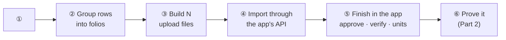

# Onboarding report template

Every onboarding keeps **one** report file. It is the checklist, the mapping explanation, the reconciliation proof and the
run log, in that order. Ops approved this shape on the Orios staging run (2026-10-18: "This explanation is wonderful").
Create the file at the start of the run, update it after **every** step, and never leave it to the end.

- **Where:** wherever ops asks (Orios: `tmp/orios_staging_onboarding.md`), otherwise `onboarding/<client>/report.md`.
- **Model to copy:** the Orios report. Reproduce its structure and level of detail, not its data.

## Rules for writing it

1. **Lead with the answer.** "In short" and every Part 2 section say the result first (✅ / ❌), then how.
2. **One numbered big picture per part, then one card per number.** The diagram's ①②③ match the card headings exactly.
   Each card says what goes in, what comes out, the rules, and a **worked example**.
3. **Trace one real folio through the whole report.** Pick an ordinary one (several dated drawdowns, redemptions and gains,
   not an edge case such as a "Various" folio). Show its raw source rows as a table in 1.2, the records built from it in 1.4,
   its units arithmetic in 1.6, and its matches and totals in 2.3 and 2.5. Edge-case folios get one line each, where their
   rule is explained.
4. **Every id and number comes from the API or the source file**, read in this session (hard rule 1a), and is never retyped
   from memory. Upload ids, record ids, row numbers and amounts must be real. Before writing a count, check it (e.g. "rows 7–1184"
   is not "1,178 rows with data" when blank separators exist).
5. **Money in the fund's convention.** For INR, Indian grouping (3,50,00,000). Units to 4 decimals. Dates as the reader reads them.
6. **Explain why for every modelling decision** (e.g. calls by drawdown number because the client drew per investor on
   different dates), with a small diagram when the source and CapHive shapes differ.
7. **Long tables go in appendices** (all columns, all folios). The body carries only the worked example and the summaries.
8. **Say what the check could not see** (redacted fields, fields the API does not return, assumed values).
9. Mermaid diagrams in every part (see the memory "Docs include mermaid diagrams"). One type scale, no decoration.

## The reconciliation behind Part 2 (contract for the script)

Write `scripts/recon_report.rb`. Start from the last client's script and adapt the source column positions (Orios:
`~/work/onboarding/orios-staging/scripts/recon_report.rb`, which reads the raw MIS by column index). It must be **independent of the transform**:
it walks the raw source rows itself, sharing only the folio-id normalisation, and reads the app through the JSON API only.
It runs five tests and prints markdown (saved as `out/recon_report.md`, pasted into Appendix B):

| # | Test | How |
|---|---|---|
| ① | Source → app | For every source entry, find an app record of the same folio + date + amount and take it out of a pool (so no record counts twice). Then compare the rest: TDS, net, verified/Paid, units. |
| ② | App → source | Whatever is left in the pools after ① is an app record with no source entry, and must be 0. |
| ③ | Per folio | For each folio, about 13 figures summed from its raw rows vs the same figures summed from its app records (committed, received, # and ₹ drawdowns, # and ₹ redemptions, TDS, net, # and ₹ gains, TDS, net, balance units). Print a ✓ table. |
| ④ | Per call / distribution | header = Σ its rows (= Σ source rows for that title), all verified / approved. |
| ⑤ | Client totals | the client's own total cells (header rows, grand-total row) vs the app's fund figures. |

Tolerances: ₹ ±0.01, units ±0.0001, dates exact. Use the pattern in [learnings.md](learnings.md) (2026-10-18 staging run).

---

## Template (copy from here; replace every `<…>`, delete the HTML comments)

````markdown
# <Client> onboarding — <env> (<host>) — run log for ops review

**Client:** <fund name> (source: `<file names>`)
**Target:** `https://<host>`

| | Name | Id | Email | Checked from |
|---|---|---|---|---|
| **Entity** | <name> | <id> | — | `GET /entities/<id>.json` (<date>) |
| **Ops user** (token owner) | <name> | <id> | <email> | <endpoint, or "ops handover" if the API has no email> |
| **Fund** | <name> | <id> | — | `GET /funds/<id>/summary.json` |
| **Sandbox inbox** | — | — | <sandbox_emails> | `entity_setting.sandbox_emails` |

Ops user roles: <roles>.

**Workspace:** `~/work/onboarding/<client>/` · **Rules followed:** every write and every check goes through the app's JSON API
with the bearer token, with no DB access, console, runner or log reading. Approvals: <waivers in approvals.yml>; undo and investor access are never waived.

## In short

<2–4 sentences: what was imported (counts), that a separate check compared every folio and number with the raw source,
and the result (✅ everything ties / ❌ N differences, see 2.x). Link Part 1, Part 2 and the go-live assumptions (1.7).>

## Checklist

| # | Step | Status | Evidence (from the API) |
|---|------|--------|-------------------------|
| 0 | Token / entity / roles checks | | |
| 1 | Sandbox on | | |
| 2 | Fund | | |
| 3 | Unit settings | | |
| 4 | Investors | | |
| 5 | Form types / custom fields | | |
| 6 | Commitments | | |
| 7 | Capital calls | | |
| 8 | Remittances | | |
| 9 | Remittance payments | | |
| 10 | Approve calls | | |
| 11 | Wait for recount, then bulk-verify remittances | | |
| 12 | Allocate units on calls | | |
| 13 | Distributions | | |
| 14 | Distribution payments | | |
| 15 | Approve distributions | | |
| 16 | Unit prices on redemption distributions | | |
| 17 | Redeem units | | |
| 18 | Reconcile (Part 2) | | |
| 19 | Investor access + advisors | ⛔ needs explicit approval (not waived) | |
<!-- Add KYC / documents / account entries rows if the client has them. Status: ✅ done · ⏳ in progress · ☐ · ⛔ blocked. -->

## Part 1 — How the <source> became CapHive data

### 1.1 The big picture



| # | Step | In | Out |
|---|---|---|---|
| ① … ⑥ | <one line each> | | |

<One paragraph: no value is typed by hand; scripts read, the app's own imports and buttons write, and the checks read back through the API.>

### 1.2 ① What the <source> looks like
<How the sheet is laid out, in plain words: where a folio starts, what one row means, which columns are the client's own
running totals (used for checking, not imported). Then the worked folio's raw rows as a table, with real row numbers.>

### 1.3 ② Group the rows into folios
<Small diagram: worked folio's rows → folio id → commitment + lists. Bullets: folio-id normalisation and why, block
boundaries and the guard against mis-attached rows, what qualifies an entry. Result counts.>

### 1.4 ③ Build the upload files
| # | File (`out/`) | CapHive type | One row per | Rows | Built from (<worked folio> example) |
|---|---|---|---|---|---|

<Each modelling decision with its why (and a diagram where the source and CapHive shapes differ). Custom fields created
first and typed. File hygiene: every template column, real Excel dates, no columns that become junk fields.>

### 1.5 ④ Import
| Upload | Type | Rows ok / total | Created |
|---|---|---|---|
<Form types and custom fields created, and when.>

### 1.6 ⑤ Finish in the app
<Diagram of the post-import actions in order. Units: price per unit and the worked folio's issued − redeemed = balance, equal to the client's figure.>

### 1.7 Placeholders and assumptions (confirm with <client> before go-live)
| Item | What the source gives | What was used |
|---|---|---|

---

## Part 2 — How we proved the app matches the <source>

### 2.1 The answer
**<✅ Every folio and every number in the app ties to the raw source. / ❌ N differences: …>**

### 2.2 The big picture
<Why the check is independent. Diagram: source ⇄ app with tests ①–⑤.>

| # | Test | Question it answers | Checked | Result |
|---|---|---|---|---|
| ① | Source → app | Is every source entry in the app, with the right amount, date, TDS, net and units? | | |
| ② | App → source | Is anything in the app that isn't in the source? | | |
| ③ | Per folio | Does each investor's position add up the same? | | |
| ④ | Per call / distribution | Does each header equal its rows, and is it approved? | | |
| ⑤ | Fund totals | Do the client's own totals equal the app's? | | |

Tolerances: ₹ to the paisa, units to 4 decimals, dates exact.

### 2.3 ① Every source entry finds its app record
<How (match by folio + date + amount, tick off, compare the rest). Example: one source row of the worked folio → the app record
ids found → the fields checked. Result.>

### 2.4 ② Nothing extra in the app
<How (leftovers after ①). Result. One-to-one conclusion.>

### 2.5 ③ Every folio, every number
<How. The worked folio's 13 figures: source vs app (with record ids) ✓. Link Appendix B. Result.>

### 2.6 ④ Every call and every distribution
<How. One call and one distribution as examples. Result.>

### 2.7 ⑤ The client's own totals
| Client total (source cell) | Source | App | |
|---|---|---|---|

### 2.8 What the check could not see
<Redacted fields, fields the API does not return, values that tie only to an assumption.>

---

## Appendix A — Every <source> column and where it went
| Col | Header | Goes to | How |
|---|---|---|---|
<Every column ends as: template column · custom field · reconciliation only · dropped on purpose (with the reason).>

## Appendix B — Full tick-and-tie tables
<Paste out/recon_report.md: B.1 test ① by check type · B.2 all totals · B.3 every folio · B.4 calls and distributions.>

## Log (newest last)
### <date> — <what>
- <every API call that wrote, its HTTP status, upload/record ids, and what was read back to confirm it; each decision
  and approval; each gap found>
````
