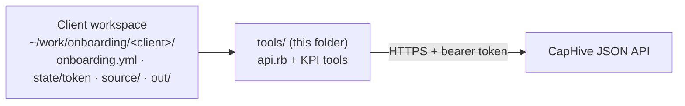
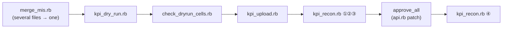
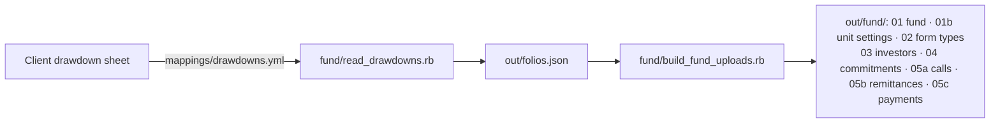

# Onboarding tools

Reusable, client-neutral tools for the client-onboarding skill. They only **read** client files and **call the app's
JSON API** as the ops user — no database, console or app code. Client data never lives here: each client has its own
workspace outside the repo.



## Start here: `onboard.rb`

One command that knows the order. From the client workspace:

```sh
T=~/work/IRM/.claude/skills/client-onboarding/tools
ruby $T/onboard.rb status         # where the onboarding stands; ▶ marks the next step (read-only)
ruby $T/onboard.rb next           # the next step's plan — writes nothing
ruby $T/onboard.rb next --run     # run that ONE step, then confirm it from read-backs (✔ / ✖)
```

| # | Step | Done when (read back) |
|---|---|---|
| 1 | Workspace ready | `onboarding.yml`, `state/token`, `mappings/drawdowns.yml`, `<client>_client_questions.md` exist |
| 2 | Sandbox on | the entity's `sandbox` is true |
| 3 | Build upload files | `out/fund/` is newer than the yml, the source file and the questions file |
| 4 | Fund | a fund with the yml's name exists |
| 5 | Unit settings | a FundUnitSetting upload fully succeeded |
| 6 | Form types | every `out/fund/02_form_types/*.json` form type exists |
| 7–11 | Investors, commitments, calls, remittances, payments | the app holds what was built |
| 12 | Approve calls + verify | every call approved; every remittance with money collected verified |
| 13–15 | Distributions, payments, approve | (only with `distributions:`) built = held, all approved |
| 16 | Units | (only with `units:`) `apply_units.rb` has nothing left to do |
| 17 | Fund recon | `out/fund_recon.json` passed and is newer than the last fund import |
| 18 | Investor access | **never run by the tool** — shows the gate; needs explicit approval |

"Done" is always read from the app and the workspace, so re-running after a crash or a fix picks up where it is and never
uploads twice. It stops at the first failure (an upload that did not fully succeed, a count that does not match). The
single tools below remain for diagnosis and for steps it does not cover (KPIs, logos, portfolio).

## Set up a client workspace

```
~/work/onboarding/<client>/
  onboarding.yml     base_url, entity_id, ops_email   (see below)
  state/token        the ops user's API token (dev: `ruby api.rb sign_in`; otherwise Profile › API tokens)
  source/            the client's files, never edited
  out/               everything the tools write (dry-run verdicts, merged workbooks, …)
  scripts/           transforms written for THIS client (their sheet layouts)
  report.md, client_questions.md, approvals.yml
```

```yaml
# onboarding.yml
base_url: http://127.0.0.1:3001
entity_id: 1234                  # the client entity ops created
ops_email: ops+<client>@caphive.com
```

Every tool takes `--workspace DIR` (or `$ONBOARDING_WORKSPACE`, or runs from the workspace as the current directory).
Every write re-checks that the entity is in sandbox and stops if it is not.

## Tools

| Tool | What it does | Writes to the app? |
|---|---|---|
| `api.rb` | API client (library + CLI): `sign_in`, `get`, `post`/`patch`/`delete`, `upload <ImportType> <file>` (polls to done), `attach <OwnerType> <id> <name> <file>`, `sandbox_on` | yes (each command) |
| `merge_mis.rb` | merge a month's MIS files into one workbook, one sheet per statement, and prove every cell equals its source | no |
| `kpi_dry_run.rb` | `validate_upload` on one workbook → `out/kpi_dryrun/<file>.json`; flags cells read from the wrong sheet | no |
| `check_dryrun_cells.rb` | every ok cell vs the source cell at its ref; lists each header → period | no (no API) |
| `kpi_upload.rb` | upload one workbook to its month's KPI report; waits for the reader job | yes (unapproved KPIs) |
| `kpi_recon.rb` | stored KPIs vs source cells and the dry run; computed = Σ components | no |

## The KPI pipeline (one company, one month)



```sh
T=~/work/IRM/.claude/skills/client-onboarding/tools; cd ~/work/onboarding/<client>
ruby $T/merge_mis.rb out/X_Aug26.xlsx "P&L=source/pl.xlsx|Summary" "Cash Flow=source/cf.xlsx|Cashflow FY25-26"   # only if several files
ruby $T/kpi_dry_run.rb --company 2276 --file out/X_Aug26.xlsx --as-of 2026-08-31
ruby $T/check_dryrun_cells.rb --verdict out/kpi_dryrun/X_Aug26.json --file out/X_Aug26.xlsx      # read the header → period list
ruby $T/kpi_upload.rb --company 2276 --file out/X_Aug26.xlsx --as-of 2026-08-31
ruby $T/kpi_recon.rb --company 2276 --file out/X_Aug26.xlsx --verdict out/kpi_dryrun/X_Aug26.json
ruby $T/api.rb patch "/kpis/approve_all.json?portfolio_company_id=2276" '{}'                      # only when the recon is all ✅
ruby $T/kpi_recon.rb --company 2276 --file out/X_Aug26.xlsx --verdict out/kpi_dryrun/X_Aug26.json   # again: computed KPIs
```

Stop at the first ✖ and report it to ops (SKILL.md › How to report each step to ops). The reasons behind each step are
in [../learnings.md](../learnings.md) (2026-10-19 Inflexor KPI phase) and [../importer-behaviour.md](../importer-behaviour.md) › KPI workbooks.

## Fund side: drawdown sheet → upload files (`fund/`)



| Tool | What it does |
|---|---|
| `fund/read_drawdowns.rb` | reads the client sheet per `mappings/drawdowns.yml` into one canonical record per folio. Layouts: `row_per_folio` (one row per folio, payments as repeated date/amount column pairs) and `folio_blocks` (an opening row with a numeric commitment, continuation rows each carrying one drawdown). Columns by header text or `{col: E}`. |
| `fund/build_fund_uploads.rb` | builds every upload file from `out/folios.json` + the yml rules. **Refuses** if `<client>_client_questions.md` is missing, an `assumptions:` entry has no `q:`, or a `q:` is not in that file; **stops** if a folio's payments ≠ the client's received total or called ≠ received + not received. |
| `compare_xlsx.rb` | compares two upload files the way the importer reads them (columns by name, rows as a multiset) — proof that a rebuilt file equals one already imported. |

The yml has five parts: `source` (file, sheet, layout, rows), `columns`, `extras` (typed custom fields; use `target:`, never
`on:` — YAML reads a bare `on` as `true`), `fund`, `settings` (conventions) and `assumptions` (each with `q:`). Worked
examples: Inflexor (`row_per_folio`) and Orios (`folio_blocks`) workspaces, `mappings/drawdowns.yml` — both rebuilt files
equal the files imported and reconciled on 2026-10-18/19.

```sh
cd ~/work/onboarding/<client>
ruby $T/fund/read_drawdowns.rb && ruby $T/fund/build_fund_uploads.rb      # then import out/fund/* with api.rb
```

## The must-have gate (`gate.rb`)

Every fund needs certain answers from the client before each step (SKILL.md hard rule 9). They are the **M section** of
`<client>_client_questions.md` (M1–M13), each with `*Status:* open | assumed | answered <date>`.

| Step | Needs answered | Check-data override? |
|---|---|---|
| fund | M1–M5 (name/currency/category, classes, first close, fees, unit price) | yes |
| commitments | M6 (folios, legal names, amounts, dates) | yes |
| drawdowns | M6–M9, M11 (drawdowns, payments, fees in calls, client totals) | yes |
| distributions | M10–M11 | yes |
| investor_access | all of M1–M13 | **never** |
| go_live | all of M1–M13 **and** a passing fund reconciliation (`out/fund_recon.json`) | **never** |

The builder and `api.rb` (on `upload` by import type, `POST /funds.json`, anything on investor access) call it and stop
with the list of unanswered items. **Check-data override** — to import and check the client's data on assumptions:

```yaml
# onboarding.yml
mode: check_data
check_data_approved_by: <who approved>
check_data_approved_on: 2026-10-19
```

Every gated run then prints a `⚠ CHECK-DATA MODE` banner naming the assumed items. `ruby gate.rb [--workspace DIR] [step …]`
prints the status of every M item and step.

## Fund reconciliation (`fund/fund_recon.rb`)

Proves the fund data in CapHive ties to the client's sheet — and is the proof go-live needs.

```sh
ruby $T/fund/fund_recon.rb [--fund-id ID]     # default: the fund named in mappings/drawdowns.yml
```

- **Independent of the transform:** it reads the raw rows with its own small reader, sharing only the yml's column map and
  folio rule (never `read_drawdowns.rb` or `folios.json`), applies the yml assumptions to work out what the app should
  hold, and reads the app through the API only (every row's `fund_id` re-checked).
- **Five tests:** ① every source folio, drawdown and payment is in the app (amount, date, class, custom fields, verified iff
  paid); ② nothing left over in the app; ③ per-folio committed / called / received / outstanding / # payments;
  ④ per call: call = Σ remittances = Σ source, collected = Σ payments, approved; ⑤ the client's own totals — per-folio total
  columns (`columns.client_totals`) and total cells (`client_total_cells:` in the yml, each `{label, sheet, cell, compare:
  committed|called|collected|due}`) — and the fund summary.
- **Output:** `out/fund_recon.md` (paste into the report's Part 2 appendix) and `out/fund_recon.json` (`passed`, counts,
  time) — `gate.rb` reads it: go-live is blocked unless `passed: true`. Exits non-zero on any ❌.
- Proven 2026-10-19: Inflexor 994/994 (row_per_folio), Orios 3,250/3,250 (folio_blocks); with two rules deliberately
  broken it failed exactly the 7 due-date folios and the 2 HDFC folios.

## Distributions and units

Optional yml sections (a fund without them is unaffected):

```yaml
distributions:                      # column groups on each folio row; a group yields an entry when its amount is numeric
  groups:
    - { kind: redemption, as: face_value, title: { col: J, replace: [Distribution, Redemption] },
        date: { col: K }, amount: { col: L }, tds: { col: M }, net: { col: N }, payment_type: { col: J } }
    - { kind: gain, as: income, title: { col: V }, date: { col: R }, amount: { col: S }, tds: { col: T }, net: { col: U },
        payment_type: { col: V }, skip_when_zero: true }
  repeat_title_suffix: { value: " - STCG", q: D2 }   # a folio's 2nd entry under one title → its own distribution
units:
  price_per_class: { value: { A: 100, B: 100 }, q: M5 }   # → each call's "Unit Price/Premium"
  balance_units: { col: O }                               # client's balance units per folio (recon ⑦)
```

- **Builder:** `06a_distributions.xlsx` (one per title; income / face value = Σ its payments, date = earliest), `06b_dist_payments.xlsx`
  (one per folio per title), and the `CapitalDistributionPayment` form type (TDS, Net Amount, Payment Type), gated by the
  distributions step (M10–M11).
- **`fund/apply_units.rb`** — imports create no units. After approving calls and distributions it allocates units on each call,
  sets `unit_prices` on each redemption and redeems — skipping anything already done. **Dry run by default**; `--execute`
  runs it behind the gate and waits for the unit totals to settle.
- **Recon ⑥ / ⑦:** every distribution entry ↔ one payment (folio, title, date, amount; TDS, net, type), headers = Σ payments =
  Σ source and approved, per-folio distribution totals; units issued = called ÷ price, redeemed = face value ÷ price, balance =
  the client's balance units. `client_total_cells` can also compare `face_value`, `income`, `balance_units`.
- Proven on Orios: rebuilt 15 distributions / 1,795 payments equal the imported files; recon 10,992 / 10,992 (12,93,178.8577
  balance units = the MIS); with the STCG rule removed it failed exactly the 6 affected entries and 2 headers.

```sh
ruby $T/fund/apply_units.rb              # dry run: lists allocate / price / redeem actions still to do
ruby $T/fund/apply_units.rb --execute    # after approving calls and distributions
```
