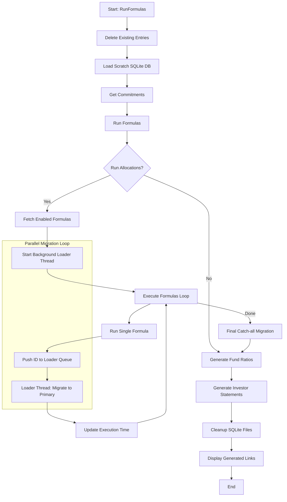

# RunFormulas Service Documentation

The `AccountEntryAllocation::RunFormulas` operation is a critical component of the IRM system responsible for executing allocation formulas for a Specific Fund. It is designed for high performance and isolation by utilizing a temporary SQLite database for heavy computations.

## Overview

The service follows a sequence of steps to safely clean existing data, prepare a local computation environment, run formulas in parallel, and migrate results back to the primary database (MySQL).

## Process Flow Diagram

## Detailed Steps

### 1. Delete Existing Entries (`delete_existing_entries`)

- Records the start time of the run.
- Performs a hard delete on `AccountEntry` records in the primary DB that fall within the start/end date range and are associated with the formulas being run.
- This ensures a clean slate before new entries are generated.

### 2. Load Scratch SQLite DB (`load_sqlite_db`)

- Defines temporary paths for `.sqlite3` and `.tsv` files in `/tmp`.
- Uses a shell script `script/load_sqlite3_from_mysql.sh` to bulk export necessary data (like `account_entries`) from MySQL and import them into a localized SQLite database.
- **Benefit**: This isolates the heavy read/write operations of formula execution from the primary database, improving performance and reducing contention.

### 3. Get Commitments (`get_commitments`)

- Loads `CapitalCommitment` records from the scratch SQLite DB into memory.
- It can handle specific sample commitment IDs or all commitments up to the `end_date`.

### 4. Run Formulas (`run_formulas`)

This is the core execution logic:

- **Parallel Loading**: It spawns a background loader thread. As each formula completes, its ID is pushed to a queue, and the loader thread migrates those specific results back to the primary DB immediately.
- **Formula Execution**: Iterates through enabled `FundFormula` records and calls `AccountEntryAllocation::RunFormula` (sub-operation) for each.
- **Resaving Portfolio Investments**: Ensures portfolio data is up-to-date before formulas run.

### 5. Migration to Primary (`migrate_entries_to_primary`)

- Moves generated `AccountEntrySqlite` records to the primary `account_entries` table.
- Converts namespaced types back to primary types (e.g., `AccountEntrySqlite` -> `AccountEntry`).
- Stores the original SQLite ID in `json_fields` for relinking.
- **Relinking**: In the final step, it reconciles parent-child relationships between account entries by updating `parent_id` with the new primary IDs.

### 6. Post-Run Operations

- **Generate Fund Ratios**: Triggers `FundRatiosJob` if requested.
- **Generate SOA**: Triggers `CapitalCommitmentSoaJob` to create Investor Statements.
- **Cleanup**: Deletes the temporary SQLite and TSV files.
- **Notification**: Sends a success notification to the user with direct links to view the generated entries, expenses, and allocations.

## Key Design Patterns

- **Isolation via SQLite**: Using a scratch DB allows for complex SQL queries and bulk inserts without impacting the main system's performance.
- **Parallel Processing**: The producer-consumer pattern (via `Thread::Queue`) allows formula execution and data migration to happen concurrently.
- **Transaction Safety**: Uses `AccountEntry.insert_all` in batches within transactions for efficient and safe data migration.
