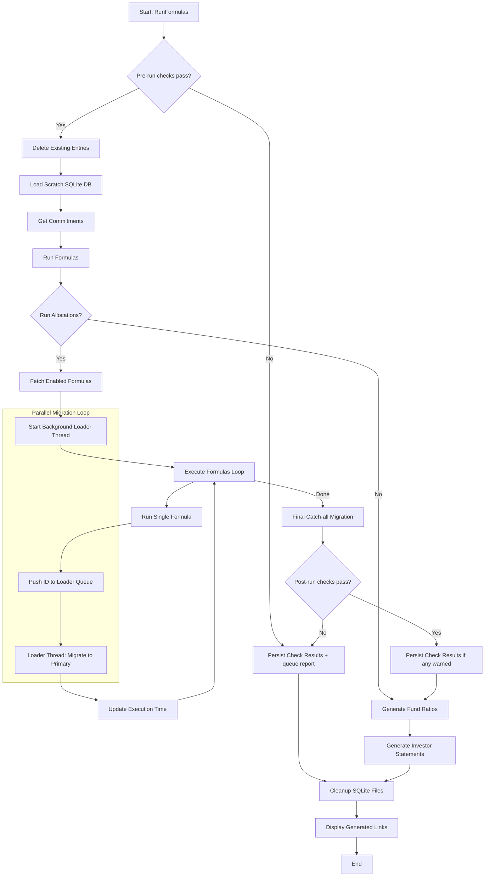
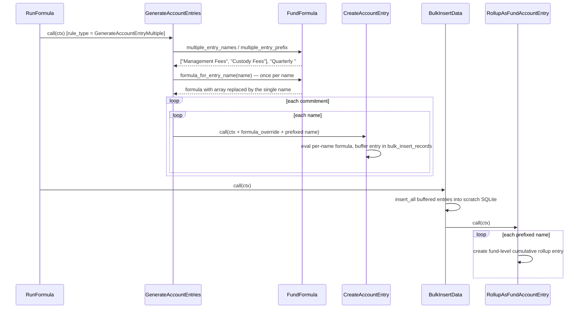

# RunFormulas Service Documentation

The `AccountEntryAllocation::RunFormulas` operation is a critical component of the IRM system responsible for executing allocation formulas for a Specific Fund. It is designed for high performance and isolation by utilizing a temporary SQLite database for heavy computations.

## Overview

The service follows a sequence of steps to safely clean existing data, prepare a local computation environment, run formulas in parallel, and migrate results back to the primary database (MySQL).

## Process Flow Diagram



## Detailed Steps

### 0. Pre-run Checks (`run_pre_checks`)

- Runs every enabled `PreRunCheck` formula in the run's `rule_for`/tag scope through
  `AccountEntryAllocation::RunChecks`, once for the fund, **before anything is deleted**.
- Every check runs even after one fails. If any failed, the `AllocationRun` status becomes
  `Pre-run checks failed (N): …` and the operation goes down the failure track: nothing is deleted,
  loaded or computed.
- Check formulas are never part of `get_formulas`, so they never reach `RunFormula`, the commitment
  cache scan or the delete scope.
- See `docs/modules/allocation/allocation_run_checks.md` for check formulas and their helpers
  (`check_helpers.rb`).

### 1. Delete Existing Entries (`delete_existing_entries`)

- Records the start time of the run.
- Performs a hard delete on `AccountEntry` records in the primary DB that fall within the start/end date range and are associated with the formulas being run.
- This ensures a clean slate before new entries are generated.

### 2. Load Scratch SQLite DB (`load_sqlite_db`)

- Defines temporary paths for `.sqlite3` and `.tsv` files in `/tmp`.
- Uses a shell script `script/load_sqlite3_from_mysql.sh` to bulk export necessary data (like `account_entries`) from MySQL and import them into a localized SQLite database.
- **Benefit**: This isolates the heavy read/write operations of formula execution from the primary database, improving performance and reducing contention.

### 3. Get Commitments (`get_commitments`)

- Loads `CapitalCommitment` records from the scratch SQLite DB into memory.
- It can handle specific sample commitment IDs or all commitments up to the `end_date`.

### 4. Run Formulas (`run_formulas`)

This is the core execution logic:

- **Parallel Loading**: It spawns a background loader thread. As each formula completes, its ID is pushed to a queue, and the loader thread migrates those specific results back to the primary DB immediately.
- **Formula Execution**: Iterates through enabled `FundFormula` records and calls `AccountEntryAllocation::RunFormula` (sub-operation) for each.
- **Resaving Portfolio Investments**: Ensures portfolio data is up-to-date before formulas run.

### 5. Migration to Primary (`migrate_entries_to_primary`)

- Moves generated `AccountEntrySqlite` records to the primary `account_entries` table.
- Converts namespaced types back to primary types (e.g., `AccountEntrySqlite` -> `AccountEntry`).
- Stores the original SQLite ID in `json_fields` for relinking.
- **Relinking**: In the final step, it reconciles parent-child relationships between account entries by updating `parent_id` with the new primary IDs.

### 5a. Post-run Checks (`run_post_checks`)

- Runs every enabled `PostRunCheck` formula after the final migration and parent relinking,
  against the primary database. It is skipped when the run's status isn't `Success`, which happens
  when the background loader recorded a migration error without failing the step.
- Any failure sets `Post-run checks failed (N): …` and fails the operation, so fund ratios, investor
  statements and the links notification don't run. The entries already written stay.

### 5b. Persist Check Results (`persist_check_results`)

- Wired on **both** tracks (`step` + `left`), so it runs however the run ended.
- When any check failed or warned, it merges the results into the run's `AllocationRunReport`
  (`json_fields["run_checks"]`), queues `AllocationRunReportJob`, and notifies the user with a link
  to the report. The report shows each check as a `1.5.n`/`1.6.n` finding. When every check passed,
  it does nothing.
- It never raises, so `cleanup_sqlite` still runs.

### 6. Post-Run Operations

- **Generate Fund Ratios**: Triggers `FundRatiosJob` if requested.
- **Generate SOA**: Triggers `CapitalCommitmentSoaJob` to create Investor Statements.
- **Cleanup**: Deletes the temporary SQLite and TSV files.
- **Notification**: Sends a success notification to the user with direct links to view the generated entries, expenses, and allocations.

## GenerateAccountEntryMultiple Rule Type

A single `GenerateAccountEntryMultiple` formula replaces N single-name `GenerateAccountEntry` formulas. The list of account entry names is embedded in the formula as an array literal:

```ruby
capital_commitment.quarterly(["Management Fees", "Custody Fees", "Audit Fees"], nil, @start_date, @end_date)
```

The engine evaluates the formula **once per name** — substituting the array with each single quoted name — creating one account entry per name per commitment, plus one fund-level cumulative rollup per name. The output is identical to running N separate single-name formulas.

### Entry Naming

Each generated entry is named `prefix + name`. The prefix is derived from the period helper wrapping the names array (see `FundFormula::MULTIPLE_PREFIX_BY_METHOD`):

| Period helper in formula | Prefix             | Example entry name           |
| ------------------------ | ------------------ | ---------------------------- |
| `quarterly` / `period`   | `Quarterly `       | Quarterly Management Fees    |
| `year_to_date`           | `YTD `             | YTD Management Fees          |
| `since_inception`        | `Since Inception ` | Since Inception Management Fees |
| anything else            | *(none)*           | Management Fees              |

A `name_prefix` entry in the formula's `meta_data` overrides the derived prefix. Note that the override is used verbatim — include the trailing space (`name_prefix=Quarterly ` not `name_prefix=Quarterly`), otherwise the prefix runs into the name (`QuarterlyManagement Fees`).

### How the names array is located

The engine picks the first array of quoted strings that appears as a **method-call argument** (e.g. the first argument of `quarterly(...)`). Guard clauses whose array is a receiver — `["active", "closed"].include?(...)` — are never mistaken for the names list. If no string array appears in argument position, the first string array anywhere in the formula is used. Duplicate names in the array are de-duplicated.

### Constraints

- The formula must contain a non-empty array of quoted names (validated on save).
- `generate_ytd_qtly` cannot be enabled — its auto-generated formulas key off `fund_formula.name`, which is a batch label here, not an account entry name.
- Keep each generated name + entry_type combination unique across formulas: rollups (commitment-level and fund-level) aggregate by name + entry_type, not by formula, so two Multiple formulas sharing an entry name and entry type would sum each other's entries. (Same semantics as two single-name `GenerateAccountEntry` formulas sharing a name — just easier to hit now that one formula carries many names.)

### Memoized period helpers

`CapitalCommitmentShared` memoizes `quarterly`, `since_inception`, `on_date`, `get_account_entry` and `cumulative_account_entry` per commitment instance + arguments, and the engine reuses the same commitment instances for the entire run. If an earlier formula in the run calls one of these helpers with the same arguments *before* its generated entries are bulk-inserted into the scratch DB (the `generate_ytd_qtly` variants do exactly this), the stale sum stays memoized. `GenerateAccountEntries` therefore calls `capital_commitment.unmemoize_all` before evaluating a Multiple formula's per-name formulas, so each sum reflects the scratch DB's current contents. Other rule types are untouched and keep the historical memoization behaviour.

### Sequence Diagram



## Key Design Patterns

- **Isolation via SQLite**: Using a scratch DB allows for complex SQL queries and bulk inserts without impacting the main system's performance.
- **Parallel Processing**: The producer-consumer pattern (via `Thread::Queue`) allows formula execution and data migration to happen concurrently.
- **Transaction Safety**: Uses `AccountEntry.insert_all` in batches within transactions for efficient and safe data migration.
