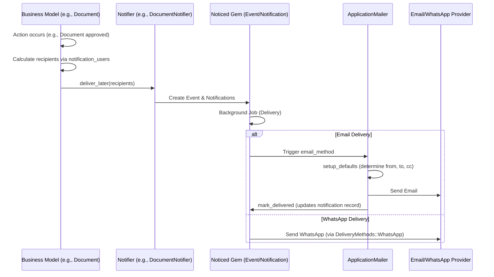

# Notifications Technical Note

This document explains the architecture and flow of notifications within the IRM system, covering Notifiers, the `ApplicationMailer`, and the recipient selection logic.

## 1. Overview

The notification system is built on top of the **Noticed** gem. It provides a multi-channel delivery mechanism (Email, WhatsApp) with modularized logic for determining recipients and message content.

### Key Components

| Component | Responsibility |
| :--- | :--- |
| **Notifiers** | Subclasses of `BaseNotifier` (derived from `Noticed::Event`). They define *what* is sent and *how* (delivery methods). |
| **`BaseNotifier`** | Provides common delivery configuration (Email/WhatsApp) and helper methods for entity and investor advisor context. |
| **`ApplicationMailer`** | The base class for all notification emails. Handles common setup like `from`, `to`, `cc`, and `reply_to` addresses. |
| **`notification_users`** | A method (usually in `Investor` or `Document` models) used to determine which users should receive a notification based on access rights. |

---

## 2. Notification Flow

The following diagram illustrates the high-level flow from triggering a notification to delivery.

---

## 3. Notifiers & `BaseNotifier`

All domain-specific notifiers should inherit from `BaseNotifier`.

*   **Path:** `app/packs/core/notifications/models/base_notifier.rb`
*   **Delivery Methods:** Defines `deliver_by :email` and `deliver_by :whats_app`.
*   **Extensions:** Uses `NotificationExtensions` (from `config/initializers/noticed.rb`) to provide:
    *   `email_delay`: Randomizes delay to prevent flooding AWS SES.
    *   `email_enabled` / `whatsapp_enabled`: Checks entity-level and user-level permissions.

---

## 4. `ApplicationMailer`

The `ApplicationMailer` handles the final assembly and delivery of email notifications.

*   **Path:** `app/packs/core/base/mailers/application_mailer.rb`
*   **Key Logic:**
    *   **`setup_defaults`**: Executed `before_action`. It finds the `Entity` and `User` from params and sets `@from`, `@to`, `@cc`, and `@reply_to`.
    *   **`from_email`**: Determines the sender address. It prioritizes `entity.entity_setting.from_email` over the default `SUPPORT_EMAIL_FROM` environment variable.
    *   **`mark_delivered`**: Executed `after_deliver`. It saves the sent email details (body, subject, recipients) back into the `Noticed::Notification` record.
    *   **Sandbox Mode**: If `entity_setting.sandbox` is enabled, emails are redirected to `sandbox_emails` instead of the user's actual address.

### Email Address Hierarchy

| Field | Source / Logic |
| :--- | :--- |
| **From** | `params[:from_email]` -> `EntitySetting#from_email` -> `ENV['SUPPORT_EMAIL_FROM']` |
| **To** | `User#email` (or `EntitySetting#sandbox_emails` if in sandbox) |
| **CC** | `EntitySetting#cc` + `InvestorAccess#cc` + `params[:additional_ccs]` |
| **Reply-To** | `EntitySetting#reply_to` -> `@cc` -> `@from` (plus inbound email address if applicable) |

---

## 5. `notification_users` Concept

The `notification_users` method is used to filter potential recipients based on authorization and business logic.

### Investor Implementation
In `Investor` model (`app/packs/core/investors/models/investor.rb`):
*   It filters `approved_users`.
*   If a `model` (e.g., a specific Fund or Commitment) is passed, it uses **Pundit** to check if each user has `show?` access to that specific record.
*   It handles **Investor Advisors** specifically, checking if they have permission to view the model as the specific investor entity.

### Document Implementation
In `Document` model (`app/packs/core/documents/models/document.rb`):
*   It maps users from the `AccessRight` records associated with the document.

---

## 6. Noticed Gem Integration Details

The project extends the base Noticed classes in `config/initializers/noticed.rb`:
*   **`Noticed::Event`**: Includes `EventExtensions` (adds `belongs_to :entity`).
*   **`Noticed::Notification`**: Includes `NotificationExtensions` (adds delivery logic like `email_delay` and `email_enabled`).
*   **Ransack Support**: Custom ransackers are added to allow searching notifications by recipient email and other attributes in dashboards.
