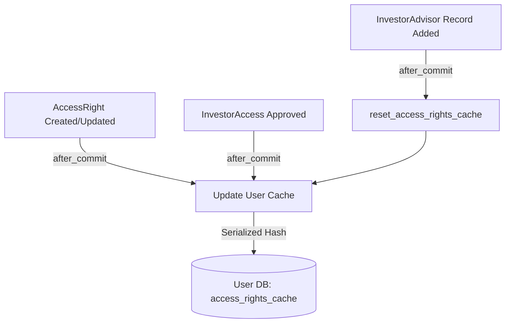
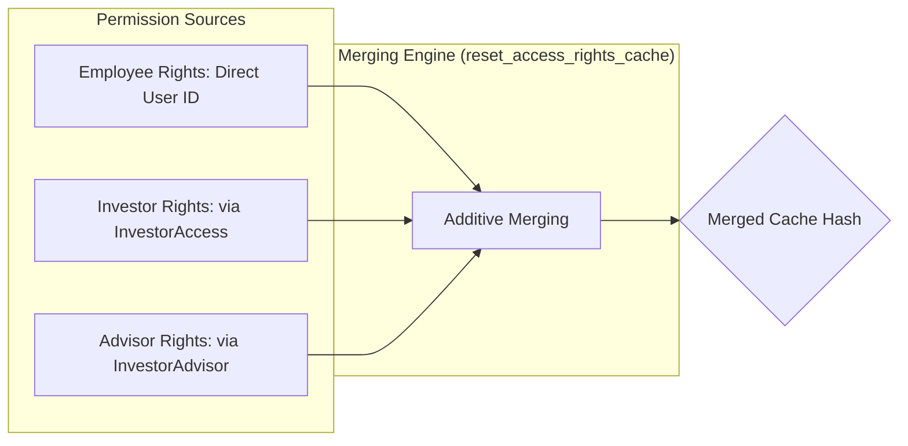
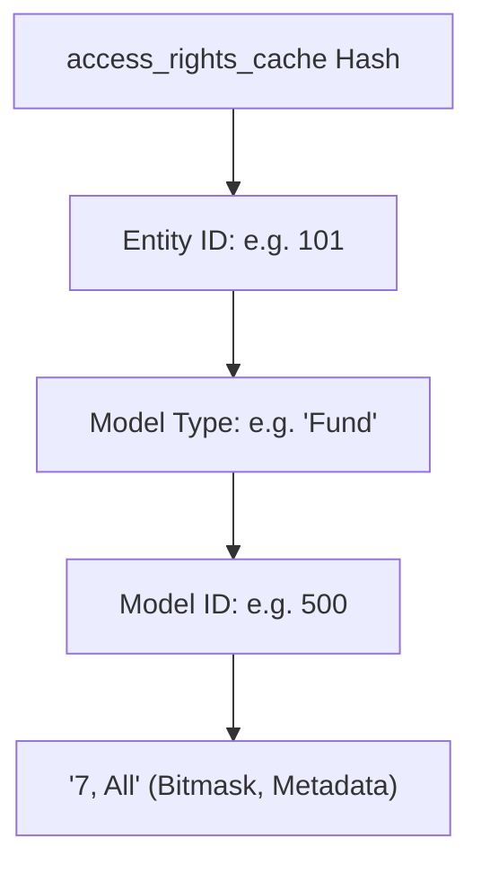
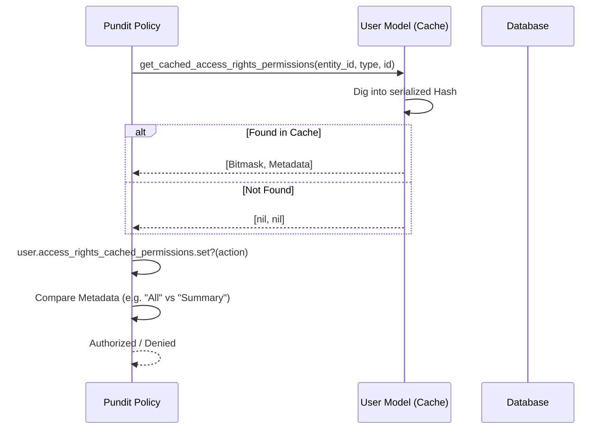

# AccessRightsCache Technical Documentation

## 🏗️ Architecture Overview

The `AccessRightsCache` is a critical performance optimization component within the IRM system. It provides a serialized caching mechanism for user permissions, allowing for rapid authorization checks without expensive database joins or recursive permission lookups.

### Data Flow Triggers
The cache is updated whenever permissions or relationships change:

### Roles Involved:
1.  **Company Admin**: Generally bypasses the cache as they have full access within their entity.
2.  **Employee**: Uses the cache for granular access to specific items within their company.
3.  **Investor / Investor Advisor**: Uses the cache to access data across different entities (Funds) they have invested in or advise.

---

## 🛠️ Implementation Details

### Additive Permission Logic
The system supports **dual-role users** (e.g., a User who is both an Employee and an Investor). The cache logic is **additive**, meaning permissions from different roles are merged into the final hash.

### Key Storage
- **`access_rights_cache`**: A serialized `Hash` in the `users` table.
- **Structure Hierarchy**:

---

### Core Methods (`AccessRightsCache`)
- **`get_cached_access_rights_permissions(entity_id, owner_type, owner_id)`**:
    - Performs the lookup in the hash.
    - If `entity_id` is nil, it scans across all entities in the cache (useful for Investor Advisors).
    - Sets `access_rights_cached_permissions` on the user instance for the current check.
- **`cache_access_rights(access_right, ...)`**:
    - Formats and writes an `AccessRight` record's permissions into the hash.
    - Only caches if the user is an employee, has `investor_advisor` role, or has valid `investor_access`.
- **`refresh_access_rights_cache(investor_access, add: true)`**:
    - Rebuilds parts of the cache when an investor's access is approved or revoked.
    - Handles category-based and investor-specific `AccessRight` inheritance.
- **`reset_access_rights_cache`**:
    - Completely clears and re-populates the cache based on the user's current roles and granted `AccessRight` records.

---

## 🔗 Entry Points & Usages

### 1. Authorization (Pundit Policies)
The primary consumer of the cache is `ApplicationPolicy` (`app/packs/core/base/policies/application_policy.rb`). It translates the serialized hash into actionable authorization decisions.

#### Core Policy Methods
- **`permissioned_employee?(perm)`**:
    - Used when a user is an employee of the entity owning the record.
    - Performs a lookup using the user's `entity_id`.
    - Validates if the bitmask in the cache matches the requested action (e.g., `:update`).
- **`permissioned_investor?(metadata)`**:
    - Used for external users (Investors/Advisors) viewing records like Funds or Deals.
    - Scans the cache for permissions granted by the Fund Entity.
    - Supports **Metadata Filtering**: Checks if the record requires `"All"` access vs `"Summary"` access.
- **`permissioned_rm?(metadata)`**:
    - Specifically for Relationship Managers, checking rights across mapped investors.

#### Delegation Logic (`get_model_with_access_rights`)
Policies don't always check the record itself. Access rights are often attached to a "Parent" or "Anchor" model. For example:
- **Offer Policy** checks the cache for the associated **SecondarySale**.
- **CapitalCommitment Policy** checks the cache for the associated **Fund**.

#### Metadata & Bitmasks
The cache returns two values: `permissions` (Integer) and `metadata` (String).
- **Bitmask Conversion**: The `permissions` integer is loaded into the user's `access_rights_cached_permissions` flag.
    - `7` -> `0111` in binary -> `create`, `read`, `update` are true.
- **Metadata Check**: Used for UI-level restriction. If a policy calls `permissioned_investor?("All")` but the cache only has `"Summary"`, access is denied even if the bitmask is valid.

#### Authorization Flow

### 2. Data Filtering (ActiveRecord Scopes)
- **`ForInvestor` Concern**: Uses `user.get_cached_ids` to filter queries.
    - Example: `Fund.for_investor(current_user)` will use the cached IDs to perform a simple `WHERE id IN (...)` query instead of complex joins.

### 3. Lifecycle Hooks (Cache Invalidation)
The cache is automatically updated via `after_commit` hooks in several models:
- **`AccessRight`**:
    - `add_to_user_access_rights_cache`: Triggered on create/update.
    - `remove_from_user_access_rights_cache`: Triggered on destroy.
- **`InvestorAccess`**:
    - `add_to_user_access_rights_cache`: Triggered when an investor user's access is `approved`.
    - `remove_from_user_access_rights_cache`: Triggered on destruction.
- **`UpdateInvestor` (Concern)**:
    - Calls `reset_access_rights_cache` when critical investor attributes change.

---

## ⚡ Outcomes & Side Effects

### Synchronous Outcomes
- **Database Update**: Every time an `AccessRight` is changed or an `InvestorAccess` is approved, the `users.access_rights_cache` column is updated.
- **Instant Authorization**: Subsequent calls to `policy(user, record).show?` reflect the change immediately without additional DB queries.

### Asynchronous Outcomes
- **Background Jobs**: In some cases (like Folder permissions), `AccessRightsDeletedJob` may be enqueued to handle cascading cleanup, though the primary cache update is usually synchronous within the commit.

### External Side Effects
- **Search Indexing**: While the cache itself is internal to the DB, changes to `AccessRight` trigger `Chewy` index updates for the `access_right` index.

---

## 🧪 Testing Strategy
- **Unit Tests**: Check `spec/models/user_spec.rb` (or specific concern specs) for cache structure verification.
- **Policy Tests**: Many RSpec policy specs rely on `AccessRightsCache` being correctly populated.
- **Integration**: Cucumber features involving "Investor login" or "Granting permissions" exercise the full flow from `AccessRight` creation to cache lookup.

---

## ⚠️ Constraints & Edge Cases
- **Serialization Size**: Large numbers of granular permissions can lead to a large `access_rights_cache` hash.
- **Concurrency**: High-frequency updates to permissions for the same user might lead to race conditions (handled by Rails `after_commit`, but still a point of caution).
- **Manual Reset**: If the cache becomes out of sync (due to manual DB edits or failed callbacks), `user.reset_access_rights_cache` must be called to restore integrity.
- **Folder Inheritance**: Permissions for `Folder` objects are often handled differently (cascading) compared to direct entity permissions like `Fund` or `Deal`.
