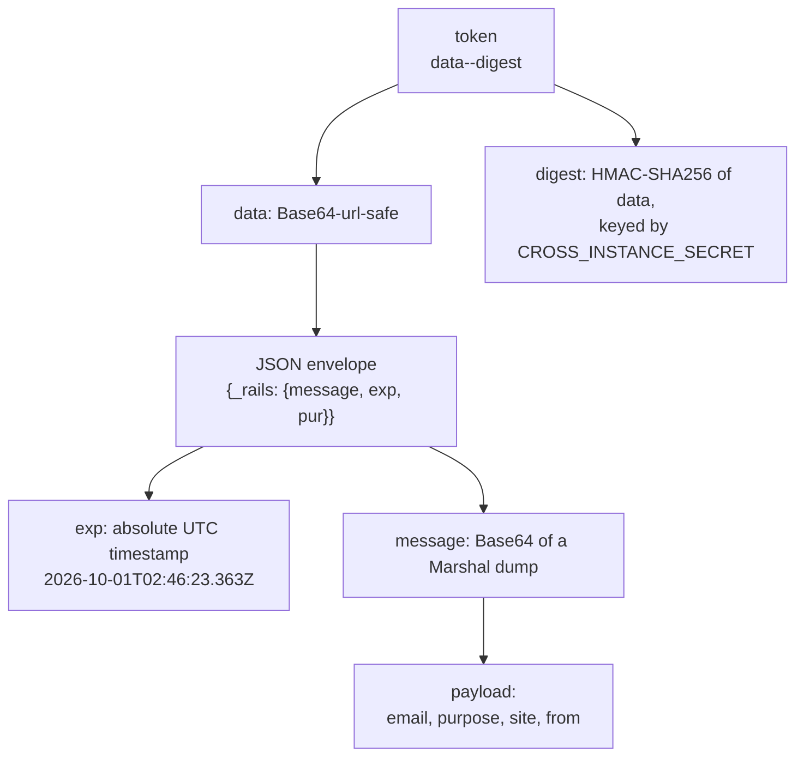
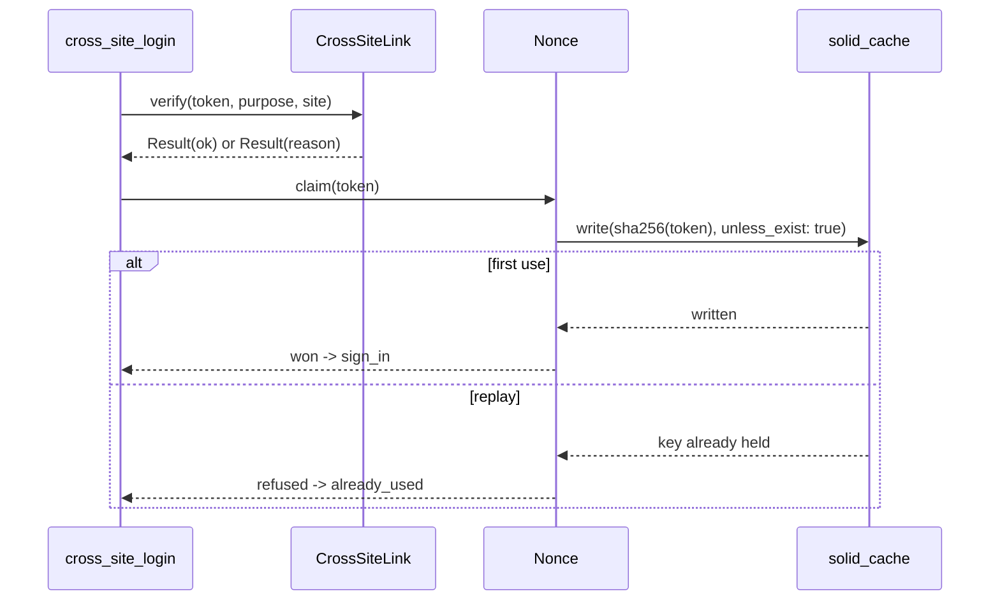

Here’s a structured brainstorm of **requirements, edge cases, and error scenarios** for your multi-region SaaS login experience:

---

## 🔑 Core Requirements

1. **User Synchronization**

   * Each region (India, US) has its own DB.
   * Users must exist in both DBs to support cross-login.
   * Sync must ensure:

     * Consistent identifiers (same `email`).
     * Same or mapped roles/permissions across DBs.
     * Handling updates (email, name, roles).
   * Decide **how to sync**:

     * **Option A**: One region as source of truth, push updates to others.
     * **Option B**: Centralized Identity Service (auth DB separate from app DBs).
     * **Option C**: Event-driven replication (user create/update triggers sync jobs).

2. **Topbar Dropdown (Region Switcher)**

   * Appears only if a user has access to more than one region.
   * Dropdown options: “India” / “US”.
   * Current region should be visually indicated.

3. **Cross-Region Login**

   * Selecting another region triggers auto-login to the other app.
   * Achieved by:

     * Backend generating a **magic link** for the target region.
     * Browser redirects to that link.
     * Target app consumes the link → logs the user in.
   * Magic links must:

     * Be short-lived (e.g., 30s–2m expiry).
     * Be one-time use.
     * Contain cryptographically signed claims (user ID, timestamp, region).

4. **Permissions & Role Consistency**

   * If a user has access in one region but not another:

     * Dropdown must only show available regions.
   * Permissions must be region-specific but consistent in logic.

---

## ⚠️ Edge Cases

1. **User Exists in One DB but Not the Other**

   * Should dropdown show the region? (probably not).
   * Or show but error on click? (bad UX).

2. **Stale User Sync**

   * User updated in India DB (e.g., email changed).
   * Sync lag → mismatch in US DB → login failure or profile inconsistency.

3. **Permission Mismatch**

   * User has `admin` role in India but only `viewer` in US.
   * When switching, UI/UX must reflect reduced privileges without confusion.

4. **Token/Magic Link Expiry**

   * If user takes too long between dropdown click and redirect.
   * Need a clear error + retry mechanism.

5. **Already Logged In**

   * If user is already logged into the other region in another tab/session:

     * Redirect should skip magic link and reuse active session.
     * Or gracefully re-authenticate.

6. **Multiple Browser Tabs**

   * User switches region in one tab.
   * Another tab is still on old region → might cause confusion or partial session conflicts.

7. **Network Latency / Failures**

   * Redirect fails midway (e.g., DNS between regions).
   * User stuck on intermediate “switching” screen.

8. **Logout Behavior**

   * Does logging out of one region log the user out of all?
   * Or do sessions remain isolated?

---

## ❌ Error Scenarios

1. **Invalid or Tampered Magic Link**

   * Must send the user to the destination region's own sign-in screen with a banner naming
     one of `expired`, `already_used`, `invalid`, `missing`, `wrong_region`, `secret_mismatch`
     or `no_account`, plus a link back to the origin region where retrying can help.
     (This used to render a bare `Invalid or expired link` page with no log line and no
     navigation — the five causes were indistinguishable. See `CrossSiteRejection`.)
   * Must not leak the token, a server name or an internal error class to the page.

2. **User Not Permissioned in Target Region**

   * Must fail gracefully:

     * Option A: Don’t show dropdown option at all.
     * Option B: Show option but display “Access not granted”.

3. **Clock Skew**

   * If one server’s clock drifts, magic links may appear expired immediately.

4. **Region App Down**

   * If US app is down, dropdown → redirect will fail.
   * Need fallback messaging: “Region temporarily unavailable”.

5. **Partial Sync**

   * If sync job failed for a subset of attributes (e.g., missing password hash).
   * Must ensure that only magic-link login is allowed (not standard login).

6. **Security Concerns**

   * Magic links must expire quickly.
   * Must prevent replay attacks.
   * Must be scoped to intended region only.

---

✅ **In summary:**

* The key piece is a reliable **user sync strategy** and **secure magic-link login across regions**.
* The UX should prioritize **predictability**: don’t show regions the user can’t access, always give clear feedback on errors, and handle expiry gracefully.
* Operationally, watch for sync failures, downtime, and permission mismatches.

---


Let’s walk through the **full lifecycle** of how a user logged into **US** can seamlessly log into **India** using the `CrossSiteLink` service.

---

---

## 🔩 Mechanism: how a `CrossSiteLink` is forged and redeemed

The hand-off link is a **signed, self-describing, single-use bearer credential**. Nothing about
the user is looked up from shared state — the destination region learns who is arriving entirely
from the link itself, which is why the two regions need no shared database.

### Where it is forged

| | |
|---|---|
| **Minted by** | `CrossSiteLink#generate` (`app/packs/core/users/services/cross_site_link.rb`) |
| **Called from** | `UsersController#cross_site_link` — the **origin** region only, once per switch |
| **Signed with** | `CROSS_INSTANCE_SECRET`, from that region's encrypted credentials |
| **Lives for** | `CrossSiteLink::LIFETIME` = 5 minutes |
| **Carried in** | the `token` query parameter, across two redirects |

A region can only mint a link **for a region on the requesting user's own profile** — that is
`UserPolicy#cross_site_link?(site:)`, checked before `generate` is reached.

### What is actually in it

A real token is **314 characters** and has exactly two parts joined by `--`:

```
eyJfcmFpbHMiOnsibWVzc2FnZSI6IkJBaDdDVG9LWlcxaGFXeEpJaGx1W...  --  a3f9...  (64 hex)
└──────────────────── data (248 chars, Base64-url-safe) ─────┘      └ HMAC-SHA256 ┘
```

Peeling the data apart, outermost first:



| Field | Example | What it is for |
|---|---|---|
| `email` | `neha@siliconroad.com` | How the destination region finds the user in **its own** database. Email, not an id, because primary keys differ between regions |
| `purpose` | `:login` | Pins the token to this flow. A token minted for anything else is refused, so it cannot be replayed here |
| `site` | `"US"` | The region that may redeem it. Checked against `SiteRegistry.current_code` |
| `from` | `"IN"` | Where the user came from. Used to log both ends of a successful switch |
| `exp` | absolute UTC | Written by the **issuing** region's clock, compared against the **verifying** region's. This is why clock drift between regions matters |

### Signed, not encrypted — read this before adding anything to the payload

`MessageVerifier` guarantees **integrity**, not **confidentiality**. The data half is plain
Base64 and anyone holding the link can decode it without the secret:

```ruby
JSON.parse(Base64.urlsafe_decode64(token.split("--").first))
# => {"_rails" => {"message" => "BAh7CTo...", "exp" => "...", "pur" => nil}}
```

So the user's email address is visible to anyone who gets the URL. That is acceptable for an
email, and it is why **nothing else goes in the payload**. Never put a role, an entity id, a
permission or anything else a holder should not see in here — use the destination region's own
database for that, which is what `redirect_to_subdomain` and `cross_site_login` already do.

### Why an attacker cannot forge one

The digest is `HMAC-SHA256(data, CROSS_INSTANCE_SECRET)`. Changing a single byte of the payload —
the email, the region, the expiry — changes the data, so the digest no longer matches and
`valid_message?` returns false. Without the secret there is no way to compute a matching digest,
and the comparison is constant-time (`ActiveSupport::SecurityUtils.secure_compare`, via
`MessageVerifier#digest_matches_data?`), so it leaks nothing by timing.

What an attacker **can** do is use a link they have stolen verbatim. That is the point of a
bearer credential, and it is why the window is short and the link dies on first use.

### How it is redeemed

Two different reads, deliberately:

| Hop | Method | Checks | Consumes? |
|---|---|---|---|
| `redirect_to_subdomain` | `#peek` | signature, expiry | **No** |
| `cross_site_login` | `#verify` | signature, expiry, purpose, destination region | **Yes**, via `Nonce.claim` |

`peek` must not consume. It runs before the browser has reached the host that will establish the
session, so claiming the link there would break every switch. Only the final hop claims it.



The claim key is `cross_site_handoff:<sha256 of the token>` — the token itself is never stored,
and the entry expires one minute after the credential does, so it can never outlive what it
guards. `unless_exist` is atomic (Solid Cache takes a row lock), which is what makes two
simultaneous presentations produce exactly one session.

### Order of checks, and why it is that order

```
missing → invalid (bad signature) → expired → wrong purpose → wrong region → already used → no account
```

Two deliberate choices:

* **Signature before expiry.** `valid_message?` ignores the expiry, so a token whose signature is
  good but whose `exp` has passed is reported as `expired`, while a tampered one is `invalid`.
  Only the first is worth telling a user to retry about.
* **The claim is last.** A link rejected for any other reason is not burned, so a user retrying
  after a misconfiguration is not then told "already used".

## 🌐 Flow: US → India login with `CrossSiteLink`

### 1. User is logged into US site

* The user has an active session in **US**.
* In the top bar, they select **“Switch to India”**.

---

### 2. US app generates a cross-instance link

* The US server calls the service:

  ```ruby
  token = CrossSiteLink.new.generate(
    user.email,
    purpose: "login",
    expires_in: 5.minutes
  )
  ```

* This produces a **signed token** containing:

  ```json
  {
    "email": "user@example.com",
    "purpose": "login"
  }
  ```

* The token is cryptographically signed with `CROSS_INSTANCE_SECRET` and expires in 5 minutes.

* The US app redirects the user to:

  ```
  https://india.myapp.com/sso?token=XYZ
  ```

---

### 3. India app receives the token

* The India app hits `SsoController#login` with `params[:token]`.

* It calls:

  ```ruby
  payload = CrossSiteLink.new.verify(params[:token], purpose: "login")
  ```

* Verification checks:

  * Token signature matches (`CROSS_INSTANCE_SECRET`).
  * Token not expired.
  * Purpose == `"login"`.

* If valid, payload is returned:

  ```json
  { "email": "user@example.com", "purpose": "login" }
  ```

---

### 4. India app finds the user

* The India DB has the same user by **email** (even if the primary key is different).
* It resolves:

  ```ruby
  user = User.find_by!(email: payload["email"])
  ```

---

### 5. User is signed in

* India app calls:

  ```ruby
  sign_in(user)
  ```
* Session/cookies are established locally in India.
* The user is now logged in without re-entering credentials.

---

## ✅ Guarantees

* **Unforgeable**: Token cannot be created or modified without `CROSS_INSTANCE_SECRET`.
* **Time-bound**: Token only valid for a short window (5 minutes — see `CrossSiteLink::LIFETIME`).
* **Single-use**: The first successful sign-in consumes the token (`CrossSiteLink::Nonce`); a
  second presentation is refused as `already_used`. This is what makes the 5-minute window safe.
  It was 30 seconds and replayable, which failed constantly and protected nothing.
* **Purpose-scoped**: A login token cannot be reused for another purpose.
* **Email-based mapping**: Works even if primary keys differ between DBs.

---

So in one line:
➡️ The **US app signs the user’s email** into a short-lived, purpose-bound token → **India app verifies it** with the same secret → **logs in the user** by email lookup.

---

```mermaid
sequenceDiagram
    participant User
    participant US_App as US App
    participant India_App as India App

    User->>US_App: Logged in, clicks "Switch to India"
    US_App->>US_App: Generate token with CrossSiteLink (email + purpose + expiry, signed with CROSS_INSTANCE_SECRET)
    US_App-->>User: Redirect to https://caphive.com/sso?token=XYZ
    User->>India_App: Open /sso?token=XYZ
    India_App->>India_App: Verify token with CrossSiteLink (check signature, expiry, purpose)
    alt Token valid
        India_App->>India_App: Find user by email from payload
        India_App->>India_App: sign_in(user)
        India_App-->>User: Logged into India App
    else Token invalid/expired
        India_App-->>User: 302 to sign-in, reason banner + way back
    end
  ```


## Global Domains


Move from a **single global domain (`app.caphive.com`)** to a **multi-region, multi-tenant domain structure** with region-specific subdomains. Let’s break this down clearly.

---

## 🌍 Current Setup

* **Single app domain:**
  `app.caphive.com` → LB (India region).
* **Client subdomains:**
  `client1.caphive.com`, `client2.caphive.com` → resolve to same LB in India.
* Effectively: all traffic (global + client subdomains) routes to India infra.

---

## 🆕 Target Setup

### Regional Domains

* `caphive.us` → LB in **US region**.
* `caphive.com` → LB in **India region**.

These become your **entry points** for app users.

### Client Subdomains

* Clients are tied to a region:

  * `client1.caphive.com` → LB in India.
  * `client2.caphive.us` → LB in US.

This makes client tenancy explicit in the DNS.
➡️ No more ambiguity — a client’s region is encoded in the hostname.

---

## 🏗 How DNS mapping will look

* **Top-level (infra domains):**

  * `caphive.us` → CNAME to `us-lb.amazonaws.com` (example).
  * `caphive.com` → CNAME to `india-lb.amazonaws.com`.

* **Client subdomains (regionalized):**

  * `client1.caphive.com` → CNAME → `india-lb.amazonaws.com`.
  * `client2.caphive.us` → CNAME → `us-lb.amazonaws.com`.

---

## ⚙️ Implications

1. **Tenant resolution logic**

   * When a request comes in at `client1.caphive.com`, your app knows:

     * Tenant = `client1`
     * Region = `india`
   * Same for US tenants.
   * This removes the guesswork of “which DB to use”.

2. **SSL/TLS Certificates**

   * You’ll need wildcard certs per region:

     * `*.caphive.com`
     * `*.caphive.us`
   * Or one SAN cert covering all (depends on your cert mgmt strategy).

3. **User login experience**

   * If you introduce SSO / cross-instance login, you’ll need a **cross-domain auth flow** (`caphive.us` → `caphive.com`).
   * This is where your earlier `CrossSiteLink` work comes in.

4. **Client communication**

   * Existing clients (`client1.caphive.com`) will need to update bookmarks / integrations.
   * You might keep `client1.caphive.com` around temporarily as a **CNAME → client1.caphive.com** for backward compatibility.

---

## 📌 Next Steps

1. **DNS**:

   * Create `caphive.us` and `caphive.com` → point each to regional LB.
   * Create client subdomains (`client1.caphive.com`, …) mapped accordingly.

2. **App logic**:

   * Parse subdomain (`client1`) and region (`india`) from `request.host`.
   * Route request to correct DB/tenant.

3. **Auth/SSO**:

   * Implement your cross-instance login using `CrossSiteLink` for seamless switching.

---

```mermaid

flowchart TD
    subgraph DNS["🌍 DNS (caphive.com)"]
        A1[caphive.us] -->|CNAME| LB_US
        A2[caphive.com] -->|CNAME| LB_IN
        C1[client1.caphive.com] -->|CNAME| LB_IN
        C2[client2.caphive.us] -->|CNAME| LB_US
    end

    subgraph US_Region["🇺🇸 US Region"]
        LB_US[Load Balancer us-lb.amazonaws.com]
        APP_US1[App Server 1]
        APP_US2[App Server 2]
        DB_US[(US DB)]
        LB_US --> APP_US1
        LB_US --> APP_US2
        APP_US1 --> DB_US
        APP_US2 --> DB_US
    end

    subgraph India_Region["🇮🇳 India Region"]
        LB_IN[Load Balancer india-lb.amazonaws.com]
        APP_IN1[App Server 1]
        APP_IN2[App Server 2]
        DB_IN[(India DB)]
        LB_IN --> APP_IN1
        LB_IN --> APP_IN2
        APP_IN1 --> DB_IN
        APP_IN2 --> DB_IN
    end

```


Here’s a clean **deployment note** you can keep for your team 👇

---

# 🚀 Multi-Region Deployment with Capistrano + Rails Credentials

## Problem

* Currently: one `deploy/production.rb` and one `config/credentials/production.yml.enc`.
* Need: multiple regions (**US** + **India**) with different infra, DBs, and secrets.
* Challenge: still want a seamless, consistent Capistrano workflow.

---

## Solution: Treat Each Region as a Separate Stage

### 1. Capistrano Stage Files

Create per-region stage files:

```bash
deploy/production_us.rb
deploy/production_in.rb
```

Example:

```ruby
# deploy/production_us.rb
server "us-app-server-1", user: "deploy", roles: %w{app db web}
set :rails_env, "production_us"
set :branch, "main"
```

```ruby
# deploy/production_in.rb
server "in-app-server-1", user: "deploy", roles: %w{app db web}
set :rails_env, "production_in"
set :branch, "main"
```

---

### 2. Rails Credentials per Region

Generate credentials:

```bash
rails credentials:edit --environment production.us
rails credentials:edit --environment production.in
```

This creates:

```
config/credentials/production.us.yml.enc
config/credentials/production.in.yml.enc
```

Rails will load the correct file automatically based on `Rails.env`.

---

### 3. Deploy Commands

* Deploy to US:

  ```bash
  cap production_us deploy
  ```
* Deploy to India:

  ```bash
  cap production_in deploy
  ```

---

### 4. Secrets & Shared Config

* **Shared secrets** (e.g. `CROSS_INSTANCE_SECRET`) → must be identical across regions.
* **Region-specific secrets** (DB\_HOST, S3 buckets, etc.) → live in each region’s credentials.

---

## ✅ Result

* Two independent but consistent deploy flows.
* Each region has isolated infra + DB + secrets.
* Shared secrets explicitly duplicated where needed.
* Future-proof: add more regions by just adding another stage + credentials file.

---


## TODOs

* Deployment
* Domain mapping
* Sync Users across instances
* Auto login to approved sites