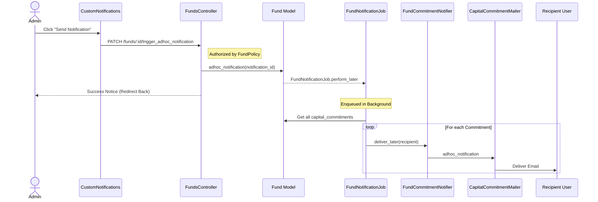

# Fund Custom Notification Workflow

This document describes the workflow for sending custom notifications to all capital commitment holders of a fund.

## Overview

The process is initiated from the UI, processed in the background, and results in individual notifications delivered to the notification users of each investor.

## Workflow Steps

1.  **UI Trigger**: A user navigates to a `CustomNotification` associated with a `Fund` and clicks the "Send Notification" button.
2.  **Controller Action**: The `FundsController#trigger_adhoc_notification` action find the fund, finds the notification and calls `fund.adhoc_notification(notification_id)`.
3.  **Model Concern**: `Fund#adhoc_notification` (via `FundNotifiers` concern) enqueues the `FundNotificationJob`.
4.  **Background Job**: `FundNotificationJob` performs the following:
    - Finds the `Fund` and the `CustomNotification`.
    - Iterates through each `CapitalCommitment` of the fund.
    - For each commitment, it identifies the `notification_users` for the associated `Investor`.
    - Triggers the `FundCommitmentNotifier` for each recipient user.
5.  **Notifier (Noticed)**: `FundCommitmentNotifier` prepares the notification data and selects the `CapitalCommitmentMailer` for delivery.
6.  **Mailer Delivery**: `CapitalCommitmentMailer` renders the email using the custom notification's subject and body (supporting ERB templates) and sends it to the recipient.

## Sequence Diagram

## Key Files

- **Controller**: `FundsController#trigger_adhoc_notification`
- **Policy**: `FundPolicy#trigger_adhoc_notification?`
- **Job**: `app/packs/funds/funds/jobs/fund_notification_job.rb`
- **Concern**: `app/packs/funds/funds/models/concerns/fund_notifiers.rb`
- **Notifier**: `app/packs/funds/capital_commitments/mailers/fund_commitment_notifier.rb`
- **Mailer**: `app/packs/funds/capital_commitments/mailers/capital_commitment_mailer.rb`
