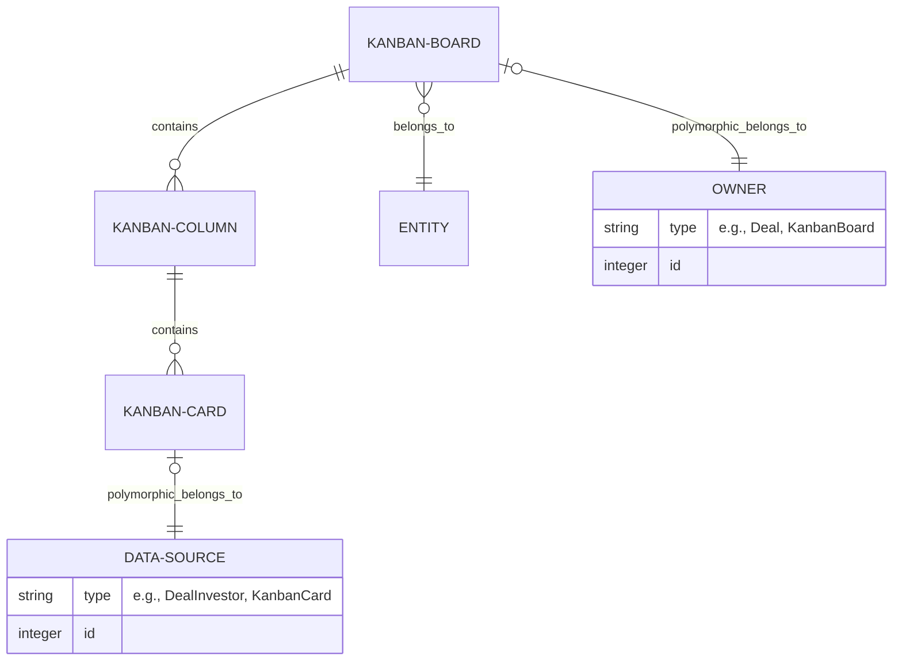
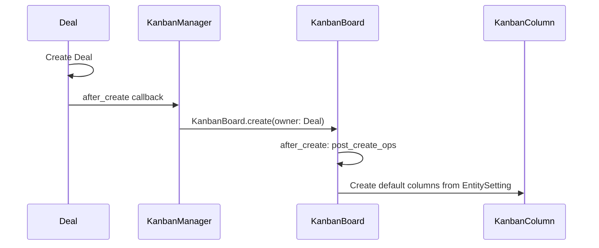
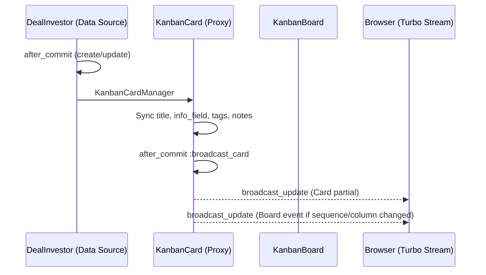

# Kanban Board Architecture & Workflow

This document provides a detailed technical overview of the Kanban board implementation, its data models, interaction patterns, and real-time update mechanisms.

---

## 1. System Architecture

The Kanban system is designed to be flexible, supporting both standalone usage and association with domain-specific models like **Deals**.

### Data Model Diagram (ERD)



### Core Components

| Component | Responsibility |
| :--- | :--- |
| **KanbanBoard** | Manages the overall board state, ownership, and initial column creation. |
| **KanbanColumn** | Represents a stage in the workflow. Uses `acts_as_list` for sequencing. |
| **KanbanCard** | The individual work item. Can be a simple card or a proxy for another model (e.g., `DealInvestor`). |
| **KanbanManager** | A concern for owner models (like `Deal`) to auto-create and sync boards. |
| **KanbanCardManager** | A concern for data source models (like `DealInvestor`) to sync data with `KanbanCard`. |

---

## 2. Operational Workflows

### 2.1. Standalone vs. Associated Boards

#### Standalone Board
- **Owner:** The `KanbanBoard` instance itself (`self_owned?`).
- **Data Source:** The `KanbanCard` instance itself.
- **Creation:** Manual creation via `BoardsController#create`.
- **Columns:** Default columns are fetched from `EntitySetting#kanban_steps['KanbanBoard']`.

#### Associated Board (e.g., Deals)
- **Owner:** A `Deal` instance.
- **Data Source:** A `DealInvestor` instance.
- **Creation:** Automatic via `KanbanManager` concern after a `Deal` is created.
- **Columns:** Fetched from `EntitySetting#kanban_steps['Deal']`.

---

## 3. Deep Dive: Deal-Kanban Integration

The **Deal** module is the primary consumer of the Kanban system. The relationship between Deal models and Kanban models is structured to maintain a "UI Proxy" relationship.

### 3.1. Ownership & Hierarchy
- **Board Owner:** Each `Deal` has one `KanbanBoard`.
- **Card Data Source:** Each `DealInvestor` (which represents an investor's participation in a deal) is represented by a `KanbanCard`.
- **Board Visualization:** The Kanban board provides a visual pipeline of all investors in a specific deal, organized by their current stage (represented by `KanbanColumn`).

### 3.2. Lifecycle of a Deal Board



### 3.3. Deal Investor to Card Synchronization

When an investor is added to a deal (`DealInvestor` record), a `KanbanCard` is automatically generated via the `KanbanCardManager` concern.

| Feature | Deal Implementation Detail |
| :--- | :--- |
| **Card Title** | Set to the Investor's name. |
| **Card Info** | Derived from `DealInvestor` attributes (Amount, Currency, etc.). |
| **Dynamic Fields** | If `deal.card_view_attrs` is set, the card's `info_field` dynamically displays those specific attributes from the `DealInvestor`. |
| **Default Column** | New `DealInvestor` cards are placed in the first column of the Deal's board. |

### 3.4. Interactions on a Deal Board
- **Add Item:** Clicking "Add Item" on a Deal board column opens the `DealInvestor` form instead of a generic card form.
- **Edit Item:** Clicking a card opens an off-canvas panel with the full `DealInvestor` details.
- **Drag & Drop:** Moving a card between columns updates the `kanban_column_id` on the `KanbanCard`, which in turn can be used to track the investor's progress through the deal pipeline.

---

## 4. Data Synchronization (The "Proxy" Pattern)



---

## 5. Real-time Updates (Turbo Broadcasts)

| Trigger Event | Broadcast Scope | Target UI Element |
| :--- | :--- | :--- |
| **Card Data Update** | `KanbanCard` | Updates the specific card content. |
| **Card Move/Reorder** | `KanbanBoard` | Triggers a full board refresh (via JS search request). |
| **Column Rename** | `KanbanColumn` | Updates the column header title. |
| **Column Move/Archive** | `KanbanBoard` | Triggers a full board refresh. |
| **Board Rename** | `KanbanBoard` | Updates the board header name. |

---

## 6. Key Configuration

### Entity Settings
Default columns (steps) are defined per `owner_type` in the `EntitySetting` model:
```ruby
# Example structure in entity_setting.kanban_steps
{
  "KanbanBoard" => ["To Do", "In Progress", "Done"],
  "Deal" => ["Prospecting", "Due Diligence", "Investment Committee", "Closing"]
}
```
