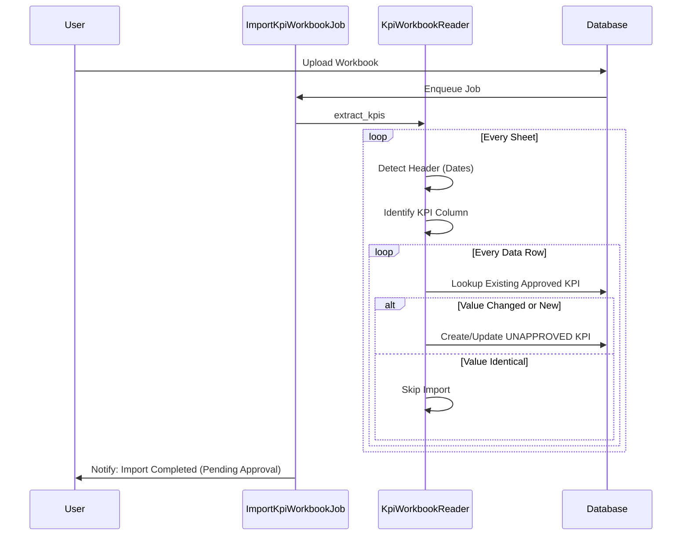
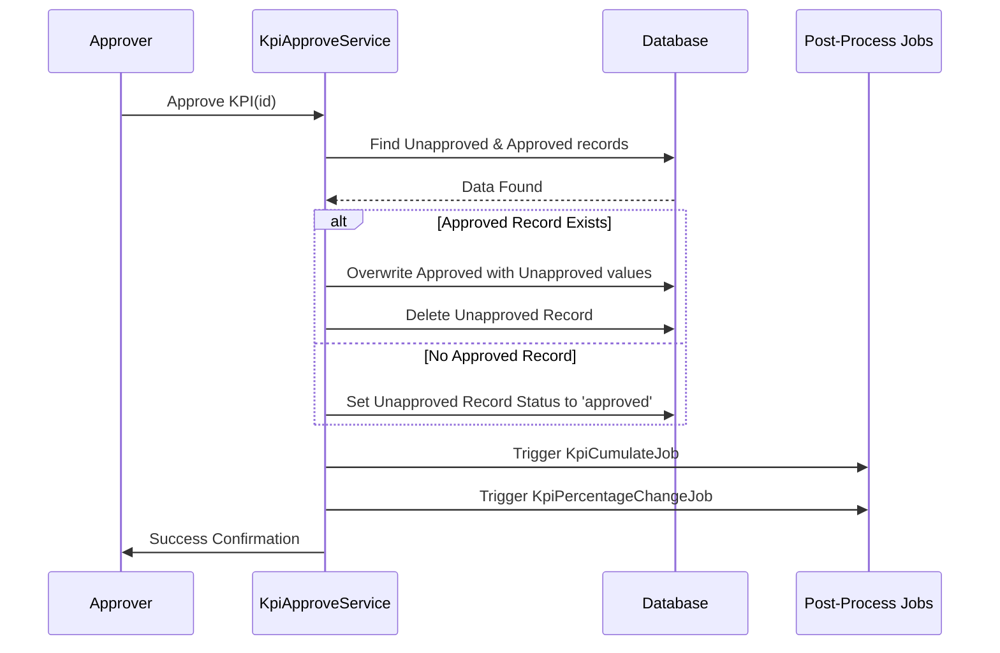

# KPI Import & Approval Process Documentation

This document provides an in-depth explanation of how Key Performance Indicators (KPIs) are imported from Excel workbooks and validated through an approval workflow in the IRM system.

## Overview

The KPI management workflow consists of two main stages:
1.  **Staged Import**: Excel workbooks are parsed, and values are stored in an `unapproved` state.
2.  **Authorized Approval**: An authorized user (Approver) reviews the staged data and promotes it to the official `approved` state.

---

## 1. Data Model Strategy

The [`Kpi`](app/packs/startups/kpis/models/kpi.rb) model includes a `status` field:
- **`unapproved`**: Staged data from recent imports. Not used in official reports or calculations.
- **`approved`**: The official, verified data point used in performance tables, dashboards, and growth calculations.

### Uniqueness Constraint
For any given metric, period, and portfolio company, there can be:
- Only **one** `approved` record.
- Multiple `unapproved` records (representing various staged imports).

---

## 2. Process Flow Diagrams

### KPI Import Sequence

### KPI Approval Sequence

---

## 3. Core Components

### A. [`KpiWorkbookReader`](app/packs/startups/kpis/services/kpi_workbook_reader.rb)
Responsible for the "Staged Import" phase.
- **Logic**: It always looks for `unapproved` records to update or creates new ones.
- **Verification**: It compares the incoming Excel value against the current `approved` value. If they are identical, it skips creating an unapproved record to minimize noise.

### B. [`KpiApproveService`](app/packs/startups/kpis/services/kpi_approve_service.rb)
Handles the transition from staged to official data.
- **Transaction Safe**: Ensures that the update of the approved record and the deletion of the unapproved record happen atomically.
- **Metadata Traceability**: Appends approval information (User ID, Timestamp) to the `notes` field of the approved KPI.

### C. [`KpiPolicy`](app/packs/startups/kpis/policies/kpi_policy.rb)
Enforces security:
- `approve?`: Restricted to users with roles `approver`, `company_admin`, or `super`.

---

## 4. Downstream Impact

To maintain data integrity, the following components are strictly filtered to only use `approved` data:

1.  **Performance Tables**: [`PerformanceTableService`](app/packs/startups/kpis/services/performance_table_service.rb) filters its scope to `Kpi.approved`. Unapproved data is invisible to standard viewers.
2.  **Cumulative Calculations**: [`KpiCumulative`](app/packs/startups/kpis/models/concerns/kpi_cumulative.rb) fetches only approved monthly data to calculate Quarterly or YTD sums.
3.  **Growth Metrics**: [`KpiPercentageChangeJob`](app/packs/startups/kpis/jobs/kpi_percentage_change_job.rb) only recomputes variances for approved records.

---

## 5. Error Handling & Notifications

- **Import phase**: If errors occur (unrecognized dates, missing mappings), the [`ImportKpiWorkbookJob`](app/packs/startups/kpis/jobs/import_kpi_workbook_job.rb) sends a detailed report via email.
- **Staging info**: The `error_msg` array in the reader is used to inform the user about which values are "pending approval" vs which were skipped due to being identical.

---

## 6. User Interface (UI) Access

### Viewing Staged KPIs
By default, all system views show only `approved` data. Authorized users can view pending imports in the **KPI Grid View** by appending the parameter `?view_unapproved=true` to the URL.

- **Visual Indicators**: Unapproved KPIs are displayed in **orange** (warning color) with a "Pending" badge.
- **Comparison**: When both an approved and unapproved value exist for the same period, they are shown together in the same cell, separated by a line, allowing for easy side-by-side comparison before approval.
