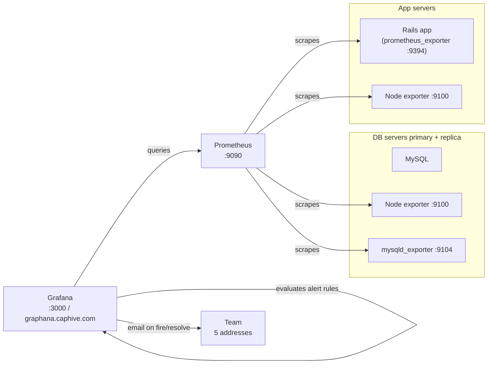
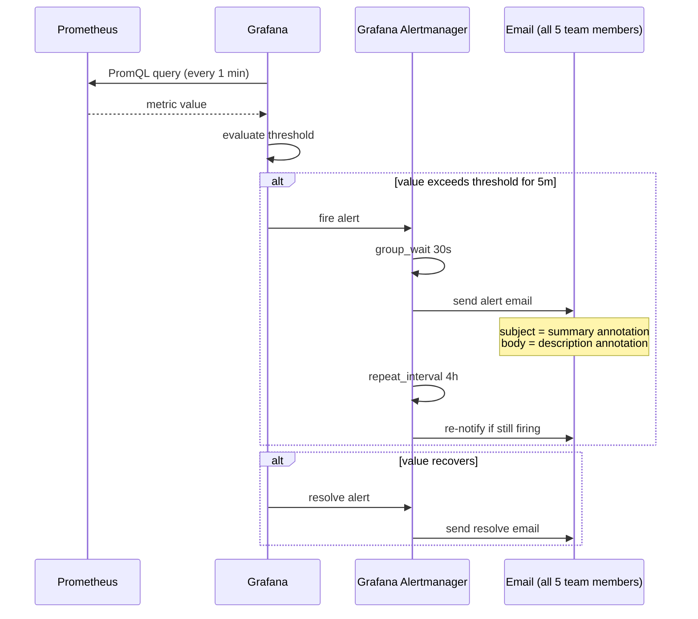
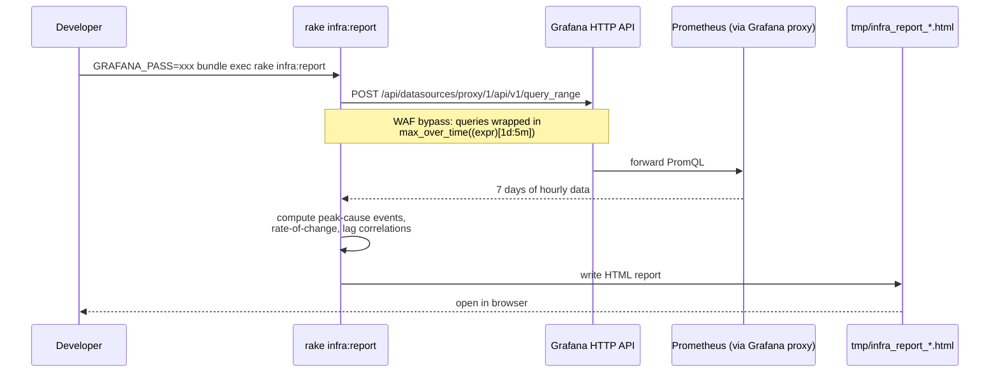
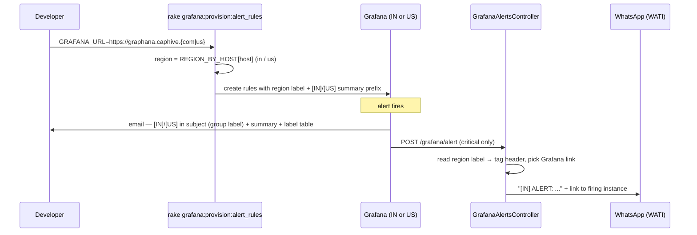
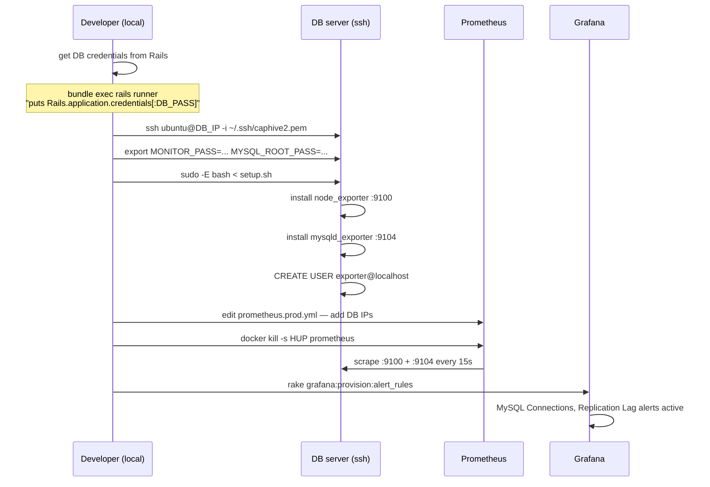

# Observability Stack

Prometheus + Grafana monitoring for CapHive. Covers infrastructure metrics (CPU, memory, disk) and Rails application metrics (requests, errors, Sidekiq, Puma memory).

Grafana: https://graphana.caphive.com
Prometheus: internal, scraped from the Grafana server on port 9090

---

## Directory layout

```
config/initializers/observability/
  README.md                  ← this file
  observability.md           ← original local dev setup notes
  prometheus.yml             ← Prometheus config for local Docker stack
  prometheus.prod.yml        ← Prometheus scrape config used in production
  alerts.yml                 ← Prometheus-native alert rules (local Docker only)
  grafana_provision.yml      ← Declarative config for Grafana alerts, contact points, policy
  mysqld_exporter/
    setup.sh                 ← installs node_exporter + mysqld_exporter on each DB server
    .my.cnf.template         ← credentials template (no real password committed)
  graphana/
    node.dashboard.json      ← Node Exporter Full dashboard (uid: rYdddlPWk)
    rails.dashboard.json     ← Rails Metrics dashboard   (uid: L-0CZ_WVk)
    puma.dashboard.json      ← Puma Metrics dashboard
    mysql.dashboard.json     ← MySQL Overview dashboard  (uid: mysql-overview)
```

**Two alerting systems co-exist:**

| File | Used by | When |
|---|---|---|
| `alerts.yml` | Prometheus (mounted as a volume) | Local Docker dev stack |
| `grafana_provision.yml` | Grafana unified alerting API | Production (applied by rake task) |

---

## Architecture



### Alert firing flow



### Infra report generation flow



---

## Rake tasks

All tasks read `GRAFANA_URL`, `GRAFANA_USER`, `GRAFANA_PASS`, `GRAFANA_DS_ID` from environment. Defaults are set in the task — only `GRAFANA_PASS` needs to be supplied.

### Generate the weekly infra report

```bash
GRAFANA_PASS=xxx bundle exec rake infra:report
```

Produces `tmp/infra_report_YYYYMMDD_HHMMSS.html` with:
- Weekly peak table and daily breakdown for CPU, memory, disk, error rates, request duration, Sidekiq, Puma memory
- Peak-cause events — which jobs were running during every CRIT resource hour
- Rate-of-change — fastest disk/memory growth hours and 7-day OLS trend
- Lag correlation — Pearson r between job run counts and resource levels at 0, +1, +2h lag
- Top endpoints by error count
- Hourly job × resource timeline (7 days, scrollable)

### Apply all Grafana provisioning

```bash
GRAFANA_PASS=xxx bundle exec rake grafana:provision
```

Applies in order: contact points → notification policy → alert rules → dashboard patches. Idempotent — safe to re-run. Run this whenever `grafana_provision.yml` changes or when setting up a new environment.

### Sub-tasks (run individually when needed)

```bash
# Contact points + notification policy only
GRAFANA_PASS=xxx bundle exec rake grafana:provision:contact_points

# Alert rules only — deletes and recreates all rules in the "CapHive Alerts" folder
GRAFANA_PASS=xxx bundle exec rake grafana:provision:alert_rules

# Patch dashboards (fix queries, add panels/variables) and save JSON to graphana/
GRAFANA_PASS=xxx bundle exec rake grafana:provision:dashboards

# Snapshot current live dashboard JSON to graphana/ without patching
GRAFANA_PASS=xxx bundle exec rake grafana:provision:save
```

---

## Alert reference

Grouped by folder in Grafana Alerting UI. All active alerts now live under **CapHive
Alerts** — see `grafana_provision.yml` for the full, current list with exact PromQL;
this table only calls out the ones worth a note.

### CapHive Alerts — infrastructure

| Alert | Query | Threshold | For |
|---|---|---|---|
| CPU Critical | avg CPU not-idle | >90% | 5m |
| Memory Critical | node (MemTotal − MemAvailable) / MemTotal | >90% | 5m |
| Disk Critical | max by instance, fstype!="tmpfs" | >90% | 5m |
| Disk IO Saturation | rate(node_disk_io_time_seconds_total) | >90% busy | 5m |
| Node Alive | `up{job="node"} == 0` | — | 2m |

### CapHive Alerts — rails

| Alert | Query | Threshold | For |
|---|---|---|---|
| Server Error Rate Critical | 5xx requests / total requests | >5% | 5m |
| Avg Request Duration Critical | irate sum/count × 1000 | >2000ms | 5m |
| Sidekiq Retry Queue Critical | ruby_sidekiq_stats_retry_size | >20 jobs | 5m |
| Web Memory Critical | avg ruby_rss (web/puma_worker) | >700 MB | 5m |
| Web Worker Memory | ruby_rss per process (master/web/puma_master/puma_worker) | >450 MB | 5m |
| Memory Sidekiq | ruby_rss per process (sidekiq) | >1000 MB | 5m — was firing repeatedly in July 2026, a real recurring leak |
| Sidekiq Canary Stale | time() − ruby_sidekiq_canary_last_run_timestamp_seconds (SidekiqCanaryJob, every minute) | >600 s | 2m — catches a worker that is alive but not processing, which Sidekiq Down cannot |
| Sidekiq Duplicate Workers | max(count by hostname of ruby_rss{type="sidekiq"}) | >1 | 5m — a second Sidekiq started outside the systemd unit |
| P95 Response Time | approx: (P90+P99)/2 (no true P95 quantile exported) | >750ms | 5m |

Sidekiq supervision, the canary and per-region provisioning order for the two Sidekiq Canary/Duplicate rules: `docs/technical/process_supervision.md`.

**Deleted (were noisy, not actionable, or duplicated a rule above):**
- `Errors > 30 errors` — absolute 4xx+5xx count; bot 404s at 3 req/s triggered this every evaluation cycle
- `Enqued Sidekiq Jobs > 30` — Chewy alone runs 292 jobs/hr, so this fired on every index batch
- `High CPU Usage` (CPU folder) — duplicate of CapHive Alerts CPU Critical
- `Disk Usage > 85%` (Disk folder) — hardcoded to a single instance (10.0.1.56); Disk
  Critical above already covers every instance via `max by(instance)`
- `High Memory usage <10% free` (Memory folder) — no DB-instance exclusion, so it
  could false-alarm on DB servers where InnoDB intentionally holds 70-85% RAM; Memory
  Critical above already excludes them
- `P99 Response Times` (ResponseTimes folder) — duplicated P99 Request Latency Critical
- `WebApp Alive` (WebApp folder) — `up{job="rails_app"} == 0`, byte-for-byte the same
  condition as Rails Exporter Down above, which already carries severity + `no_data_state`

All 4 of the above, plus the 5 migrated rules, had **no `severity` label at all** in
their pre-migration form — meaning even a full node outage could only ever reach email,
never WhatsApp. See `export_legacy_alert_rules.sh` to re-pull the live definition of any
rule if it's ever edited outside this file again.

---

## Notification routing

All alerts → **Caphive Support** contact point:

```
thimmaiah@gmail.com
shrikantgour018@gmail.com
aniketpoptani100@gmail.com
sampada.diwan@gmail.com
```

Group wait 30s, group interval 5m, repeat every 4h. To change recipients, edit `grafana_provision.yml` and re-run `rake grafana:provision:contact_points`.

### Region identification (IN vs US)

`grafana_provision.yml` is shared by both Grafana instances, so the region is NOT in the
YAML — `rake grafana:provision:alert_rules` injects it per-instance from the target host:

- every rule gets a `region: in` / `region: us` label (shown in email label tables, and
  used by `GrafanaAlertsController` to tag the WhatsApp message and pick the right
  Grafana link)
- every summary annotation is prefixed with `[IN]` / `[US]`

If notifications arrive without a region tag, the rules were provisioned by an older
version of the rake task — re-run `rake grafana:provision:alert_rules` against both hosts.



### Silence / Source links in notifications

The Silence and Source buttons in alert emails are built from Grafana's `root_url`
server setting — **not** anything provisioned by the rake task. If they point to
`localhost:3000`, the Grafana container is missing its external URL.

**Preferred fix (no container recreation)** — edit the ini in place and restart.
The setting is only read at startup, so a restart is unavoidable, but `docker restart`
keeps the container and all its state:

```bash
# -u root: the ini is root-owned; grafana runs as uid 472.
# Use https://graphana.caphive.us on the US monitoring server.
docker exec -u root grafana sed -i \
  's|^;root_url =.*|root_url = https://graphana.caphive.com|' /etc/grafana/grafana.ini
docker restart grafana
curl -s -u admin:$GRAFANA_PASS https://graphana.caphive.com/api/admin/settings | jq '.server.root_url'
```

The container was started with `--rm`, so use `docker restart` — never `docker stop`
then `docker start`: a plain stop triggers auto-remove and (with no volume) destroys
dashboards, users, and alert state. The ini edit lives in the container's writable
layer: it survives restarts but is lost if the container is ever recreated (e.g. an
image upgrade) — when recreating, pass the env var instead, which overrides the ini:

```bash
-e GF_SERVER_ROOT_URL=https://graphana.caphive.com   # IN instance
-e GF_SERVER_ROOT_URL=https://graphana.caphive.us    # US instance
```

Before any recreation, check for a persistent volume (`docker inspect grafana --format
'{{json .Mounts}}'`) and back up `/var/lib/grafana/grafana.db` (`docker cp`).
Everything in this directory is re-provisionable via `rake grafana:provision`, but
manual changes are not.

---

## DB server exporters (MySQL primary + replica)

Both DB servers need two exporters: **node_exporter** (OS metrics) and **mysqld_exporter** (MySQL metrics). The `setup.sh` script installs both in one shot.

### Setup sequence



### Step-by-step

**1. Get the DB replica IP**
```bash
# From the Rails app server:
bundle exec rails runner "puts Rails.application.credentials[:DB_HOST]"         # primary
bundle exec rails runner "puts Rails.application.credentials[:DB_HOST_REPLICA]" # replica
```

**2. Run setup on each DB server** (primary, then replica)
```bash
ssh ubuntu@<DB_SERVER_IP> -i ~/.ssh/caphive2.pem

export MONITOR_PASS="choose-a-strong-password"
export MYSQL_ROOT_PASS="$(bundle exec rails runner 'puts Rails.application.credentials[:DB_PASS]')"
sudo -E bash < <(cat config/initializers/observability/mysqld_exporter/setup.sh)
```

The script:
- Installs `node_exporter` v1.8.2 on `:9100` (skips if already running)
- Creates `exporter@localhost` MySQL user with read-only grants
- Installs `mysqld_exporter` v0.15.1 on `:9104` with full InnoDB + replication collectors
- Both run as systemd services with auto-restart

**3. Update prometheus.prod.yml** — replace `DB_REPLICA_IP` with the actual private IP in both `node` and `mysqld` jobs, then reload Prometheus:
```bash
ssh ubuntu@<PROMETHEUS_SERVER> -i ~/.ssh/caphive2.pem
# edit /path/to/prometheus.prod.yml — or pull updated config from git
docker kill -s HUP prometheus
```

**4. Apply DB alert rules**
```bash
GRAFANA_PASS=xxx bundle exec rake grafana:provision:alert_rules
```

**5. Import MySQL dashboard** — the dashboard JSON is at `graphana/mysql.dashboard.json`. Import via Grafana UI (Dashboards → Import → upload JSON) or via API:
```bash
curl -s -u admin:$GRAFANA_PASS \
  -H 'Content-Type: application/json' \
  -d "{\"dashboard\": $(cat config/initializers/observability/graphana/mysql.dashboard.json), \"overwrite\": true}" \
  https://graphana.caphive.com/api/dashboards/db | jq .status
```

### DB alert rules

| Alert | Query | Threshold | For |
|---|---|---|---|
| MySQL Connections Critical | threads_connected / max_connections | >80% | 5m |
| MySQL Replication Lag Critical | seconds_behind_master | >30s | 5m |
| MySQL Slow Queries High | rate(slow_queries[5m]) | >1/s | 10m |
| MySQL Exporter Down | max(1 − up{job="mysqld"}) | >0 | 2m |

---

## Recreating in a new AZ / environment

```bash
# 1. Deploy Grafana + Prometheus (see observability.md for Docker commands)

# 2. Set env vars
export GRAFANA_URL=https://new-grafana.example.com
export GRAFANA_USER=admin
export GRAFANA_PASS=newpassword

# 3. Apply Grafana provisioning (alerts, dashboards, contact points)
bundle exec rake grafana:provision

# 4. Import puma.dashboard.json manually if needed
#    (no UID assigned — import via Grafana UI: Dashboards > Import)

# 5. Install exporters on each DB server
ssh ubuntu@<PRIMARY_DB_IP> -i ~/.ssh/caphive2.pem
export MONITOR_PASS="..." MYSQL_ROOT_PASS="..."
sudo -E bash < <(cat config/initializers/observability/mysqld_exporter/setup.sh)

# 6. Update prometheus.prod.yml with new DB IPs, reload Prometheus
docker kill -s HUP prometheus
```

The `grafana:provision` task applies contact points, notification policy, alert rules, and dashboard patches in one shot. Dashboard JSONs in `graphana/` are the authoritative patched versions — they get pushed to Grafana with `overwrite: true`.

---

## Known quirks

### WAF blocks raw PromQL in GET requests
Nginx WAF blocks any GET request whose query string contains `{label="value"}` matchers. All Prometheus queries in `infra_report.rake` work around this by:
1. Wrapping every query in `max_over_time((expr)[window:step])` or `avg_over_time(...)` — this satisfies the WAF regex check
2. Sending all params via `URI.encode_www_form_component` in a POST body with `Content-Type: application/x-www-form-urlencoded`

Dashboard panel queries and Grafana alert rules are evaluated server-side (Grafana → Prometheus internally) and are not affected.

### Container disk detection
Production nodes are Docker/k8s containers. The root filesystem appears at `/etc/hosts`, `/etc/hostname`, `/etc/resolv.conf` bind-mount points — **not** at `mountpoint="/"`. Disk queries that filter `mountpoint="/"` return no data.

**Fix applied everywhere:** use `max by(instance)(node_filesystem_size_bytes{fstype!="tmpfs"} ...)` with no mountpoint filter.

### Sidekiq::ActiveJob::Wrapper job names
Rails 7+ with Sidekiq 7+ wraps ActiveJob classes as `Sidekiq::ActiveJob::Wrapper`. The `prometheus_exporter` gem only unwraps the older `ActiveJob::QueueAdapters::SidekiqAdapter::JobWrapper` name. Real job class names (e.g. `DocGenJob`) were showing as `Sidekiq::ActiveJob::Wrapper` in metrics.

**Fix:** `config/initializers/sidekiq.rb` monkey-patches `PrometheusExporter::Instrumentation::Sidekiq.get_name` to handle both wrapper class names.

### irate() outliers on sparse traffic
Using `max_over_time` on `irate()`-based queries (e.g. request duration) produces extreme outliers (51–152s) when traffic is sparse, because a single data point in a sparse window gets amplified. Request duration metrics use `avg_over_time` instead.

### Grafana provisioning API vs ruler API
This Grafana version has a partial provisioning API:
- `POST/PUT /api/v1/provisioning/alert-rules` — **works** (used by `rake grafana:provision:alert_rules`)
- `GET /api/v1/provisioning/alert-rules` — returns 404 on this version
- `GET/POST /api/ruler/grafana/api/v1/rules/{folder}` — works for non-provisioned alerts

Rules created via the provisioning API are locked from ruler API edits. To update them, use `PUT /api/v1/provisioning/alert-rules/{uid}` — this is what the rake task does.
