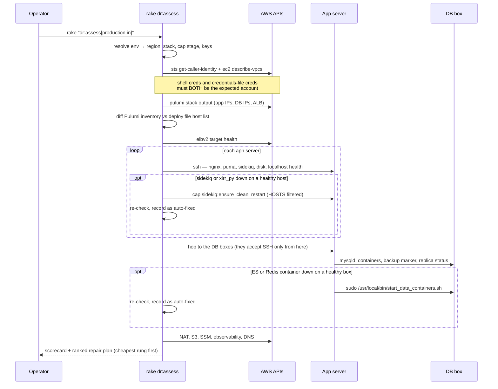
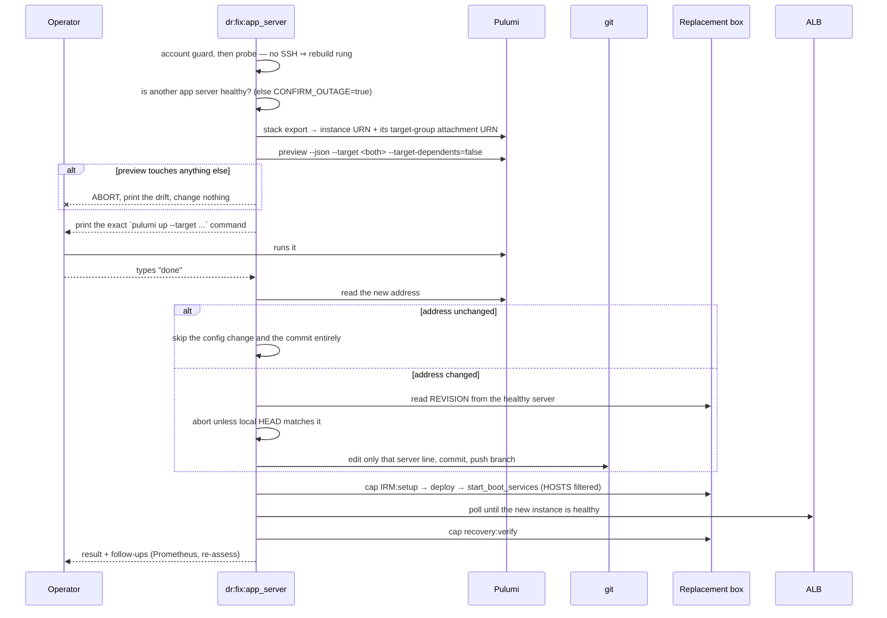

# Component Recovery Guide

Repairing **one broken component** of a live environment, without rebuilding the
stack and without disturbing anything that is still working.

Full disaster recovery (`docs/DR_GUIDE.md`) rebuilds an entire environment in
another region. It is the right response to losing a region, and the wrong
response to losing one app server. Most real incidents are a single component: a
box that died, a container that stopped, a database that needs restoring. This
guide covers those.

## The three tools

| Tool | Question it answers | When |
|---|---|---|
| `aws:dr_readiness` | Could we recover if we had to? | Quarterly, and before any migration |
| **`dr:assess`** | **Which component is broken, and what is the smallest fix?** | **During an incident** |
| `dr:verify` | Is the stack serving again? | After any recovery or deploy |

## Supported environments

| | production.in | production.us | staging.in |
|---|---|---|---|
| AWS account | 825199636520 | 825199636520 | 174852986003 |
| Region | ap-south-1 | us-east-1 | ap-south-1 |
| Pulumi stack | `production-ap-south-1` | `production-us-east-1` | `staging-ap-south-1` |
| Cap stage | `production_in` | `production_us` | `staging_in` |
| App servers Pulumi owns | 2 | 2 | 2 |
| App servers the deploy file targets | 2 | 2 | **1** |
| Public website | caphive.com | caphive.us | altconnects.com |

`staging.us` is **not supported** by these tools. Files for it exist in the
repository, but the environment does not.

Two consequences worth knowing before an incident:

- **Component recovery works for `production.us`, full DR does not.** `.env.production.us`
  names `us-east-2` as its backup region, but no `production-us-east-2` Pulumi
  stack exists, so `aws:setup_infra` has nowhere to rebuild. Component recovery
  always repairs in the environment's own live region, which is configured for
  all three environments.
- **Repairing the `staging.in` app server is a full outage.** Its deploy file
  lists one distinct host, so nothing carries traffic during the repair. In the
  production environments the surviving app server keeps serving and the repair
  is rolling. `dr:assess` states which case you are in.

## Step 0 — always start with assess

```bash
rake "dr:assess[production.in]"
```

Takes roughly a minute. It walks every component, prints a scorecard, and ends
with a ranked repair plan. It **does not** rebuild, deploy, restore, or touch
MySQL, and it never changes DNS.

Before anything else it verifies the AWS account. Production and staging are
separate accounts, and the two credential paths in play are independent: the SDK
reads the encrypted credentials file, while every `aws` CLI subprocess and
Pulumi read whatever is exported in your shell. They can point at different
accounts, and only one of them is visible in your terminal. A mismatch aborts.



### What assess repairs by itself

Only the **trivial rung**: a process that died on a host that is otherwise
healthy. This mirrors `dr:verify`, which already restarts a downed
`prometheus_exporter` rather than merely reporting it.

| Auto-fixed | How |
|---|---|
| Elasticsearch / Redis container on the DB primary | the baked `/usr/local/bin/start_data_containers.sh` |
| sidekiq on an app server | `cap sidekiq:ensure_clean_restart`, filtered to that host |
| `xirr_py` container on an app server | `cap IRM:start_boot_services`, filtered to that host |

Nothing else. No Pulumi, no deploy, no restore, no MySQL, no nginx config.
Auto-fixes are reported separately in the summary as 🔧 so they are never
confused with things that were already healthy.

Run `ASSESS_READ_ONLY=true rake "dr:assess[...]"` to suppress even those.

## The repair ladder

Every component has a ladder, and `dr:assess` recommends the lowest rung the
evidence supports. Restarting a stopped container is not a database event and
must never escalate into one.

| Component | Detection | ① cheapest | ② | ③ |
|---|---|---|---|---|
| ALB / listener | target health, `describe-load-balancers` | re-register targets | rebuild ALB → **needs `aws:dns_cutover`** | — |
| App server | SSH, nginx, puma, localhost `disk_check` | restart services | redeploy that host | rebuild the box |
| Sidekiq | `pgrep` on the host | restart (auto) | redeploy that host | — |
| MySQL primary | `systemctl is-active mysql` | restart | promote the replica | rebuild + restore |
| MySQL replica | `SHOW REPLICA STATUS` | reset replication | rebuild + restore | — |
| Redis / Elasticsearch | container list on the DB box | restart containers (auto) | — | — |
| Observability | instance state, Grafana health | restart Grafana | rebuild the box | — |
| NAT gateway | gateway state + reachability **from a DB box** | `aws:nat:create` | — | — |
| S3 buckets | `head_bucket`, backup freshness | re-provision | restore from the replica bucket | — |
| SSM params | per-key `get-parameter` | `xtrabackup:seed_ssm_params` | — | — |
| DNS / website | resolution, apex + alias response | rebuild website + deploy | `aws:dns_cutover` | — |

Two detection choices are deliberate:

- **`disk_check` is the app-server probe.** Every other `/health_check` endpoint
  depends on MySQL, Redis or Elasticsearch, so using one of those would blame an
  app server for a data-tier outage.
- **NAT is checked from a DB box, not from its own state.** The DB boxes sit in
  private subnets with no S3 or SSM VPC endpoints, so backups and the baked
  restore script's SSM config both travel through the NAT gateway. A dead NAT
  stops backups with no user-visible symptom.

## Repairing one app server

```bash
rake "dr:fix:app_server[production.in, 35.154.185.236]"
```

The task probes the box and picks the rung itself:

**The box answers SSH** → services are repaired in place. No Pulumi, no git, no
rebuild. nginx is only started after `nginx -t` passes, because a bad config is
a different failure that a blind restart would hide. `puma`, `sidekiq` and
`start_boot_services` are restarted with `HOSTS=` filtering, so the other app
server is never touched. It finishes by curling the serving chain and, if that
still fails, prints the next rung rather than escalating on its own.

**The box is gone** → it is rebuilt from the AMI:



Three guards are worth knowing about before you need them:

- **The preview guard.** If the targeted preview would change anything beyond
  the instance and its attachment, the task aborts and prints what it found.
  Stack drift — a refreshed AMI id, most often — is reported and left alone.
- **The outage guard.** If no other app server is reachable, rebuilding this one
  means a full outage, and if both are gone it is a region-level event. The task
  refuses without `CONFIRM_OUTAGE=true`.
- **The revision guard.** If the surviving server is running a different commit
  from your HEAD, the task aborts with the `git checkout` command to run, so the
  repair deploys exactly what was already live.

If the replacement lands on the same address — common in these small subnets —
there is no config change, no commit and no branch at all.

## Single-box database restores

```bash
bundle exec cap production_in partial:restore_replica
bundle exec cap production_in partial:restore_primary
bundle exec cap production_in partial:reset_replication

# restoring from the DR-region bucket when the primary bucket is unreachable
BUCKET=docs.caphive.com.production-replica-backup-xtra BUCKET_REGION=ap-south-2 \
  bundle exec cap production_in partial:restore_primary
```

These wrap the existing, drill-tested `db:restore_*_remote` tasks. They exist
because the only Capistrano route to a restore was `recovery:load_db_from_backups`,
which restores **both** boxes — so repairing one replica meant SSHing to an app
server and running rake by hand, mid-incident.

⚠️ A restore **deletes** the target box's MySQL data directory. `partial:restore_primary`
deliberately does **not** reset replication afterwards: the replica would then
hold data from the old primary at binlog positions that do not correspond to the
restored one, which is silent drift rather than an error. Restore both, or
promote — `dr:assess` says which.

## Repairing the database tier

`dr:assess` names which of these applies. The choice between the last two is the
most consequential in the whole tool.

| Task | Use when | Data loss |
|---|---|---|
| `dr:fix:db_replica[<env>]` | The replica is broken or gone; the primary is fine | none |
| `dr:fix:promote_replica[<env>]` | The primary is gone and the replica is healthy | ≈ none |
| `dr:fix:db_primary[<env>]` | The primary is gone and the replica is unusable too | up to ~1 hour |

Three things make these different from an app-server repair:

- **They are not host-filtered.** `DB_HOST` lives in the committed encrypted
  credentials, so *every* app server must be redeployed to learn a new address.
- **The primary box is `DB-Redis-ES`.** Losing it also loses Redis (Sidekiq
  queues, ActionCable) and the Elasticsearch indexes — neither is replicated.
  `Rails.cache` is `solid_cache`, i.e. MySQL, so the cache is unaffected.
- **A restore deletes the target box's MySQL data directory.**

### Promotion

```bash
rake "dr:fix:promote_replica[production.in]"
```

```mermaid
sequenceDiagram
    participant Op as Operator
    participant F as dr:fix:promote_replica
    participant Old as Dead primary
    participant Rep as Replica
    participant App as App servers

    F->>Old: is mysqld still running?
    alt primary still serving
        F--xOp: ABORT — promoting now would be split brain
    end
    F->>Rep: SHOW REPLICA STATUS (lag, errors)
    F-->>Op: state the costs, require typing "promote"
    F->>App: nginx:switch_maintenance
    F->>Rep: STOP REPLICA; RESET REPLICA ALL
    F->>Rep: touch /etc/db_backup_enabled (arm backups)
    F->>Rep: start_data_containers.sh (Redis + ES)
    F->>F: DB_HOST and DB_HOST_REPLICA → the promoted box
    F->>F: REDIS_URL, ELASTIC_SEARCH_URL → the promoted box
    F->>F: revision guard, commit, push branch
    F->>App: deploy to EVERY app server
    F->>App: nginx:switch_app
    F->>App: recovery:verify + partial:verify_data_tier
    F-->>Op: follow-ups — chewy:reset, rebuild a replica, lost jobs
```

Both credential keys are pointed at the promoted box on purpose. There is no
replica any more, and `dr:verify` skips its replication checks when the two
match — so the existing verifier reports honestly on a degraded single-database
stack instead of failing on a replica that deliberately does not exist.

After a promotion, `DB_HOST` points at Pulumi's `db-replica-*` resource. The
inversion is harmless and self-heals at the next full DR, which rebuilds both
boxes from S3 and rewrites both credentials — but **do not run a bare,
untargeted `pulumi up` on that stack before then**.

`dr:fix:db_primary` refuses to run while a healthy replica is holding data it
would discard, unless you set `CONFIRM_DATA_LOSS=true`.

## Verifying the data tier

```bash
bundle exec cap production_in partial:verify_data_tier
```

Checks Redis with a real `PING` and a value round-trip, Sidekiq's registered
process set and queue latency, the Chewy index, and whether `cable.yml` and
`REDIS_URL` agree. Run it after any repair that moved Redis or Elasticsearch —
`dr:verify` alone cannot catch those (finding #5).

## Status of this work

| Phase | Delivers | State |
|---|---|---|
| 1 | `dr:assess` + this guide | **done** |
| 2 | `partial:restore_primary` / `restore_replica` / `reset_replication` | **done** |
| 3 | `dr:fix:app_server` — service rung, then box rebuild | **done** |
| 4 | `dr:fix:observability`, `dr:fix:prometheus_config`, `dr:fix:nat`, `partial:verify_data_tier` | **done** |
| 5 | `dr:fix:db_replica`, `dr:fix:promote_replica`, `dr:fix:db_primary` | **done** |
| 6 | Component drills on staging.in, logged to `docs/dr_drills.md` | pending |

**Nothing here has been exercised against a live environment yet.** Every task
loads and its pure logic is tested, but the AWS, SSH and Capistrano paths are
proven only by drilling them. Until Phase 6 runs, treat these as reviewed code,
not as a tested capability — and read what a task prints before answering its
prompts.

## Design rules the `dr:fix:*` tasks follow

1. **Isolation is enforced, not promised.** Every Pulumi step runs
   `pulumi preview --json` against an exact URN list first and aborts if the
   preview contains any operation beyond the targeted resources. Drift it finds
   is reported and left alone. Every Capistrano step is filtered to the host
   being repaired, so healthy hosts are never restarted.
2. **Pulumi is print-only.** The task prepares and prints the exact targeted
   `pulumi up` command; a human runs it.
3. **One component per run**, then re-assess. No task chains repairs.
4. **Cross-component consequences are reported, never silently performed.**
5. **Branch from the deployed revision.** Any repair that needs a deploy checks
   that your HEAD matches what the app servers are running, so an incident
   deploy cannot carry unreleased work.

## Known findings — documented, not fixed

These were found while building this tooling. They are recorded here
deliberately; none is fixed by this work.

1. **Replacing an app server must target its target-group attachment too.**
   `alb.py` creates one `TargetGroupAttachment` per instance, named after the
   instance. Replacing an instance with `--target-dependents=false` — the
   isolation flag these tasks use — leaves the attachment pointing at the old
   instance id, so the new box never joins the target group and the ALB quietly
   serves on one server. `dr:fix:app_server` targets both URNs explicitly.
2. **The observability instance is never attached to its target group.**
   `create_observability` returns `target_group_obs` and `attach_grafana_rule`
   forwards to it, but nothing in the Pulumi code registers the instance. Either
   Grafana is not reachable through the ALB, or it was registered by hand — in
   which case a rebuild loses it silently. `dr:assess` reports an empty target
   group rather than assuming.
3. **NAT is a single point of failure for backups.** No S3 or SSM VPC endpoints
   exist, so a dead NAT gateway silently stops backups and blocks restores. A
   gateway endpoint for S3 would remove this dependency cheaply.
4. **`aws:generate_prometheus_yml` only writes the file locally.** Nothing
   pushes it to the observability box or reloads Prometheus, so any replaced box
   stays invisible to monitoring until someone copies it by hand.
5. **`/health_check/redis_check` does not check Redis.** It exercises
   `Rails.cache`, which is `solid_cache` — MySQL. Redis is verified directly by
   `dr:assess` and, from Phase 4, by `partial:verify_data_tier`.
6. **`reset_replication` sets `server_id` with `SET GLOBAL`**, which does not
   survive a replica reboot.
7. **No live stack exports an `alb` output.** Each stack's outputs were written
   by whatever `outputs.py` ran at its last `pulumi up`, and none has been upped
   since `alb` was added to `create_output`. `production-ap-south-1` and
   `staging-ap-south-1` also export no `OBSERVABILITY_HOST`.
   **`aws:dns_cutover` and `aws:dr_verify_edge` both read `output["alb"]` and
   raise without it**, so both would fail today on an existing stack. A real DR
   is unaffected — `aws:setup_infra` runs `pulumi up`, which regenerates the
   outputs before cutover — but neither task can be used to verify or re-point a
   stack that is already running. These tools read Pulumi **state** instead and
   are immune.
8. **Stale resources sit in `staging-ap-south-1`'s state.** A second
   `observability-ap-south-1-staging`, stopped and flagged `delete: true`, is a
   leftover from an interrupted update. Every lookup here skips `delete: true`
   resources so a repair is never aimed at one.
9. **Staging's outputs disagree with its own state.** The outputs claim two app
   servers and a replica; the state has one app server and no replica, matching
   `staging_in.rb`. `dr:assess` reports the disagreement rather than silently
   preferring one.

## Related documents

- `docs/DR_GUIDE.md` — full region-loss disaster recovery
- `docs/dr_drills.md` — drill log
- `docs/dr_runs/` — per-run transcripts and evidence reports
- `IRM-Infra/PULUMI_STATE.md` — Pulumi state backend
