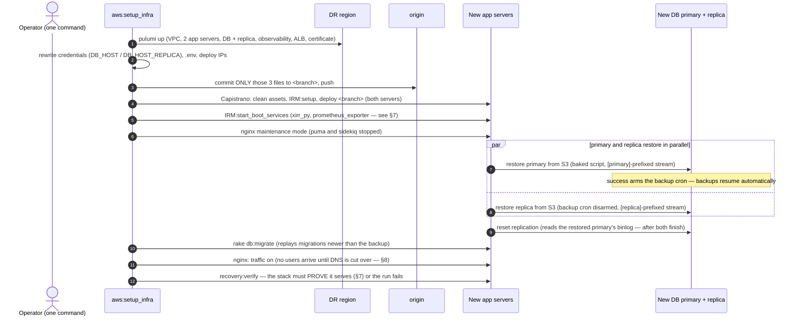
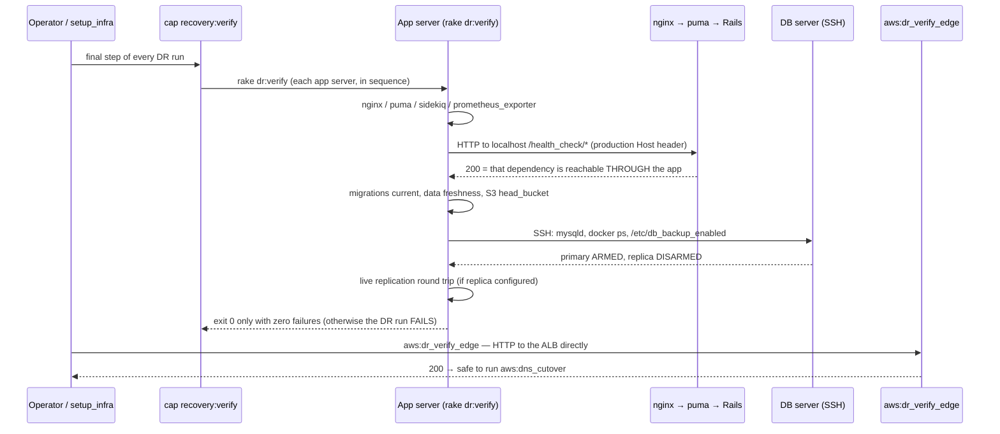

# Disaster Recovery Guide

**Scope:** This is the operational runbook for a disaster recovery (DR) event: how to
assess the situation, what to run, what happens at each step, and what must be
verified before declaring recovery complete. It also covers planned region
migrations, which use the same machinery.

**Audience:** An operator with access to the AWS accounts, this repository, and
the sibling `IRM-Infra` repository. No prior DR experience is assumed; every
step is a single command with its effects documented.

**Last updated:** 2026-07-10 · **Last verified by drill:** 2026-07-10 (see
`docs/dr_drills.md`)

### Related documents

| Document | Contents |
|---|---|
| `docs/db_backup_system.md` | How database backups obtain credentials and buckets, from AMI build to runtime. Written for newcomers. |
| `docs/dr_review/` | Design rationale for each DR hardening decision. |
| `docs/dr_drills.md` | Drill history with measured recovery times. |
| `lib/tasks/Caphive infra setup.md` | Full environment setup runbook. |

### Recovery objectives

| Metric | Target | Basis |
|---|---|---|
| **RTO** (Recovery Time Objective — time to restore service) | ~10 minutes for staging-sized data, unattended; scales with database size | Measured by drill: 8.7 minutes including automated post-recovery verification (2026-07-10) |
| **RPO** (Recovery Point Objective — maximum data loss) | 30 minutes | Incremental backup cadence — **valid only while the backup freshness alert is green** (see §3) |

---

## 1. Emergency Quick Reference

For a production incident in the IN deployment, the complete sequence is:

```bash
# Step 1 — Readiness check (read-only, ~30 seconds):
rake "aws:dr_readiness[production, in, ap-south-2, production.in]"

# Step 2 — Full recovery (one command, unattended; ends with automated
# verification, so success means the stack has PROVEN it serves traffic):
RAILS_ENV=production rake "aws:setup_infra[production, AppServer, DB-Redis-ES, ap-south-2, in, production.in, dr_prod_in_<date>]"

# Step 3 — Edge check: exercises the new load balancer directly, before DNS:
rake "aws:dr_verify_edge[production, ap-south-2]"

# Step 4 — Go live (interactive; requires typed confirmation):
rake "aws:dns_cutover[production, ap-south-2, in]"
```

Each step is explained in the sections below. Do not run step 4 until the
verification described in §7 has passed.

**Drills versus real recovery:** `aws:dr_drill` is a rehearsal wrapper around
the same `aws:setup_infra` engine. It uses a throwaway git branch, records the
result and measured recovery time in `docs/dr_drills.md`, and can tear the
infrastructure down afterwards (`TEARDOWN=true`). For a real disaster **or a
permanent region migration**, call `aws:setup_infra` directly with a branch
name you intend to merge.

`aws:dr_drill`'s 4th argument is `stack` (default `staging`). Passing
`production` runs the identical unattended sequence against the real
production Pulumi stack in the DR region, using live production backups and
credentials — it is a genuine DR exercise against the production AWS account,
not staging at larger scale. It requires `CONFIRM_PRODUCTION=true` in addition
to the argument, so a staging command can't be turned into a production run by
a copy-paste mistake:

```bash
CONFIRM_PRODUCTION=true TEARDOWN=true \
  rake "aws:dr_drill[in, ap-south-2, production.in, production]"
```

`docs/dr_drills.md` and the drill-recency check in `aws:dr_readiness` both key
on `stack`, so a passed staging drill is never read as satisfying production's
recency requirement (or vice versa).

## 2. Scenario Assessment

Match the failure to the response before running anything. Most incidents do
not require full DR.

| Failure | Response | DNS change required |
|---|---|---|
| One app server down | Not a DR event. Run `pulumi up` on the stack (recreates the instance), then `cap <stage> deploy`. | No |
| Database primary down or corrupt; region healthy | Restore in place: single command on the DB server (§6), or promote the replica. | No |
| Entire primary region lost (compute) | **Full DR**: one-command rebuild in the backup region (§5). | Yes (§8) |
| Primary region's **S3** also unreachable | Full DR, restoring from the **replicated backup bucket** (§5 with the bucket override in §6). | Yes (§8) |
| Bad deploy or application-level data damage | Not covered by this guide. Use a point-in-time restore from a chosen backup chain: `restore_from_primary <full_key> [incr_key]` on the DB server. | No |

**Region pairs:** IN production runs in ap-south-1 (Mumbai) with ap-south-2
(Hyderabad) as the DR region. US runs in us-east-1 (rebuild in place, or extend
with a second region). Staging mirrors the IN topology.

## 3. Readiness Verification

DR readiness is a testable property, not an assumption. One read-only command
checks every prerequisite and prints a scorecard:

```bash
rake "aws:dr_readiness[<stack>, <variant>, <dr-region>, <env>]"

# Examples:
rake "aws:dr_readiness[production, in, ap-south-2, production.in]"
rake "aws:dr_readiness"    # defaults: staging, in, $AWS_BACKUP_REGION
```

It completes in about 30 seconds, prints ✅ / ⚠️ / ❌ per check, and exits
non-zero on any hard failure, making it suitable for cron or CI. Run it
quarterly at minimum, and always before a planned migration.

| Check | Why it must be true | Remediation when ❌ |
|---|---|---|
| Backup freshness (primary and replica buckets) | Actual RPO equals the age of the newest backup — a restore recovers only what is in the bucket. The replica-bucket check proves backups survive a region loss. *Incident history: staging backups stopped silently on 2026-06-08 and a later drill restored 30-day-old data; this check exists to make that impossible to miss.* | Re-arm the backup cron on the DB primary. Backfill the replica bucket once: `aws s3 sync s3://<bucket>-backup-xtra s3://<bucket>-replica-backup-xtra` |
| Three AMIs present in the DR region (warns if older than 8 days) | Recovery launches instances from these images; stale images mean slow post-restore catch-up. | Confirm the weekly `aws:create_and_copy_ami` cron ran; bake manually if needed (`PACKER_AWS_REGION=<region> rake "packer:build_env[...]"`). |
| SSM backup parameters in the DR region | The baked backup script reads its credentials and bucket from SSM **in the instance's own region**. | `rake "xtrabackup:seed_ssm_params[<env>, <region>]"` |
| Pulumi stack configuration complete | `pulumi up` aborts on any missing key — better discovered now than mid-incident. | `rake "aws:setup_pulumi_config[...]"`; for a brand-new region also set `DOMAIN_NAME` and `AWS_KEY_NAME`. |
| Pulumi state backend reachable | If the backend or its login is broken, `pulumi up` is impossible for every stack. | Log in per `IRM-Infra/PULUMI_STATE.md` (backend URL and SSM passphrase documented there). A missing stack in a brand-new region only warns — `setup_infra` creates it. |
| EC2 key pair in the DR region | Pulumi does not create key pairs; instances cannot launch without one. | EC2 → Key Pairs → create or import, matching the stack file's `key_name`. |
| Route 53 hosted zone for the domain | Required for both ACM certificate validation and the DNS cutover. | Create the zone (one-time, global). |
| Local files (`.env.<env>`, credentials pair, sibling `IRM-Infra` checkout) | The orchestration runs from the operator's machine. | Restore from the secrets store; clone the infrastructure repository as a sibling directory. |
| Drill recency (warns if older than 100 days) | An untested DR plan is a hypothesis, not a capability. | `TEARDOWN=true rake "aws:dr_drill[<variant>]"` |

In addition to this on-demand scorecard, the hourly `DbBackupFreshnessJob`
(staging and production) alerts continuously on backup staleness.

## 4. Declaring a Disaster

Declare full DR when the primary region cannot serve traffic and will not
recover soon. Requirements to execute:

- A machine with both repositories checked out as sibling directories
- The affected environment's AWS access keys (staging and production are
  **separate AWS accounts**)
- Pulumi login
- 30–60 minutes

Nothing in the recovery depends on the failed region except the backup bucket,
and §6 covers the case where that is also unreachable.

## 5. Executing Recovery

```bash
export AWS_ACCESS_KEY_ID=<env keys>
export AWS_SECRET_ACCESS_KEY=...

RAILS_ENV=production rake "aws:setup_infra[production, AppServer, DB-Redis-ES, ap-south-2, in, production.in, dr_prod_in_<date>]"
```

The seventh argument (the branch name) makes the run fully unattended. The
sequence, in order:



Operational notes:

- The database restore is the longest step; its duration scales with database
  size. The primary and replica restore **in parallel**, so wall time is the
  slower of the two rather than their sum.
- Any failure aborts loudly with the failing step named. The infrastructure
  stays up for diagnosis.
- Re-running the same command **converges**: Pulumi makes no changes to
  existing resources, and the configuration commit is skipped if nothing
  changed.

## 6. Database Restore — Variants

The restore runs automatically inside §5. The manual forms below exist for
in-place recovery (§2) and for the S3-region-loss case. All of them run on the
DB server, reached via an app server — DB servers accept SSH only from app
servers.

```bash
# Standard restore (backup bucket reachable):
sudo /usr/local/bin/db_backup_xtra.sh restore_primary

# Primary region's S3 unreachable — restore from the DR-region replica bucket.
# From an app server:
rake "db:restore_primary_remote[<bucket>-replica-backup-xtra, <dr-region>]"
# Or directly on the DB server:
sudo env BUCKET_OVERRIDE=<bucket>-replica-backup-xtra AWS_REGION_OVERRIDE=<dr-region> \
     /usr/local/bin/db_backup_xtra.sh restore_primary

# Both boxes in parallel, then replication reset (what §5 runs internally):
rake "db:restore_all_remote"                       # from an app server
```

Built-in safety: the previous MySQL data directory is **parked** as
`<datadir>.bak.<timestamp>`, never deleted. The script prints the rollback
command to run if MySQL fails to start on the restored data, and the cleanup
command to run once the restore is verified.

## 7. Post-Recovery Verification

Verification is automated and enforced. `aws:setup_infra` runs
`cap <stage> recovery:verify` as its final step, so a DR run — and therefore
any drill — only reports success if every app server proves it is actually
serving. Both layers can also be run by hand at any time:

```bash
# Inside the servers — every app server plus the DB servers:
LB=true bundle exec cap staging_in recovery:verify

# At the edge — the ALB itself, before any DNS change:
rake "aws:dr_verify_edge[staging, ap-south-2]"
```

`recovery:verify` executes `rake dr:verify` on each app server, which checks:

| Layer | Checks |
|---|---|
| Daemons on the app server | nginx active; puma processes present; sidekiq registered in Redis; prometheus_exporter running (started automatically if down) |
| Full serving chain (HTTP to localhost with the production Host header) | `/health_check/db_check`, `redis_check`, `elastic_check`, `disk_check`, `xirr_check` — each request exercises nginx → puma → Rails → that dependency |
| Application level | Migrations current; age of the newest `users`/`documents` rows (detects a restore from a **stale backup**); S3 application bucket reachable with the application's own credentials |
| DB server (via SSH from the app server — the only route in) | mysqld active; `elasticsearch` and `redis-stack-server` containers running; backup cron **armed** (`/etc/db_backup_enabled`) on the primary; cron file installed |
| Replica (only on stacks that have one) | mysqld active; backup cron **disarmed** (one writer per backup chain); live write-to-primary → read-from-replica round trip via `ReplicationHealthJob` |



**Why the first-boot service checks exist:** the `every :reboot` crontab
entries (sidekiq, puma, prometheus_exporter, and the `xirr_py` container — see
`config/schedule.rb`) are installed by Capistrano **after** a fresh instance
has already booted, so they do nothing until the next reboot. Puma and sidekiq
are started by the deploy's own restart hooks regardless; `xirr_py` and
`prometheus_exporter` are not. `aws:setup_infra` therefore runs
`cap <stage> IRM:start_boot_services` immediately after deploying, which starts
exactly those two services and is a no-op when they are already running.
`dr:verify` still fails (xirr) or warns (prometheus) if they are down, which
catches instances built outside `setup_infra`. The DB server is not affected:
its Elasticsearch and Redis `@reboot` entries are baked into the AMI's crontab
before first boot.

**Manual checks before DNS cutover:**

- [ ] `rake s3:check_backup_freshness` a few hours after recovery — proves the
  first backup from the recovered primary actually landed
- [ ] Data sanity: the latest records match the RPO expectation (compare
  against the backup timestamp the restore printed)

**Manual checks after DNS cutover:**

- [ ] Logins and one critical business flow work end to end on the real domain
- [ ] ALB target group reports both app servers healthy
- [ ] Email delivers (if SES is not yet provisioned in this region:
  `pulumi config set manage_ses true && pulumi up`, plus a sandbox-exit
  request if the region has never sent mail)
- [ ] Monitoring repointed: `rake aws:generate_prometheus_yml`,
  `rake grafana:provision`

## 8. DNS Cutover

The cutover is deliberately manual and runs last — going live is a human
decision, and drills never touch DNS. Run it only after §7 passes.

```bash
rake "aws:dns_cutover[production, <dr-region>, in]"
```

The task shows where the record currently points, requires a typed `yes`, and
then aliases `app.<domain>` (production) or `dev.<domain>` (staging) to the new
ALB. Traffic shifts as DNS TTLs expire. Confirm with `dig app.<domain>` — it
should resolve to the new ALB.

## 9. Post-Recovery Actions

In the first days after a recovery or migration:

1. **Re-establish DR for the new primary region.** Run
   `rake "aws:provision_s3_buckets[<env>]"` (backup replication now flows in
   the opposite direction), re-seed SSM parameters in the new backup region,
   and confirm the weekly AMI cron targets it (`AWS_BACKUP_REGION`).
2. **Deal with the old region when it returns.** Either `pulumi destroy` its
   stack or keep it as the new standby. Rotate any credentials the incident
   may have exposed.
3. **Merge the DR branch** (`dr_prod_in_<date>`). It holds the credential and
   IP state that is now production reality.
4. **Record and review.** Log the event and measured recovery time in
   `docs/dr_drills.md`; hold a retrospective against this guide and update it
   wherever reality diverged.

## 10. Known Limitations

- **Actual RPO is the age of the newest backup**, not the 30-minute design
  target, if the freshness alert was firing and ignored. Check the alert
  channel before trusting the restore.
- **An environment built without a restore never arms backups.** Arming is a
  side effect of `restore_primary`. Empty-database setups must arm manually:
  `sudo touch /etc/db_backup_enabled` on the primary.
- **Instances from pre-2026-07 AMIs lack the baked backup script.** The rake
  restore tasks detect this and upload a generated script automatically, but
  the manual on-box command will not exist at `/usr/local/bin` on such
  instances, and the backup cron file will be absent (verification warns).
- **SES in a never-used region starts in sandbox mode.** Leaving the sandbox
  requires an AWS support request that takes days; transactional email may
  need a temporary relay through another region.
- **Pulumi state lives in Pulumi Cloud under a personal account** until the
  per-account S3 backend migration is executed. The design and migration
  script are ready — see `IRM-Infra/PULUMI_STATE.md` and
  `IRM-Infra/migrate_state_to_s3.sh` (one run per AWS account). Until both
  runs are complete, that personal Pulumi login is a DR dependency, and the
  readiness scorecard's "Pulumi state backend" check reports against whichever
  backend the operator is logged into.
