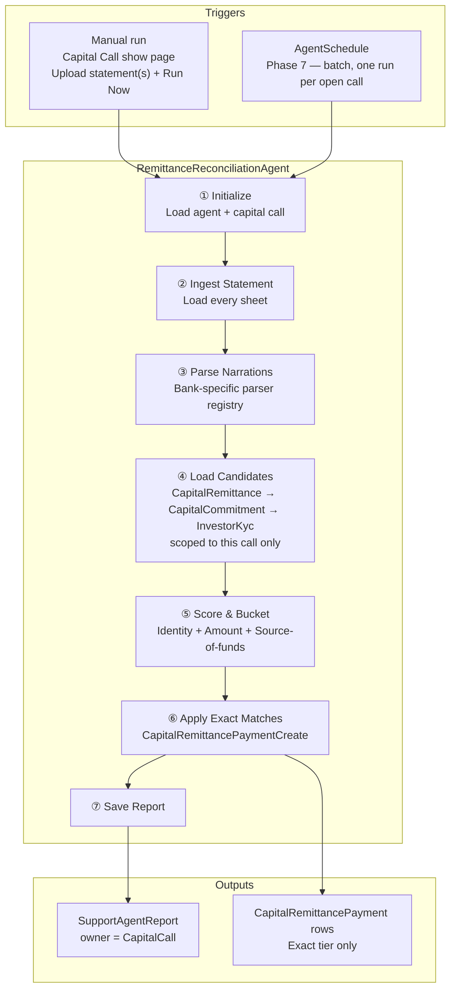
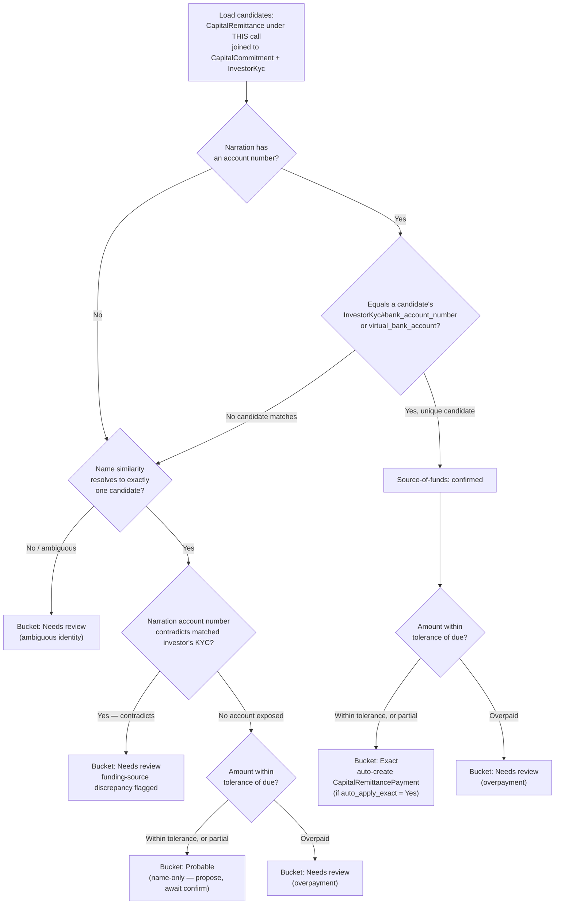
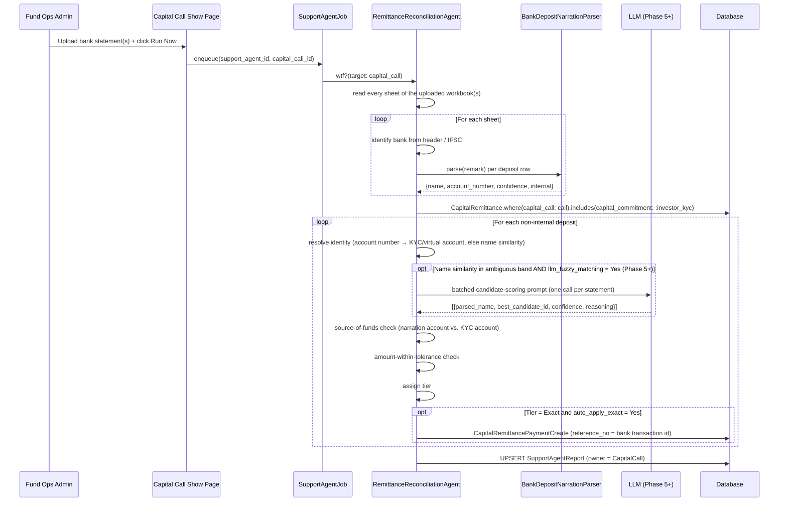
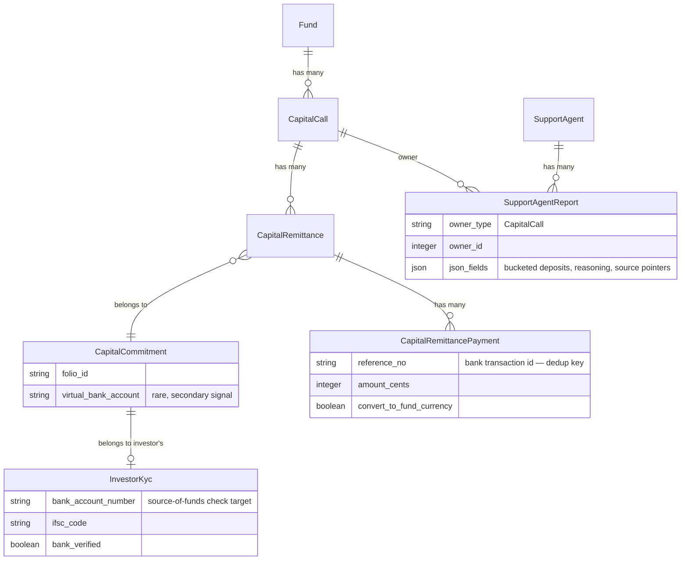
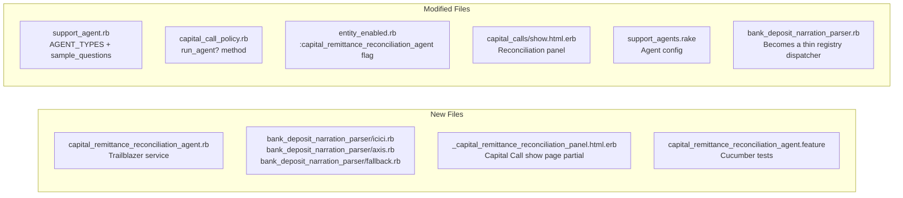

# PRD: Capital Remittance Reconciliation Agent

**Status:** Phases 1–4 implemented (see §14); Phases 5–7 open
**Author:** Fund Operations / Platform Engineering
**Date:** 2026-09-03
**Last Updated:** 2026-09-04

---

## TL;DR

`RemittanceReconciliationAgent` — named without the "Capital" prefix because `SupportAgent#agent_type` and `#name` are both validated `length: { maximum: 30 }`, and `CapitalRemittanceReconciliationAgent` (36 chars) doesn't fit — is a support agent scoped to **one `CapitalCall` per run** — not a whole Fund — that accepts one or more uploaded bank statement exports (xlsx), extracts every deposit through a per-bank narration parser registry, and matches each deposit against that call's outstanding `CapitalRemittance` records via the `CapitalRemittance → CapitalCommitment → InvestorKyc` chain. Matches bucket into five tiers (**Exact / Probable / Needs review / No match / Internal**); only Exact auto-creates a `CapitalRemittancePayment`. Every match independently runs a **source-of-funds check** — does the depositor's account number agree with the investor's registered KYC bank account — and flags any contradiction regardless of tier, since in theory an LP's payment should only ever arrive from their own registered account, but in practice sometimes doesn't. Results are stored in a `SupportAgentReport` owned by the `CapitalCall`. No new tables are required for the core engine; one optional table (`FundBankAccount`) is deferred to a later phase.

---

## 1. Problem Statement

Every capital call produces a batch of remittance notices and, days later, a batch of deposits in the fund's bank account that don't identify themselves cleanly. A fund controller today opens the bank statement, reads narrations like:

```
RTGS-HDFCR5202606247 4674383-DEEPAKAGARWAL-50100602457893-HDFC0000240
```

and manually keys a **Folio No** or **Virtual Bank Account** into `ImportCapitalRemittancePayment`'s CSV importer, one row at a time, for every deposit on every statement. This is:

- **Manual and repetitive** — a call with 50+ remittances means 50+ rows of narration-reading and CSV-typing.
- **Undocumented** — no record of *why* a payment was matched to a given investor, only that it was.
- **Silent on discrepancies** — if a payment happens to arrive from an account other than the investor's own KYC-registered account, there's no structured way today to notice, since the CSV importer only asks for a Folio No or Virtual Bank Account, never checks it against KYC.
- **A dead end previously attempted** — an earlier unwired prototype (`RemittanceReconciler`, an OpenAI Assistants + `code_interpreter` script) tried to solve one remittance and one CSV query at a time. It had no tolerance handling, no multi-payment support, and wrote `amount_cents` directly, bypassing the folio→fund currency conversion path. It's out of scope for this PRD — the design here starts fresh from the existing `ImportCapitalRemittancePayment` and `RtaReconciliationAgent` patterns instead.

---

## 2. Solution

**RemittanceReconciliationAgent** — a support agent that runs per `CapitalCall`. It accepts uploaded bank statement xlsx workbook(s), parses every deposit narration through a bank-specific parser registry, scores each deposit against the call's outstanding remittances, and buckets the result. Only unambiguous matches are auto-applied; everything else is a worked queue with its reasoning attached.

```
┌──────────────────── RemittanceReconciliationAgent ─────────────────────┐
│                                                                          │
│  ① Ingest        Load every sheet of the uploaded workbook(s)          │
│  ② Parse         Bank-specific parser registry extracts name/account   │
│  ③ Candidates    CapitalRemittance under THIS call → Commitment → KYC  │
│  ④ Score         Identity + amount-within-tolerance + source-of-funds  │
│  ⑤ Bucket        Exact / Probable / Needs review / No match / Internal │
│  ⑥ Apply         Exact tier → CapitalRemittancePaymentCreate           │
│  ⑦ Save Report   Persist SupportAgentReport, owner = CapitalCall       │
│                                                                          │
└──────────────────────────────────────────────────────────────────────┘
```

### System Context



---

## 3. Goals

| Goal | Success Metric |
|---|---|
| Eliminate row-by-row manual CSV keying for capital call reconciliation | A fund controller resolves a majority of a call's deposits via Exact + one-click-confirm, not manual folio entry |
| Never silently accept a funding-source discrepancy | 100% of deposits whose account number contradicts the matched investor's KYC record are flagged — zero absorbed into an auto-applied payment |
| Handle partial and multi-tranche payments without double-counting | A call paid in two wires by two signatories reconciles to one settled remittance, not two orphaned partial payments |
| Create an audit trail for every match | Every created payment traces back to one bank row (sheet, row number, raw narration) an operator can re-open |
| Be safe to re-run on an overlapping or re-uploaded statement | Zero duplicate `CapitalRemittancePayment` rows on re-run, via `reference_no` = bank transaction id |
| Scale narration parsing to new banks and new clients without touching the matching engine | Adding a bank is a new parser module; adding a client is (usually) nothing at all, since parsers are keyed by bank, not by tenant |

---

## 4. Out of Scope (v1)

- **Reconciling across more than one capital call in a single run.** Remittances are generated per call; a fund with three open calls needs three runs, not one fund-wide sweep. See §6.2.
- **Auto-detecting which fund/account a statement belongs to.** Every fund holds its own dedicated bank account(s) by law, so the mapping is simple and stable — but nothing records it today. v1 keeps a manual fund + call picker on upload, the way `RtaReconciliationAgent` already picks a fund.
- **Reconciling bounced/reversed payments.** A credit followed by a reversing debit days later is a known gap, deferred to Phase 6.
- **Auto-verifying remittances.** A payment being matched is not the same claim as a controller signing off the call as settled — see §6.6 and §8.
- **Multi-currency FX reconciliation beyond what `CapitalRemittancePayment` already does.** The agent populates folio-currency amounts through the existing conversion path; it does not second-guess the fund's recorded exchange rate.
- **One deposit funding multiple capital calls (cross-call bundling).** Decided: not built, in any phase. Reconciliation stays strictly single-call — a deposit that overpays this call's due amount is flagged as an overpayment and left for a human to apply manually against another call if needed. See §12.5 (Closed).

---

## 5. User Stories

| Persona | Story |
|---|---|
| Fund Ops Admin | Upload a capital call's bank statement and immediately see which investors have paid, so I don't have to read every narration by hand. |
| Fund Controller | Confirm a handful of AI-flagged probable matches in one click each, instead of typing folio numbers into a CSV for fifty rows. |
| Compliance Officer | See every payment whose source account doesn't match the investor's registered KYC bank account, so I can investigate before the call is marked settled. |
| Fund Accountant | Trust that a payment split across two wires from the same investor reconciles correctly against one remittance, without manual reconciliation math. |

---

## 6. Functional Requirements

### 6.1 Agent Configuration

**FormType:** `SupportAgent / RemittanceReconciliationAgent`

| Field | Type | Default | Description |
|-------|------|---------|-------------|
| `bank_statement` | File(s) | _(blank)_ | xlsx bank statement(s) covering the call's due window. Agent fails step ① if absent. |
| `tolerance_amount` | NumberField | `500` (₹) | Absolute shortfall/excess tolerated before an otherwise-exact match is downgraded. Wire charges deducted in transit are the dominant real-world cause. |
| `tolerance_pct` | NumberField | `0` | Percentage tolerance, OR'd with `tolerance_amount` — either passing is enough. |
| `name_similarity_threshold` | NumberField | `0.90` | Minimum normalized name similarity accepted deterministically for a name-only (Probable) match. |
| `auto_apply_exact` | Select (Yes/No) | **No** | Kill switch: when No, even Exact-tier matches are queued for confirm rather than auto-applied. Defaults to No for every fund's first live run — flipped to Yes deliberately once trust is established, never assumed. |
| `llm_fuzzy_matching` | Select (Yes/No) | No | Whether ambiguous-band names are scored by the LLM (see §6.4) or left as Needs review. Present on the form from Phase 1 so the setting exists per fund, but **read nowhere until Phase 5** — it has no effect on a run before then (the help text says so). |
| `send_report` | Select (Yes/No) | Yes | Email the reconciliation summary after each run. |
| `notify_email` | TextField | _(blank)_ | Recipient for the reconciliation report email. |

---

### 6.2 Scope: One Capital Call, Not a Fund

Remittances are already generated per call (`capital_call.capital_remittances`), so a run's candidate set is exactly that call's remittances. **RTA reconciliation is fund-scoped; this agent is deliberately call-scoped instead** — the candidate set stays small and unambiguous, and a fund with several open calls is reconciled one run per call, each producing its own `SupportAgentReport` owned by the `CapitalCall`.

This has a direct consequence worked through in §6.5: a deposit that doesn't belong to the selected call (e.g. it's actually a pre-payment for the *next* call) is invisible to the run and reads as a plain overpayment or no-match, not something the agent tries to guess about across calls it can't see.

---

### 6.3 Step ③ — Parser Registry

Narration format is a property of **which bank issued the statement**, not of which client (entity) uploaded it — ICICI's hyphen-delimited RTGS narration looks the same for any fund banking with ICICI. `BankDepositNarrationParser` (already built and validated — see §11) becomes a **registry of per-bank parser modules**, resolved once per statement sheet and shared across every entity that banks there.

**Resolution order:**

1. **Entity override** (rare) — a client with a bespoke RM-negotiated export format.
2. **Bank default** (the normal path) — one module per bank (`Icici`, `Axis`, …), shared by every entity that banks there.
3. **Generic fallback** — patterns that already generalize across banks (bare `TRF/`, `RTGS/`, `TRANSFER FROM …`) for a bank with no dedicated module yet.

**Identifying the bank:** each sheet's own header and every narration's trailing IFSC encode the issuing bank's 4-letter code — no manual "which bank" picker is needed alongside the fund/call picker.

| IFSC prefix | Bank | Parser module | Narration style |
|---|---|---|---|
| `ICIC` | ICICI Bank | `Icici` | Hyphen-delimited — `RTGS-<ref>-<name>-<account>-<ifsc>` |
| `UTIB` | Axis Bank *(fka UTI Bank)* | `Axis` | Slash-delimited — `RTGS/<ref>/<name>/<bank>/…`, no account number exposed |
| `HDFC` / `SBIN` / `KKBK` / … | The **remitter's** bank, not the statement issuer | — | Appears *inside* another bank's narration (the sender's IFSC); never selects the parser — a common confusion to guard against in code review |

A new bank module implements the same `.parse(remark) → Result` contract as the existing dispatch chain. This is a refactor of `BankDepositNarrationParser`'s internals (the hyphen/slash/IMPS handlers become `Icici`/`Axis` modules; the already bank-agnostic handlers — `TRF`, `TRFR FROM:`, `TRANSFER FROM`) move to the shared fallback — not a change to its public contract.

---

### 6.4 Step ⑤ — Scoring & Tier Decision

Every parsed, non-internal deposit is scored against this call's candidates on three signals, and the weakest of the three sets the tier:



**Illustrative scoring logic** (not a literal diff — see §11 for the real implementation surface):

```ruby
# 1. Try account-based identity first
if parsed.account_number.present?
  by_kyc = candidates.find { |c| c.investor_kyc&.bank_account_number == parsed.account_number }
  by_virtual = candidates.find { |c| c.capital_commitment.virtual_bank_account == parsed.account_number }
  identity = by_kyc ? { candidate: by_kyc, via: :kyc_account } :
             by_virtual ? { candidate: by_virtual, via: :virtual_account } : nil
end

# 2. Fall back to name similarity (normalized, see below)
if identity.nil?
  ranked = candidates.map { |c| [c, name_similarity(parsed.name, c.investor_name)] }
                      .sort_by { |_, score| -score }
  top, top_score = ranked.first
  runner_up_score = ranked[1]&.last || 0
  if top_score >= name_similarity_threshold && (top_score - runner_up_score) >= margin
    identity = { candidate: top, via: :name }
  end
end

# 3. Source-of-funds check — independent of how identity was resolved
if identity && parsed.account_number.present? && identity[:via] != :kyc_account
  kyc_account = identity[:candidate].investor_kyc&.bank_account_number
  discrepancy = kyc_account.present? && kyc_account != parsed.account_number
end

# 4. Amount classification — partial payments are accepted, overpayments are not
amount_status =
  if amount_within_tolerance?(deposit.amount, due) then :within_tolerance
  elsif deposit.amount < due then :partial   # a tranche; recorded for the amount received
  else :overpaid                             # surplus may belong to a call this run can't see
  end

# 5. Tier decision
tier =
  if identity.nil? then :no_match
  elsif discrepancy then :needs_review
  elsif amount_status == :overpaid then :needs_review
  elsif identity[:via] == :kyc_account then :exact
  elsif identity[:via] == :virtual_account then :exact
  else :probable # name-only, no account exposed to check
  end
# Every deposit's `reasoning` carries one line per signal (identity, source-of-funds,
# amount), so a Needs review row always says *why* — see the §8 sample.
```

**Name normalization and matching:** uppercase, strip punctuation, collapse whitespace, and separate common legal suffixes (`PVT LTD`, `LLP`, `HUF`, `TRUST`, `LIMITED`) into their own comparison rather than penalizing the core name for their presence/absence. Because several banks strip **all** whitespace from the beneficiary name entirely — observed in the ICICI sample as `SANDEEPKUMARSINGH`, `RADHIKARAMAKRISHNAN`, `HIMANSHUVARSHNEY` — a plain edit-distance comparison against `"Sandeep Kumar Singh"` scores far lower than it should. Run a second pass with whitespace stripped from **both** sides before falling back to token-set similarity for names with no such collision. Jaro-Winkler is proposed as the base similarity function (rewards a shared prefix, tolerant of transpositions — well suited to name matching).

---

### 6.5 Step ④/⑥ — Amount Logic

**Tolerance.** Reuses the pattern already proven in `RtaReconciliationAgent`: `tolerance_amount` (absolute) OR `tolerance_pct` — either passing is enough. Default `₹500` absolute, since intermediary/correspondent banks routinely deduct wire charges before an RTGS/NEFT lands — a deposit landing a few hundred rupees short is the single most common "almost exact" pattern observed, not an anomaly.

**Partial payment.** A deposit short of the due amount by more than tolerance is **not** downgraded — `CapitalRemittance#status` already models partial-due. The deposit keeps the tier its identity earned (Exact for an unambiguous account match, Probable for a name match), is tagged `amount_status: "partial"` with a reasoning line stating the shortfall, and the payment is created for the amount actually received; the remittance's own `due_amount` carries the balance. **Decided 2026-09-04** — this resolves the earlier contradiction between this paragraph and the §6.4 table, which had sent every out-of-tolerance amount to Needs review.

**Multiple deposits → one remittance.** An investor sometimes pays in two tranches. Because matching is call-scoped, this stays a bounded search: combinations of **up to 3** unmatched, same-day-to-few-days deposits whose sum lands within tolerance of one remittance's due amount, where each deposit already has a plausible identity link to that investor. Always **Needs review** — never auto-applied.

**One deposit → multiple remittances (cross-call) — not supported, by decision.** An investor who missed a prior call sometimes pays the current and a past call together in one wire. Reconciliation is single-call only, permanently — a call-scoped run has no visibility into another call's remittance, and this PRD deliberately does not build an exception to give it one. The deposit simply reads as an overpayment against *this* call; applying the surplus to another call is always a manual, separate action (a second ordinary reconciliation run against that call, or a manual payment entry).

**Overpayment.** A deposit exceeding the due amount by more than tolerance is always **Needs review** (`amount_status: "overpaid"`), with a reasoning line stating the surplus. The agent does not guess whether the surplus belongs to a different call (that call's remittances aren't loaded in a call-scoped run) — it notes the overpayment plainly and suggests checking the investor's other open calls manually. Confirming it manually records the full deposit and the remittance's existing `Overpaid` status takes over.

---

### 6.6 Source-of-Funds Check

Run independently of which tier the identity/amount signals land on, whenever the narration exposes a sender account number at all:

| Narration account vs. `InvestorKyc#bank_account_number` | Meaning | Effect |
|---|---|---|
| Matches | Funding from the LP's own registered account — the expected path | Strengthens toward Exact |
| No account number in narration | Common (most Axis formats, IMPS, cheque clearing) | Not a red flag — just unverifiable, noted as such |
| Contradicts | Joint account, family member, corporate treasury paying on the LP's behalf — or a genuine error | **Always** surfaced as a discrepancy, **always** caps the tier at Needs review, regardless of how strong name/amount look. Never AI-judged — this is a plain equality check. |
| No `InvestorKyc#bank_account_number` on file at all | KYC incomplete for this investor | **Decided:** not a blocker. A `virtual_bank_account` match alone is sufficient to reach Exact — with no KYC account on file there is simply nothing to check a contradiction against, so none is raised. See §12.6 (Closed). |

`CapitalCommitment#virtual_bank_account` is a **secondary** identity signal only — very few funds configure one, so the design leans on the KYC account number as the default path, not a virtual-account convention that may not exist for a given fund. **An account number exposed in a narration is always the sender's account, the virtual-account case included** (decided 2026-09-04): a deposit whose identity resolved via `virtual_bank_account` is still checked against the investor's `InvestorKyc#bank_account_number` when one is on file, and a mismatch is a discrepancy exactly as for a name match. Only a missing KYC account leaves it `unverifiable`.

---

### 6.7 Processing Flow



---

## 7. Non-Functional Requirements

| Concern | Behaviour |
|---|---|
| **LLM cost** | Zero LLM calls in Phase 1–4 (deterministic engine). From Phase 5, at most one batched call per statement for the ambiguous name band — never one call per row. |
| **Idempotency** | Every created payment's `reference_no` is the bank's own transaction id (e.g. `S16767980`), or a deterministic `SYN-` hash of sheet/row/narration/amount when the export has no id column; re-running on the same or overlapping statement is a safe no-op for rows already imported. The check is **call-aware**: a reference already applied under a *different* call of the same fund comes back as `recorded_elsewhere` — never re-applied, never counted as recorded on this call, never offered for Undo here. |
| **Soft failures** | A row the parser can't classify becomes `UNMATCHED`/`No match`, not a pipeline failure — one bad narration never blocks the rest of the statement. |
| **Reversibility** | An Exact-tier auto-payment can be deleted like any manually entered one (subject to the existing `check_units_before_deletion` guard once units are allocated). |
| **Authorization** | Trigger and confirm actions follow the same permission surface as today's CSV importer, pending §12.3. |
| **Multi-tenancy** | Candidate remittances always scoped to `entity_id` via the selected fund/call — no cross-entity data access. |
| **Report email** | When `send_report = Yes` and `notify_email` is set, `RemittanceReconciliationMailer` sends the run summary (tier counts, every funding-source discrepancy with sender vs KYC account, every Needs review row with its reasoning, every No match) via `deliver_now` before the report is saved. A mail failure is a warning on the report, never a pipeline failure. |
| **No silent auto-verification** | `CapitalRemittancePayment`'s `after_commit` hook already flips `capital_remittance.verified = false` on any payment change; the agent never sets `verified = true` itself — see §8. |

---

## 8. Data Model

> **Summary:** No new tables required for the core engine (Phases 1–6). One optional table (`FundBankAccount`) is proposed for Phase 7. `SupportAgentReport.owner` is `CapitalCall`, not `Fund`.



**`SupportAgentReport.json_fields` structure:**

```json
{
  "capital_call_id": 42,
  "statement_files": ["Bank_Statements_Jun26.xlsx"],
  "deposits": [
    {
      "sheet": "ICICI",
      "row": 19,
      "raw_narration": "RTGS-HDFCR5202606247 4674383-DEEPAKAGARWAL-50100602457893-HDFC0000240",
      "parsed": { "name": "DEEPAKAGARWAL", "account_number": "50100602457893", "confidence": "high" },
      "tier": "exact",
      "matched_commitment_id": 108,
      "matched_investor_name": "Deepak Agarwal",
      "identity_via": "kyc_account",
      "kyc_account_number": "50100602457893",
      "source_of_funds": "confirmed",
      "amount": 699842.06,
      "due_amount": 699842.06,
      "amount_status": "within_tolerance",
      "payment_id": 5231,
      "reference_no": "S16767980",
      "payment_status": "created",
      "reasoning": ["account 50100602457893 matches InvestorKyc#bank_account_number", "amount 699,842.06 within tolerance of due 699,842.06"]
    },
    {
      "sheet": "Axis",
      "row": 50,
      "raw_narration": "TRF/KRISHNAKUMAR RAMNARAYAN BOOB HUF/trf",
      "parsed": { "name": "KRISHNAKUMAR RAMNARAYAN BOOB HUF", "account_number": null, "confidence": "medium" },
      "tier": "probable",
      "matched_commitment_id": 114,
      "identity_via": "name",
      "kyc_account_number": null,
      "source_of_funds": "unverifiable",
      "amount": 400000.00,
      "due_amount": 699842.06,
      "amount_status": "partial",
      "reasoning": ["name similarity 0.94 to \"Krishnakumar R Boob (HUF)\"", "partial payment: 400,000.00 received against due 699,842.06 (shortfall 299,842.06)"]
    }
  ],
  "tier_counts": { "exact": 12, "probable": 4, "needs_review": 3, "no_match": 2, "internal": 6 },
  "discrepancy_count": 1,
  "payments_created": 12, "payments_already_recorded": 0, "payments_recorded_elsewhere": 0, "payments_failed": 0
}
```

`amount_status` ∈ `within_tolerance | partial | overpaid | unknown`; `source_of_funds` ∈ `confirmed | discrepancy | unverifiable`; `payment_status` ∈ `created | already_recorded | recorded_elsewhere | error` (absent until a payment is attempted; cleared again by Undo).

```json
```

**Changelog:**

| Record | Change |
|--------|--------|
| `SupportAgent::AGENT_TYPES` | `"RemittanceReconciliationAgent"` appended |
| `FormType` | New: `name: "SupportAgent", tag: "RemittanceReconciliationAgent"` |
| `FormCustomField` | 8 fields per §6.1 |
| `SupportAgentReport` | `owner_type: "CapitalCall"` — full JSON schema above |
| `app/packs/funds/capital_remittances/services/bank_deposit_narration_parser.rb` | **Refactored** — split into a bank-module registry (§6.3) |
| `entity_enabled.rb` | `:capital_remittance_reconciliation_agent` appended to `support_agents` flag list |
| `RemittanceReconciliationMailer` + view | **New** — the `send_report` summary email (§7) |
| `RemittanceDepositPaymentApplier` | **New** — builds the payment for a deposit; shared by auto-apply and the manual Confirm/Reassign actions; call-aware dedup; derives the folio-currency amount through `WithExchangeRate#convert_currency` (fund → folio, as of the payment date) so a foreign-currency folio's `folio_collected_amount` moves and the remittance can reach Paid — refuses with an error when no rate is on file rather than recording a zero folio amount |
| *(Phase 7, optional)* `fund_bank_accounts` table | `fund_id`, `bank_code`, `account_number`, `ifsc`, `label` |

---

## 9. UI

### Component Map

```
Capital Call Show Page
└── Reconciliation Panel   (entity employees only)
    ├── Upload Bank Statement(s)   (xlsx file picker, one or more)
    ├── [Run Now] button            → triggers agent for this call
    ├── Tier summary badges         Exact 12 · Probable 4 · Review 3 · No match 2
    ├── Live progress panel         step-by-step run progress (shared with Call Notice agent)
    ├── Payments recorded           collapsed list, expandable, with Undo (call-scoped; clears the row)
    ├── Ready to confirm / Needs review   one row per proposed match — Confirm / Reassign; Partial / Overpayment / Account-differs badges + reasoning lines
    ├── No match                    manual folio/virtual-account entry (reuses CSV importer fields)
    ├── Internal                    collapsed, override link per row
    └── Last run: DD Mon YYYY HH:MM · [View Full Report]
```

### Reconciliation Panel — Wireframe

```
┌── Reconciliation ─────────────────────── [Upload Statement] [Run Now] ┐
│                                                                        │
│  Capital Call #7 · Due 30 Jun 2026 · Statement: Jun 2026 (ICICI+Axis) │
│  Exact 12 · Probable 4 · Needs review 3 · No match 2 · Internal 6     │
│                                                                        │
│  Exact matches (auto-recorded) ────────────────────────────  [12] ▾  │
│                                                                        │
│  Needs your review ──────────────────────────────────────────────    │
│  ┌────────────────────────────┬──────────────┬─────────────────────┐│
│  │ RAHUL PRADEEP RATHI          │ ₹6,99,842.06 │ ⚠ acct differs KYC ││
│  │ matched: Rahul P. Rathi      │ due exact    │ [Confirm] [Reassign]││
│  ├────────────────────────────┼──────────────┼─────────────────────┤│
│  │ INVESTEC CAPITAL SERVICES..  │ ₹17,49,604.99│ acct unparseable   ││
│  │ matched: Investec Cap. Svcs. │ due exact    │ [Confirm] [Reassign]││
│  └────────────────────────────┴──────────────┴─────────────────────┘│
│                                                                        │
│  No match ──────────────────────────────────────────  [Enter manually]│
│  Internal (fund's own money) ───────────────────────────────  [6] ▸  │
└────────────────────────────────────────────────────────────────────────┘
```

---

## 10. Provisioning

```bash
# Provision for an entity (idempotent — safe to re-run)
rake 'support_agents:setup[ENTITY_ID]'
```

**Default agent config:**

```ruby
{
  name:         "Capital Remittance Reconciliation",
  agent_type:   "RemittanceReconciliationAgent",
  enabled:      true,
  json_fields: {
    "tolerance_amount"           => "500",
    "tolerance_pct"              => "0",
    "name_similarity_threshold"  => "0.90",
    "auto_apply_exact"           => "No",  # deliberately opt-in per fund, see §6.1
    "llm_fuzzy_matching"         => "No",   # flips to Yes in Phase 5
    "send_report"                => "Yes",
    "notify_email"               => ""
  }
  # No default schedule in Phases 1–6 — runs on-demand at statement upload time
}
```

---

## 11. Implementation Scope



| Artifact | Action |
|----------|--------|
| `app/packs/funds/capital_remittances/services/capital_remittance_reconciliation_agent.rb` | **Created** — Trailblazer service, steps per §6 |
| `app/packs/funds/capital_remittances/services/bank_deposit_narration_parser.rb` | **Refactored** — becomes the registry dispatcher (§6.3) |
| `app/packs/funds/capital_remittances/services/bank_deposit_narration_parser/icici.rb`, `axis.rb`, `fallback.rb` | **Created** — per-bank modules |
| `app/packs/ai/support_agents/models/support_agent.rb` | **Modified** — `AGENT_TYPES` + `sample_questions` |
| `app/packs/funds/capital_calls/policies/capital_call_policy.rb` | **Modified** — add `run_agent?` |
| `app/packs/core/entities/models/concerns/entity_enabled.rb` | **Modified** — append `:capital_remittance_reconciliation_agent` |
| `app/packs/funds/capital_calls/views/capital_calls/show.html.erb` | **Modified** — add Reconciliation panel partial |
| `app/packs/funds/capital_calls/views/capital_calls/_capital_remittance_reconciliation_panel.html.erb` | **Created** — panel partial |
| `lib/tasks/support_agents.rake` | **Modified** — agent config added |
| `app/packs/funds/capital_remittances/services/remittance_deposit_payment_applier.rb` | **Created** — shared payment builder (auto-apply + manual confirm/reassign) |
| `app/packs/ai/support_agents/mailers/remittance_reconciliation_mailer.rb` + view | **Created** — summary email |
| `capital_calls_controller.rb` | **Modified** — `confirm_reconciliation_deposit`, `reassign_reconciliation_deposit`, `undo_reconciliation_deposit` |
| `lib/remittance_reconciliation_statement_generator.rb`, `lib/tasks/remittance_reconciliation.rake` | **Created** — `rake "remittance_reconciliation:statement[<capital_call_id>,<icici|axis>,run]"`: from an existing call's own remittances, writes one bank statement xlsx in the chosen bank's export format whose rows produce every outcome (Exact, Partial, Probable, discrepancy, overpayment, No match, Internal, ignored withdrawal); creates nothing in the DB; `run` also executes the agent |
| `features/capital_remittance_reconciliation_agent.feature` | **Created** — Cucumber acceptance tests |

No DB migrations required through Phase 6. Phase 7 adds `fund_bank_accounts`.

---

## 12. Open Questions

| # | Question | Owner | Status |
|---|----------|-------|--------|
| 1 | Should Phases 1–3 (engine) ship without a reviewer UI, validated via Rails console/raw report JSON — matching RTA's own build order — or does ops need hands-on access sooner, pulling UI earlier? | Product | **Closed** — UI can come later; Phases 1–3 ship console-validated, UI is Phase 4 as planned. |
| 2 | Bank statement source: always a manual xlsx upload, or is a bank-feed/API integration planned that should shape the Ingest step differently? | Product | Open |
| 3 | Who can trigger a run and who can confirm a Probable/Needs review match — same role as today's CSV importer, or a narrower "verified reconciler" permission? | Product | Open |
| 4 | Default `tolerance_amount = ₹500` — confirm against real short-payment history, or expose as a per-fund override from day one? | Fund Ops | Open |
| 5 | Is cross-call bundled-payment detection worth building, or should a surplus after this call's due amount always be a manual follow-up in a second, ordinary run? | Product | **Closed** — no. Reconciliation is single-call only, permanently; cross-call bundling is not built in any phase. See §4, §6.5. |
| 6 | When the matched investor has no `InvestorKyc#bank_account_number` on file (KYC incomplete), should a `virtual_bank_account` match alone still reach Exact, or always cap at Needs review since there's nothing to check a contradiction against? | Engineering | **Closed** — either signal is sufficient for Exact; a missing KYC account is not a blocker. When a KYC account *is* on file, the virtual account in the narration is the sender's account and must agree with it (§6.6). |
| 9 | Partial payments: Exact-with-payment (§6.5) or Needs review (§6.4 table)? | Fund Ops | **Closed 2026-09-04** — partial payments keep their tier and record the amount received; only overpayments cap at Needs review. §6.4 and §6.5 now agree. |
| 7 | Combinatorial matching depth — proposed cap of 3 deposits combined per remittance. Confirm this covers real multi-signatory payment patterns without needing to go higher. | Engineering | Open |
| 8 | Should `auto_apply_exact` default to **No** for a fund's first live run (extra-cautious rollout), flipped to Yes once trust is established, rather than defaulting Yes everywhere? | Fund Ops | **Closed** — yes, default No everywhere; a fund opts into auto-apply explicitly. See §6.1, §10. |

---

## 13. Acceptance Criteria

**Agent setup**
- [x] Agent appears in the Support Agents index and can be created/edited.
- [x] Provisioned via `rake 'support_agents:setup[ENTITY_ID]'` with default config (all eight §6.1 fields except `bank_statement`, which is a per-run upload on the capital call page, not an agent setting).
- [x] Agent is disabled for entities where the `:capital_remittance_reconciliation_agent` flag is unset.
- [x] Untargeted/batch runs process nothing (`targets` returns an empty relation) — a statement always belongs to one specific call.

**Parser registry**
- [x] Each sheet's bank is identified from its header/IFSC, not re-derived per row.
- [x] `Icici` and `Axis` modules reproduce the exact behaviour of today's unified `BankDepositNarrationParser` (validated against the 101-row sample statement, 0 unparsed).
- [x] An unrecognized bank falls to the generic fallback, not a crash.
- [x] Amount cells exported as text with comma grouping (`"6,99,842.06"`) parse as the full figure; an unreadable amount yields `amount_status: "unknown"` (Needs review), never a wrong number.

**Candidate loading & scoring**
- [x] Candidates are always `CapitalRemittance.where(capital_call: call)` — never a fund-wide query.
- [x] An account number matching `InvestorKyc#bank_account_number` resolves identity with `via: :kyc_account`, unambiguously.
- [x] A narration account number that contradicts the matched investor's KYC record — whether identity came from the name or from a `virtual_bank_account` — is **always** flagged and caps the tier at Needs review, even when amount matches exactly.
- [x] Name-only matches (no account in narration) never exceed Probable, never auto-apply.
- [x] A `virtual_bank_account` match reaches Exact when the investor has no `InvestorKyc#bank_account_number` on file — missing KYC is not a blocker.
- [x] A deposit that overpays this call's due amount is never checked against, or split across, another capital call — it is reported as a plain overpayment (Needs review, `amount_status: "overpaid"`) on this call only.
- [x] A partial payment from an unambiguous account match stays Exact (`amount_status: "partial"`) and, when applied, records the amount received; a name-only partial stays Probable.
- [x] Every scored deposit's `reasoning` states the amount outcome (within tolerance / partial with shortfall / overpayment with surplus) and, when present, the KYC contradiction.

**Payment creation**
- [x] Exact-tier rows create a `CapitalRemittancePayment` via `CapitalRemittancePaymentCreate`, with `reference_no` = the bank's transaction id. The fund-currency amount is the statement figure; the folio-currency amount is derived through the fund's recorded exchange rate (`convert_currency`, fund → folio), never invented — and a missing rate refuses the payment rather than recording a zero folio amount.
- [x] Re-running the agent against the same or an overlapping statement produces zero duplicate payments, and a reference already applied under another call of the fund is reported `recorded_elsewhere`, not claimed by this call.
- [x] No created payment ever sets `capital_remittance.verified = true`.
- [x] A freshly provisioned agent defaults to `auto_apply_exact = No` — Exact-tier rows queue for confirm out of the box; a fund opts into auto-apply explicitly.
- [x] `auto_apply_exact = No` produces the same tiering but creates zero payments — all Exact rows queue for confirm instead.
- [x] `send_report = Yes` + `notify_email` emails the run summary; `No` sends nothing.

**Reports**
- [x] `SupportAgentReport` is owned by the `CapitalCall` (`owner_type: "CapitalCall"`).
- [x] Every deposit in the report links back to its source sheet + row number + raw narration.
- [x] Reconciliation panel is visible on the Capital Call show page with the latest report data, and the live step-progress panel streams back after Run Reconciliation.
- [x] Undo on a recorded payment deletes it through `CapitalRemittancePaymentDestroy` (so `check_units_before_deletion` still applies), clears the deposit's payment fields, and returns the row to its review section on this page.

---

## 14. Implementation Phases

Each phase ends with a `/code-review` gate before the next phase begins.

### Phase 1 — Foundation (No matching logic, No UI)

Register the agent in the framework and refactor the parser into a bank-module registry. Deliverable: the agent can be provisioned, appears in the Support Agents UI, and running it against an uploaded statement produces a report listing every parsed deposit (name/account/confidence/internal) with **no matching or bucketing yet**.

| Task | File(s) |
|------|---------|
| Append `:capital_remittance_reconciliation_agent` to `support_agents` flag list | `entity_enabled.rb` |
| Add `"RemittanceReconciliationAgent"` to `SupportAgent::AGENT_TYPES` | `support_agent.rb` |
| Add `run_agent?` to `CapitalCallPolicy` | `capital_call_policy.rb` |
| Add agent config to `SUPPORT_AGENT_FORM_CONFIGS` | `lib/tasks/support_agents.rake` |
| Refactor `BankDepositNarrationParser` into a registry dispatcher; extract `Icici`/`Axis` modules; move bank-agnostic handlers to `Fallback` | `bank_deposit_narration_parser.rb` + new module files |
| Create bare agent: `initialize_agent` → `ingest_statement` → `parse_narrations` → `generate_progress_reports` (no scoring yet) | `capital_remittance_reconciliation_agent.rb` (new) |
| Cucumber: provision agent, upload sample statement, verify report lists every deposit with correct parsed fields | `capital_remittance_reconciliation_agent.feature` (new) |

**Gate:** `/code-review` — verify agent type registration, policy method, parser registry behaves identically to the pre-refactor parser on the sample statement.

---

### Phase 2 — Deterministic Matching Engine

Add candidate loading and the full scoring/bucketing logic from §6.4–§6.6. Deliverable: running the agent against a call + statement produces a `SupportAgentReport` with every deposit bucketed into one of five tiers with reasoning, including the source-of-funds check — viewable via the report's raw `json_fields` (Rails console), no reviewer UI yet.

| Task | File(s) |
|------|---------|
| Implement `load_candidates` step: `CapitalRemittance.where(capital_call:).includes(capital_commitment: :investor_kyc)` | `capital_remittance_reconciliation_agent.rb` |
| Implement identity resolution: account-number match against `InvestorKyc#bank_account_number` then `virtual_bank_account`, else name similarity (Jaro-Winkler + whitespace-stripped fallback + legal-suffix separation, per §6.4) | `capital_remittance_reconciliation_agent.rb` |
| Implement source-of-funds check: narration account vs. matched investor's KYC account, independent of tier | `capital_remittance_reconciliation_agent.rb` |
| Implement amount-within-tolerance check (`tolerance_amount` OR `tolerance_pct`) | `capital_remittance_reconciliation_agent.rb` |
| Implement tier decision table (§6.4) | `capital_remittance_reconciliation_agent.rb` |
| Persist per-deposit bucket + reasoning + source pointers in `json_fields.deposits` | `capital_remittance_reconciliation_agent.rb` |
| Cucumber: scenario per tier — Exact (KYC account + amount match), Probable (name-only), Needs review (KYC discrepancy), Needs review (amount out of tolerance), No match, Internal | `capital_remittance_reconciliation_agent.feature` |

**Gate:** `/code-review` — verify the tier decision table matches §6.4 exactly, especially that a KYC discrepancy always caps at Needs review regardless of other signals.

---

### Phase 3 — Auto-Apply & Idempotency

Wire Exact-tier matches to actually create payments, safely and repeatably. Deliverable: running the agent twice against the same statement creates each Exact-tier payment exactly once.

| Task | File(s) |
|------|---------|
| Implement `apply_exact_matches` step: `CapitalRemittancePaymentCreate` per Exact row (skipped when `auto_apply_exact = No`) | `capital_remittance_reconciliation_agent.rb` |
| Set `reference_no` from the bank's own transaction id on every created payment | `capital_remittance_reconciliation_agent.rb` |
| Dedup check: skip rows whose `reference_no` already has a payment on this fund before attempting create | `capital_remittance_reconciliation_agent.rb` |
| Record `payment_id` back onto the deposit's `json_fields` entry | `capital_remittance_reconciliation_agent.rb` |
| Cucumber: run agent twice on the same statement, assert exactly one payment per Exact row; run with `auto_apply_exact = No`, assert zero payments but full tiering | `capital_remittance_reconciliation_agent.feature` |

**Gate:** `/code-review` — verify the folio-currency amount is never invented: the statement figure is fund currency, so the payment goes through `CapitalRemittancePaymentCreate` with `convert_to_fund_currency: false` and derives `folio_amount_cents` via `WithExchangeRate#convert_currency` (fund → folio) from the fund's own recorded rate; verify re-run idempotency, including the cross-call `recorded_elsewhere` case.

---

### Phase 4 — UI

Surface the reconciliation results on the Capital Call show page. Deliverable: an ops admin can upload a statement, click Run Now, and confirm/reassign matches without touching Rails console.

| Task | File(s) |
|------|---------|
| Create `_capital_remittance_reconciliation_panel.html.erb`: upload picker, Run Now, tier summary badges, Exact collapsed list w/ Undo, Probable/Review rows w/ Confirm & Reassign, No match manual-entry form (reusing CSV importer fields), Internal collapsed list | `capital_calls/_capital_remittance_reconciliation_panel.html.erb` (new) |
| Wire partial into Capital Call show page, gated on the entity flag + `run_agent?` | `capital_calls/show.html.erb` |
| Reassign action reuses the manual Folio No / Virtual Bank Account picker from `ImportCapitalRemittancePayment` | new controller action |
| Undo action on the capital call (`undo_reconciliation_deposit`): destroys via `CapitalRemittancePaymentDestroy`, clears the deposit's payment fields, redirects back | `capital_calls_controller.rb`, `capital_call_policy.rb` |
| Live progress panel placeholder on the capital call page so the run's Turbo stream has a target | `capital_calls/_details.html.erb` |
| Cucumber: verify panel visible/hidden per flag+policy; verify Confirm creates a payment; verify Undo removes an Exact auto-payment | `capital_remittance_reconciliation_agent.feature` |

**Gate:** `/code-review` — verify gating, no inline styles (SCSS only), Undo respects `check_units_before_deletion`.

---

### Phase 5 — AI-Assisted Matching

Turn on LLM fuzzy name scoring for the ambiguous middle band. Deliverable: names that deterministic similarity can't confidently resolve (e.g. heavily truncated or reordered names) get a scored, reasoned proposal instead of falling straight to Needs review.

| Task | File(s) |
|------|---------|
| Implement batched LLM scoring: one call per statement, input = every ambiguous-band `{parsed_name}` + the call's candidate investor names, output = `[{parsed_name, best_candidate_id, confidence, reasoning}]` | `capital_remittance_reconciliation_agent.rb` |
| Wire result into the tier decision only for names in the configured ambiguous band; deterministic resolution always takes precedence when available | `capital_remittance_reconciliation_agent.rb` |
| Persist LLM reasoning string alongside the deposit's `reasoning` array | `capital_remittance_reconciliation_agent.rb` |
| Cucumber: scenario where deterministic similarity is inconclusive but LLM resolves it; scenario where LLM proposes a candidate but a discrepancy or tolerance failure still caps the tier | `capital_remittance_reconciliation_agent.feature` |

**Gate:** `/code-review` — verify the LLM is never invoked for names already deterministically resolved, and never overrides a source-of-funds discrepancy or amount-tolerance failure.

---

### Phase 6 — Multi-Payment & Reversal Detection

Add within-call combinatorial matching and reversed-payment detection. Deliverable: multi-tranche payments within a call resolve correctly; a later reversing debit gets flagged against the payment it undoes. **Cross-call bundling is explicitly not part of this phase, or any phase** — see §4, §6.5, §12.5 (Closed).

| Task | File(s) |
|------|---------|
| Implement combination search (up to 3 deposits) **within the selected call** for a remittance whose due amount only reconciles as a sum | `capital_remittance_reconciliation_agent.rb` |
| Reversed/bounced-payment detection: correlate a later debit row (same or later statement) against an already-created payment's amount/reference, flag for review — never auto-delete | `capital_remittance_reconciliation_agent.rb` |
| Cucumber: two-tranche payment reconciles to one remittance; an overpayment stays a plain overpayment on this call and is never checked against or split across another call | `capital_remittance_reconciliation_agent.feature` |

**Gate:** `/code-review` — verify a single deposit is never claimed by more than one proposed combination, and that reversal detection only flags, never auto-deletes, an existing payment.

---

### Phase 7 — Scale & Automate

Add fund/account auto-detection and scheduled batch runs. Deliverable: reduced manual picker friction; batch coverage across a fund's open calls.

| Task | File(s) |
|------|---------|
| New `fund_bank_accounts` table (`fund_id`, `bank_code`, `account_number`, `ifsc`, `label`) | migration (new) |
| Auto-detect fund + bank from a statement's account number/IFSC; validate against the operator's fund/call pick, warn on mismatch | `capital_remittance_reconciliation_agent.rb` |
| Scheduled/batch runs: one recon per open `CapitalCall`, never merged across calls, RTA-style `AgentSchedule` reuse | `capital_remittance_reconciliation_agent.rb` |
| Optional per-fund `auto_verify` toggle, off by default | `support_agent.rb`, form config |
| Cucumber: batch run across a fund's three open calls produces three separate reports | `capital_remittance_reconciliation_agent.feature` |

**Gate:** `/code-review` — verify batch mode never merges candidates across calls, verify `fund_bank_accounts` mismatch warning fires correctly.
