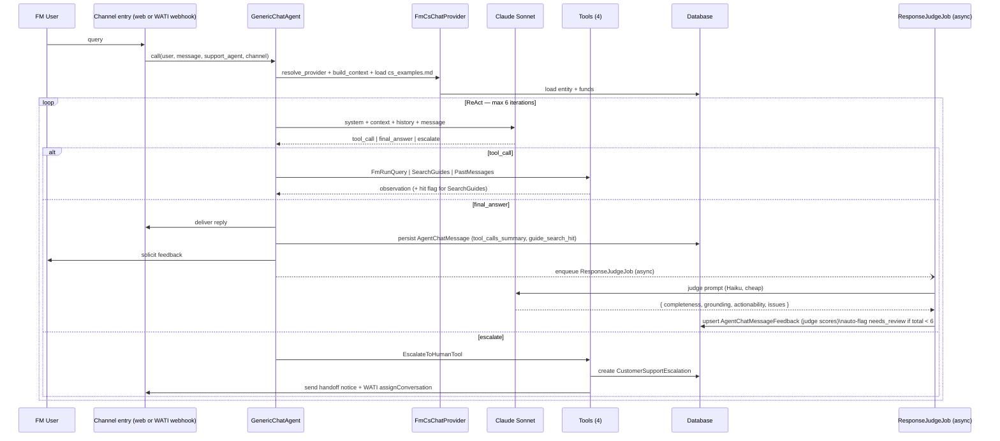
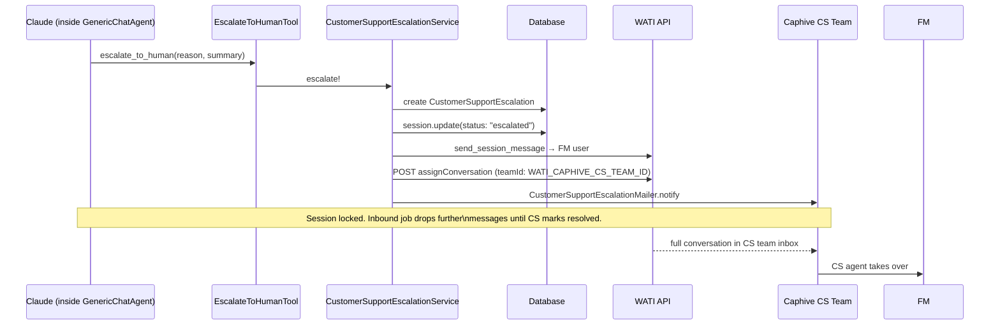

# PRD: Customer Support Agent (FM Edition)

**Status:** Draft  
**Author:** Product  
**Date:** 2026-06-05

---

## Contents

1. [Problem Statement](#1-problem-statement)
2. [Goals & Success Metrics](#2-goals--success-metrics)
3. [Who It's For](#3-who-its-for)
4. [Agent Capabilities](#4-agent-capabilities)
5. [Channels](#5-channels)
6. [Response Rating UX](#6-response-rating-ux)
7. [Escalation](#7-escalation)
8. [Continuous Improvement System](#8-continuous-improvement-system)
9. [Permissions](#9-permissions)
10. [Non-Goals](#10-non-goals)
11. [Open Questions](#11-open-questions)

— *Implementation* —

12. [What Already Exists](#12-what-already-exists)
13. [Architecture](#13-architecture)
14. [New Components](#14-new-components)
15. [Data Model Changes](#15-data-model-changes)
16. [GenericChatAgent Changes](#16-genericchatagent-changes)
17. [Escalation Flow Detail](#17-escalation-flow-detail)
18. [Implementation Plan](#18-implementation-plan)

---

# Part 1 — Requirements & Outcomes

---

## 1. Problem Statement

Fund Manager (FM) admins and ops users contact Caphive's Customer Success team via WhatsApp and email when they have questions about the platform. A large share are answerable without a human:

| Pattern | Example |
| :--- | :--- |
| How-to / workflow | "How do I send a capital call notice?" |
| Entity data status | "Why is Investor X still showing KYC incomplete?" |
| Compound | "The investor says they uploaded their PAN — why are they still blocked?" |
| History | "Did we already send the drawdown notice for Fund II?" |

Routing these through a human adds unnecessary latency, consumes CS bandwidth, and gives FM users a worse experience than the question warrants.

---

## 2. Goals & Success Metrics

### Goals

1. FM users get an accurate, actionable answer to support queries **without waiting for a human** — via WhatsApp or the web app.
2. The agent draws on three sources to compose its answer: Caphive User Guides, the FM's live entity data, and prior conversation history.
3. Queries the agent cannot resolve are handed off to the Caphive CS team with full context, without the FM user having to repeat themselves.
4. Every response is quality-scored automatically — regardless of whether the user leaves feedback — so regressions are caught before users notice them.
5. The User Guides and example library improve continuously based on signal from both users and the automated judge, with a verified fix loop.

### Definition of "Resolved"

A query is **resolved** when: the agent produced a `final_answer` (not an escalation) **and** at least one of: (a) the user gave positive feedback, (b) the user sent no follow-up question within 10 minutes, or (c) the automated judge scored completeness ≥ 2 and grounding ≥ 2. A query is **unresolved** if it escalated, the user gave negative feedback, or the judge flagged it.

This definition is what drives the self-resolution rate metric — not merely "the agent replied without escalating."

### Success Metrics (Phase 1, first 60 days)

| Metric | Target |
| :--- | :--- |
| Self-resolution rate (as defined above) | ≥ 70% |
| User-rated positive feedback rate | ≥ 80% of rated responses |
| Automated judge score ≥ 6/9 | ≥ 85% of all responses |
| Guide search hit rate (≥ 1 passage found) | ≥ 80% of how-to queries |
| Guide gap items acted on weekly | ≥ 80% of no-hit query clusters |
| Median response time (WhatsApp) | < 30 seconds end-to-end |
| Median response time (Web) | < 15 seconds end-to-end |
| Escalations reviewed within SLA | 100% within 4 business hours |
| Golden test set pass rate before deploy | 100% |

---

## 3. Who It's For

**Primary users:** Fund Manager admins, ops managers, and ops users — i.e. anyone with an FM-side Caphive account. Not LPs (investors).

**Support team:** Caphive's own Customer Success team. They see escalated conversations in their WATI team inbox and own the feedback review queue.

---

## 4. Agent Capabilities

The agent answers questions by combining three data sources. It always decides which sources to consult — the user never has to specify.

### Source 1 — User Guides

Caphive platform documentation (markdown files). The agent greps these to answer how-to and workflow questions. Examples of what it can answer:

- "How do I add a co-investor?"
- "What documents are required for KYC approval?"
- "How does the drawdown notice get sent?"
- "What does 'pending approval' status mean on a document?"

### Source 2 — Entity Data

The FM's live data in the Caphive database — investors, KYC statuses, capital calls, commitments, distributions, documents, notifications, WhatsApp logs. The agent queries this to answer account-status questions. Examples:

- "Why is Investor X still showing KYC incomplete?" → queries `investor_kycs` for that entity.
- "Has the drawdown notice for Fund II been sent?" → queries `whatsapp_logs` + `noticed_notifications`.
- "How much is uncalled for Acme Capital?" → queries `capital_commitments`.
- "What documents are still pending approval for the May capital call?" → queries `documents`.

All queries are automatically scoped to the FM's entity. The agent cannot access another entity's data.

### Source 3 — Conversation History

The FM user's prior support conversations. The agent uses this when the user references something that happened "before" or "last week", or when a question was partially addressed in a previous session. This prevents the user from having to repeat context the agent has already heard.

### Chaining (ReAct loop)

For compound queries the agent chains sources in multiple steps — e.g. check the User Guide definition of "KYC complete", then query the DB for the investor's actual status, then compare. The loop runs up to six reasoning steps. If it cannot reach a confident answer after six steps, it escalates automatically.

### Out-of-scope behaviour

If the query is outside the agent's three sources — e.g. billing questions, platform outages, "can you email this investor", general knowledge questions — the agent replies with a short, honest decline and offers to escalate:

> "That's outside what I can look up directly. I can connect you to the Caphive support team if you'd like — just say 'escalate'."

The agent must not attempt a tool call, must not hallucinate an answer, and must not pretend the question is answerable when it isn't. Out-of-scope queries are tracked separately and reviewed weekly; if a pattern emerges (e.g. five users asking about billing in a week), that's a signal to either add guide coverage or add a new tool intent.

### Response quality standard

A good response meets all three criteria:
- **Complete** — answers the full question, including sub-questions implied by context.
- **Grounded** — every factual claim is traceable to a tool result (guide passage or DB row). No fabricated data.
- **Actionable** — tells the user what to do next, not just what the current state is.

These are the criteria the automated judge uses. They also serve as acceptance criteria for QA.

---

## 5. Channels

The agent is available on **two channels**. Both deliver the same answer quality; the channels differ only in delivery and formatting.

### Web (in-app)

Accessible via the existing floating chat panel in the FM dashboard. Response is formatted as Markdown (tables, numbered lists, code). Feedback is collected via thumbs-up / thumbs-down buttons shown below each assistant reply, with an optional free-text note.

### WhatsApp (WATI)

FM users send a WhatsApp message to the Caphive support number. The agent replies within ~30 seconds. Response is formatted as plain text (no Markdown). After each reply, the agent sends a follow-up prompt: *"Was this helpful? Reply YES or NO."* The YES/NO reply is recorded as feedback.

Both channels share the same conversation history. An FM user can start on WhatsApp and continue on the web (or vice versa) in the same logical session.

---

## 6. Response Rating UX

Every agent reply must be ratable by the GP user. Rating is voluntary but always offered. The rating UX is channel-specific.

### 6.1 Web — Rating inline below each reply

A compact rating row appears directly below every assistant message bubble. It is shown once and persists until the user rates (or starts a new question).

```
┌──────────────────────────────────────────────────────────────────────┐
│ 🤖  Investor X (Acme Capital) is missing two fields: PAN card and    │
│     address proof. Go to Settings → Investors → Acme Capital → KYC  │
│     to request re-submission. The investor re-submits via their      │
│     portal login.                                                    │
├──────────────────────────────────────────────────────────────────────┤
│  Was this helpful?   👍 Yes    👎 No                                 │
└──────────────────────────────────────────────────────────────────────┘
```

**After clicking 👎 (Not helpful)** — an optional note field expands inline:

```
┌──────────────────────────────────────────────────────────────────────┐
│ 🤖  Investor X (Acme Capital) is missing two fields...               │
├──────────────────────────────────────────────────────────────────────┤
│  👎  What was missing or wrong? (optional)                           │
│  ┌──────────────────────────────────────────────────────────────┐    │
│  │                                                              │    │
│  └──────────────────────────────────────────────────────────────┘    │
│  [ Send feedback ]   [ Skip ]                                        │
└──────────────────────────────────────────────────────────────────────┘
```

**After submitting** — the row collapses to a small confirmation, and the rating is locked:

```
├──────────────────────────────────────────────────────────────────────┤
│  👎 Feedback sent — thank you.                                       │
└──────────────────────────────────────────────────────────────────────┘
```

**After clicking 👍 (Helpful)** — immediate confirmation, no note required:

```
├──────────────────────────────────────────────────────────────────────┤
│  👍 Got it — glad that helped.                                       │
└──────────────────────────────────────────────────────────────────────┘
```

**Rules:**
- Rating is per assistant message, not per session.
- A user can only rate once per message (no changing after submit).
- The rating row is hidden if the message was an escalation notice (nothing to rate).
- Rating is available for up to 24 hours after the message (after that the row is hidden).

---

### 6.2 WhatsApp — Two-turn rating flow

The rating interaction is a short two-turn exchange appended after the agent's reply. It does not interrupt the conversation — the GP can ignore it and ask a new question at any point.

**Turn 1 — Rating prompt** (sent automatically 3 seconds after the agent reply):

```
Was this helpful?
Reply YES ✅ or NO ❌
(or ask your next question to skip)
```

**If the GP replies YES:**

```
👍 Thanks — glad that helped!
```
→ Feedback recorded as `positive`. No further prompt.

**If the GP replies NO — Turn 2 — optional note prompt:**

```
Got it. What was missing or wrong?
Reply with your note, or SKIP to skip.
```

**If the GP sends a note:**
```
Thanks for the feedback — we'll improve this. 👍
```
→ Feedback recorded as `negative` with the note text.

**If the GP replies SKIP (or ignores Turn 2 and asks a new question):**
→ Feedback recorded as `negative` with no note. The new question is processed normally.

**Expiry:** The two-turn rating window expires 10 minutes after the Turn 1 prompt is sent. After that, any inbound message is treated as a new query, not a feedback reply.

**State machine for pending WhatsApp feedback:**

```
[AWAITING_RATING]    ← set when Turn 1 prompt is sent
      |
      ├── YES → record positive → [DONE]
      ├── NO  → send Turn 2 prompt → [AWAITING_NOTE]
      └── other text / timeout → treat as new query → [DONE]

[AWAITING_NOTE]
      ├── SKIP         → record negative (no note) → [DONE]
      ├── other text   → record negative + note → [DONE]
      └── timeout 10m  → record negative (no note) → [DONE]
```

The current state is stored in `agent_chat_messages.feedback_prompt_state` (new column: `nil` / `awaiting_rating` / `awaiting_note` / `done`). `WatiInboundController` reads this to route the inbound message to `CustomerSupportFeedbackJob` or `CustomerSupportInboundJob`.

---

### 6.3 Shared behaviour

- Both channels feed into the same `agent_chat_message_feedbacks` table.
- A message rated on one channel cannot be re-rated on the other.
- The LLM-as-judge runs independently regardless of whether the GP rates — it is not a substitute for GP feedback, but a complement.
- Ratings and judge scores are both shown in the feedback review dashboard (Section 8).

---

## 7. Escalation

### When the agent escalates

| Trigger | Condition |
| :--- | :--- |
| Customer-requested | User message matches "human / agent / escalate / speak to / help me" |
| Low confidence | Agent cannot give a high-confidence answer after exhausting tools |
| Complex / access issue | Issue requires Caphive infrastructure access (billing, admin config, environment) |
| Max iterations | Loop reaches six reasoning steps without resolution |

### What happens on escalation

1. The agent sends the user a message: *"Connecting you to the Caphive support team. Someone will be in touch shortly."*
2. The conversation is assigned to the Caphive CS team inbox on WATI.
3. The Caphive CS team receives an email with: entity name, user name, escalation reason, a 2-sentence LLM-generated summary, and a link to the full conversation.
4. The agent stops auto-replying. All subsequent messages from the FM user go directly to the CS team via WATI.
5. Once CS resolves the issue they mark the conversation resolved; the agent can then handle new messages from that user again.

---

## 8. Continuous Improvement System

User feedback is a lagging, low-coverage signal — most users don't rate, and a quietly wrong answer that goes unrated registers as no signal at all. The improvement system has four layers that together cover every response, not just the ones users notice.

---

### Layer 1 — User Feedback (lagging signal, high trust)

Every agent response solicits a rating:
- **Web:** thumbs-up / thumbs-down buttons below each assistant turn, with an optional free-text note.
- **WhatsApp:** follow-up message sent 3 seconds after the reply: *"Was this helpful? Reply YES or NO."* The response is captured as feedback. Users can ignore it.

Negative feedback sets `status = needs_review` in the feedback queue. Positive feedback from a response that matches a guide hit updates that guide's `last_positive_hit_at` timestamp (used to detect stale guides that haven't been validated recently).

---

### Layer 2 — LLM-as-Judge (leading signal, 100% coverage)

After every `final_answer`, `GenericChatAgent` enqueues `ResponseJudgeJob` asynchronously. The job makes a second lightweight LLM call that scores the response before the user has a chance to rate it:

```
Given:
  - User question
  - Tool calls made + results returned
  - Agent reply

Score on three dimensions (0–3 each):
  completeness  — does it answer the full question including implied sub-questions?
  grounding     — is every claim traceable to a tool result?
  actionability — does it tell the user what to do next?

Return: { completeness: N, grounding: N, actionability: N, issues: ["..."] }
```

Scores are stored on the `agent_chat_message_feedbacks` row (or created if the user hasn't rated yet). Responses scoring below **6/9 total** are auto-flagged `needs_review` — no user rating required. This catches wrong or incomplete answers on responses users simply ignore.

Judge scores also enable regression detection: if the rolling 7-day average score drops after a guide edit or system prompt change, the dashboard shows a quality regression alert.

---

### Layer 3 — Guide Gap Tracking (proactive, structural)

Every call to `SearchUserGuidesTool` records whether it returned at least one passage (`guide_search_hit = true/false`) on `agent_chat_messages`. Weekly, a background job clusters all `guide_search_hit = false` messages by keyword and produces a ranked **guide gap report**:

```
Week of 2026-06-02 — Guide Gap Report
──────────────────────────────────────
 17 queries  →  "co-investor"          (no guide match)
 11 queries  →  "waterfall distribution"
  8 queries  →  "email template"
  5 queries  →  "bulk upload investors"
```

This drives proactive guide work — not just fixing broken answers but filling blank spots before users complain. The CS team reviews the gap report weekly and assigns guide sections to write. Target: ≥ 80% of repeated no-hit clusters have a guide update within 2 weeks.

---

### Layer 4 — Few-Shot Example Library (quality anchor)

The system prompt loads a curated example file at request time:

```
docs/user_guides/cs_examples.md
```

This file contains 10–20 canonical question → ideal answer pairs, maintained by the CS team. Examples set the tone, format, depth, and actionability standard without prompt engineering rules. When the LLM sees a query similar to an example, it mimics the example's structure. New examples are added from: (a) positive-feedback responses on common queries, (b) responses CS would have written themselves for escalated tickets.

The CS team edits this file directly — no code change or deploy required. The file is loaded fresh on each request.

Example entry format:
```markdown
## Q: Why is Investor X showing KYC incomplete?

**Good answer:**
Investor X (Acme Capital) is missing two fields: PAN card and address proof.
You can request re-submission from: Settings → Investors → Acme Capital → KYC.
The investor re-submits via their portal login. Once both fields are uploaded,
KYC status updates automatically within a few minutes.

**Why this is good:** names the specific missing fields from the DB, gives the
navigation path from the guide, tells the FM what the investor needs to do.
```

---

### Feedback Review Workflow (triage → fix → verify → resolve)

All items in `needs_review` status (from user feedback or judge auto-flag) appear in the **feedback review dashboard** at `/entities/:id/support_feedback`.

**Each item shows:**
- The user's original question
- The agent's full reply
- Which guide files were searched + which passages were returned (or "no match")
- Judge scores (completeness / grounding / actionability) with issue notes
- User rating + free-text note (if given)

**Reviewer actions:**

| Triage decision | Action |
| :--- | :--- |
| Guide incomplete / wrong | Edit `docs/user_guides/<file>.md` → commit → click Re-test |
| Guide missing entirely | Add new guide section or file → commit → click Re-test |
| Example needed | Add entry to `cs_examples.md` → commit → click Re-test |
| Tool limitation | File engineering issue; mark "pending engineering" |
| Answer was actually correct | Dismiss with note |

**Re-test button:** The review dashboard has a "Re-test" button on each item. It replays the original question through `GenericChatAgent` live and renders the new response inline — so the reviewer can verify the fix worked before marking resolved. This prevents fixing blind.

**Resolution:** Mark resolved with a required note describing what changed (e.g. *"Added PAN card re-submission steps to kyc_guide.md §3.2"*). Resolved items are retained for analytics but removed from the active queue.

---

### Golden Test Set (regression guard)

A file `docs/user_guides/test_cases.yml` (or a DB table) maintains 20–50 canonical question → expected answer pairs. Sources: past resolved tickets, positive-feedback responses on high-frequency queries.

Before any deploy that touches guide files, `cs_examples.md`, the system prompt, or tools, CI runs:

```
rake support_agent:run_test_cases
```

Each test case is run through `GenericChatAgent` and scored by the LLM judge. A test case **fails** if the judge score drops more than 1 point vs its recorded baseline. A failing test set blocks the deploy and requires the engineer to investigate. This is the only mechanism that catches regressions — without it, a guide edit that fixes one thing can silently break another.

Test cases are added by CS after resolving a feedback item (they record the now-correct answer as a test case). Over time the set grows to cover the most common and most error-prone queries.

---

## 9. Permissions

| Action | Super Admin | Entity Admin | CS Manager | FM Ops User |
| :--- | :---: | :---: | :---: | :---: |
| Use the chat agent (web + WhatsApp) | ✓ | ✓ | ✓ | ✓ |
| Submit feedback ratings | ✓ | ✓ | ✓ | ✓ |
| View feedback review queue | ✓ all | ✓ own entity | ✓ all | ✗ |
| Resolve / annotate feedback items | ✓ | ✓ own entity | ✓ | ✗ |
| View guide gap report | ✓ | ✓ own entity | ✓ | ✗ |
| Edit guide files / cs_examples.md | ✓ | ✗ | ✓ | ✗ |
| View judge scores | ✓ | ✓ own entity | ✓ | ✗ |
| Manage golden test set | ✓ | ✗ | ✓ | ✗ |
| View escalations | ✓ all | ✓ own entity | ✓ all | ✗ |
| Resolve escalations | ✓ | ✗ | ✓ | ✗ |
| Configure `CustomerSupportAgent` record | ✓ | ✓ own entity | ✗ | ✗ |

---

## 10. Non-Goals

- **Embeddings / vector search** — User Guides are grepped directly at runtime. No indexing pipeline.
- **Guide authoring UI** — guides and `cs_examples.md` are edited as markdown files and committed; the review dashboard links to the relevant file. A full in-app editor is a future consideration.
- **Automated guide writing** — the agent flags gaps and the LLM judge scores responses, but humans write guide content. No auto-generated guide sections in Phase 1.
- **Voice or email channel** — web chat and WhatsApp only.
- **Multi-language** — English only in Phase 1.
- **Ticket system integration** — escalations route to WATI team inbox + email; no Jira/Zendesk in Phase 1.
- **Proactive outreach** — the agent only responds to inbound messages.
- **LP-facing support** — LPs continue to use the LP Assistant; this agent is for FM users only.

---

## 11. Open Questions

| # | Question | Owner | Due |
| :--- | :--- | :--- | :--- |
| 1 | Does the current WATI plan include `assignConversation` (team inbox API)? What is the Caphive CS team ID? | Ops | Sprint 1 |
| 2 | Where do the FM-facing User Guides live today — `docs/user_guides/` in this repo, Notion, or a help site? | Product | Sprint 1 |
| 3 | Should the agent handle queries from all FM-role users, or only Admins and Managers? | Product | Sprint 1 |
| 4 | Should prior `WhatsappChatJob`-era message history (pre-`AgentChatMessage`) be searchable? | Engineering | Sprint 2 |
| 5 | WATI inbound webhook: what is the signature header and HMAC algorithm for verification? | Ops | Sprint 2 |
| 6 | Should the web chat show the feedback prompt inline after each reply, or only at end of session? | Product | Sprint 4 |
| 7 | Which model should the LLM-as-judge use? A cheaper/faster model (Haiku) is preferred to keep per-response cost low. | Engineering | Sprint 5 |
| 8 | Should the golden test set live as a YAML file in `docs/user_guides/` (version-controlled, editable by CS) or as a DB table (editable in-app)? | Product | Sprint 5 |

---

---

# Part 2 — Implementation

---

## 12. What Already Exists (Do Not Rebuild)

This feature is an extension of the LP Assistant stack. All of the following are reused unchanged:

| Component | Purpose |
| :--- | :--- |
| `GenericChatAgent` (Trailblazer, 5 steps) | ReAct loop engine — iterative tool use via RubyLLM |
| `BaseChatProvider` | Abstract provider: system prompt, context, tools |
| `ListSkillsTool`, `LoadSkillTool`, `DocumentUrlTool` | Existing LP tools (available if needed) |
| `AgentChatSession`, `AgentChatMessage` | Session and message persistence |
| `SupportAgentChatsController` | Web chat API endpoint |
| `_chat_panel.html.erb` + `agent_chat_controller.js` | Floating chat UI |
| `WhatsappGeneralNotification.send_session_message` | WATI outbound delivery |
| `EntitySetting#fetch_whatsapp_endpoint/token` | WATI credentials per entity |

`RunQueryTool` is **subclassed** (not modified) as `FmRunQueryTool` — wider table allowlist, no mandatory `{FUND_IDS}` guard.

The existing `WhatsappChatJob` (Langchain/OpenAI) is **not** extended — a new `CustomerSupportInboundJob` routes directly to `GenericChatAgent`.

---

## 13. Architecture

### Channel routing

```
WEB CHANNEL (existing route, unchanged)
─────────────────────────────────────────────────────────
FM browser
  → POST /support_agents/:id/chats
  → GenericChatAgent (channel: :web)
  → FmCsChatProvider
  → ctx[:reply] returned to controller → rendered in _chat_panel
  → thumbs UI → PATCH /support_agents/:id/chats/:message_id/feedback

WHATSAPP CHANNEL (new)
─────────────────────────────────────────────────────────
FM WhatsApp → WATI → POST /webhooks/wati/inbound
  → WatiInboundController (ACK 200 immediately)
  → CustomerSupportInboundJob (Sidekiq, queue: customer_support)
  → GenericChatAgent (channel: :whatsapp)
  → FmCsChatProvider
  → WhatsappGeneralNotification.send_session_message
  → [3s later] send feedback prompt "Was this helpful? YES / NO"
  → next YES/NO inbound → CustomerSupportFeedbackJob
```

### Sequence diagram



---

## 14. New Components

### 13.1 `FmCsChatProvider`

**Location:** `app/packs/ai/customer_support_agent/services/fm_cs_chat_provider.rb`

```ruby
class FmCsChatProvider < BaseChatProvider
  WEB_FORMAT = <<~FMT
    Format as Markdown. Use tables for multi-row data. Numbered lists for steps.
    Use `code` for field names or values.
  FMT

  WHATSAPP_FORMAT = <<~FMT
    Plain text only. No HTML, no Markdown, no asterisks.
    Numbered lists for steps. Newlines to separate items. Max 300 words.
  FMT

  EXAMPLES_FILE = Rails.root.join("docs/user_guides/cs_examples.md").freeze

  def system_prompt
    <<~PROMPT
      You are the Caphive Customer Support AI.
      Fund Manager: #{support_agent.entity&.name} (entity_id: #{support_agent.entity_id})
      User: #{analyst&.name} (#{analyst&.curr_role})
      Date: #{Date.current.strftime('%d %b %Y')}

      You help fund managers resolve questions about the Caphive platform and their
      entity's data: investors, KYC, capital calls, fund setup, notifications, documents.

      Tools:
        run_query(sql)                  — live entity data
        search_user_guides(query)       — grep Caphive documentation
        search_past_messages(query)     — this user's prior support history
        escalate_to_human(reason, summary)

      WORKFLOW:
      1. How-to / workflow → search_user_guides first.
      2. Data status → run_query; always WHERE entity_id IN ({ENTITY_ID}).
      3. Compound → chain guides then data.
      4. References "earlier" / "before" → search_past_messages.
      5. Out of scope (billing, outages, "send email") → decline politely, offer escalation.
      6. Escalate if: user asks for human; cannot answer after all tools;
         issue needs Caphive infrastructure access.

      A good response is complete (answers all implied sub-questions), grounded
      (every claim comes from a tool result), and actionable (tells the user what to do next).

      SQL: every query must include WHERE entity_id IN ({ENTITY_ID}). Never query other entities.
      #{whatsapp? ? WHATSAPP_FORMAT : WEB_FORMAT}
      #{strict_scope_prompt}
      #{load_examples}
    PROMPT
  end

  private

  def load_examples
    return "" unless EXAMPLES_FILE.exist?
    "\n## EXAMPLES OF GOOD RESPONSES\n\n#{EXAMPLES_FILE.read}"
  end

  def build_context
    entity = support_agent.entity
    funds  = Fund.where(entity_id: entity.id, deleted_at: nil).order(:name)
    [
      "## Entity: #{entity.name}  entity_id: #{entity.id}",
      "## Funds (#{funds.count})",
      *funds.map { |f| "- #{f.name} (fund_id: #{f.id}, currency: #{f.currency})" },
      "## User: #{analyst&.name}  Role: #{analyst&.curr_role}"
    ].join("\n")
  end

  def tools
    [
      FmRunQueryTool.new(entity_id: support_agent.entity_id),
      SearchUserGuidesTool.new,
      SearchPastMessagesTool.new(user: analyst),
      EscalateToHumanTool.new(user: analyst, entity: support_agent.entity,
                               session: current_session)
    ]
  end

  private

  def whatsapp?
    current_session&.channel == "whatsapp"
  end
end
```

Wire up: add `when "CustomerSupportAgent" then FmCsChatProvider` in `BaseChatProvider.resolve`.

---

### 13.2 `FmRunQueryTool`

Subclass of `RunQueryTool`. Drops the mandatory `{FUND_IDS}` requirement and adds FM-relevant tables.

```ruby
class FmRunQueryTool < RunQueryTool
  ALLOWED_TABLES = (RunQueryTool::ALLOWED_TABLES + %w[
    investor_kycs whatsapp_logs noticed_notifications investor_accesses
  ]).freeze

  def initialize(entity_id:)
    @entity_ids              = [entity_id.to_i]
    @accessible_fund_ids     = Fund.where(entity_id: entity_id, deleted_at: nil).pluck(:id)
    @accessible_investor_ids = []
  end

  private

  def validate(sql)
    error = super
    return nil if error == 'missing {FUND_IDS} placeholder — scope required.'
    error
  end
end
```

---

### 13.3 `SearchUserGuidesTool`

No table, no indexing, no embeddings — greps markdown files directly. Adding or editing a guide file takes effect immediately.

```ruby
class SearchUserGuidesTool < RubyLLM::Tool
  description "Search Caphive user guides and documentation. Use for how-to questions, " \
              "feature explanations, and platform workflow questions."

  param :query, type: :string, desc: "Keywords or question to search for", required: true

  GUIDES_DIR    = Rails.root.join("docs/user_guides").freeze
  CONTEXT_LINES = 8
  MAX_RESULTS   = 5
  STOP_WORDS    = %w[a an the is it in on at to for of and or how do i my your can
                     what when where why which please help me with].freeze

  def execute(query:)
    keywords = query.downcase.scan(/[a-z0-9]+/)
                    .reject { |w| STOP_WORDS.include?(w) || w.length < 3 }
                    .first(6)
    return "(no search terms found)" if keywords.empty?

    pattern = Regexp.new(keywords.map { |k| Regexp.escape(k) }.join("|"), Regexp::IGNORECASE)
    results = []

    Dir.glob("#{GUIDES_DIR}/**/*.md").sort.each do |path|
      break if results.size >= MAX_RESULTS
      lines = File.readlines(path, chomp: true)
      lines.each_with_index do |line, idx|
        next unless line.match?(pattern)
        ctx_start = [idx - CONTEXT_LINES / 2, 0].max
        ctx_end   = [idx + CONTEXT_LINES / 2, lines.size - 1].min
        context   = lines[ctx_start..ctx_end].join("\n")
        source    = Pathname.new(path).relative_path_from(GUIDES_DIR).to_s
        results << "--- #{source} ---\n#{context}"
        break  # one hit per file keeps results varied
      end
    end

    results.empty? ? "(no guide sections found for: #{keywords.join(', ')})" : results.join("\n\n")
  end
end
```

---

### 13.4 `SearchPastMessagesTool`

```ruby
class SearchPastMessagesTool < RubyLLM::Tool
  description "Search this user's past support conversations for prior context. " \
              "Use when the user references something from a prior session."

  param :query, type: :string, required: true
  param :limit, type: :integer, required: false

  def initialize(user:)
    super()
    @user = user
  end

  def execute(query:, limit: 5)
    terms = query.split.first(4)
    scope = AgentChatMessage
              .joins(:agent_chat_session)
              .where(agent_chat_sessions: { analyst_id: @user.id })
              .order(created_at: :desc)
              .limit(limit)

    scope = terms.reduce(scope) do |s, term|
      s.or(
        AgentChatMessage.joins(:agent_chat_session)
          .where(agent_chat_sessions: { analyst_id: @user.id })
          .where("agent_chat_messages.content LIKE ?", "%#{term}%")
      )
    end

    rows = scope.pluck(:role, :content, :created_at)
    return "(no matching past messages)" if rows.empty?

    rows.reverse.map { |role, content, at|
      "[#{at.strftime('%Y-%m-%d')} #{role}] #{content.to_s.truncate(200)}"
    }.join("\n")
  end
end
```

---

### 13.5 `EscalateToHumanTool`

```ruby
class EscalateToHumanTool < RubyLLM::Tool
  description "Escalate to Caphive's support team. Call when user asks for a human, " \
              "confidence is low after all tools, or issue requires Caphive infrastructure access."

  param :reason,  type: :string,
        desc: "customer_requested | low_confidence | complex_issue | max_iterations",
        required: true
  param :summary, type: :string, desc: "1-2 sentence issue summary for the CS agent", required: true

  def initialize(user:, entity:, session:)
    super()
    @user = user; @entity = entity; @session = session
  end

  def execute(reason:, summary:)
    CustomerSupportEscalationService.new(
      user: @user, entity: @entity, session: @session, reason:, summary:
    ).escalate!
    "Escalated. User has been notified that the Caphive support team will follow up."
  end
end
```

**`CustomerSupportEscalationService#escalate!` steps:**
1. Create `CustomerSupportEscalation`.
2. Set `agent_chat_session.status = "escalated"`.
3. Send user message via their active channel: *"Connecting you to the Caphive support team. Someone will be in touch shortly."*
4. `POST /api/v1/assignConversation` on WATI (`teamId` = `ENV["WATI_CAPHIVE_CS_TEAM_ID"]`).
5. Email `ENV["CAPHIVE_CS_EMAIL"]` with entity, user, reason, summary, conversation link.

---

### 13.6 WATI Inbound Webhook + Job

**Route:**
```ruby
post "/webhooks/wati/inbound", to: "webhooks/wati_inbound#create"
```

**Controller (`Webhooks::WatiInboundController`):**
```ruby
def create
  payload = JSON.parse(request.body.read)
  return head :ok unless payload["type"] == "text"

  phone, text, wati_id = payload["waId"], payload["text"]["body"], payload["id"]
  user = User.find_by_phone_with_call_code(phone)
  return head :ok unless user

  if pending_feedback?(user, text)
    CustomerSupportFeedbackJob.perform_later(user.id, text, wati_id)
  else
    return head :ok if AgentChatMessage.exists?(wati_message_id: wati_id)
    CustomerSupportInboundJob.perform_later(user.id, text, wati_id)
  end
  head :ok
end

def pending_feedback?(user, text)
  text.strip.match?(/\A(yes|no|skip)\z/i) &&
    AgentChatMessage.pending_feedback_for(user).exists?
end
```

**`CustomerSupportInboundJob`:**
```ruby
def perform(user_id, message, wati_message_id)
  user  = User.find(user_id)
  agent = SupportAgent.active.customer_support.for_entity(user.entity_id).first
  return unless agent

  session = AgentChatSession.current_for(user, agent)
  return if session&.escalated?   # drop — CS team has taken over

  WhatsappGeneralNotification.send_session_message(
    whatsapp_number: user.phone_with_call_code,
    message: agent.acknowledgment_message
  )

  GenericChatAgent.call(
    support_agent: agent, analyst: user,
    message:, channel: :whatsapp, wati_message_id:
  )
end
```

---

### 13.7 `ResponseJudgeJob`

**Location:** `app/packs/ai/customer_support_agent/jobs/response_judge_job.rb`

Runs asynchronously after every `final_answer`. Uses a cheaper model (Haiku) to keep per-response cost low. Creates or updates the `agent_chat_message_feedbacks` row.

```ruby
class ResponseJudgeJob < ApplicationJob
  queue_as :customer_support_judge
  sidekiq_options retry: 2

  JUDGE_PROMPT = <<~PROMPT
    You are a quality reviewer for a customer support AI.

    Score the following response on three dimensions (0 = poor, 1 = partial, 2 = good, 3 = excellent):
    - completeness: does it answer the full question including implied sub-questions?
    - grounding: is every factual claim traceable to the tool results provided?
    - actionability: does it tell the user what to do next, not just what the current state is?

    Respond with JSON only: {"completeness": N, "grounding": N, "actionability": N, "issues": ["..."]}
  PROMPT

  def perform(message_id)
    message = AgentChatMessage.find(message_id)
    summary = JSON.parse(message.tool_calls_summary || "{}")

    result = RubyLLM.chat(model: "claude-haiku-4-5-20251001")
               .with_instructions(JUDGE_PROMPT)
               .ask(build_judge_input(message, summary))

    scores = JSON.parse(result.content)
    total  = scores.values_at("completeness", "grounding", "actionability").sum

    feedback = AgentChatMessageFeedback.find_or_initialize_by(
      agent_chat_message_id: message_id
    )
    feedback.assign_attributes(
      judge_completeness:  scores["completeness"],
      judge_grounding:     scores["grounding"],
      judge_actionability: scores["actionability"],
      judge_total:         total,
      judge_issues:        scores["issues"].to_json,
      judge_ran_at:        Time.current,
      feedback_source:     feedback.rating? ? "both" : "judge"
    )
    # Auto-flag for review if score is below threshold
    feedback.status = "needs_review" if total < 6 && feedback.status == "open"
    feedback.save!
  end

  private

  def build_judge_input(message, summary)
    session    = message.agent_chat_session
    user_msg   = session.agent_chat_messages.where(role: "user")
                        .where("created_at < ?", message.created_at)
                        .order(:created_at).last
    tool_results = summary["tool_results"]&.map { |t| "#{t['tool']}: #{t['result']}" }&.join("\n")

    <<~INPUT
      USER QUESTION: #{user_msg&.content}

      TOOL RESULTS AVAILABLE TO THE AGENT:
      #{tool_results || "(no tool results)"}

      AGENT REPLY:
      #{message.content}
    INPUT
  end
end
```

---

### 13.8 `GuideGapReportJob`

**Location:** `app/packs/ai/customer_support_agent/jobs/guide_gap_report_job.rb`

Runs weekly (Sunday night). Clusters all `guide_search_hit = false` messages from the past 7 days by keyword and emails the gap report to `CAPHIVE_CS_EMAIL`.

```ruby
class GuideGapReportJob < ApplicationJob
  queue_as :customer_support_maintenance

  def perform
    no_hit_messages = AgentChatMessage
                        .where(guide_search_hit: false)
                        .where("created_at > ?", 1.week.ago)
                        .pluck(:content)

    return if no_hit_messages.empty?

    # Simple keyword frequency count — no LLM needed
    keyword_counts = Hash.new(0)
    no_hit_messages.each do |content|
      content.downcase.scan(/[a-z]{4,}/).each { |w| keyword_counts[w] += 1 }
    end

    top_gaps = keyword_counts
                 .sort_by { |_, count| -count }
                 .reject { |word, _| STOP_WORDS.include?(word) }
                 .first(20)

    GuideGapMailer.weekly_report(top_gaps, no_hit_messages.count).deliver_now
  end
end
```

Scheduled via `AgentSchedule` (existing infrastructure) or a Sidekiq cron entry. The gap report email links directly to the feedback review dashboard filtered to `guide_search_hit = false` for that week.

---

### 13.9 `SupportAgentTestRunner`

**Location:** `lib/tasks/support_agent.rake` (rake task) + `app/packs/ai/customer_support_agent/services/support_agent_test_runner.rb`

```ruby
# rake support_agent:run_test_cases
task run_test_cases: :environment do
  runner = SupportAgentTestRunner.new
  results = runner.run_all

  failures = results.select { |r| !r[:passed] }
  if failures.any?
    failures.each { |f| puts "FAIL: #{f[:question]}\n  scores: #{f[:scores]}\n  baseline: #{f[:baseline]}" }
    abort "#{failures.count} test case(s) failed — deploy blocked."
  else
    puts "All #{results.count} test cases passed."
  end
end
```

`SupportAgentTestRunner#run_all`:
1. Loads all `CsSupportTestCase` records (or reads `test_cases.yml`).
2. For each: runs `GenericChatAgent.call(question)` against the test `SupportAgent`.
3. Scores the response with `ResponseJudgeJob` logic (inline, not async).
4. Compares scores to `baseline_scores`. Fails if any dimension drops by > 1.
5. Updates `last_run_at` and `last_run_passed` on the test case record.

---

### 14.10 Rating UI — Web

**Endpoint:**
```ruby
# config/routes.rb (nested under support_agent_chats)
patch "/support_agents/:support_agent_id/chats/:id/feedback",
      to: "support_agent_chat_feedbacks#update"
```

**Controller (`SupportAgentChatFeedbacksController#update`):**
```ruby
def update
  message = AgentChatMessage.find(params[:id])
  authorize message, :rate?   # Pundit: user must own the session

  # Idempotency: once rated, locked
  return render json: { error: "already rated" }, status: :unprocessable_entity if message.rated?

  feedback = AgentChatMessageFeedback.find_or_initialize_by(
    agent_chat_message_id: message.id
  )
  feedback.assign_attributes(
    rating:         params[:rating],          # "positive" | "negative"
    notes:          params[:notes],
    channel:        "web",
    user_id:        current_user.id,
    entity_id:      current_user.entity_id,
    feedback_source: feedback.judge_ran_at? ? "both" : "user",
    status:         params[:rating] == "negative" ? "needs_review" : "open"
  )
  feedback.save!

  render json: { status: "recorded" }
end
```

**Stimulus controller** (`app/javascript/controllers/support_agent_rating_controller.js`):

```javascript
// Attached to each assistant message bubble.
// data-support-agent-rating-url-value = PATCH endpoint for this message
// data-support-agent-rating-message-id-value = message id

import { Controller } from "@hotwired/stimulus"

export default class extends Controller {
  static values = { url: String, messageId: String }
  static targets = ["buttons", "noteForm", "noteInput", "confirmation"]

  // GP clicks 👍
  ratePositive() {
    this.submit("positive", null)
  }

  // GP clicks 👎 — expand note form instead of submitting immediately
  rateNegative() {
    this.buttonsTarget.classList.add("hidden")
    this.noteFormTarget.classList.remove("hidden")
    this.noteInputTarget.focus()
  }

  // GP clicks "Send feedback" in the note form
  submitWithNote() {
    this.submit("negative", this.noteInputTarget.value.trim())
  }

  // GP clicks "Skip" in the note form
  skipNote() {
    this.submit("negative", null)
  }

  async submit(rating, notes) {
    const body = { rating }
    if (notes) body.notes = notes

    await fetch(this.urlValue, {
      method: "PATCH",
      headers: {
        "Content-Type": "application/json",
        "X-CSRF-Token": document.querySelector('meta[name="csrf-token"]').content
      },
      body: JSON.stringify(body)
    })

    this.showConfirmation(rating)
  }

  showConfirmation(rating) {
    this.buttonsTarget.classList.add("hidden")
    this.noteFormTarget.classList.add("hidden")
    this.confirmationTarget.classList.remove("hidden")
    this.confirmationTarget.textContent =
      rating === "positive"
        ? "👍 Got it — glad that helped."
        : "👎 Feedback sent — thank you."
  }
}
```

The rating row HTML is rendered inside the existing `_chat_panel` assistant message partial:

```erb
<%# app/packs/ai/support_agents/views/support_agents/_assistant_message.html.erb %>
<div data-controller="support-agent-rating"
     data-support-agent-rating-url-value="<%= support_agent_chat_feedback_path(support_agent, message) %>"
     data-support-agent-rating-message-id-value="<%= message.id %>">

  <div class="message-bubble assistant">
    <%= message.content_html %>
  </div>

  <% unless message.rated? || message.escalation_notice? %>
    <div class="rating-row">
      <span class="rating-label">Was this helpful?</span>
      <div data-support-agent-rating-target="buttons">
        <button data-action="support-agent-rating#ratePositive">👍 Yes</button>
        <button data-action="support-agent-rating#rateNegative">👎 No</button>
      </div>
      <div data-support-agent-rating-target="noteForm" class="hidden">
        <label>What was missing or wrong? (optional)</label>
        <textarea data-support-agent-rating-target="noteInput" rows="2"></textarea>
        <button data-action="support-agent-rating#submitWithNote">Send feedback</button>
        <button data-action="support-agent-rating#skipNote">Skip</button>
      </div>
      <div data-support-agent-rating-target="confirmation" class="hidden"></div>
    </div>
  <% end %>
</div>
```

---

### 14.11 Rating Flow — WhatsApp (`CustomerSupportFeedbackJob`)

**Location:** `app/packs/ai/customer_support_agent/jobs/customer_support_feedback_job.rb`

Handles inbound YES / NO / SKIP / note text from the GP. Uses `feedback_prompt_state` to know which turn is being processed.

```ruby
class CustomerSupportFeedbackJob < ApplicationJob
  queue_as :customer_support

  def perform(user_id, text, wati_message_id)
    user    = User.find(user_id)
    message = AgentChatMessage.pending_feedback_for(user)  # most recent awaiting_rating or awaiting_note
    return unless message

    case message.feedback_prompt_state
    when "awaiting_rating"
      handle_rating(user, message, text.strip.upcase)
    when "awaiting_note"
      handle_note(user, message, text.strip)
    end
  end

  private

  def handle_rating(user, message, reply)
    if reply == "YES"
      record_feedback(message, user, "positive", nil)
      send_wa(user, "👍 Got it — glad that helped!")
      message.update!(feedback_prompt_state: "done")
    elsif reply == "NO"
      send_wa(user, "Got it. What was missing or wrong?\nReply with your note, or SKIP to skip.")
      message.update!(feedback_prompt_state: "awaiting_note")
    else
      # Any other text → treat as new query; expire the feedback window
      message.update!(feedback_prompt_state: "done")
      CustomerSupportInboundJob.perform_later(user.id, reply, nil)
    end
  end

  def handle_note(user, message, text)
    note = text.upcase == "SKIP" ? nil : text
    record_feedback(message, user, "negative", note)
    send_wa(user, "Thanks for the feedback — we'll improve this. 👍")
    message.update!(feedback_prompt_state: "done")
  end

  def record_feedback(message, user, rating, notes)
    feedback = AgentChatMessageFeedback.find_or_initialize_by(
      agent_chat_message_id: message.id
    )
    feedback.assign_attributes(
      rating:,
      notes:,
      channel:        "whatsapp",
      user_id:        user.id,
      entity_id:      user.entity_id,
      feedback_source: feedback.judge_ran_at? ? "both" : "user",
      status:          rating == "negative" ? "needs_review" : "open"
    )
    feedback.save!
  end

  def send_wa(user, text)
    WhatsappGeneralNotification.send_session_message(
      whatsapp_number: user.phone_with_call_code,
      message: text
    )
  end
end
```

**`AgentChatMessage.pending_feedback_for(user)` scope:**
```ruby
scope :pending_feedback_for, ->(user) {
  joins(:agent_chat_session)
    .where(agent_chat_sessions: { analyst_id: user.id })
    .where(feedback_prompt_state: %w[awaiting_rating awaiting_note])
    .where("feedback_prompt_sent_at > ?", 10.minutes.ago)
    .order(created_at: :desc)
    .limit(1)
}
```

---

## 15. Data Model Changes

| Change | Type | Purpose |
| :--- | :--- | :--- |
| `agent_chat_sessions.status` | new column | `active` / `escalated` / `resolved` |
| `agent_chat_sessions.channel` | new column | `web` / `whatsapp` |
| `agent_chat_messages.wati_message_id` | new column (unique idx) | idempotency for WATI inbound |
| `agent_chat_messages.tool_calls_summary` | new column (JSON text) | tools called + guide files searched (drives feedback review and gap tracking) |
| `agent_chat_messages.guide_search_hit` | new boolean column | whether `SearchUserGuidesTool` returned ≥ 1 result (drives gap report) |
| `agent_chat_messages.feedback_prompt_sent_at` | new column | timestamp when WhatsApp Turn 1 prompt was sent |
| `agent_chat_messages.feedback_prompt_state` | new column | WhatsApp rating state machine: `nil` / `awaiting_rating` / `awaiting_note` / `done` |
| `agent_chat_message_feedbacks` | new table | user ratings + judge scores + review queue |
| `customer_support_escalations` | new table | escalation records |
| `cs_support_test_cases` | new table (or YAML) | golden test set for regression guard |

No `user_guide_chunks` table. No indexing task.

### `agent_chat_message_feedbacks` schema
```
id                      bigint PK
agent_chat_message_id   integer NOT NULL  → agent_chat_messages
agent_chat_session_id   integer NOT NULL  → agent_chat_sessions (denormalised)
user_id                 integer NOT NULL  → users
entity_id               integer NOT NULL  → entities
channel                 string            (web | whatsapp)

-- User feedback
rating                  string nullable   (positive | negative)
notes                   text nullable
feedback_source         string nullable   (user | judge | both)

-- LLM-as-judge scores (0–3 each)
judge_completeness      integer nullable
judge_grounding         integer nullable
judge_actionability     integer nullable
judge_total             integer nullable  (sum — computed)
judge_issues            text nullable     (JSON array of issue strings from judge)
judge_ran_at            datetime nullable

-- Review queue
status                  string DEFAULT "open"  (open | needs_review | resolved | dismissed | pending_engineering)
guide_files_searched    text nullable     (JSON array of source paths from SearchUserGuidesTool)
reviewed_by_id          integer nullable  → users
reviewed_at             datetime nullable
resolution_notes        text nullable

created_at / updated_at datetime
```

### `customer_support_escalations` schema
```
id                    bigint PK
agent_chat_session_id integer NOT NULL  → agent_chat_sessions
user_id               integer NOT NULL  → users
entity_id             integer NOT NULL  → entities
reason                string
summary               text
status                string DEFAULT "open"  (open | resolved | dismissed)
resolved_by_id        integer nullable   → users
resolved_at           datetime nullable
created_at / updated_at datetime
```

### `cs_support_test_cases` schema
```
id              bigint PK
question        text NOT NULL
expected_themes text          (JSON array — phrases/facts the answer must contain)
guide_files     text          (JSON — which guide files should be hit)
baseline_scores text          (JSON — { completeness, grounding, actionability } from last passing run)
last_run_at     datetime nullable
last_run_passed boolean nullable
added_by_id     integer NOT NULL  → users
created_at / updated_at datetime
```

---

## 16. `GenericChatAgent` Changes

Three targeted additions only:

```ruby
# Step: deliver_reply — channel-aware delivery + feedback prompt
def deliver_reply(ctx, **)
  if ctx[:session].channel == "whatsapp"
    WhatsappGeneralNotification.send_session_message(
      whatsapp_number: ctx[:analyst].phone_with_call_code,
      message:         ctx[:reply]
    )
    schedule_feedback_prompt(ctx)   # enqueues "Was this helpful? YES / NO" after 3s
  end
  # Web: ctx[:reply] returned to controller as before
end

# Step: persist_conversation — capture tool usage + guide hit + enqueue judge
def persist_conversation(ctx, **)
  # ... existing message persistence ...

  guide_hit = ctx[:tool_calls_summary]&.any? { |t|
    t["tool"] == "search_user_guides" && t["hit"] == true
  }

  ctx[:assistant_message].update!(
    tool_calls_summary: ctx[:tool_calls_summary].to_json,
    guide_search_hit:   guide_hit || false
  )

  # Enqueue async judge for every final_answer (CustomerSupportAgent only)
  if ctx[:support_agent].agent_type == "CustomerSupportAgent"
    ResponseJudgeJob.perform_later(ctx[:assistant_message].id)
  end
end
```

`BaseChatProvider.resolve` gets one new line: `when "CustomerSupportAgent" then FmCsChatProvider`.

`SearchUserGuidesTool#execute` sets a hit flag in its return value so `GenericChatAgent` can record it:

```ruby
# SearchUserGuidesTool — append hit metadata to return value
def execute(query:)
  # ... existing grep logic ...
  if results.empty?
    { hit: false, content: "(no guide sections found for: #{keywords.join(', ')})" }
  else
    { hit: true, content: results.join("\n\n") }
  end
end
```

---

## 17. Escalation Flow Detail



---

## 18. Implementation Plan

### Sprint 1 — Core tools + Web channel (4 days)

1. DB migrations: `agent_chat_sessions.status + channel`, `agent_chat_messages.wati_message_id` (unique idx), `agent_chat_messages.tool_calls_summary`.
2. `FmRunQueryTool`.
3. `SearchUserGuidesTool` (grep, no table).
4. `SearchPastMessagesTool`.
5. `FmCsChatProvider` + wire up in `BaseChatProvider.resolve`.
6. Add `"CustomerSupportAgent"` to `SupportAgent::AGENT_TYPES`.
7. Cucumber: web chat resolves compound query (guide grep + DB lookup chained).

### Sprint 2 — WhatsApp channel (3 days)

8. `WatiInboundController` + route + HMAC signature verification.
9. `CustomerSupportInboundJob` (acknowledgment + escalation guard).
10. `GenericChatAgent` WhatsApp delivery step.
11. Cucumber: WATI webhook → inbound job → reply via `send_session_message`.

### Sprint 3 — Escalation (2 days)

12. `customer_support_escalations` migration + model.
13. `EscalateToHumanTool` + `CustomerSupportEscalationService`.
14. `CustomerSupportEscalationMailer`.
15. Escalation guard in inbound job + web controller.
16. Cucumber: "talk to human" → escalation created → WATI assigned → session locked.

### Sprint 4 — Rating UX + feedback loop (4 days)

17. DB migrations: `agent_chat_message_feedbacks`, `agent_chat_messages.feedback_prompt_sent_at`, `agent_chat_messages.feedback_prompt_state`, `agent_chat_messages.guide_search_hit`.
18. `SupportAgentChatFeedbacksController` + route + Pundit policy.
19. `support_agent_rating_controller.js` (Stimulus) + rating row partial in `_assistant_message.html.erb`.
20. Web end-to-end: 👍 records positive, 👎 expands note form, submit/skip record negative.
21. WhatsApp: `GenericChatAgent` sends Turn 1 prompt 3s after reply; sets `feedback_prompt_state = awaiting_rating`.
22. `WatiInboundController#pending_feedback?` reads `feedback_prompt_state`; routes YES/NO/note to `CustomerSupportFeedbackJob`.
23. `CustomerSupportFeedbackJob`: full two-turn state machine (awaiting_rating → awaiting_note → done).
24. `AgentChatMessage.pending_feedback_for` scope with 10-min expiry.
25. `GenericChatAgent` captures `tool_calls_summary` + `guide_search_hit` in persist step.
26. Feedback review dashboard (`/entities/:id/support_feedback`): list, filter, triage actions, re-test button.
27. Cucumber: web 👎 + note → `needs_review`; WhatsApp NO + note → `needs_review`; both resolvable with annotation.

### Sprint 5 — Continuous improvement infrastructure (4 days)

24. `ResponseJudgeJob`: judge prompt, Haiku model call, score persistence, auto-flag logic.
25. `GuideGapReportJob` + `GuideGapMailer` + weekly Sidekiq cron schedule.
26. `cs_support_test_cases` migration + model.
27. `SupportAgentTestRunner` service + `rake support_agent:run_test_cases` task.
28. Seed initial golden test set (10 canonical questions) from existing escalation history.
29. Add `cs_examples.md` skeleton with 5 example Q&A pairs; wire into `FmCsChatProvider#load_examples`.
30. CI job: run test cases on any commit touching `docs/user_guides/` or `FmCsChatProvider`.
31. Judge score columns surfaced in feedback review dashboard (completeness / grounding / actionability badges).
32. Cucumber: `ResponseJudgeJob` scores a low-quality response → auto-flags → appears in review queue without user rating.

---

*Customer Support Agent PRD | Draft 2026-06-05*
