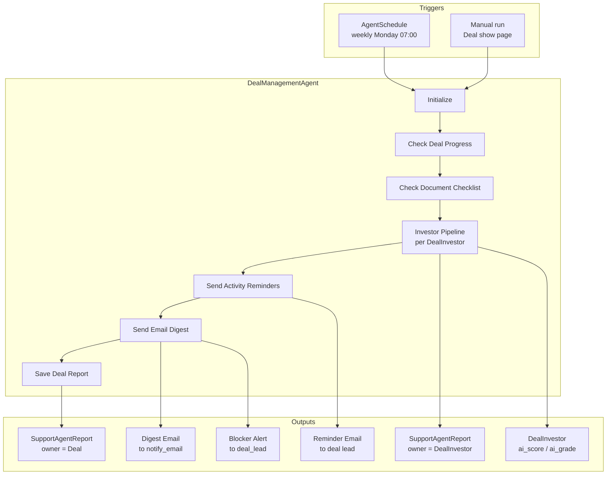
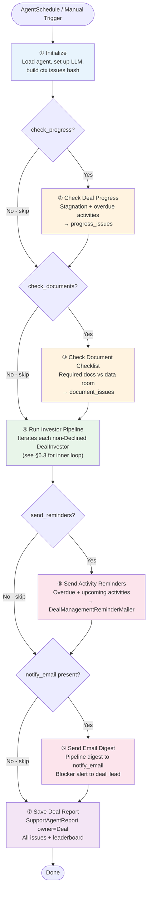
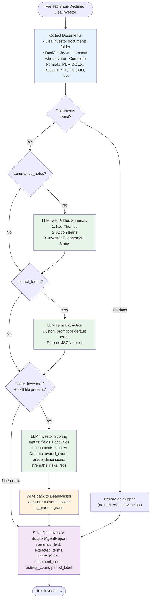
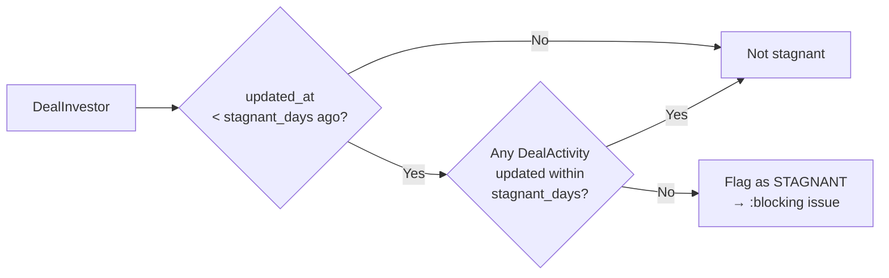
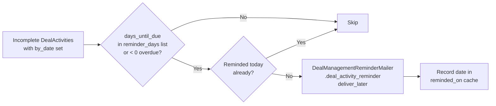
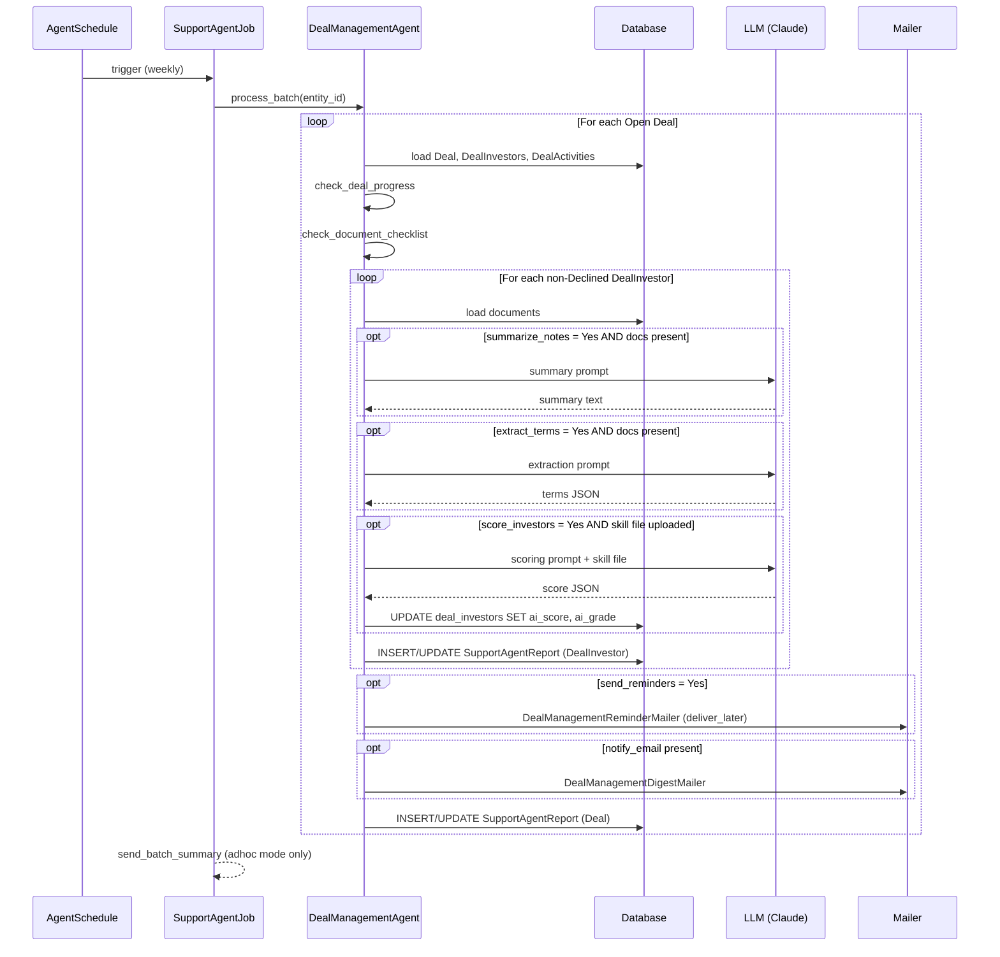
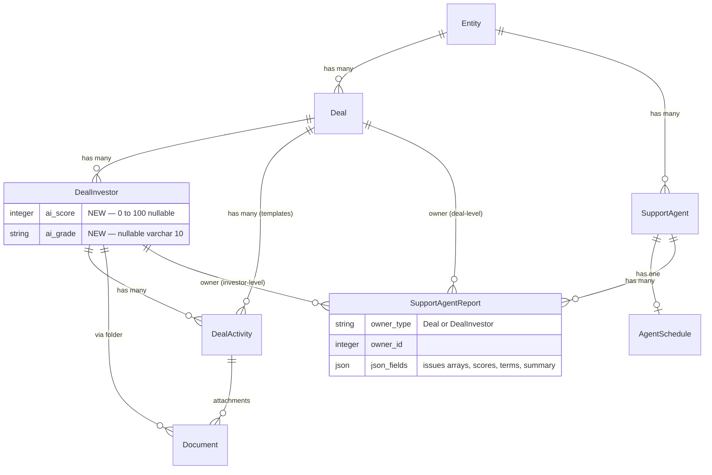
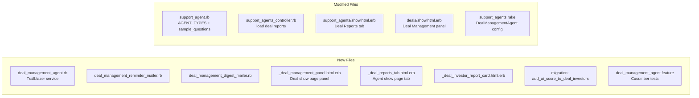

# PRD: Deal Management Agent

**Status:** Draft  
**Author:** Fund Operations  
**Date:** 2026-05-28

---

## TL;DR

`DealManagementAgent` is a single configurable support agent that monitors every open deal on a weekly schedule. It runs six independently-toggleable capabilities — progress monitoring, activity reminders, document checklist, investor note summarisation, deal term extraction, and LLM investor scoring — and produces two levels of report: one per **Deal** (pipeline summary) and one per **DealInvestor** (detail + score). It reuses all existing infrastructure (`SupportAgent`, `AgentSchedule`, `SupportAgentReport`) and requires one migration: adding `ai_score` / `ai_grade` to `deal_investors`.

---

## 1. Problem Statement

Deal execution involves tracking many moving parts simultaneously — investor steps, document checklists, deadlines, and scattered notes — across potentially dozens of open deals. Today teams rely on manual reviews to catch stalled investors, overdue activities, missing documents, and key deal terms buried in uploaded files. This creates:

- **Stagnation blind spots** — investors sitting in the same step for weeks go unnoticed until a quarterly review.
- **Missed reminders** — the `notify_investor` / `notify_employees` flags on `DealActivity` are set but never automatically acted upon.
- **Document gaps** — there is no automated check confirming NDAs, term sheets, and financials have been uploaded before a deal advances.
- **Unstructured knowledge** — deal terms, investor interaction notes, and document summaries live in disparate places with no LLM-assisted synthesis.
- **No investor ranking** — deal leads have no objective, data-driven signal for which investors to prioritise or which are at risk of dropping out.

---

## 2. Solution

**DealManagementAgent** — a configurable, multi-capability support agent that runs per open deal. It orchestrates six toggleable capabilities under a single agent instance, all controlled via `json_fields`:

```
┌─────────────────────────────── DealManagementAgent ───────────────────────────────┐
│                                                                                    │
│  ① Deal Progress      Flag stagnant investors + overdue steps                     │
│  ② Activity Reminders Email deal lead when steps are overdue or coming due        │
│  ③ Document Checklist Verify required docs are in the data room                   │
│  ④ Note Summary       LLM summary of investor docs + activity attachments         │
│  ⑤ Term Extraction    LLM extracts deal terms from data room using custom prompt  │
│  ⑥ Investor Scoring   LLM scores each investor 0–100 using a skill-file rubric   │
│                                                                                    │
│  Each capability is independently toggled via json_fields on the agent.           │
└────────────────────────────────────────────────────────────────────────────────────┘
```

An entity can deploy one agent instance covering all six capabilities, or separate instances each covering a subset, using the same agent type.

### System Context



---

## 3. Goals

| Goal | Success Metric |
|---|---|
| Surface stagnant deals before they become lost deals | 100% of deals stagnant beyond the configured threshold appear in the digest email |
| Eliminate manual reminder sending for overdue steps | Deal leads receive automated reminders on configured days without any manual action |
| Ensure document completeness before deal advancement | Missing required docs flagged in the report before a deal moves to next stage |
| Reduce time-to-briefing before investor meetings | Deal lead can read a per-investor doc summary instead of opening each file |
| Capture deal terms without manual re-entry | Extracted terms visible in the agent report within minutes of running |
| Provide objective investor prioritisation | `ai_score` on each `DealInvestor` gives a data-backed ranking within the deal |
| Zero new scheduling infrastructure | Reuses `SupportAgent`, `AgentSchedule`, `SupportAgentReport` unchanged |

---

## 4. Out of Scope (v1)

- Writing extracted terms back as `Deal` or `DealInvestor` custom fields (stored in the report only).
- Scoring dimensions configurable without editing the skill file (embedded in the skill prompt).
- Investor-facing notifications (only deal lead is notified in v1).
- Chat interface for querying deal status.
- Closed deals (`status = "Open"` only).
- Cross-deal portfolio-level analytics.
- Automatic advancement of deal steps based on agent findings.

---

## 5. User Stories

| Persona | Story |
|---|---|
| Fund Manager | Receive a weekly email showing which deals have stagnant investors or overdue steps, so I can intervene before a deal goes cold. |
| Deal Lead | Be alerted the day before and on the day an investor's deal step is due, so I can follow up without manually tracking deadlines. |
| Operations Admin | Configure which documents are required in the data room (e.g. signed NDA, term sheet, financial model) and receive a report showing which are missing. |
| Analyst | Get a per-investor summary of all documents and activity notes so I can brief my manager on any investor's status in under 5 minutes. |
| Deal Manager | Have the agent extract key terms (valuation, equity %, board seats, pro-rata rights) from data room documents, so I don't have to read every file manually. |
| Deal Lead | Have each investor automatically scored against a rubric I define in a skill file, producing an overall score, grade, and dimension breakdown, so I can prioritise which investors to focus on. |

---

## 6. Functional Requirements

### 6.1 Agent Configuration

> **Summary:** 14 `json_fields` keys control the agent. Each capability has its own toggle (Yes/No). LLM-heavy capabilities have additional tuning fields. The `scoring_skill_file` is a File upload identical in pattern to `PortfolioScoringAgent`.

**FormType:** `SupportAgent / DealManagementAgent`

```
┌─── Capability Group ─────────────────┬──── Fields ───────────────────────────────────┐
│ Deal Progress                         │ check_progress (Y/N), stagnant_days (#)        │
│ Activity Reminders                    │ send_reminders (Y/N), reminder_days (CSV)      │
│                                       │ alert_deal_lead (Y/N)                          │
│ Document Checklist                    │ check_documents (Y/N), required_docs (CSV)     │
│ Note & Doc Summary                    │ summarize_notes (Y/N), note_period (M/Q)       │
│ Term Extraction                       │ extract_terms (Y/N), term_extraction_prompt    │
│ Investor Scoring                      │ score_investors (Y/N), scoring_skill_file (F)  │
│                                       │ min_points_per_section (#)                     │
│ Notifications                         │ notify_email (text)                            │
└───────────────────────────────────────┴────────────────────────────────────────────────┘
```

Full field reference:

| Field | Type | Default | Description |
|-------|------|---------|-------------|
| `check_progress` | Select (Yes/No) | Yes | Enable stagnation monitoring and overdue activity detection. |
| `stagnant_days` | NumberField | `7` | Days without any update on `DealInvestor` **or** linked `DealActivity` before flagging stagnant. |
| `send_reminders` | Select (Yes/No) | Yes | Email deal lead when activities are overdue or within the reminder window. |
| `reminder_days` | TextField | `7,3,1` | Comma-separated day offsets before `by_date`. `0` = on due date. Negative = overdue. |
| `check_documents` | Select (Yes/No) | Yes | Verify required documents exist in the deal data room. |
| `required_docs` | TextField | _(blank)_ | Comma-separated document names to check (e.g. `NDA, Term Sheet, Financial Model`). Blank = no check. |
| `summarize_notes` | Select (Yes/No) | Yes | LLM summary of each investor's documents folder + completed DealActivity attachments. |
| `note_period` | Select (Month/Quarter) | Quarter | Lookback window for document and activity collection. |
| `extract_terms` | Select (Yes/No) | Yes | Extract structured deal terms from data room documents. |
| `term_extraction_prompt` | TextField | _(blank)_ | Custom extraction instructions. Blank = default common deal terms (see §6.7). |
| `notify_email` | TextField | _(blank)_ | Email address for the regular pipeline digest (sent after every scheduled run). |
| `alert_deal_lead` | Select (Yes/No) | Yes | Targeted alert to `deal_lead` email when blocking issues are found. |
| `score_investors` | Select (Yes/No) | No | Enable LLM scoring of each `DealInvestor`. Off by default — requires a skill file upload. |
| `scoring_skill_file` | File | _(blank)_ | Markdown skill prompt defining scoring dimensions, rubric, and weighting. Same pattern as `PortfolioScoringAgent`. |
| `min_points_per_section` | NumberField | `3` | Minimum positives and concerns required per scoring dimension. |

---

### 6.2 Execution Pipeline

> **Summary:** Seven sequential Trailblazer steps. Steps 2–6 are conditionally skipped based on config flags. All steps return `true` so the pipeline always reaches step 7 (Save Deal Report) even when earlier steps error.



| Step | Class method | Toggle field | Always runs? |
|---|---|---|---|
| ① Initialize | `initialize_agent` | — | Yes |
| ② Check Deal Progress | `check_deal_progress` | `check_progress` | No |
| ③ Check Document Checklist | `check_document_checklist` | `check_documents` | No |
| ④ Run Investor Pipeline | `run_investor_pipeline` | — | Yes |
| ⑤ Send Activity Reminders | `send_activity_reminders` | `send_reminders` | No |
| ⑥ Send Email Digest | `send_email_digest` | `notify_email` present | No |
| ⑦ Save Deal Report | `generate_progress_reports` | — | Yes |

---

### 6.3 Investor Pipeline (Inner Loop — Step ④)

> **Summary:** For each non-Declined `DealInvestor`, the agent collects documents, then conditionally summarises, extracts terms, and scores using the LLM. Each investor gets its own `SupportAgentReport`. One investor failing does not block the next.



**Document collection sources:**

| Source | Condition |
|---|---|
| `DealInvestor` documents folder | Always included |
| `DealActivity` attachments | Only where `status = Complete` and `deal_investor_id` matches |

**Supported document formats:** PDF, DOCX, XLSX, XLS, PPTX, PPT, TXT, MD, CSV — same `read_document_text` / `extract_text_from_file` pipeline as `PortfolioScoringAgent`.

---

### 6.4 Stagnation Check Logic

> **Summary:** Uses a stricter "both signals absent" criterion compared to the existing `DealInvestor#stagnant?` method. Both the investor record and its activities must be idle.



A `DealInvestor` is flagged stagnant only when **both** conditions are true:
- `deal_investor.updated_at < stagnant_days.days.ago`
- No linked `DealActivity` has `updated_at` within `stagnant_days`

---

### 6.5 Activity Reminder Logic

> **Summary:** Scans incomplete activities for due-date proximity. Deduplicates within a calendar day. Only the deal lead receives reminders in v1.



- `days_until_due = (activity.by_date - Date.today).to_i`
- Idempotency key: `"#{activity.id}:#{Date.today}"` stored in report `json_fields["reminded_on"]`
- Only deal lead receives reminders in v1

---

### 6.6 Document Checklist Logic

- Required document names matched **case-sensitively** against `Document#name` in `deal.deal_documents_folder`
- Missing document → `:blocking` severity issue
- Present document → `:success` severity issue
- Blank `required_docs` → step records one `:success` info message and exits (no check performed)

---

### 6.7 LLM Prompt Contracts

> **Summary:** Three distinct LLM calls are possible per investor. All are soft-fail — errors are recorded in issues but never crash the pipeline.

**① Investor Note & Document Summary**

```
System: You are a deal manager's assistant.

Below are documents and activity notes for investor {investor_name}
in deal {deal_name} ({period}).

Summarize into three sections:
1. Key Themes — recurring discussion points and developments (bullet points)
2. Action Items — specific follow-ups or commitments identified
   (bullet points, or "None identified")
3. Investor Engagement — one of: Actively Engaged / In Progress / Stalled,
   with one sentence of justification

Rules: Be concise. Do not invent information not present in the documents.
Plain prose — no markdown code fences.

=== DOCUMENTS ===
{formatted_document_text}
```

**② Deal Term Extraction (with custom prompt)**

```
System: You are a deal analyst. Extract the following information from the
documents below.

{term_extraction_prompt}

Return ONLY a JSON object. Use null for any field not found. No explanation.

=== DOCUMENTS ===
{formatted_document_text}
```

**② Deal Term Extraction (default, when `term_extraction_prompt` is blank)**

```
Extract the following common deal terms (use null if not present):
pre_money_valuation, post_money_valuation, equity_percentage,
investment_amount, instrument_type, closing_date, board_seats,
pro_rata_rights, anti_dilution, rofr, drag_along, lock_up_period
```

**③ Investor Scoring**

```
{scoring_skill_file content — full markdown rubric}

---

Score the following deal investor. Use all available data below.

Investor: {investor_name}
Deal: {deal_name}

## Investor Details
{status, tier, primary_amount, source, tags, health_score}

## Activity Completion History
{title, status, by_date, completed_at, days_overdue per activity}

## Documents
{formatted_document_text}

## Notes
{deal_investor.notes plain text}

---

Return your assessment as a single JSON object. Required keys:
- overall_score: integer 0–100
- grade: string (e.g. "B+")
- summary: string narrative
- dimensions: array of {name, score, weight, rationale, positives[], concerns[]}
  * positives: ≥ {min_points} specific data-backed positive signals
  * concerns:  ≥ {min_points} specific data-backed concerns
- strengths: array of ≥ {min_points} items
- risks: array of ≥ {min_points} items
- recommendations: array of ≥ {min_points} items

Return ONLY the JSON object wrapped in ```json ... ``` fences.
```

---

### 6.8 Scheduling

- Reuses existing `AgentSchedule` — no new scheduling code
- Suggested default: `weekly`, `run_on_day: 1` (Monday), `07:00` entity timezone
- One scheduled run processes all open deals for the entity sequentially
- On-demand trigger available from the Support Agents UI and the Deal show page panel

---

### 6.9 Batch Processing



- `targets(entity_id)` → `Deal.where(entity_id:, status: "Open")`
- Sequential processing — one Trailblazer call per deal
- One deal failing does not block subsequent deals
- Batch summary notification suppressed for `:scheduled` mode

---

## 7. Non-Functional Requirements

| Concern | Behaviour |
|---|---|
| **LLM cost guard** | LLM skipped when investor has no documents. Empty-investor deals produce a deal-level report at zero LLM cost. |
| **Document text limits** | Per-document: 5,000 chars max. Per-investor total: 50,000 chars. Oldest docs truncated first; warning logged. |
| **Idempotency** | Re-running overwrites existing `SupportAgentReport` records. Reminder dedup prevents duplicate emails within a calendar day. |
| **Privacy** | Documents sent only to the LLM configured on the entity (`@support_agent.effective_model`). |
| **Soft failures** | All LLM steps (summarise, extract, score) are soft-fail. Errors recorded in `json_fields` but do not block checklist or report save. |
| **Scoring validation** | Score JSON must contain `overall_score` (0–100), `grade`, `summary`, `dimensions` (non-empty array). Invalid JSON raises and is caught by soft-fail handler. |

---

## 8. Data Model

> **Summary:** No new tables. One migration adds `ai_score` and `ai_grade` to `deal_investors`. Two `SupportAgentReport` rows are written per deal run (one owned by `Deal`, one per `DealInvestor`).



**Changelog:**

| Record | Change |
|--------|--------|
| `SupportAgent::AGENT_TYPES` | `"DealManagementAgent"` added |
| `FormType` | New: `name: "SupportAgent", tag: "DealManagementAgent"` |
| `FormCustomField` | 14 fields (§6.1) |
| `SupportAgentReport` (deal-level) | `owner_type: "Deal"` — `progress_issues`, `document_issues`, `reminder_issues`, `digest_issues`, `health_scores`, `score_leaderboard` |
| `SupportAgentReport` (investor-level) | `owner_type: "DealInvestor"` — `summary_text`, `extracted_terms`, `score` JSON, `document_count`, `period_label`, `activity_count` |
| `deal_investors` | **Migration** — `ai_score integer nullable`, `ai_grade varchar(10) nullable` |
| `DealManagementReminderMailer` | New mailer — `deal_activity_reminder` action |
| `DealManagementDigestMailer` | New mailer — `pipeline_digest` and `blocker_alert` actions |

---

## 9. UI

> **Summary:** The agent surfaces in three places — a panel on the Deal show page, a "Deal Reports" tab on the SupportAgent admin page, and two email formats. No new admin pages are needed.

### Component Map

```
Deal Show Page
└── Deal Management Panel
    ├── Progress Summary  (stagnant count, overdue count, health scores)
    ├── Document Checklist (green ✓ / red ✗ per required doc)
    ├── Scoring Leaderboard (investors ranked by ai_score, with grade badge)
    ├── [Run Now] button  → on-demand trigger for this deal only
    └── [View Full Report] → opens SupportAgent show page filtered to this deal

SupportAgent Admin (/support_agents/:id)
└── Deal Reports Tab
    ├── Table: deal name | run date | status | issue count | score range
    └── Expandable row per deal
        └── Investor Cards (per DealInvestor)
            ├── Score badge (overall_score, grade)
            ├── Engagement status
            ├── Summary text
            ├── Extracted terms table
            └── Document list

Email: Pipeline Digest  →  notify_email
    One row per open deal: health score | stagnant count | missing docs | overdue activities

Email: Blocker Alert    →  deal_lead email
    Triggered when ≥1 :blocking issue exists and alert_deal_lead = Yes
    Lists: overdue activities, missing required docs (for this investor's deal only)
```

### Deal Management Panel — Wireframe

```
┌── Deal Management ──────────────────────────── [Run Now] ┐
│                                                           │
│  Progress                                                 │
│  ● 2 stagnant investors (> 7 days)                       │
│  ● 3 activities overdue                                   │
│                                                           │
│  Document Checklist                                       │
│  ✓ NDA           ✗ Term Sheet    ✗ Financial Model       │
│                                                           │
│  Investor Scores                                          │
│  Investor A    82  B+  ████████░░                        │
│  Investor B    67  C+  ██████░░░░                        │
│  Investor C    45  D   ████░░░░░░  ⚠ Stagnant           │
│                                                           │
│  Last run: Mon 26 May 2026 07:04 · [View Full Report]    │
└───────────────────────────────────────────────────────────┘
```

---

## 10. Provisioning

```bash
# Provision for an entity (idempotent — safe to re-run)
rake 'support_agents:setup[ENTITY_ID]'

# Clone configuration to another entity
rake 'support_agents:clone[TARGET_ENTITY_ID]'
```

The `DealManagementAgent` entry is added to `SUPPORT_AGENT_FORM_CONFIGS` in `lib/tasks/support_agents.rake` with the default field values from §6.1.

**Default agent config provisioned:**

```ruby
{
  name:         "Deal Management",
  agent_type:   "DealManagementAgent",
  enabled:      true,
  json_fields: {
    "check_progress"   => "Yes",  "stagnant_days"     => "7",
    "send_reminders"   => "Yes",  "reminder_days"     => "7,3,1",
    "check_documents"  => "Yes",  "required_docs"     => "",
    "summarize_notes"  => "Yes",  "note_period"       => "Quarter",
    "extract_terms"    => "Yes",  "term_extraction_prompt" => "",
    "score_investors"  => "No",   "min_points_per_section" => "3",
    "alert_deal_lead"  => "Yes",  "notify_email"      => ""
  },
  schedule: {
    frequency: "weekly", run_on_day: 1,
    run_at_time: "07:00", timezone: "Asia/Kolkata", enabled: true,
    notify_on_failure: true, notify_on_success: false
  }
}
```

---

## 11. Implementation Scope



| Artifact | Action |
|----------|--------|
| `app/packs/ai/support_agents/services/deal_management_agent.rb` | **Created** — 7-step Trailblazer service |
| `app/packs/ai/support_agents/models/support_agent.rb` | **Modified** — `AGENT_TYPES` + `sample_questions` |
| `app/packs/ai/support_agents/mailers/deal_management_reminder_mailer.rb` | **Created** — `deal_activity_reminder` action |
| `app/packs/ai/support_agents/mailers/deal_management_digest_mailer.rb` | **Created** — `pipeline_digest` and `blocker_alert` actions |
| `app/packs/ai/support_agents/mailers/views/deal_management_reminder_mailer/` | **Created** — mailer views |
| `app/packs/ai/support_agents/mailers/views/deal_management_digest_mailer/` | **Created** — mailer views |
| `app/packs/startups/deals/views/deals/show.html.erb` | **Modified** — add Deal Management panel |
| `app/packs/startups/deals/views/deals/_deal_management_panel.html.erb` | **Created** — progress panel partial |
| `app/packs/ai/support_agents/controllers/support_agents_controller.rb` | **Modified** — load deal reports on show action |
| `app/packs/ai/support_agents/views/support_agents/show.html.erb` | **Modified** — Deal Reports tab |
| `app/packs/ai/support_agents/views/support_agents/_deal_reports_tab.html.erb` | **Created** |
| `app/packs/ai/support_agents/views/support_agents/_deal_investor_report_card.html.erb` | **Created** |
| `lib/tasks/support_agents.rake` | **Modified** — `DealManagementAgent` added to `SUPPORT_AGENT_FORM_CONFIGS` |
| `features/deal_management_agent.feature` | **Created** — Cucumber acceptance tests |
| `db/migrate/YYYYMMDDHHMMSS_add_ai_score_to_deal_investors.rb` | **Created** — `ai_score` integer nullable, `ai_grade` varchar(10) nullable |

---

## 12. Open Questions

| # | Question | Owner | Status |
|---|----------|-------|--------|
| 1 | Should the Deal Management panel be visible to investors via the LP portal, or entity employees only? | Product | Open |
| 2 | What is the expected volume of open deals per entity? Affects whether background-job-per-deal is needed vs sequential. | Engineering | Open |
| 3 | Should `term_extraction_prompt` ship with library templates (VC term sheet, PE buyout, debt deal) selectable via dropdown? | Product | Open |
| 4 | Should reminder emails use the existing `DealMailer` / `WithCustomNotifications` infrastructure, or the new standalone mailers? | Engineering | Open |
| 5 | `deal_investors.deal_lead` is free-text. Do we need a `User` lookup for the email address, or should `notify_email` serve as the fallback? | Engineering | Open |
| 6 | Should `extract_terms` write results to `Deal` / `DealInvestor` custom fields in v1.1, or is the report `json_fields` sufficient for now? | Product | Open |
| 7 | Should `ai_score` / `ai_grade` appear in the pipeline Kanban card and the deals index table? Which columns? | Product | Open |
| 8 | Should scoring use a flat single skill file per agent instance, or the `skill_for_sector` pattern (sector-keyed) from `PortfolioScoringAgent`? | Engineering | Open |

---

## 13. Acceptance Criteria

**Agent setup**
- [ ] Agent appears in the Support Agents index and can be created/edited via the UI.
- [ ] Provisioned via `rake 'support_agents:setup[ENTITY_ID]'` with default config.
- [ ] All capabilities disabled (`check_progress: No`, `summarize_notes: No`, etc.) results in a deal-level report with no issues and zero LLM calls.

**Deal Progress**
- [ ] A `DealInvestor` with no update and no activity completion in > `stagnant_days` days is flagged in `progress_issues`.
- [ ] Overdue `DealActivity` records appear in `progress_issues` with investor name and due date.
- [ ] Closed deals are not processed.

**Document Checklist**
- [ ] Missing required documents are listed as `:blocking` issues in `document_issues`.
- [ ] Present documents are listed as `:success`.
- [ ] Blank `required_docs` skips the check with no blocking issues.

**Activity Reminders**
- [ ] Reminder mailer is enqueued for activities whose `by_date` falls within `reminder_days`.
- [ ] No duplicate reminder is sent for the same activity on the same calendar day.

**Note & Document Summary**
- [ ] When `summarize_notes = Yes` and documents are found, a non-empty `summary_text` is stored in the investor-level report.
- [ ] When no documents are found, the investor report is saved with `final_status: "skipped"` and no LLM call is made.

**Term Extraction**
- [ ] When `extract_terms = Yes`, a JSON object is stored in `extracted_terms` in the investor-level report.
- [ ] Custom `term_extraction_prompt` is honoured; blank falls back to default terms.

**Investor Scoring**
- [ ] When `score_investors = Yes` and a skill file is uploaded, each non-Declined `DealInvestor` receives `overall_score`, `grade`, and `dimensions` in their report.
- [ ] `deal_investor.ai_score` and `deal_investor.ai_grade` are updated after a successful scoring run.
- [ ] Missing skill file is soft-failed — `:warning` issue recorded, run continues.
- [ ] An investor with no documents and no notes is scored using field and activity data only.
- [ ] Scoring leaderboard (investors ranked by `ai_score`) is visible in the Deal Management panel.

**Email**
- [ ] Pipeline digest email sent to `notify_email` after every scheduled run.
- [ ] Blocker alert sent to `deal_lead` only when ≥1 `:blocking` issue exists and `alert_deal_lead = Yes`.

**Reports**
- [ ] One deal-level `SupportAgentReport` (owner = `Deal`) and one per non-Declined `DealInvestor` are produced per run.
- [ ] Re-running overwrites existing reports — no duplicates.
- [ ] Deal Management panel visible on the deal show page with the latest report data.
- [ ] On-demand run button triggers the agent for that deal only.
