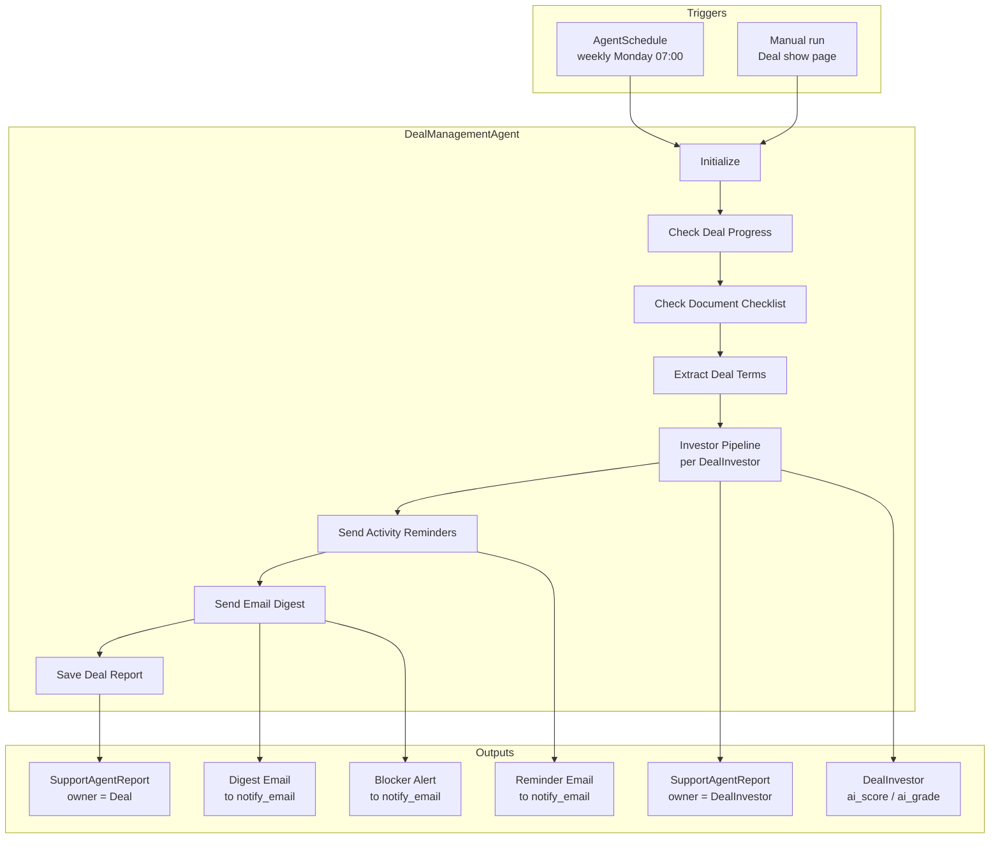
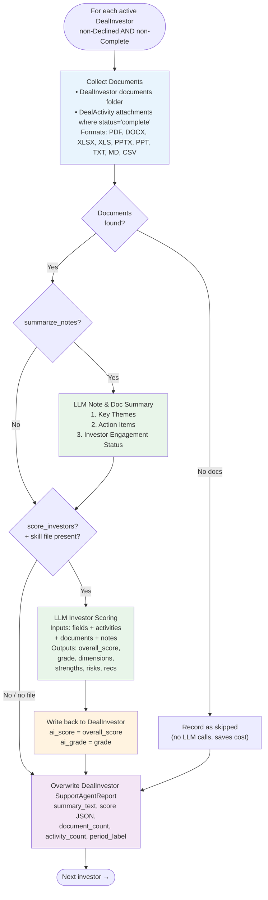
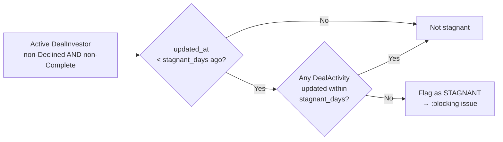
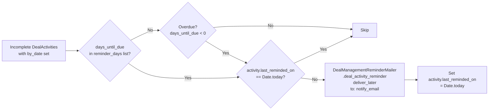
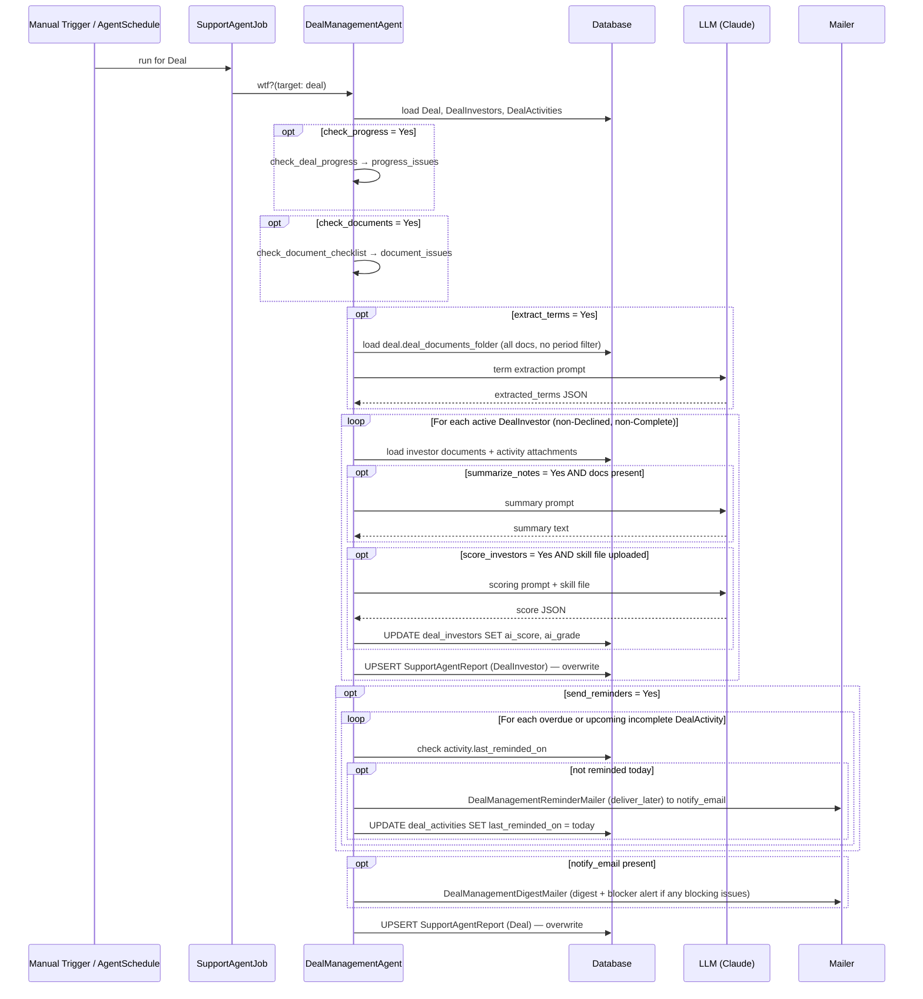
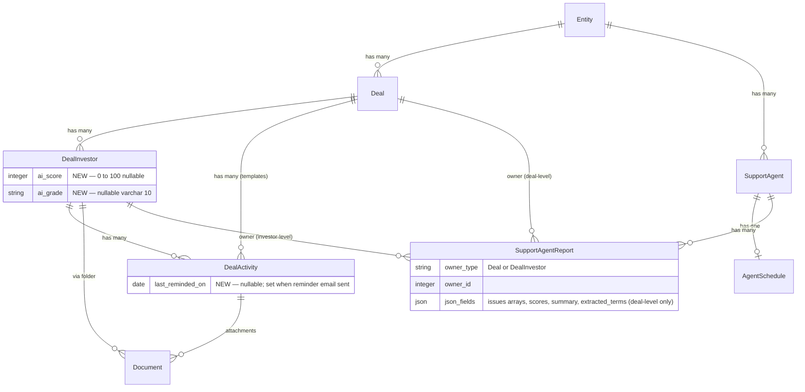
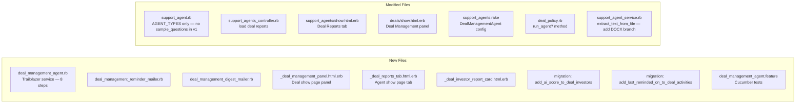

# PRD: Deal Management Agent

**Status:** Draft  
**Author:** Fund Operations  
**Date:** 2026-05-28  
**Last Updated:** 2026-05-31

---

## TL;DR

`DealManagementAgent` is a single configurable support agent scoped to **one deal at a time**. It runs six independently-toggleable capabilities — progress monitoring, activity reminders, document checklist, investor note summarisation, deal term extraction, and LLM investor scoring — and produces two levels of report: one per **Deal** (pipeline summary + extracted terms) and one per **DealInvestor** (detail + score). It reuses all existing infrastructure (`SupportAgent`, `AgentSchedule`, `SupportAgentReport`) and requires two migrations: `ai_score` / `ai_grade` on `deal_investors`, and `last_reminded_on` date on `deal_activities`.

---

## 1. Problem Statement

Deal execution involves tracking many moving parts simultaneously — investor steps, document checklists, deadlines, and scattered notes — across potentially dozens of open deals. Today teams rely on manual reviews to catch stalled investors, overdue activities, missing documents, and key deal terms buried in uploaded files. This creates:

- **Stagnation blind spots** — investors sitting in the same step for weeks go unnoticed until a quarterly review.
- **Missed reminders** — the `notify_investor` / `notify_employees` flags on `DealActivity` are set but never automatically acted upon.
- **Document gaps** — there is no automated check confirming NDAs, term sheets, and financials have been uploaded before a deal advances.
- **Unstructured knowledge** — deal terms, investor interaction notes, and document summaries live in disparate places with no LLM-assisted synthesis.
- **No investor ranking** — deal leads have no objective, data-driven signal for which investors to prioritise or which are at risk of dropping out.

---

## 2. Solution

**DealManagementAgent** — a configurable, multi-capability support agent that runs per deal. It orchestrates six toggleable capabilities under a single agent instance, all controlled via `json_fields`:

```
┌─────────────────────────────── DealManagementAgent ───────────────────────────────┐
│                                                                                    │
│  ① Deal Progress      Flag stagnant investors + overdue steps                     │
│  ② Activity Reminders Email notify_email when steps are overdue or coming due     │
│  ③ Document Checklist Verify required docs are in the data room                   │
│  ④ Term Extraction    LLM extracts deal terms from data room (deal-level, once)   │
│  ⑤ Note Summary       LLM summary of investor docs + activity attachments         │
│  ⑥ Investor Scoring   LLM scores each investor 0–100 using a skill-file rubric   │
│                                                                                    │
│  Each capability is independently toggled via json_fields on the agent.           │
└────────────────────────────────────────────────────────────────────────────────────┘
```

One agent instance per entity. The `targets` method accepts a single `Deal` instance (on-demand from the show page) or an entity_id for a future scheduled run. All notifications go to `notify_email`.

### System Context



---

## 3. Goals

| Goal | Success Metric |
|---|---|
| Surface stagnant deals before they become lost deals | 100% of deals stagnant beyond the configured threshold appear in the digest email |
| Eliminate manual reminder sending for overdue steps | `notify_email` receives automated reminders on configured days without any manual action |
| Ensure document completeness before deal advancement | Missing required docs flagged in the report before a deal moves to next stage |
| Reduce time-to-briefing before investor meetings | Deal lead can read a per-investor doc summary instead of opening each file |
| Capture deal terms without manual re-entry | Extracted terms visible in the deal-level agent report within minutes of running |
| Provide objective investor prioritisation | `ai_score` on each `DealInvestor` gives a data-backed ranking within the deal |
| Zero new scheduling infrastructure | Reuses `SupportAgent`, `AgentSchedule`, `SupportAgentReport` unchanged |

---

## 4. Out of Scope (v1)

- Writing extracted terms back as `Deal` or `DealInvestor` custom fields (stored in the report only).
- Scoring dimensions configurable without editing the skill file (embedded in the skill prompt).
- Investor-facing notifications (all notifications go to `notify_email` in v1).
- Chat interface for querying deal status.
- Closed deals (`status = "Open"` only).
- Cross-deal portfolio-level analytics.
- Automatic advancement of deal steps based on agent findings.
- Batch processing across all open deals for an entity (single-deal scope in v1).

---

## 5. User Stories

| Persona | Story |
|---|---|
| Fund Manager | Receive a weekly email showing which deals have stagnant investors or overdue steps, so I can intervene before a deal goes cold. |
| Deal Lead | Be alerted the day before and on the day an investor's deal step is due, so I can follow up without manually tracking deadlines. |
| Operations Admin | Configure which documents are required in the data room (e.g. signed NDA, term sheet, financial model) and receive a report showing which are missing. |
| Analyst | Get a per-investor summary of all documents and activity notes so I can brief my manager on any investor's status in under 5 minutes. |
| Deal Manager | Have the agent extract key terms (valuation, equity %, board seats, pro-rata rights) from data room documents, so I don't have to read every file manually. |
| Deal Lead | Have each investor automatically scored against a rubric I define in a skill file, producing an overall score, grade, and dimension breakdown, so I can prioritise which investors to focus on. |

---

## 6. Functional Requirements

### 6.1 Agent Configuration

> **Summary:** 14 `json_fields` keys control the agent. Each capability has its own toggle (Yes/No). LLM-heavy capabilities have additional tuning fields. The `scoring_skill_file` is a File upload identical in pattern to `PortfolioScoringAgent`. All email notifications go to `notify_email`.

**FormType:** `SupportAgent / DealManagementAgent`

```
┌─── Capability Group ─────────────────┬──── Fields ───────────────────────────────────┐
│ Deal Progress                         │ check_progress (Y/N), stagnant_days (#)        │
│ Activity Reminders                    │ send_reminders (Y/N), reminder_days (CSV)      │
│ Document Checklist                    │ check_documents (Y/N), required_docs (CSV)     │
│ Term Extraction                       │ extract_terms (Y/N), term_extraction_prompt    │
│ Note & Doc Summary                    │ summarize_notes (Y/N), note_period (M/Q)       │
│ Investor Scoring                      │ score_investors (Y/N), scoring_skill_file (F)  │
│                                       │ min_points_per_section (#)                     │
│ Notifications                         │ notify_email (text)                            │
└───────────────────────────────────────┴────────────────────────────────────────────────┘
```

Full field reference:

| Field | Type | Default | Description |
|-------|------|---------|-------------|
| `check_progress` | Select (Yes/No) | Yes | Enable stagnation monitoring and overdue activity detection. |
| `stagnant_days` | NumberField | `7` | Days without any update on `DealInvestor` **or** linked `DealActivity` before flagging stagnant. |
| `send_reminders` | Select (Yes/No) | Yes | Send reminder emails to `notify_email` when activities are overdue or within the reminder window. |
| `reminder_days` | TextField | `7,3,1` | Comma-separated day offsets before `by_date`. `0` = on due date. Overdue activities (past due date) always trigger regardless of this list. |
| `check_documents` | Select (Yes/No) | Yes | Verify required documents exist in the deal data room. |
| `required_docs` | TextField | _(blank)_ | Comma-separated document names to check (e.g. `NDA, Term Sheet, Financial Model`). Matched case-insensitively. Blank = no check. |
| `extract_terms` | Select (Yes/No) | Yes | Extract structured deal terms from the deal data room (runs once at deal level, not per investor). |
| `term_extraction_prompt` | TextArea | _(blank)_ | Custom extraction instructions. Blank = default common deal terms (see §6.7). |
| `summarize_notes` | Select (Yes/No) | Yes | LLM summary of each investor's documents folder + completed DealActivity attachments. |
| `note_period` | Select (Month/Quarter) | Quarter | Lookback window for per-investor document and activity collection (does not apply to deal-level term extraction). |
| `notify_email` | TextField | _(blank)_ | Email address for all agent notifications: pipeline digest, reminder alerts, and blocker alerts. |
| `score_investors` | Select (Yes/No) | No | Enable LLM scoring of each `DealInvestor`. Off by default — requires a skill file upload. |
| `scoring_skill_file` | File | _(blank)_ | Markdown skill prompt defining scoring dimensions, rubric, and weighting. Same pattern as `PortfolioScoringAgent`. |
| `min_points_per_section` | NumberField | `3` | Minimum positives and concerns required per scoring dimension. |

> **Removed:** `alert_deal_lead` field. All notifications (digest, reminders, blocker alerts) go to `notify_email` in v1. The `deal_lead` column on `DealInvestor` is a free-text name string, not an email address.

---

### 6.2 Execution Pipeline

> **Summary:** Eight sequential Trailblazer steps. Steps 2–7 are conditionally skipped based on config flags. All steps return `true` so the pipeline always reaches step 8 (Save Deal Report) even when earlier steps error.

```mermaid
flowchart TD
    Start([Manual Trigger — Deal show page]) --> Init

    Init["① Initialize\nLoad agent, set up LLM,\nbuild ctx issues hash"]

    Init --> P{check_progress?}
    P -->|Yes| ChkProgress["② Check Deal Progress\nStagnation + overdue activities\n→ progress_issues"]
    P -->|No - skip| D
    ChkProgress --> D

    D{check_documents?}
    D -->|Yes| ChkDocs["③ Check Document Checklist\nRequired docs vs data room\n→ document_issues"]
    D -->|No - skip| T
    ChkDocs --> T

    T{extract_terms?}
    T -->|Yes| Cache{"Docs unchanged\n+ prompt unchanged\n+ prior result exists?"}
    T -->|No - skip| InvPipe
    Cache -->|Yes — reuse| InvPipe
    Cache -->|No — re-run| ExtTerms["④ Extract Deal Terms\nLLM reads deal.deal_documents_folder\nAll docs — no period filter\n→ extracted_terms JSON"]
    ExtTerms --> InvPipe

    InvPipe["⑤ Run Investor Pipeline\nIterates each active DealInvestor\n(non-Declined, non-Complete)\n(see §6.3 for inner loop)"]

    InvPipe --> R{send_reminders?}
    R -->|Yes| SendR["⑥ Send Activity Reminders\nOverdue + upcoming activities\n→ DealManagementReminderMailer"]
    R -->|No - skip| Dig
    SendR --> Dig

    Dig{notify_email present?}
    Dig -->|Yes| SendDig["⑦ Send Email Digest\nPipeline digest + blocker alert\nto notify_email"]
    Dig -->|No - skip| Save
    SendDig --> Save

    Save["⑧ Save Deal Report\nSupportAgentReport owner=Deal\nAll issues + terms + leaderboard"]
    Save --> Done([Done])

    style Init fill:#e8f4fd
    style ChkProgress fill:#fff3e0
    style ChkDocs fill:#fff3e0
    style ExtTerms fill:#e8f5e9
    style InvPipe fill:#e8f5e9
    style SendR fill:#fce4ec
    style SendDig fill:#fce4ec
    style Save fill:#f3e5f5
```



| Step | Class method | Toggle field | Always runs? |
|---|---|---|---|
| ① Initialize | `initialize_agent` | — | Yes |
| ② Check Deal Progress | `check_deal_progress` | `check_progress` | No |
| ③ Check Document Checklist | `check_document_checklist` | `check_documents` | No |
| ④ Extract Deal Terms | `extract_deal_terms` | `extract_terms` | No |
| ⑤ Run Investor Pipeline | `run_investor_pipeline` | — | Yes |
| ⑥ Send Activity Reminders | `send_activity_reminders` | `send_reminders` | No |
| ⑦ Send Email Digest | `send_email_digest` | `notify_email` present | No |
| ⑧ Save Deal Report | `generate_progress_reports` | — | Yes |

---

### 6.3 Investor Pipeline (Inner Loop — Step ⑤)

> **Summary:** For each active (non-Declined, non-Complete) `DealInvestor`, the agent collects documents then conditionally summarises and scores using the LLM. Term extraction does **not** run here — it runs once at deal level in step ④. Each investor gets its own `SupportAgentReport` (overwritten on re-run). One investor failing does not block the next.



**Document collection sources:**

| Source | Condition |
|---|---|
| `DealInvestor` documents folder | Always included |
| `DealActivity` attachments | Only where `status = "complete"` (DB value, lowercase) and `deal_investor_id` matches |

**Supported document formats:** PDF, DOCX, XLSX, XLS, PPTX, PPT, TXT, MD, CSV — same `read_document_text` / `extract_text_from_file` pipeline as `PortfolioScoringAgent`, extended with DOCX support (see §11).

---

### 6.4 Stagnation Check Logic

> **Summary:** Uses a stricter "both signals absent" criterion compared to the existing `DealInvestor#stagnant?` method. Only active investors are evaluated — Declined and Complete are excluded.



A `DealInvestor` is flagged stagnant only when **all** conditions are true:
- `status` is neither `Declined` nor `Complete`
- `deal_investor.updated_at < stagnant_days.days.ago`
- No linked `DealActivity` has `updated_at` within `stagnant_days`

---

### 6.5 Activity Reminder Logic

> **Summary:** Scans incomplete activities for due-date proximity. Overdue activities always trigger. Deduplicates within a calendar day using a persistent `last_reminded_on` date column on `deal_activities`. All reminder emails go to `notify_email`.



- `days_until_due = (activity.by_date - Date.today).to_i`
- **Overdue always triggers:** activities where `days_until_due < 0` fire regardless of the `reminder_days` list.
- **Idempotency:** `activity.last_reminded_on` (date column on `deal_activities`) is checked and updated. Survives report overwrites because it lives on the activity record, not the report.
- All reminder emails go to `notify_email`. Blocker alerts (≥1 `:blocking` issue) are included in the digest email and fire on every run while the blocker persists.

---

### 6.6 Document Checklist Logic

- Required document names matched **case-insensitively** against `Document#name` in `deal.deal_documents_folder`
- Missing document → `:blocking` severity issue
- Present document → `:success` severity issue
- Blank `required_docs` → step records one `:success` info message and exits (no check performed)

---

### 6.7 LLM Prompt Contracts

Three LLM calls are possible per run. All are **soft-fail** — an error is recorded in `json_fields` and the pipeline continues.

| # | Call | Runs | Toggle | Input | Output stored in |
|---|---|---|---|---|---|
| ① | Deal Term Extraction | Once per deal | `extract_terms` | `deal.deal_documents_folder` | Deal-level report → `extracted_terms` |
| ② | Investor Note Summary | Once per active investor | `summarize_notes` | Investor folder + activity attachments | Investor report → `summary_text` |
| ③ | Investor Scoring | Once per active investor | `score_investors` + skill file | Investor fields + activities + documents + notes | Investor report → `score`; `DealInvestor.ai_score` / `ai_grade` |

---

#### ① Deal Term Extraction

**When:** `extract_terms = Yes` and the cache is stale (see below).  
**Reads:** All documents in `deal.deal_documents_folder` — no period filter.  
**Writes:** `extracted_terms` JSON into the deal-level `SupportAgentReport`.

**Cache — skip LLM if all three match:**

| Stored in report | Compared against |
|---|---|
| `term_extraction_fingerprint` | SHA1 of sorted `"#{doc.id}:#{doc.updated_at}"` for every doc in the folder |
| `term_extraction_prompt_used` | Current value of `term_extraction_prompt` config field |
| `extracted_terms` | Must be present (non-nil) |

If the cache hits, carry forward existing `extracted_terms` unchanged and log the skip. If the cache misses, run the LLM and update all three stored values.

**Prompt — when `term_extraction_prompt` is set:**

```
You are a deal analyst. Extract the following information from the documents below.

{term_extraction_prompt}

Rules:
- Return ONLY a valid JSON object.
- Use null for any field not found in the documents.
- No explanation, no markdown prose outside the JSON.

=== DOCUMENTS ===
{formatted_document_text}
```

**Prompt — default when `term_extraction_prompt` is blank:**

```
You are a deal analyst. Extract the following deal terms from the documents below.
Return ONLY a valid JSON object. Use null for any field not found.

Fields to extract:
  pre_money_valuation, post_money_valuation, equity_percentage,
  investment_amount, instrument_type, closing_date, board_seats,
  pro_rata_rights, anti_dilution, rofr, drag_along, lock_up_period

=== DOCUMENTS ===
{formatted_document_text}
```

---

#### ② Investor Note & Document Summary

**When:** `summarize_notes = Yes` and at least one document was collected for this investor.  
**Reads:** Investor document folder + completed `DealActivity` attachments within `note_period`.  
**Writes:** `summary_text` string into the investor-level `SupportAgentReport`.

```
You are a deal manager's assistant. Summarize the documents and activity notes
below for investor {investor_name} in deal {deal_name} ({period}).

Write three sections:

1. Key Themes
   Bullet points covering recurring topics and developments.

2. Action Items
   Bullet points listing specific follow-ups or commitments.
   Write "None identified" if there are none.

3. Investor Engagement
   One of: Actively Engaged / In Progress / Stalled
   Follow with one sentence of justification.

Rules: Be concise. Do not invent facts not present in the documents.
Plain prose only — no markdown code fences.

=== DOCUMENTS ===
{formatted_document_text}
```

---

#### ③ Investor Scoring

**When:** `score_investors = Yes` and a `scoring_skill_file` is uploaded.  
**Reads:** Investor fields, activity history, documents, and notes.  
**Writes:** `score` JSON into the investor-level report; updates `DealInvestor.ai_score` and `DealInvestor.ai_grade`.

```
{scoring_skill_file — full markdown rubric defining dimensions, weights, and benchmarks}

---

Score the investor below using all available data.

Investor : {investor_name}
Deal     : {deal_name}

### Investor Details
{status} | {tier} | {primary_amount} | Source: {source} | Tags: {tags}

### Activity History
{For each activity: title | status | by_date | completed_at | days_overdue}

### Documents
{formatted_document_text}

### Notes
{deal_investor.notes}

---

Return a single JSON object with these keys:

{
  "overall_score": <integer 0–100>,
  "grade":         <string e.g. "B+">,
  "summary":       <string — one paragraph narrative>,
  "dimensions": [
    {
      "name":      <string>,
      "score":     <integer 0–100>,
      "weight":    <number>,
      "rationale": <string>,
      "positives": [<at least {min_points} specific, data-backed positives>],
      "concerns":  [<at least {min_points} specific, data-backed concerns>]
    }
  ],
  "strengths":       [<at least {min_points} items>],
  "risks":           [<at least {min_points} items>],
  "recommendations": [<at least {min_points} items>]
}

Wrap the JSON in ```json ... ``` fences. Return nothing else.
```

---

### 6.8 Scheduling

- Reuses existing `AgentSchedule` — no new scheduling code
- Suggested default: `weekly`, `run_on_day: 1` (Monday), `07:00` entity timezone
- The scheduled run processes a **single configured deal** — the agent is scoped per-deal, not per-entity
- On-demand trigger available from the Support Agents UI and the Deal show page "Run Now" button
- `targets` accepts a `Deal` instance (on-demand) or a `Deal` id (scheduled)

---

### 6.9 Processing Flow



- `targets(deal_or_id)` → accepts a `Deal` instance or id; returns `[deal]`
- One deal failing does not block the schedule — errors are recorded in `AgentExecutionLog`
- Both deal-level and investor-level `SupportAgentReport` records are **overwritten** on re-run (not appended)

---

## 7. Non-Functional Requirements

| Concern | Behaviour |
|---|---|
| **LLM cost guard** | LLM skipped when investor has no documents. Empty-investor deals produce a deal-level report at zero LLM cost. |
| **Document text limits** | Per-document: 5,000 chars max. Per-investor total: 50,000 chars. Oldest docs truncated first; warning logged. |
| **Idempotency** | Re-running overwrites existing `SupportAgentReport` records (both deal-level and investor-level). Reminder dedup is stored in `deal_activities.last_reminded_on` (date column) — survives report overwrites. |
| **Term extraction cache** | LLM call skipped when documents and `term_extraction_prompt` are unchanged since the last run. Fingerprint and prompt value stored in the deal-level report `json_fields`; compared at the start of step ④ on every run. |
| **Blocker alert frequency** | Blocker alert email fires on **every run** as long as ≥1 `:blocking` issue exists. No dedup — persistent blockers generate a weekly alert until resolved. |
| **Privacy** | Documents sent only to the LLM configured on the entity (`@support_agent.effective_model`). |
| **Soft failures** | All LLM steps (summarise, extract, score) are soft-fail. Errors recorded in `json_fields` but do not block checklist or report save. |
| **Scoring validation** | Score JSON must contain `overall_score` (0–100), `grade`, `summary`, `dimensions` (non-empty array). Invalid JSON raises and is caught by soft-fail handler. Existing `ai_score` / `ai_grade` are preserved on scoring failure. |
| **Authorization** | `Run Now` button on the Deal show page requires `DealPolicy#run_agent?`. Visible to entity employees only — not LP portal. |

---

## 8. Data Model

> **Summary:** No new tables. Two migrations: one adds `ai_score` and `ai_grade` to `deal_investors`; one adds `last_reminded_on` date to `deal_activities`. Two `SupportAgentReport` rows are written per run (one owned by `Deal`, one per active `DealInvestor`), overwritten on re-run.



**Changelog:**

| Record | Change |
|--------|--------|
| `SupportAgent::AGENT_TYPES` | `"DealManagementAgent"` added |
| `FormType` | New: `name: "SupportAgent", tag: "DealManagementAgent"` |
| `FormCustomField` | 14 fields (§6.1) — note: `alert_deal_lead` removed |
| `SupportAgentReport` (deal-level) | `owner_type: "Deal"` — `progress_issues`, `document_issues`, `extracted_terms`, `reminder_issues`, `digest_issues`, `health_scores`, `score_leaderboard` |
| `SupportAgentReport` (investor-level) | `owner_type: "DealInvestor"` — `summary_text`, `score` JSON, `document_count`, `period_label`, `activity_count` |
| `deal_investors` | **Migration** — `ai_score integer nullable`, `ai_grade varchar(10) nullable` |
| `deal_activities` | **Migration** — `last_reminded_on date nullable` |
| `DealManagementReminderMailer` | New mailer — `deal_activity_reminder` action (to: `notify_email`) |
| `DealManagementDigestMailer` | New mailer — `pipeline_digest` and `blocker_alert` actions (both to: `notify_email`) |

---

## 9. UI

> **Summary:** The agent surfaces in three places — a panel on the Deal show page, a "Deal Reports" tab on the SupportAgent admin page, and two email formats. No new admin pages are needed. The Deal Management panel is visible to entity employees only (not LP portal). The `Run Now` button is guarded by `DealPolicy#run_agent?`.

### Component Map

```
Deal Show Page
└── Deal Management Panel  (entity employees only — DealPolicy#run_agent?)
    ├── Progress Summary  (stagnant count, overdue count, health scores)
    ├── Document Checklist (green ✓ / red ✗ per required doc)
    ├── Extracted Terms table (from deal-level report)
    ├── Scoring Leaderboard (investors ranked by ai_score, with grade badge)
    ├── [Run Now] button  → on-demand trigger for this deal only
    └── [View Full Report] → opens SupportAgent show page filtered to this deal

SupportAgent Admin (/support_agents/:id)
└── Deal Reports Tab
    ├── Table: deal name | run date | status | issue count | score range
    └── Expandable row per deal
        └── Investor Cards (per DealInvestor)
            ├── Score badge (overall_score, grade)
            ├── Engagement status
            ├── Summary text
            └── Document list

Email: Pipeline Digest  →  notify_email
    One row per open deal: health score | stagnant count | missing docs | overdue activities
    Includes extracted terms section when extract_terms = Yes

Email: Blocker Alert    →  notify_email (included in digest when ≥1 :blocking issue exists)
    Fires on every run while blocking issues persist
    Lists: overdue activities, missing required docs
```

### Deal Management Panel — Wireframe

```
┌── Deal Management ──────────────────────────── [Run Now] ┐
│                                                           │
│  Progress                                                 │
│  ● 2 stagnant investors (> 7 days)                       │
│  ● 3 activities overdue                                   │
│                                                           │
│  Document Checklist                                       │
│  ✓ NDA           ✗ Term Sheet    ✗ Financial Model       │
│                                                           │
│  Deal Terms                                               │
│  Pre-money: $10M   Equity: 20%   Instrument: SAFE        │
│                                                           │
│  Investor Scores                                          │
│  Investor A    82  B+  ████████░░                        │
│  Investor B    67  C+  ██████░░░░                        │
│  Investor C    45  D   ████░░░░░░  ⚠ Stagnant           │
│                                                           │
│  Last run: Mon 26 May 2026 07:04 · [View Full Report]    │
└───────────────────────────────────────────────────────────┘
```

---

## 10. Provisioning

```bash
# Provision for an entity (idempotent — safe to re-run)
rake 'support_agents:setup[ENTITY_ID]'

# Clone configuration to another entity
rake 'support_agents:clone[TARGET_ENTITY_ID]'
```

The `DealManagementAgent` entry is added to `SUPPORT_AGENT_FORM_CONFIGS` in `lib/tasks/support_agents.rake` with the default field values from §6.1.

**Default agent config provisioned:**

```ruby
{
  name:         "Deal Management",
  agent_type:   "DealManagementAgent",
  enabled:      true,
  json_fields: {
    "check_progress"          => "Yes",  "stagnant_days"           => "7",
    "send_reminders"          => "Yes",  "reminder_days"           => "7,3,1",
    "check_documents"         => "Yes",  "required_docs"           => "",
    "extract_terms"           => "Yes",  "term_extraction_prompt"  => "",
    "summarize_notes"         => "Yes",  "note_period"             => "Quarter",
    "score_investors"         => "No",   "min_points_per_section"  => "3",
    "notify_email"            => ""
  },
  schedule: {
    frequency: "weekly", run_on_day: 1,
    run_at_time: "07:00", timezone: "Asia/Kolkata", enabled: true,
    notify_on_failure: true, notify_on_success: false
  }
}
```

---

## 11. Implementation Scope



| Artifact | Action |
|----------|--------|
| `app/packs/ai/support_agents/services/deal_management_agent.rb` | **Created** — 8-step Trailblazer service |
| `app/packs/ai/support_agents/models/support_agent.rb` | **Modified** — `AGENT_TYPES` only (no `sample_questions` in v1, chat disabled) |
| `app/packs/ai/support_agents/services/support_agent_service.rb` | **Modified** — extend `extract_text_from_file` with `.docx` branch (using `docx` gem or LibreOffice) |
| `app/packs/ai/support_agents/mailers/deal_management_reminder_mailer.rb` | **Created** — `deal_activity_reminder` action, to: `notify_email` |
| `app/packs/ai/support_agents/mailers/deal_management_digest_mailer.rb` | **Created** — `pipeline_digest` and `blocker_alert` actions, both to: `notify_email` |
| `app/packs/ai/support_agents/mailers/views/deal_management_reminder_mailer/` | **Created** — mailer views |
| `app/packs/ai/support_agents/mailers/views/deal_management_digest_mailer/` | **Created** — mailer views |
| `app/packs/startups/deals/views/deals/show.html.erb` | **Modified** — add Deal Management panel |
| `app/packs/startups/deals/views/deals/_deal_management_panel.html.erb` | **Created** — progress panel partial |
| `app/packs/startups/deals/policies/deal_policy.rb` | **Modified** — add `run_agent?` method |
| `app/packs/core/entities/models/concerns/entity_enabled.rb` | **Modified** — append `:deal_management_agent` to `support_agents` flag list |
| `app/packs/startups/deals/views/deals/_deal.html.erb` | **Modified** — add `ai_score`/`ai_grade` to Kanban card, gated on `entity.support_agents.set?(:deal_management_agent)` |
| `app/packs/startups/deals/views/deals/_index.html.erb` | **Modified** — add Score/Grade columns, gated on `entity.support_agents.set?(:deal_management_agent)` |
| `app/packs/ai/support_agents/controllers/support_agents_controller.rb` | **Modified** — load deal reports on show action |
| `app/packs/ai/support_agents/views/support_agents/show.html.erb` | **Modified** — Deal Reports tab |
| `app/packs/ai/support_agents/views/support_agents/_deal_reports_tab.html.erb` | **Created** |
| `app/packs/ai/support_agents/views/support_agents/_deal_investor_report_card.html.erb` | **Created** |
| `lib/tasks/support_agents.rake` | **Modified** — `DealManagementAgent` added to `SUPPORT_AGENT_FORM_CONFIGS` |
| `features/deal_management_agent.feature` | **Created** — Cucumber acceptance tests |
| `db/migrate/YYYYMMDDHHMMSS_add_ai_score_to_deal_investors.rb` | **Created** — `ai_score integer nullable`, `ai_grade varchar(10) nullable` |
| `db/migrate/YYYYMMDDHHMMSS_add_last_reminded_on_to_deal_activities.rb` | **Created** — `last_reminded_on date nullable` |

---

## 12. Open Questions

| # | Question | Owner | Status |
|---|----------|-------|--------|
| 1 | Should the Deal Management panel be visible to investors via the LP portal, or entity employees only? | Product | **Closed — entity employees only** |
| 2 | What is the expected volume of open deals per entity? Affects whether background-job-per-deal is needed vs sequential. | Engineering | **Closed — single-deal scope in v1; batch is out of scope** |
| 3 | Should `term_extraction_prompt` ship with library templates (VC term sheet, PE buyout, debt deal) selectable via dropdown? | Product | **Closed — plain TextArea in v1; templates deferred to v1.1** |
| 4 | Should reminder emails use the existing `DealMailer` / `WithCustomNotifications` infrastructure, or the new standalone mailers? | Engineering | **Closed — standalone mailers** |
| 5 | `deal_investors.deal_lead` is free-text. Do we need a `User` lookup for the email address, or should `notify_email` serve as the fallback? | Engineering | **Closed — all notifications go to `notify_email`; `deal_lead` not used for email in v1** |
| 6 | Should `extract_terms` write results to `Deal` / `DealInvestor` custom fields in v1.1, or is the report `json_fields` sufficient for now? | Product | **Closed — `report.json_fields` is sufficient for v1** |
| 7 | Should `ai_score` / `ai_grade` appear in the pipeline Kanban card and the deals index table? Which columns? | Product | **Closed — see §7a below** |
| 8 | Should scoring use a flat single skill file per agent instance, or the `skill_for_sector` pattern (sector-keyed) from `PortfolioScoringAgent`? | Engineering | **Closed — flat single skill file per agent instance** |

### §7a — `ai_score` / `ai_grade` Column Visibility (Q7 resolution)

- Add `ai_score` and `ai_grade` columns to both the **Kanban card** (`_deal.html.erb`) and the **deals index table** (`_index.html.erb`).
- Columns are shown **only when** `entity.support_agents.set?(:deal_management_agent)` is true.
- `deal_management_agent` must be added to the `support_agents` flag list in `EntityEnabled` (`entity_enabled.rb`) — append to the end of the existing list to preserve bit positions.
- Kanban card shows: score badge (number + grade letter, coloured by grade tier) and a ⚠ stagnant indicator if the investor is flagged stagnant.
- Deals index table shows: a `Score` column (numeric `ai_score`) and a `Grade` column (`ai_grade` badge). Both sortable.
- When `ai_score` is `nil` (agent never run or scoring disabled), the cell renders as `—`.

### §3a — Term Extraction Template Library (Q3 detail)

Before deciding, the following sub-questions need product answers:

| Sub-question | Options |
|---|---|
| **Which templates ship in v1?** | VC term sheet / PE buyout / SAFE / convertible note / debt facility — which subset? |
| **Field type change?** | Does `term_extraction_prompt` stay a free-text `TextField`, or change to a Select (template picker) + editable text area below it? |
| **UX pattern** | (A) Dropdown pre-fills the text field and user can edit before saving. (B) Separate "Load template" button that populates the field. (C) Dropdown replaces the field entirely — no free-text editing. |
| **Template storage** | Hardcoded in the agent class (simple, no DB) vs. seeded as option values on the `FormCustomField` (configurable by CapHive admins). |
| **Custom + template relationship** | If a user selects a template and then edits it, is the result treated as "custom" on the next UI load, or does it still show the template name? |
| **Who can add templates?** | CapHive admins only, or entity admins too? |

Recommendation: defer to v1.1 — ship `term_extraction_prompt` as a plain `TextField` in v1. The default blank → default common terms path covers the majority of cases. Templates add UX surface area that needs the above decisions resolved first.

---

## 13. Acceptance Criteria

**Agent setup**
- [ ] Agent appears in the Support Agents index and can be created/edited via the UI.
- [ ] Provisioned via `rake 'support_agents:setup[ENTITY_ID]'` with default config.
- [ ] All capabilities disabled (`check_progress: No`, `summarize_notes: No`, etc.) results in a deal-level report with no issues and zero LLM calls.

**Deal Progress**
- [ ] A `DealInvestor` with no update and no activity completion in > `stagnant_days` days is flagged in `progress_issues`.
- [ ] `Declined` and `Complete` investors are excluded from the stagnation check.
- [ ] Overdue `DealActivity` records appear in `progress_issues` with investor name and due date.
- [ ] Closed deals are not processed.

**Document Checklist**
- [ ] Missing required documents are listed as `:blocking` issues in `document_issues`.
- [ ] Present documents are listed as `:success`.
- [ ] Document name matching is case-insensitive (`NDA` matches `nda`, `Nda`).
- [ ] Blank `required_docs` skips the check with no blocking issues.

**Term Extraction (deal-level)**
- [ ] When `extract_terms = Yes`, a JSON object is stored in `extracted_terms` in the **deal-level** report (not the investor-level report).
- [ ] Term extraction reads all documents in `deal.deal_documents_folder` regardless of `note_period`.
- [ ] Custom `term_extraction_prompt` is honoured; blank falls back to default terms.
- [ ] Term extraction runs once per deal run, not per investor.
- [ ] When documents and `term_extraction_prompt` are unchanged since the last run, extraction is skipped and existing `extracted_terms` are carried forward — no LLM call is made.
- [ ] When a document is added, removed, or updated in the deal data room, extraction re-runs on the next agent run.
- [ ] When `term_extraction_prompt` is changed, extraction re-runs on the next agent run.

**Activity Reminders**
- [ ] Reminder mailer is enqueued for activities whose `by_date` falls within `reminder_days`.
- [ ] Overdue activities (`by_date` in the past) always trigger a reminder regardless of `reminder_days`.
- [ ] No duplicate reminder is sent for the same activity on the same calendar day.
- [ ] `deal_activities.last_reminded_on` is updated when a reminder is sent; the field persists across agent re-runs.
- [ ] Reminder emails are sent to `notify_email`.

**Note & Document Summary**
- [ ] When `summarize_notes = Yes` and documents are found, a non-empty `summary_text` is stored in the investor-level report.
- [ ] When no documents are found, the investor report is saved with `final_status: "skipped"` and no LLM call is made.
- [ ] `Declined` and `Complete` investors are excluded from the investor pipeline.

**Investor Scoring**
- [ ] When `score_investors = Yes` and a skill file is uploaded, each active `DealInvestor` receives `overall_score`, `grade`, and `dimensions` in their report.
- [ ] `deal_investor.ai_score` and `deal_investor.ai_grade` are updated after a successful scoring run.
- [ ] Existing `ai_score` / `ai_grade` values are preserved when scoring fails (soft-fail).
- [ ] Missing skill file is soft-failed — `:warning` issue recorded, run continues.
- [ ] An investor with no documents and no notes is scored using field and activity data only.
- [ ] Scoring leaderboard (investors ranked by `ai_score`) is visible in the Deal Management panel.

**DOCX Support**
- [ ] `.docx` files in the investor document folder are successfully parsed and included in LLM prompts.

**Email**
- [ ] Pipeline digest email sent to `notify_email` after every run.
- [ ] Blocker alert included in digest email when ≥1 `:blocking` issue exists; fires on every run while the blocker persists.
- [ ] No emails are sent to `deal_lead` (free-text field, not an email address).

**Reports**
- [ ] One deal-level `SupportAgentReport` (owner = `Deal`) and one per active `DealInvestor` are produced per run.
- [ ] Re-running overwrites existing reports — no duplicate records accumulate.
- [ ] Deal Management panel visible on the deal show page with the latest report data.
- [ ] Deal Management panel is hidden from the LP portal (entity employees only).
- [ ] `Run Now` button is guarded by `DealPolicy#run_agent?`.
- [ ] On-demand run button triggers the agent for that deal only, not all open deals.
