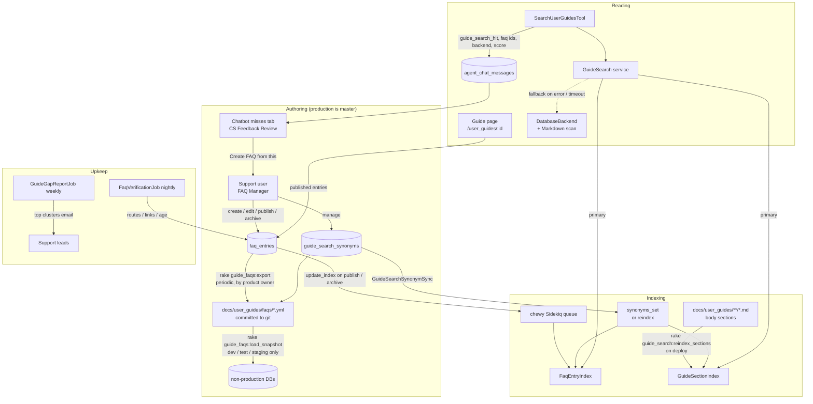

# PRD: Managed FAQs and Guide Search (Elasticsearch)

**Status:** v1 implemented (simplified — see §20)
**Author:** Product / Platform Engineering
**Date:** 2026-09-13

---

## TL;DR

User-guide FAQs move out of the Markdown files in `docs/user_guides/` and into a database-backed
`FaqEntry` model that CapHive support staff create, edit and publish from an in-app screen, with no
code change or deploy. Production is the master copy; support exports and imports FAQs as a
spreadsheet, which is also how a copy is kept in git or loaded into another environment. Published entries render as the FAQ accordion on
each guide page exactly as today, and are indexed in Elasticsearch (through Chewy, which the
app already runs) together with the guides' body sections. The Customer Support Agent's
`SearchUserGuidesTool` queries that index instead of scanning Markdown files line by line, and
gets back whole FAQ entries and sections with a link to the guide. Questions the agent could not
answer flow back into the ops screen as prefilled draft FAQs, closing the guide-gap loop that
[`customer_support_agent_prd.md`](customer_support_agent_prd.md) §8 Layer 3 describes but that
was never built. A retrieval eval, built from the published FAQs themselves, measures whether
search is finding the right answer before and after every change.

---

## Contents

1. [Problem Statement](#1-problem-statement)
2. [Goals and Success Metrics](#2-goals-and-success-metrics)
3. [Who It's For](#3-who-its-for)
4. [User Stories](#4-user-stories)
5. [Functional Requirements](#5-functional-requirements)
6. [Permissions](#6-permissions)
7. [Non-Goals](#7-non-goals)
8. [Decisions](#8-decisions)

— *Implementation* —

9. [What Already Exists](#9-what-already-exists)
10. [Architecture](#10-architecture)
11. [Data Model](#11-data-model)
12. [Search Index Design](#12-search-index-design)
13. [Search Tool and Service Changes](#13-search-tool-and-service-changes)
14. [Guide Page Rendering Changes](#14-guide-page-rendering-changes)
15. [Ops Screens](#15-ops-screens)
16. [Migration from Markdown and the YAML Snapshot](#16-migration-from-markdown-and-the-yaml-snapshot)
17. [Testing and Evaluation](#17-testing-and-evaluation)
18. [Rollout Plan](#18-rollout-plan)
19. [Risks](#19-risks)
20. [v1 Implementation (as built)](#20-v1-implementation-as-built)

---

# Part 1 — Requirements and Outcomes

---

## 1. Problem Statement

In September 2026 every user guide's FAQ was rewritten so a reader can answer three questions
from the FAQ alone: **why** use the feature, **how** to reach and operate it, and **what will
happen** when they do. The guides now hold roughly 2,500 FAQ entries, each verified against the
routes, views, models and jobs. That work exposed four structural problems.

- **Only engineers can change an answer.** FAQs live in Markdown in the repository. The people
  who hear customer questions every day, CapHive ops and support, cannot fix a wrong answer or
  add a missing one without a pull request and a deploy. Answers go stale between releases.
- **The chatbot's search is a line scanner.** `SearchUserGuidesTool` reads every guide file on
  every call, counts keyword matches in a fixed window of the matched line plus five lines either
  side, and returns those windows. It has no stemming beyond a suffix strip, no relevance model,
  a hand-maintained synonym table in Ruby, and no notion of "an FAQ entry" as a unit. An answer
  that starts or ends outside the window is truncated before the model sees it.
- **Guide gaps are recorded but never acted on.** Every search sets
  `agent_chat_messages.guide_search_hit`, but nothing turns a miss into guide work. The weekly
  `GuideGapReportJob` and the golden test set from the Customer Support Agent PRD were never built.
- **Accuracy decays silently.** The rewrite found dozens of places where guide text contradicted
  the code: menu paths that no longer exist, emails the code never sends, a whole guide for a
  removed feature. Nothing flags an FAQ when the route or screen it describes changes.

---

## 2. Goals and Success Metrics

### Goals

1. Support staff can create, edit, publish and retire FAQ entries in the app, and the change is
   live on the guide page and in the chatbot within one minute of publishing.
2. The chatbot retrieves whole, current FAQ entries and guide sections, ranked by relevance.
3. Every chatbot question with no good match becomes a reviewable draft FAQ, not a lost signal.
4. Search quality is measured with a repeatable eval, so a change to the index, synonyms or
   prompt can be shown to help or hurt before it ships.
5. Answers that reference a route or guide that no longer exists are flagged automatically.

### Success Metrics (first 60 days after Phase 3)

| Metric | Baseline | Target |
|--------|----------|--------|
| Retrieval recall@3 on the paraphrased FAQ eval set | Measured on the current file search in Phase 0 | ≥ 90%, and ≥ 15 points above baseline |
| Share of chatbot guide searches with a hit (`guide_search_hit`) | Measured in Phase 0 | +10 points |
| Median time from a no-hit question to a published FAQ | Not tracked (no loop exists) | ≤ 2 business days |
| Thumbs-down rate on answers that used guide search | From `agent_chat_message_feedbacks` | −25% |
| FAQ edits shipped without a deploy | 0 | 100% |
| Published entries with a broken route or link older than 24 hours | Unknown | 0 |

---

## 3. Who It's For

| Persona | What they do here |
|---------|-------------------|
| **CapHive ops / support staff** (users with the `support` role) | Author, edit, publish and archive FAQs, triage chatbot misses into drafts, mark entries verified, manage synonyms, export the YAML snapshot. |
| **Fund manager and company users** | Read FAQs on guide pages; ask the chatbot, which answers from published FAQs and guide sections. |
| **Anonymous visitors** | Read FAQs on the allowlisted public guides (two-factor and authenticator setup) only. |
| **Engineers** | Own the index, the eval, and the Markdown guide bodies; review eval regressions. |

---

## 4. User Stories

1. As a **support user**, when a customer asks something the guide does not answer, I open
   **FAQ Manager**, pick the guide and group, write the question and answer, preview the accordion,
   and publish it, without waiting for a release.
2. As a **support user reviewing chatbot feedback**, I see a message where guide search found
   nothing and click **Create FAQ from this question**; the form opens with the customer's question,
   the guessed guide and a link back to the conversation.
3. As a **support user editing a published entry**, I see my pending changes next to the live text
   and publish when ready. Customers keep seeing the old answer until I do.
4. As a **support user**, when a screen changes, I filter FAQ Manager by **Needs verification** and
   see every entry whose quoted path no longer routes or whose last verification is older than 180 days.
5. As a **support user**, I add `drawdown` as a synonym of `capital call` in **Search Synonyms**, and
   the chatbot starts matching "drawdown" questions to capital call FAQs without a deploy.
6. As a **fund manager**, I open a guide and see its FAQ accordion, grouped by *Navigation*, *How to*,
   *Why*, *What happens* and *Troubleshooting*, containing only published entries.
7. As a **fund manager**, I ask the chatbot "where do I record an investor's payment?" and it quotes
   the exact FAQ entry with the menu path and a link to that entry on the guide page.
8. As an **engineer**, I run the retrieval eval before merging an analyzer or synonym change and see
   recall@1, recall@3 and the list of questions whose rank got worse.
9. As the **product owner**, I run the export in production every few weeks, commit the YAML files,
   and see in the diff exactly which FAQs support changed since the last snapshot.
10. As an **engineer setting up staging or a dev machine**, I load the committed YAML snapshot and get
    the same FAQs production had at the last export.

---

## 5. Functional Requirements

### 5.1 FAQ entries

- **FR-1** An FAQ entry belongs to exactly one guide, identified by the guide's id under
  `docs/user_guides/` (for example `capital_calls_user_guide` or `agents/call_notice_agent_user_guide`).
  The guide must exist on disk when the entry is saved.
- **FR-2** An entry has a **group**: `navigation`, `how_to`, `why`, `what_happens` or
  `troubleshooting`. The guide page renders groups in that order, with these headings:
  *Navigation and getting there*, *Creating, updating and managing*, *Why use it*,
  *What happens when I…*, *Troubleshooting and edge cases*.
- **FR-3** An entry has a **question** (plain text, 10–200 characters, ending in `?`) and an
  **answer** (Markdown, 1–900 characters). The answer supports bold, inline code, and links; it may
  not contain headings, lists, tables or images, because the accordion and the search snippet
  render one paragraph.
- **FR-4** Questions are unique within a guide, compared case-insensitively after collapsing whitespace.
- **FR-5** Entries are ordered within their group by a drag-to-reorder **position**.
- **FR-6** An entry has an **audience**: `signed_in` (default) or `public`. Only `public` entries on
  guides in `PublicGuidesController::PUBLIC_GUIDE_IDS` render for anonymous visitors. An entry on a
  non-public guide cannot be marked `public`.
- **FR-7** An entry may carry **extra search keywords** that are indexed but never displayed, for
  vocabulary customers use that the answer does not contain.

### 5.2 Lifecycle

```mermaid
stateDiagram-v2
    [*] --> draft : create / create from chatbot miss / CSV import
    draft --> published : Publish
    published --> published : Edit (pending revision; live text unchanged until Publish)
    published --> archived : Archive
    archived --> draft : Restore
```



There is no separate review step or publisher role: any support user may publish (§8 D1). Pending
revisions and the audit history are the safety net.

- **FR-8** Only `published` entries appear on guide pages and in the chatbot index.
- **FR-9** Editing a published entry creates a **pending revision**. The published text stays live until
  the revision is published, so an in-progress edit never shows half-finished text to customers.
- **FR-10** Archiving removes the entry from guide pages and the index within one minute. Nothing is
  hard-deleted from the UI; every change is kept in the audit history.
- **FR-11** Publishing records `published_by` and `published_at`, and sets `last_verified_at` to now.

### 5.3 Validation on save

- **FR-12** Every backticked absolute path in the answer (for example `/funds` or
  `/capital_calls/new`) must route, using the same rule as `UserGuideLint#routable?`
  (placeholders such as `<id>` are allowed; mounted engines and files under `public/` pass).
- **FR-13** Every Markdown link must resolve: an in-guide anchor must match a heading in the guide,
  and a guide link must point at an existing guide.
- **FR-14** Validation failures block **Publish**, but a draft or pending revision may be saved with
  warnings so work is not lost.

### 5.4 Guide pages

- **FR-15** A guide page renders its FAQ section from published entries, in the same
  `<div class="faq"><details>` accordion markup `WithGuideRendering#wrap_faq_section` produces today,
  one accordion per group under a `###` group heading.
- **FR-16** The FAQ section appears immediately before the guide's `## Related Guides` section if it
  has one, otherwise at the end. The Markdown files no longer contain FAQ sections (see §16).
- **FR-17** Each entry has a stable anchor (`#faq-<id>`) so the chatbot and support staff can link to
  one entry.
- **FR-18** A guide with no published entries shows no FAQ heading.

### 5.5 Chatbot search

- **FR-19** `SearchUserGuidesTool` searches published FAQ entries and guide body sections in one
  query and returns at most 8 results, no more than 3 from one guide.
- **FR-20** An FAQ result returns the full question and answer, the guide title, the group, and the
  URL of the entry anchor. A section result returns the section heading path, its full text up to
  1,500 characters, and the URL of the section anchor.
- **FR-21** Search applies stemming, the ops-managed synonyms (§5.7), and field weights that rank a
  match in a question above a match in a heading, and both above a match in body text.
- **FR-22** If Elasticsearch is unavailable or times out after 1.5 seconds, the tool falls back to a
  database search over published entries (question, answer, keywords) plus the current Markdown file
  scan for sections, and logs the fallback. The chatbot must never fail a conversation because the
  index is down.
- **FR-23** Every search records on the message: `guide_search_hit`, `guide_search_strong_hit`, the
  ids and ranks of returned results, the backend used (`elasticsearch` or `fallback`), and the top score.

### 5.6 Guide-gap loop

- **FR-24** A search is a **miss** when either:
  1. it returned no results, or
  2. no result is a **strong match**: a result that matches at least two-thirds of the search terms
     (stop words removed, synonyms counted as the term they expand) in its question, keywords,
     heading or guide title.

  A message is also treated as a miss when the user rated the answer thumbs-down. Raw relevance
  scores are recorded but never used as the threshold, because BM25 scores are not comparable
  across queries of different lengths; the two-thirds rule is. The fraction is a single constant,
  `GuideSearch::STRONG_MATCH_RATIO = 2.0 / 3`, revisited only with eval evidence (§17).
- **FR-25** FAQ Manager has a **Chatbot misses** tab listing misses from the last 30 days, clustered by
  normalised keywords, with count, example questions, and the entities they came from (visible to
  support users only for entities in their `SupportClientMapping`).
- **FR-26** **Create FAQ from this** on a miss, or on a message in the CS Feedback Review dashboard,
  opens a new draft with the question prefilled, a suggested guide (the guide of the best-scoring
  result, if any), and `source_message_id` set.
- **FR-27** A miss cluster can be **dismissed** with a reason (out of scope, data question, duplicate)
  so it stops appearing.
- **FR-28** A weekly email to support leads summarises the top 10 open clusters and how many misses
  were turned into published FAQs that week.

### 5.7 Search synonyms

- **FR-29** Support users manage synonym rows: a set of equivalent terms (for example
  `drawdown, capital call`) or a one-way mapping (`LP => investor, stakeholder, limited partner`).
- **FR-30** Saving synonyms updates search behaviour within one minute, without a deploy or reindex
  (Elasticsearch 8.15 synonyms API with an updateable search analyzer).
- **FR-31** The synonyms currently hard-coded in `SearchUserGuidesTool::SYNONYMS` are seeded as rows.

### 5.8 Accuracy upkeep

- **FR-32** A nightly job re-runs FR-12 and FR-13 on every published entry and flags failures as
  **Needs verification**, notifying the entry's last editor.
- **FR-33** Entries whose `last_verified_at` is older than 180 days are also flagged.
- **FR-34** **Mark verified** on an entry sets `last_verified_at` and `verified_by` without changing text.

### 5.9 Import and export

- **FR-35** Support users can export entries (filtered) as CSV and import a CSV of new or changed
  entries. Imported rows land as drafts; rows matching an existing question in the same guide
  update that entry as a pending revision.

### 5.10 YAML snapshot in git

Production is the master copy of FAQs. Git holds a periodic, read-only snapshot.

- **FR-36** `rake guide_faqs:export` writes every published entry (live text only, never pending
  revisions or drafts) to `docs/user_guides/faqs/<guide_key>.yml`, one file per guide, plus
  `docs/user_guides/faqs/_synonyms.yml`. Entries are ordered by group then position, and fields are
  written in a fixed order, so an unchanged FAQ produces an unchanged file and diffs show only real edits.
- **FR-37** Each file starts with a generated-file banner: exported from production at a timestamp,
  do not edit by hand, edit in FAQ Manager.
- **FR-38** FAQ Manager has an **Export snapshot** button that runs the same export and downloads a zip,
  for the product owner to commit from a laptop without shell access to production.
- **FR-39** `rake guide_faqs:load_snapshot` loads the committed YAML into a non-production database:
  upserts entries keyed on `[guide_key, question]`, archives entries absent from the snapshot, and
  replaces synonyms. It refuses to run when `Rails.env.production?`, so the snapshot can never
  overwrite the master.
- **FR-40** Development, test and staging seed FAQs from the snapshot. Cucumber scenarios that exercise
  guide pages and the chatbot load it (or a fixture subset) instead of reading Markdown.
- **FR-41** The drift guard (`features/core/user_guide_lint.feature`) validates the committed snapshot
  on every run: every backticked path routes and every link resolves. A code change that renames a
  route referenced by a production FAQ therefore fails in CI, before it ships.

---

## 6. Permissions

| Action | Support user | Company admin / employee | Investor | Anonymous |
|--------|:---:|:---:|:---:|:---:|
| Read published FAQs on guide pages | ✓ | ✓ | — (guides are hidden from investors today) | Public guides only |
| Open FAQ Manager | ✓ | — | — | — |
| Create, edit, publish, archive, restore | ✓ | — | — | — |
| Mark verified | ✓ | — | — | — |
| Manage synonyms | ✓ | — | — | — |
| See chatbot misses | Mapped entities only | — | — | — |
| Import / export CSV, export YAML snapshot | ✓ | — | — | — |

- FAQ Manager is gated on a new `FaqEntryPolicy`, not on `support?` alone. Like the
  `InternalDocPolicy` link in the sidebar, a support user impersonating a customer must not see it,
  and the link must not render for anyone who would get a 403.
- Chatbot misses contain customer questions, so they follow `CsFeedbackReviewPolicy::Scope`:
  a support user sees only entities mapped to them.

---

## 7. Non-Goals

- **Customer-authored FAQs.** Fund managers adding firm-specific FAQs for their own staff or
  investors is a separate feature (tenant scoping, investor visibility, access rights). The schema
  leaves room for it (§11), but Phase 1 content is CapHive-wide.
- **Editing guide bodies in the app.** Guide sections stay in Markdown and change through code
  review. Only FAQs move to the database.
- **Vector or semantic search.** Keyword search with stemming, synonyms and field weights comes
  first. Embeddings are reconsidered only if the eval (§17) shows paraphrased questions are still
  being missed after Phase 3.
- **Translations.** Guides and FAQs remain English-only.
- **Investor-facing guides.** Investors do not see the guide library today; this PRD does not change that.

---

## 8. Decisions

Recorded 2026-09-13.

- **D1 — No publisher role.** The `support` role is sufficient to create, edit, publish and archive.
  There is no review step. Pending revisions on published entries, validation on publish, and the
  audit history provide the safety net.
- **D2 — Elasticsearch 8.15.** Production runs 8.15, so synonyms use the synonyms API
  (`synonyms_set` with `updateable: true` on the search analyzer) and change without a reindex.
- **D3 — Miss rule, not a score threshold.** A search is a miss when it returns nothing or when no
  result matches at least two-thirds of the search terms (FR-24). BM25 scores vary with query length
  and corpus statistics, so a fixed score cutoff would mark long questions as misses and short ones as
  hits. The term-coverage rule is stable, explainable to support staff, and computed in the same
  request with a named query (§12). Top scores are still recorded for later analysis.
- **D5 — Spreadsheet, not YAML (2026-09-13, supersedes the YAML format in D4 and §5.10/§16).** Export and
  import use an .xlsx spreadsheet from FAQ Manager or `rake guide_faqs:export` / `guide_faqs:import`. The
  product owner commits the exported spreadsheet to git when a copy is wanted.
- **D4 — Production is the master; git holds a YAML snapshot.** Support edits only in production. The
  product owner periodically exports published FAQs to `docs/user_guides/faqs/*.yml` and commits them
  (§5.10). The snapshot seeds development, test and staging, which answers staging drift, and it is the
  restore point after a database loss. Loading a snapshot into production is blocked.

---

# Part 2 — Implementation

---

## 9. What Already Exists

| Component | Where | How this PRD uses it |
|-----------|-------|----------------------|
| Chewy + Elasticsearch client, `chewy` Sidekiq queue | `Gemfile`, `config/chewy.yml`, `config/initializers/chewy.rb` | Hosts the two new indexes. Tests run with `Chewy.strategy :bypass`. |
| Existing index pattern | `app/packs/core/notes/models/note_index.rb` | Model for `FaqEntryIndex` and the `update_index` callback. |
| Guide renderer | `WithGuideRendering` (`render_guide_markdown`, `wrap_faq_section`, `FAQ_HEADING`) | Renders DB entries into the same accordion markup. |
| Guide linter | `lib/user_guide_lint.rb`, `features/core/user_guide_lint.feature` | `routable?` and link resolution move into a shared validator used by the model and the nightly job. |
| Current search tool | `SearchUserGuidesTool` | Becomes a thin wrapper over a new `GuideSearch` service; keeps its tool name and contract. |
| Chat messages | `agent_chat_messages` (`guide_search_hit`, `tool_calls_summary`) | Source of misses. |
| Feedback dashboard | `CsFeedbackReviewsController`, `CsFeedbackReviewPolicy` | Gets a **Create FAQ from this** action; its scope rule governs miss visibility. |
| Support role and mappings | `User#support?`, `SupportClientMapping` | Authoring permissions and miss scoping. |
| Audit history | `audited` gem, `audits` table | Change history for entries and synonyms. |
| Ordering | `acts_as_list` | Position within a group. |
| Filters and pagination | `ransack`, `pagy` | FAQ Manager list. |

---

## 10. Architecture



---

## 11. Data Model

### `faq_entries`

| Column | Type | Notes |
|--------|------|-------|
| `id` | bigint | |
| `guide_key` | string(150), not null, indexed | Guide id under `docs/user_guides/`, validated to exist. |
| `group` | string(20), not null | `navigation`, `how_to`, `why`, `what_happens`, `troubleshooting`. |
| `position` | integer, not null | `acts_as_list scope: [:guide_key, :group]`. |
| `question` | string(200), not null | |
| `answer` | text, not null | Markdown, max 900 characters. |
| `search_keywords` | string(500) | Indexed, never displayed. |
| `audience` | string(20), not null, default `signed_in` | `signed_in` or `public`. |
| `status` | string(20), not null, indexed | `draft`, `published`, `archived`. |
| `published_revision_id` | bigint, nullable | Points at the live `faq_entry_revisions` row (FR-9). |
| `source` | string(30), not null | `markdown_import`, `ops`, `chatbot_miss`, `feedback_review`, `csv_import`, `snapshot_load` (non-production only). |
| `source_message_id` | bigint, nullable | `agent_chat_messages.id` the draft came from. |
| `created_by_id`, `updated_by_id`, `published_by_id`, `verified_by_id` | bigint, nullable | `users.id`. Not exported to YAML (user ids differ across environments). |
| `published_at`, `last_verified_at` | datetime | |
| `needs_verification` | boolean, not null, default false, indexed | Set by `FaqVerificationJob`. |
| `verification_errors` | json | Last failures, for display. |
| `entity_id` | bigint, nullable | Reserved for customer-authored FAQs (non-goal); always null in Phase 1. |
| `created_at`, `updated_at` | datetime | |

Indexes: unique on `[guide_key, question_normalized]` via a generated column
`question_normalized = LOWER(TRIM(question))` (MySQL functional index), and `[guide_key, group, position]`.

### `faq_entry_revisions`

Holds the text that is live versus pending, so editing a published entry never exposes a draft (FR-9).

| Column | Type | Notes |
|--------|------|-------|
| `faq_entry_id` | bigint, not null, indexed | |
| `question`, `answer`, `search_keywords`, `group` | as above | Snapshot of the editable fields. |
| `state` | string(20) | `pending`, `published`, `superseded`, `discarded`. |
| `created_by_id`, `published_by_id` | bigint | |
| `created_at`, `published_at` | datetime | |

At most one `pending` revision exists per entry; **Discard changes** marks it `discarded`.

`FaqEntry` reads the live question and answer through `published_revision`. Guide pages and the
index only ever read `published_revision`.

### `guide_search_synonyms`

| Column | Type | Notes |
|--------|------|-------|
| `terms` | string(500), not null | Comma-separated equivalents, or `lhs => rhs` for one-way. |
| `enabled` | boolean, default true | |
| `note` | string(255) | Why it exists. |
| `created_by_id`, `updated_by_id` | bigint | |

### `guide_search_miss_dismissals`

| Column | Type | Notes |
|--------|------|-------|
| `cluster_key` | string(200), unique | Normalised keyword signature. |
| `reason` | string(30) | `out_of_scope`, `data_question`, `duplicate`, `covered`. |
| `faq_entry_id` | bigint, nullable | When dismissed as covered by an existing entry. |
| `dismissed_by_id` | bigint | |

### `agent_chat_messages` additions

- New column `guide_search_strong_hit` (boolean, not null, default false, indexed), set per FR-24.
  The misses view filters on `guide_search_hit = false OR guide_search_strong_hit = false`.
- `tool_calls_summary` already stores a JSON summary per tool call. `SearchUserGuidesTool` adds
  `backend`, `top_score`, `terms`, and `results: [{type, id, guide_key, rank, score, strong}]` to its
  entry there, which feeds keyword clustering on the misses tab.

All four new models include `audited`.

---

## 12. Search Index Design

Two Chewy indexes, both small (about 2,500 FAQ documents and about 3,000 section documents).

### Shared analysis settings

```ruby
settings analysis: {
  filter: {
    guide_synonyms: { type: "synonym_graph", synonyms_set: "guide_search", updateable: true },
    english_stem:   { type: "stemmer", language: "english" }
  },
  analyzer: {
    guide_index:  { tokenizer: "standard", filter: %w[lowercase asciifolding english_stem] },
    guide_search: { tokenizer: "standard", filter: %w[lowercase asciifolding guide_synonyms english_stem] }
  }
}
```

Synonyms apply at search time only. On Elasticsearch 8.15 (§8 D2), `GuideSearchSynonymSync` calls
`PUT _synonyms/guide_search` with the enabled rows whenever a synonym row is saved; Elasticsearch
reloads the search analyzers of every index using the set, so no reindex is needed. Chewy does not
manage synonym sets, so the sync uses the `elasticsearch` client that Chewy already depends on, and
`rake guide_search:sync_synonyms` recreates the set on a fresh cluster before the indexes are created.

### `FaqEntryIndex`

```ruby
class FaqEntryIndex < Chewy::Index
  index_scope FaqEntry.published.includes(:published_revision)

  field :guide_key,  type: "keyword"
  field :guide_title, value: ->(e) { GuideCatalog.title(e.guide_key) }, analyzer: "guide_index", search_analyzer: "guide_search"
  field :group,      type: "keyword"
  field :audience,   type: "keyword"
  field :question,   value: ->(e) { e.published_revision.question }, analyzer: "guide_index", search_analyzer: "guide_search"
  field :answer,     value: ->(e) { e.published_revision.answer },   analyzer: "guide_index", search_analyzer: "guide_search"
  field :keywords,   value: ->(e) { e.published_revision.search_keywords }, analyzer: "guide_index", search_analyzer: "guide_search"
  field :url,        value: ->(e) { "/user_guides/#{e.guide_key}#faq-#{e.id}" }, type: "keyword", index: false
end
```

`FaqEntry` declares `update_index("faq_entry") { self }`, so publish, archive and restore reach the
index through the existing `chewy` Sidekiq queue.

### `GuideSectionIndex`

One document per `##` or `###` section of every guide, excluding FAQ sections. Built by
`GuideSectionExtractor`, which walks the Markdown AST (Redcarpet, as `WithGuideRendering` does) and
emits `guide_key`, `guide_title`, `heading_path` (for example "Capital Calls › Approving the Capital Call"),
`anchor`, `body` (plain text, capped at 1,500 characters), and `is_where_to_find_it` for the
navigation box. Rebuilt by `rake guide_search:reindex_sections`, run as a Capistrano hook after each
deploy, because guide bodies only change when code ships.

### Query

```ruby
{
  bool: {
    must: {
      multi_match: {
        query: keywords,
        type: "best_fields",
        fields: ["question^4", "keywords^3", "heading_path^3", "guide_title^2", "answer", "body"],
        tie_breaker: 0.3
      }
    },
    should: [
      { term: { is_where_to_find_it: { value: true, boost: 1.5 } } },
      {
        multi_match: {
          query: keywords,
          type: "cross_fields",
          fields: %w[question keywords heading_path guide_title],
          minimum_should_match: "67%",
          boost: 0,
          _name: "strong"
        }
      }
    ],
    filter: [{ terms: { audience: allowed_audiences } }]
  }
}
```

Both indexes are queried in one multi-index request, results collapsed to at most three per
`guide_key` (FR-19). Field weights and the `where` boost are tuned against the eval (§17), not by hand.

The named `strong` clause implements the miss rule (FR-24, §8 D3) without a second request. It has
`boost: 0`, so it never changes ranking; a hit whose `matched_queries` includes `"strong"` matched at
least two-thirds of the search terms in its question-like fields. `guide_search_strong_hit` is true
when any returned hit is strong. `DatabaseBackend` applies the same rule by counting matched terms in
Ruby, using `STRONG_MATCH_RATIO`.

---

## 13. Search Tool and Service Changes

### `GuideSearch` (new service)

```ruby
GuideSearch.new(audience: :signed_in).call(keywords) # => GuideSearch::Result
# Result#hits    => [Hit(type:, id:, guide_key:, title:, text:, url:, score:, rank:)]
# Result#backend => :elasticsearch | :fallback
```

- `ElasticsearchBackend` runs the query in §12 with a 1.5-second timeout.
- `DatabaseBackend` is used when Elasticsearch raises or times out, and always in the test
  environment, where Chewy is bypassed. It matches published entries with `LIKE` on question, answer
  and keywords, applies the same synonyms from `guide_search_synonyms`, and appends section results
  from the current Markdown scan logic (moved out of `SearchUserGuidesTool` unchanged).

### `SearchUserGuidesTool`

Keeps its name, description and `keywords` parameter, so `FmCsChatProvider` and the system prompt do
not change. `execute` calls `GuideSearch`, formats each hit as a full entry or section with its URL,
and records `guide_search_hit`, `backend`, `top_score` and result ids (FR-23). The `SYNONYMS`,
`STOP_WORDS` and `HEADING_LIKE` constants move into `DatabaseBackend` and the seed data.

The agent's instructions gain one line: when an FAQ result answers the question, quote it and link its URL.

---

## 14. Guide Page Rendering Changes

- `WithGuideRendering#render_guide_markdown` renders the Markdown body as today, then inserts the FAQ
  section built by a new `FaqSectionRenderer.new(guide_key, audience:)` before `## Related Guides`, or at
  the end (FR-16). The renderer emits the exact accordion markup `wrap_faq_section` produces now, so
  `caphive.css` and `caphive.js` need no changes.
- `wrap_faq_section` stays, so a guide that still has a Markdown FAQ during migration keeps rendering.
- `PublicGuidesController` passes `audience: :public`.
- The rendered page is fragment-cached on `[guide_key, file mtime, FaqEntry.where(guide_key:).maximum(:updated_at)]`.

---

## 15. Ops Screens

Routes live under `resources :faq_entries` with member actions `publish`, `discard_changes`,
`archive`, `restore`, `verify` and collection actions `preview`, `export_csv`, `import_csv`,
`export_snapshot`, plus `resources :guide_search_synonyms` and
`resources :guide_search_misses, only: %i[index] do post :dismiss end`. The sidebar shows **FAQ Manager**
next to **CS Reviews**, gated on `policy(FaqEntry).index?`.

### FAQ Manager list (`/faq_entries`)

- Tabs: **All**, **Unpublished changes** (drafts and pending revisions, count badge), **Needs verification** (count badge), **Chatbot misses**.
- Filters (ransack): guide, group, status, audience, source, updated by, updated since.
- Columns: question, guide, group, status, last verified, updated by, updated at.
- Actions: **New FAQ**, **Import CSV**, **Export CSV**, **Export snapshot** (YAML zip, FR-38).

### Entry form (`/faq_entries/new`, `/faq_entries/:id/edit`)

- Guide (searchable select from `GuideCatalog`), group, question, answer (Markdown textarea with a
  character counter), search keywords, audience.
- A live **Preview** pane, a Turbo Frame that posts the draft to `preview` and renders it through
  `FaqSectionRenderer`, so the author sees the accordion as customers will.
- Inline validation results for routes and links (FR-12, FR-13), shown as warnings on **Save** and as
  blocking errors on **Publish**.
- When editing a published entry, a banner: "Customers keep seeing the published version until this
  revision is published."

### Entry page (`/faq_entries/:id`)

- Live and pending text side by side with a word diff, the source conversation link (when
  `source_message_id` is set and the viewer is mapped to that entity), and the audit history.
- Buttons by state: **Publish**, **Discard changes**, **Archive**, **Restore**, **Mark verified**,
  **View on guide page**.

### Chatbot misses (`/guide_search_misses`)

- Clusters from the last 30 days: keyword signature, count, three example questions, last seen,
  entities (scoped per `CsFeedbackReviewPolicy::Scope`).
- Per cluster: **Create FAQ from this**, **Dismiss** (with reason), **Link to existing FAQ**.

### Search synonyms (`/guide_search_synonyms`)

- Table of rows with enabled toggle, note, updated by. Saving triggers `GuideSearchSynonymSync`.
- A **Test search** box that runs `GuideSearch` against the current settings and shows the top 8 hits
  with scores, so a synonym's effect is visible before leaving the page.

---

## 16. Migration from Markdown and the YAML Snapshot

### One-time migration

1. **Convert in git first.** `rake guide_faqs:markdown_to_snapshot` parses every guide's FAQ section
   with the same parser `UserGuideLint#faq_entries` uses, maps each `###` group heading to a group key,
   and writes the initial `docs/user_guides/faqs/*.yml` snapshot. That snapshot is reviewed and committed
   in the same pull request that removes the FAQ sections from the Markdown files, so the content moves
   rather than being copied. `UserGuideLint` gains a check that no guide contains an FAQ section.
2. **Dry run.** Before merging, `rake guide_faqs:compare_rendering` renders every guide page twice,
   Markdown FAQ versus snapshot FAQ, and reports any guide whose entry count or text differs.
3. **Seed production once.** On the release that ships Phase 2, a one-off
   `rake guide_faqs:seed_production_from_snapshot` loads the committed snapshot into the empty production
   table with `source: markdown_import` and `last_verified_at` set to the September 2026 verification
   date. It refuses to run if production already has any FAQ entries. This is the only time data flows
   from git into production; afterwards production is the master (§8 D4).
4. **Lint moves.** The FAQ shape, length and render checks in `UserGuideLint` are replaced by model
   validations and `FaqVerificationJob`. The route and link checks stay for guide bodies, run against the
   YAML snapshot (FR-41), and are shared with the model through `GuideReferenceValidator`.

### Ongoing snapshot cycle

```
production FAQ Manager edits
        │
        ▼
rake guide_faqs:export  (or Export snapshot button)  ── periodic, by the product owner
        │
        ▼
docs/user_guides/faqs/*.yml  ── commit, review diff, merge
        │
        ├──► CI: user_guide_lint.feature validates routes and links in the snapshot
        └──► dev / test / staging: rake guide_faqs:load_snapshot
```

- **Restore after data loss.** If production FAQ data is lost, an engineer runs
  `rake guide_faqs:seed_production_from_snapshot FORCE_RESTORE=1` against the latest committed snapshot.
  Edits made after that snapshot are recovered from the `audits` table where possible. This is the only
  sanctioned write from git into production after the initial seed.
- **Snapshot staleness.** FAQ Manager shows "Last snapshot exported: <date>" (from a
  `guide_faqs.last_exported_at` setting written by the export), and the list's **Unexported changes**
  count shows how many published entries changed since then, as a prompt to export.

---

## 17. Testing and Evaluation

### Cucumber (no RSpec in this app)

| Feature | Covers |
|---------|--------|
| `features/ai/guide_faqs/faq_manager_permissions.feature` | Support users can author and publish; impersonating support, company users and investors get no link and a 403. |
| `features/ai/guide_faqs/faq_lifecycle.feature` | Draft, publish, edit-while-published keeps live text until publish, discard changes, archive, restore, audit rows. |
| `features/ai/guide_faqs/faq_validation.feature` | Unroutable path and dangling link block publish but not save; duplicate question rejected; public audience only on public guides. |
| `features/ai/guide_faqs/faq_snapshot.feature` | Export writes deterministic YAML (unchanged entries give byte-identical files) and excludes drafts and pending revisions; load upserts and archives missing entries; load refuses in production; seed refuses when production already has entries. |
| `features/ai/guide_faqs/miss_detection.feature` | A search matching fewer than two-thirds of its terms is recorded as a weak hit and appears on the misses tab; a search matching two-thirds or more is not. |
| `features/ai/guide_faqs/guide_page_faqs.feature` | Guide page shows only published entries, grouped and ordered, before Related Guides; anonymous view of a public guide shows only public entries. |
| `features/ai/guide_faqs/guide_search_fallback.feature` | With Elasticsearch bypassed, `SearchUserGuidesTool` returns DB and Markdown results, records `backend: fallback`, and synonyms from the table apply. |
| `features/ai/guide_faqs/chatbot_misses.feature` | A no-hit message appears in its cluster for a mapped support user only; Create FAQ from this prefills the form; dismiss hides the cluster. |
| `features/ai/guide_faqs/faq_import.feature` | Import from a fixture guide is idempotent and does not overwrite an app-edited entry. |

The existing `features/customer_support_agent/guide_search_ranking.feature` scenarios keep running
against the fallback backend.

### Retrieval eval (runs against a real index, staging or local)

- `rake guide_search:eval` builds the eval set from published entries: each entry's question, plus two
  paraphrases per entry generated once and stored in `docs/ai/guide_search_eval.yml` (reviewed by a
  human, then frozen, so the set does not drift with the index).
- For each item it runs `GuideSearch` and records the rank of the source entry. It reports recall@1,
  recall@3, mean reciprocal rank, results per backend, and the 25 items whose rank got worst compared
  with the last saved run.
- Phase 0 runs the eval against today's `SearchUserGuidesTool` to set the baseline in §2.
- Any change to analyzers, field weights, synonyms seeding or the query must include before-and-after
  eval numbers in its pull request.

---

## 18. Rollout Plan

| Phase | Scope | Size |
|-------|-------|------|
| **0 — Baseline** | Eval set and `rake guide_search:eval` against the current file search; record hit rate and thumbs-down baseline. | 2 days |
| **1 — Model and ops screens** | Migrations, `FaqEntry` and revisions, policy, FAQ Manager list, form with preview, entry page, audit history, validations. Snapshot export and load tasks, Markdown-to-snapshot conversion with rendering comparison. FAQs still render from Markdown. | 5 days |
| **2 — Guide pages from DB** | `FaqSectionRenderer`, public audience, caching, commit the initial snapshot and strip Markdown FAQ sections, seed production, lint against the snapshot. | 3 days |
| **3 — Elasticsearch search** | Both indexes, analysis settings, synonyms set and sync, `GuideSearch` with both backends and the strong-match rule, tool changes, deploy reindex hook, eval tuning to targets. | 5 days |
| **4 — Gap loop and upkeep** | Misses tab and clustering, Create FAQ from this in CS Feedback Review, dismissals, `GuideGapReportJob`, `FaqVerificationJob`, CSV import and export, Export snapshot button and staleness indicator. | 4 days |

Each phase ships behind no flag beyond permissions: Phase 1 is invisible to customers, Phase 2 is a
content-identical switch verified by the dry-run diff, and Phase 3 keeps the fallback path.

---

## 19. Risks

| Risk | Mitigation |
|------|------------|
| Ops edits introduce wrong answers that customers and the chatbot then repeat, with no second reviewer (§8 D1). | Validation on publish, pending revisions that keep the live answer until publish, audit history with one-click restore of a prior revision, and snapshot diffs reviewed at each export. |
| FAQs drift from the code again after screens change. | Nightly `FaqVerificationJob`, 180-day re-verification, and the existing drift feature for guide bodies. |
| Elasticsearch outage breaks the chatbot. | 1.5-second timeout and database fallback (FR-22), with the backend recorded per message for monitoring. |
| Database loss or a bad bulk import wipes FAQs. | Audited history, CSV import that lands as drafts and pending revisions only, and restore from the committed YAML snapshot (§16). |
| The snapshot in git goes stale because nobody exports. | "Last snapshot exported" and "Unexported changes" shown in FAQ Manager; the export is one button. |
| Someone edits the YAML by hand, expecting it to reach production. | Generated-file banner in every file, and loading into production is blocked; the only path into production is FAQ Manager. |
| Customer questions in the misses view leak across tenants. | Scoped by `SupportClientMapping` exactly like the CS Feedback Review dashboard; impersonating support users see nothing. |
| Two sources of truth during migration. | Markdown FAQ sections are removed in the same pull request that commits the initial snapshot, and a lint check prevents them returning. |
| Synonym changes silently degrade ranking. | The **Test search** box on the synonyms screen and eval numbers required on pull requests that change seeding or analysis. |

---

## 20. v1 Implementation (as built)

v1 deliberately keeps the system small. Where it differs from Part 2, this section wins.

### What was built

| Piece | Where |
|-------|-------|
| `faq_entries`, `guide_search_synonyms`, `agent_chat_messages.guide_search_strong_hit` / `guide_search_terms` | `db/migrate/20260913100000_create_guide_faqs.rb` |
| `FaqEntry` (audited, `acts_as_list`, publish / archive / verify, reference validation on publish) | `app/packs/ai/guide_faqs/models/faq_entry.rb` |
| `GuideSearchSynonym` (Elasticsearch/Solr rule syntax, built-in synonyms always included) | `app/packs/ai/guide_faqs/models/guide_search_synonym.rb` |
| `FaqEntryIndex` (Chewy; English stemming; synonym analyzer at search time) | `app/packs/ai/guide_faqs/models/faq_entry_index.rb` |
| `GuideSearch` (Elasticsearch with database fallback; strong-match rule via a named, zero-boost query) | `app/packs/ai/guide_faqs/services/guide_search.rb` |
| `FaqSectionRenderer` + `WithGuideRendering` changes (database FAQ replaces the Markdown FAQ once a guide has a published entry; `#faq-<id>` anchors; public audience on public guides) | `app/packs/ai/guide_faqs/services/faq_section_renderer.rb` |
| `FaqSpreadsheet` (xlsx export and import; match on ID, else Guide + Question; never deletes) | `app/packs/ai/guide_faqs/services/faq_spreadsheet.rb` |
| `FaqMarkdownImporter` (one-time import of the Markdown FAQ sections) | `app/packs/ai/guide_faqs/services/faq_markdown_importer.rb` |
| `GuideReferenceCheck` (route and guide-link checks shared with `UserGuideLint`) | `lib/guide_reference_check.rb` |
| FAQ Manager, Search synonyms, Chatbot misses screens; sidebar link for support and super users | `app/packs/ai/guide_faqs/controllers`, `views`, `policies` |
| `FaqVerificationJob` (nightly 02:30), `GuideSearchReindexJob` (on synonym change) | `app/packs/ai/guide_faqs/jobs`, `config/initializers/sidekiq.rb` |
| `SearchUserGuidesTool` returns FAQ entries first, then guide passages (skipping Markdown FAQ sections of guides managed in the database); `GenericChatAgent` records hit, strong hit and terms on the assistant message | `app/packs/ai/customer_support_agent/tools/search_user_guides_tool.rb`, `app/packs/ai/support_agents/services/generic_chat_agent.rb` |
| All-FAQs index page for anyone who can read the guides (`/faqs`, linked from User Guides and the sidebar), with an in-page filter; uses database FAQs where a guide has them, else the Markdown FAQ | `app/packs/ai/guide_faqs/controllers/faqs_controller.rb`, `services/faq_catalog.rb`, `app/javascript/controllers/faq_index_controller.js` |
| Raw app paths are not allowed in guide text or FAQ answers: a fixed path is a link on the on-screen label, a path with an ID is described in words (enforced by `GuideReferenceCheck#path_errors` on publish and by `UserGuideLint`) | `lib/guide_reference_check.rb`, `lib/user_guide_lint.rb` |
| Rake tasks: `guide_faqs:import_markdown`, `guide_faqs:export`, `guide_faqs:import`, `guide_faqs:verify`, `guide_search:reindex`, `guide_search:eval` | `lib/tasks/guide_faqs.rake` |
| Cucumber: access, lifecycle, validation, verification, search, synonyms, spreadsheet round trip | `features/customer_support_agent/faq_manager.feature` |

### Simplifications against Part 2

- **No pending revisions.** Editing a published FAQ changes the live answer on save; the audit history
  keeps every prior version. `faq_entry_revisions` was not built.
- **Spreadsheet instead of YAML** (D5). No snapshot loader and no production-seed guard; the importer
  creates and updates but never deletes, so it is safe to run anywhere.
- **Synonym changes rebuild the index** (`FaqEntryIndex.reset!`, seconds at this size) instead of using the
  8.15 synonyms API. Same effect, no synonym-set lifecycle to manage.
- **Guide body sections are not indexed.** Only FAQ entries are in Elasticsearch; guide passages still come
  from the Markdown scan in `SearchUserGuidesTool`. `GuideSectionIndex` can be added later if the eval shows
  body passages are being missed.
- **Chatbot misses** is a list of the last 30 days with a keyword tally, not clustering with dismissals, and
  there is no weekly email.
- **Eval** searches each FAQ's own question (`rake guide_search:eval`), without paraphrases.
- **Markdown FAQ sections are not stripped.** A guide page switches to database FAQs as soon as the guide has a
  published entry, so the Markdown copy can be removed at leisure after `rake guide_faqs:import_markdown` runs
  in production.

### Rollout

1. Deploy and run the migration.
2. In production: `rake guide_faqs:import_markdown` (2,668 entries in development), then `rake guide_search:reindex`.
3. Check a few guide pages and FAQ Manager; download the spreadsheet and commit it if a copy in git is wanted.
4. Later: remove the FAQ sections from the Markdown files and drop the FAQ shape checks from `UserGuideLint`.

