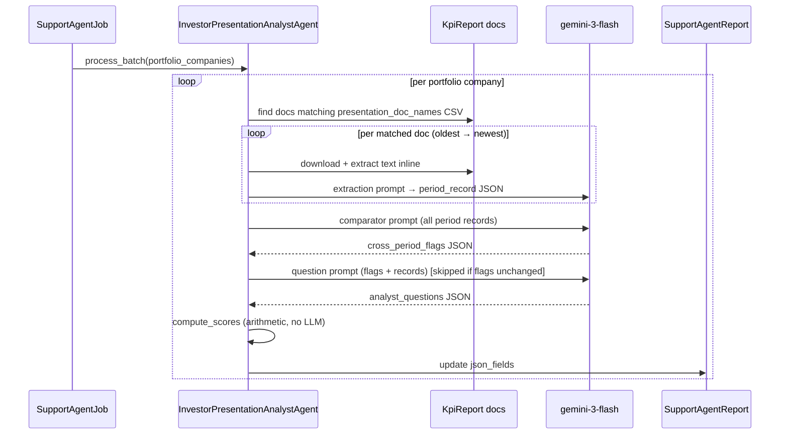

# PRD: Investor Presentation Analyst Agent

**Status:** Draft  
**Author:** Product  
**Date:** 2026-06-11

---

## Contents

1. [Problem Statement](#1-problem-statement)
2. [Goals & Success Metrics](#2-goals--success-metrics)
3. [Who It's For](#3-whos-for)
4. [What the Agent Produces](#4-what-the-agent-produces)
5. [The Pre-Board Briefing](#5-the-pre-board-briefing)
6. [Management Accountability Score](#6-management-accountability-score)
7. [Output: What the GP Sees](#7-output-what-the-gp-sees)
8. [Permissions](#8-permissions)
9. [Non-Goals](#9-non-goals)

— *Implementation* —

10. [What Already Exists](#10-what-already-exists)
11. [Architecture](#11-architecture)
12. [New Components](#12-new-components)
13. [Data Storage](#13-data-storage)
14. [Implementation Plan](#14-implementation-plan)

---

# Part 1 — Requirements & Outcomes

---

## 1. Problem Statement

A fund manager with 12 portfolio companies has a board call tomorrow. Before the call they should know: what did management commit to last quarter, did they deliver, what risks were flagged and are they still relevant, and what questions should they be asking that management hasn't addressed. In practice, none of this happens — there isn't time to re-read four quarters of board decks before every call.

Presentations are uploaded to KpiReports as PDFs or PowerPoints and never read again. The information is there — commitments, risks, metrics, strategic objectives, management tone — but extracting and comparing it across time takes hours of manual effort that usually doesn't happen at all.

**The result:** fund managers go into board meetings under-prepared, ask the same questions they asked last quarter, and miss the signals hiding in the pattern of what management said, then didn't say, across successive presentations.

---

## 2. Goals & Success Metrics

### Goals

1. A fund manager can open any portfolio company's page and see a board-ready briefing: what management said across all presentations, what changed, what's inconsistent, and the 8–12 questions they should ask on the next call.
2. The briefing is generated automatically on each agent run — no manual reading, no analyst prep work.
3. A Management Accountability Score gives the GP a single trackable signal: is this management team doing what they say?
4. GPs can ask follow-up questions in plain English using the same chat panel as other agents.

### Success Metrics (first 90 days)

| Metric | Target |
| :--- | :--- |
| Extraction coverage — % of portfolio companies with ≥ 2 presentations processed per run | ≥ 95% |
| GP rates briefing as "useful before a board call" | ≥ 80% |
| Generated questions rated relevant by GP | ≥ 75% |
| Time from agent run to briefing ready | < 3 minutes per company |
| GP opens chat to ask a follow-up at least once per session | ≥ 50% of sessions |

---

## 3. Who It's For

**Primary:** Fund Manager analysts and portfolio managers — anyone who prepares for board meetings, writes LP updates, or monitors company health.

**Not for:** Portfolio company users or LPs in Phase 1.

---

## 4. What the Agent Produces

The agent reads all investor presentations attached to a portfolio company's KpiReports (across all periods, oldest to newest) and produces three outputs in a single run:

### 4.1 Structured Intelligence per Period

For each presentation, the agent extracts:

| What | Why it matters |
| :--- | :--- |
| **Management narrative** | Tone shift from "we're executing" to "the market is challenging" is often the first signal |
| **Commitments** | Specific measurable promises — targets, timelines, numbers — that can be tracked to delivery |
| **Risks** | Named risks and stated mitigations — the raw material for the risk evolution analysis |
| **Accomplishments** | What management claims was achieved, which can be checked against prior commitments |
| **Forward plans** | What they say they'll do next — sets up the next period's accountability check |
| **Strategic objectives** | The stated priorities; drift across periods flags strategic instability |
| **Key metrics** | Named numbers with values — enables arithmetic checks across periods |
| **Initiatives** | Named programs that can be tracked to completion or abandonment |

### 4.2 Cross-Period Analysis

After extracting all periods, the agent compares them across five lenses and surfaces only the items that changed, disappeared, or don't add up:

- **Commitment tracker** — for every commitment in any prior period, did a later period address it? Marked: Met / Partial / Missed / Dropped silently.
- **Risk evolution** — risks that disappeared without resolution; risks that have been carried for multiple periods with identical language; new risks that emerged.
- **Objective drift** — strategic objectives that were removed, reframed, or replaced without explanation.
- **Initiative graveyard** — named programs that appeared in multiple periods and then vanished with no completion evidence.
- **Metric anomalies** — regressions on positively-framed metrics, arithmetic inconsistencies in burn/runway, unexplained restatements of prior-period numbers.

### 4.3 Pre-Board Briefing

From the cross-period analysis, the agent generates 8–12 specific questions grounded in the actual names, numbers, and language from the documents. See §5.

### 4.4 Chat Q&A

The agent is chat-enabled. After the briefing is generated, the GP can ask follow-up questions against the extracted data using the same floating chat panel as the LP Assistant and other agents:

- *"What did management say about churn risk in Q3?"*
- *"Compare their stated ARR targets across all periods."*
- *"Did they ever follow up on the Series B timeline from the Q1 deck?"*

---

## 5. The Pre-Board Briefing

The agent generates 8–12 questions per portfolio company, each grounded in the actual document language — not generic templates. The GP can take this list directly into a board call.

**What makes a question generated by this agent different from a generic checklist:** every question names the specific period, the specific commitment or risk or number, and the specific discrepancy. A GP can read it cold and ask it without preparation.

### Representative examples by category

**Commitment accountability**
> "In Q1 you committed to $8M ARR by Q4. The Q4 deck reports $6.1M — a 24% shortfall against your own target. What is the explanation, and what is the updated guidance for the next twelve months?"

> "The Q2 presentation stated that the [automation platform] would launch 'within 90 days'. Q3 and Q4 make no mention of it. Was it launched, deferred, or cancelled?"

**Risk accountability**
> "In Q2 you flagged data residency compliance as a high-priority risk with active legal review. This risk does not appear in Q3 or Q4. Was it resolved? If so, what was the resolution? If not, why has it been removed from reporting?"

> "Customer concentration — top 3 customers at 62% of revenue — has been flagged in three consecutive presentations with identical stated mitigations. What concrete progress has been made?"

**Strategic drift**
> "Q1 and Q2 positioned enterprise mid-market as the primary ICP. Q3 pivots to SMB self-serve without referencing the prior enterprise focus. Was enterprise abandoned, or is SMB an addition to the go-to-market?"

> "In Q1 you defined Year 2 success as '$12M ARR and 200 enterprise customers'. By Q3 the Year 2 goal is 'product-market fit in two new verticals' — a qualitative target has replaced a numerical one. Why?"

**Numbers that don't add up**
> "Q3 states a burn rate of $650K/month and 14 months of runway, implying approximately $9.1M cash on hand. With $18M raised and the spend trajectory visible in prior decks, this is difficult to reconcile. Can you provide the cash balance as of Q3 quarter-end?"

> "NRR was 118% in Q1, 109% in Q2, and 102% in Q3. The trendline is approaching sub-100% contraction. This has not been addressed in any presentation. What is the intervention?"

**Leadership and governance**
> "The Q3 deck introduces a new CFO in a footnote without explaining the prior CFO's departure. What were the circumstances of the change?"

---

## 6. Management Accountability Score

After the cross-period analysis, the agent computes a score (0–100) measuring whether management does what it says. This is a separate and complementary signal to `PortfolioScoringAgent` — see the comparison at the end of this section.

### Four dimensions

| Dimension | What it measures | Weight |
| :--- | :--- | :---: |
| **Commitment** | Ratio of met/partial commitments to total tracked; penalises silent drops | 35% |
| **Risk transparency** | Rewards named risks tracked to resolution; penalises dropped critical risks and stale mitigations | 25% |
| **Strategic coherence** | Rewards stable priorities across periods; penalises unexplained objective drift and initiative abandonment | 25% |
| **Narrative consistency** | Penalises metric regressions, arithmetic errors, and unexplained prior-period restatements | 15% |

```
Overall = (Commitment × 0.35) + (Risk × 0.25) + (Coherence × 0.25) + (Narrative × 0.15)
```

Scoring is pure arithmetic from the cross-period flags — no additional LLM call. The same grade scale as `PortfolioScoringAgent` (A / B+ / B / C+ / C / D) is used so both scores are immediately comparable.

### How to read the score

| Score | What it signals |
| :--- | :--- |
| 80–100 (A / B+) | Management is consistently accountable — commitments tracked, risks named and resolved, direction stable |
| 60–79 (B / C+) | Generally reliable with identifiable gaps — worth tracking the specific flagged items |
| 40–59 (C) | Frequent misses and drift — the pattern suggests commitments are aspirational rather than operational |
| 0–39 (D) | Systematic avoidance — numbers shift, risks disappear, objectives change without acknowledgment |

### How this differs from PortfolioScoringAgent

These two scores answer different questions and are designed to be read together.

| | PortfolioScoringAgent | This agent |
| :--- | :--- | :--- |
| **What is scored** | The company — fundamentals, growth, unit economics | Management's communication behaviour — do they follow through, are they honest |
| **Data source** | KPIs, valuations, investments, all documents | Investor presentations only |
| **Time axis** | Point-in-time (latest data) | Cross-period (requires multiple presentations) |
| **Scoring method** | LLM judgment via skill prompt | Pure arithmetic from extracted flags |

The scores diverge in revealing ways. A company that scores **A on fundamentals but D on accountability** is a red flag — strong numbers alongside a pattern of broken commitments and silently-shifted objectives suggests the reporting itself may not be trustworthy. A company that scores **C on fundamentals but A on accountability** is a different engagement: the business is struggling, but management is being consistent and honest about it.

---

## 7. Output: What the GP Sees

### Report tab (after agent run)

The support agent report page shows three sections in order:

**Section 1 — Management Accountability Score card**

```
┌─────────────────────────────────────────────────────────────────────────┐
│  Acme Analytics · Management Accountability  ·  4 presentations · B     │
├───────────────────────┬──────┬──────────────────────────────────────────┤
│  Overall              │  72  │  ████████████░░░  Adequate               │
├───────────────────────┼──────┼──────────────────────────────────────────┤
│  Commitments          │  68  │  Delivers ~2/3 of targets. 2 silent      │
│                       │      │  drops flagged (ARR target, hire plan).  │
│  Risk transparency    │  75  │  Mostly named. 1 critical risk (data     │
│                       │      │  residency) dropped without resolution.  │
│  Strategic coherence  │  80  │  Consistent priorities across 4 periods; │
│                       │      │  minor reframing of growth objective Q4. │
│  Narrative consistency│  65  │  NRR restatement in Q3 unexplained;      │
│                       │      │  burn/runway arithmetic inconsistent.    │
└───────────────────────┴──────┴──────────────────────────────────────────┘
```

**Section 2 — Pre-Board Briefing**

The 8–12 generated questions, each tagged with category and source period. The GP can mark questions as Asked, Promote to agenda, or Dismiss.

```
Pre-Board Briefing  ·  Acme Analytics  ·  Generated 11 Jun 2026

  [Commitment]  Q1 → Q4
  In Q1 you committed to $8M ARR by Q4. Q4 reports $6.1M — a 24% shortfall.
  What is the explanation and the updated guidance?
  [ Ask ]  [ Agenda ]  [ Dismiss ]

  [Risk]  Q2 → Q4
  Data residency compliance was flagged as high-priority in Q2 with active legal
  review. It does not appear in Q3 or Q4. Was it resolved? If not, why removed?
  [ Ask ]  [ Agenda ]  [ Dismiss ]

  [Metric]  Q1–Q3
  NRR declined from 118% → 109% → 102% across three periods. No presentation
  addresses this trend. What is the intervention?
  [ Ask ]  [ Agenda ]  [ Dismiss ]

  … (8–12 questions total)
```

**Section 3 — Cross-Period Findings (expandable)**

Five expandable panels showing the raw flags that drove the score and the questions:
- Commitment Tracker — table: commitment / first period / status badge
- Risk Evolution — delta: new ↑ / resolved ✓ / dropped ✗ / stale ⚠
- Objective Drift — added / removed / reframed list
- Initiative Graveyard — name, last seen period
- Metric Anomalies — metric, description, periods affected

Collapsed by default so the GP sees the score and questions first. Full detail available for analysts who want to dig in.

**Section 4 — Period records (expandable, one per period)**

The raw extracted intelligence per presentation — eight categories shown in a collapsible card per period, ordered newest-first. This is the source of truth behind the analysis.

### Chat panel

The same floating chat panel as LP Assistant and Portfolio Company Agent. The extracted intelligence is injected as context. Grounded responses cite the source period: `[Q3 2025]`.

Sample questions surfaced in the welcome state:
- *"What commitments from the last presentation were not in the most recent one?"*
- *"Which risks have disappeared without explanation?"*
- *"Compare the ARR targets stated across all periods."*
- *"What happened to the Series B fundraise?"*

---

## 8. Permissions

| Action | Entity Admin | Analyst |
| :--- | :---: | :---: |
| Run agent (single company or batch) | ✓ | ✗ |
| View report and briefing | ✓ | ✓ |
| Use chat Q&A | ✓ | ✓ |
| Mark questions asked / promote to agenda | ✓ | ✓ |
| Configure agent | ✓ | ✗ |
| Schedule agent | ✓ | ✗ |

---

## 9. Non-Goals

- **Automatic trigger on document upload** — the agent runs on demand or on a schedule. Event-driven triggering adds complexity and creates redundant runs when multiple documents are uploaded in one session.
- **Generating questions for management to answer** — the briefing is for the GP, not a questionnaire sent to the portco.
- **Audio/video investor updates** — text documents only (PDF, PPTX, DOCX) in Phase 1.
- **Cross-portfolio pattern detection** — per-company analysis only in Phase 1.
- **New DB tables** — all data lives in `SupportAgentReport.json_fields`.

---

---

# Part 2 — Implementation

---

## 10. What Already Exists (Do Not Rebuild)

| Component | Reused as-is |
| :--- | :---: |
| `SupportAgentService` (Trailblazer) — step pipeline, issue tracking, report generation | Subclassed |
| `SupportAgentReport` + `json_fields` | Used directly |
| `SupportAgent` model + `AGENT_TYPES`, `AgentSchedule`, `SupportAgentJob` | Extended |
| `_chat_panel.html.erb` + `SupportAgentChatsController` + `GenericChatAgent` + `BaseChatProvider` | Subclassed (chat mode) |
| `read_document_text` / `extract_text_from_file` from `PortfolioScoringAgent` | Copied to shared helper |
| `LlmService.ruby_llm_chat` | Yes |

**Not used:** `FolderDocumentExtractor`. Document reading is done inline in the Trailblazer steps, identical to `PortfolioScoringAgent`.

**Model:** configure `llm_model` to `gemini-3-flash` (1M token context). Presentations are passed in full — no truncation. Model is set per-agent via the existing `effective_model` mechanism.

---

## 11. Architecture

### Execution modes

```
BATCH / SCHEDULED
  SupportAgentJob / AgentSchedule
    → process_batch(portfolio_companies) — sequential, one wtf? per company
        Step 1: initialize_agent        — load investor, check enabled
        Step 2: collect_presentations   — find KPI report docs matching name CSV
        Step 3: extract_intelligence    — per-doc: read inline → LLM extraction call
        Step 4: compare_across_periods  — one LLM call (or sliding window) across all records
        Step 5: generate_analyst_qs     — one LLM call (skipped if flags unchanged)
        Step 6: compute_scores          — pure arithmetic, no LLM call
        Step 7: store_results           — SupportAgentReport.json_fields
    → batch summary notification

ADHOC (single company)
  Run button → wtf?(target: investor, with_steps: true) → same 7 steps, Turbo Stream progress

CHAT
  GP → _chat_panel → SupportAgentChatsController → GenericChatAgent
    → PresentationChatProvider (loads SupportAgentReport.json_fields as context)
    → SearchPresentationTextTool (for raw text lookup)
```

### Sequence diagram



---

## 12. New Components

### 12.1 Configuration (custom fields)

| Field | Type | Default | Purpose |
| :--- | :--- | :--- | :--- |
| `presentation_doc_names` | Text (CSV) | `"Investor Update, Board Deck, Management Presentation, Quarterly Update"` | Case-insensitive substring match against `document.name` |
| `max_periods` | Integer | 8 | Maximum periods to scan (uses most recent N) |
| `kpi_tag_list` | Select | `Actual` | Which KpiReport tag to scan |
| `comparison_strategy` | Select | `all_periods` | `all_periods` (one LLM call, accurate) or `sliding_window` (N−1→N pairs, cheaper) |
| `llm_model` | Text | `gemini-3-flash` | Large-context model for full document processing |

### 12.2 `InvestorPresentationAnalystAgent`

**Location:** `app/packs/ai/support_agents/services/investor_presentation_analyst_agent.rb`

Subclasses `SupportAgentService`. Follows `PortfolioScoringAgent` pattern exactly.

```ruby
class InvestorPresentationAnalystAgent < SupportAgentService
  DESCRIPTION = "Reads investor presentations across periods and generates a pre-board briefing: " \
                "cross-period flags, analyst questions, and a Management Accountability Score.".freeze

  LONG_DESCRIPTION = <<~DESC.freeze
    Reads investor presentation documents (PDF, PPTX, DOCX) from a portfolio company's KpiReports,
    extracts structured intelligence per period, compares across periods to find commitment misses,
    dropped risks, objective drift, abandoned initiatives, and metric anomalies. Produces a
    pre-board briefing (8–12 grounded questions) and a Management Accountability Score.

    Config: presentation_doc_names (CSV), max_periods (default 8), kpi_tag_list (default Actual),
    comparison_strategy (all_periods | sliding_window), llm_model (default gemini-3-flash).
  DESC

  STEP_LABELS = {
    initialize_agent:       "Initialize",
    collect_presentations:  "Collect Presentations",
    extract_intelligence:   "Extract Intelligence",
    compare_across_periods: "Cross-Period Analysis",
    generate_analyst_qs:    "Generate Briefing",
    compute_scores:         "Score",
    store_results:          "Save"
  }.freeze

  SUPPORTED_DOC_EXTENSIONS = %w[.pdf .txt .md .xlsx .xls .pptx .ppt .docx .doc].freeze
  DEFAULT_DOC_NAMES        = ["Investor Update", "Board Deck", "Management Presentation",
                               "Quarterly Update", "Investor Presentation"].freeze

  step :initialize_agent
  step :collect_presentations
  step :extract_intelligence
  step :compare_across_periods
  step :generate_analyst_qs
  step :compute_scores
  step :store_results

  def targets(entity_id)
    if entity_id.is_a?(Investor) || entity_id.is_a?(ActiveRecord::Base)
      [entity_id]
    else
      Investor.where(entity_id: entity_id, category: "Portfolio Company")
    end
  end

  def self.process_batch(support_agent_id:, targets:, user_id:, entity_id:, with_steps: false, execution_mode: :adhoc_batch) # rubocop:disable Lint/UnusedMethodArgument
    support_agent = SupportAgent.find(support_agent_id)
    targets = targets.includes(:portfolio_kpi_reports) if targets.respond_to?(:includes)
    successes = []
    errors    = []

    targets.to_a.each do |target|
      begin
        support_agent.agent.wtf?(support_agent_id: support_agent_id, target: target,
                                  user_id: user_id, entity_id: entity_id, batch_mode: true)
        successes << { id: target.id, name: target.try(:investor_name) || "ID=#{target.id}" }
      rescue StandardError => e
        Rails.logger.error { "[InvestorPresentationAnalystAgent] process_batch error for ID=#{target.id}: #{e.message}" }
        errors << { target_id: target.id, target_name: target.try(:investor_name) || "ID=#{target.id}", error: e.message }
      end
    end

    if execution_mode != :scheduled
      begin
        batch_target_type = targets.first.class.name if targets.any?
        SupportAgentJob.new.send(:send_batch_summary, support_agent, successes, errors, user_id, batch_target_type) if defined?(SupportAgentJob)
      rescue StandardError => e
        Rails.logger.error { "[InvestorPresentationAnalystAgent] failed to send batch summary: #{e.message}" }
      end
    end

    { successes: successes, errors: errors }
  end

  private

  def initialize_agent(ctx, target: nil, **)
    super
    ctx[:investor]       = target
    ctx[:period_records] = []
    ctx[:issues]         = { collection_issues: [], extraction_issues: [], analysis_issues: [] }
    target.category == "Portfolio Company" && @support_agent.enabled?
  end

  def collect_presentations(ctx, investor: nil, **)
    allowed_names = presentation_doc_names
    tag_list      = @support_agent.json_fields["kpi_tag_list"].presence || "Actual"
    max_periods   = [@support_agent.json_fields["max_periods"].to_i, 1].max
    max_periods   = 8 if max_periods < 1

    reports = investor.portfolio_kpi_reports
                      .where(tag_list: tag_list)
                      .order(as_of: :asc)
                      .last(max_periods)

    ctx[:presentation_docs] = reports.filter_map do |report|
      doc = report.documents.find do |d|
        d.file.present? && allowed_names.any? { |n| d.name.to_s.downcase.include?(n.downcase) }
      end
      next unless doc
      ext = File.extname(doc.file.original_filename.to_s).downcase
      next unless SUPPORTED_DOC_EXTENSIONS.include?(ext)
      { report: report, document: doc, period_label: report.label }
    end

    if ctx[:presentation_docs].empty?
      ctx[:issues][:collection_issues] << {
        type: :info,
        message: "No presentation documents found matching: #{allowed_names.join(', ')}",
        severity: :blocking
      }
      return false
    end

    ctx[:issues][:collection_issues] << {
      type: :info,
      message: "Found #{ctx[:presentation_docs].size} presentation(s): #{ctx[:presentation_docs].map { |d| d[:period_label] }.join(', ')}",
      severity: :success
    }
    true
  end

  def extract_intelligence(ctx, investor: nil, **)
    ctx[:presentation_docs].each do |entry|
      text = read_document_text(entry[:document])
      unless text.present?
        ctx[:issues][:extraction_issues] << { type: :info, message: "Could not read #{entry[:period_label]} — skipped", severity: :success }
        next
      end

      # Full document passed — no truncation. Requires large-context model (gemini-3-flash).
      record = extract_json_hash(extract_text_content(ctx[:llm].ask(build_extraction_prompt(investor.investor_name, entry[:period_label], text))))

      if record
        ctx[:period_records] << record.merge("period_label" => entry[:period_label], "as_of" => entry[:report].as_of.to_s)
        ctx[:issues][:extraction_issues] << { type: :info, message: "Extracted #{entry[:period_label]}", severity: :success }
      else
        ctx[:issues][:extraction_issues] << { type: :info, message: "Unparseable response for #{entry[:period_label]} — skipped", severity: :success }
      end
    rescue StandardError => e
      Rails.logger.error { "[InvestorPresentationAnalystAgent] Extraction failed for #{entry[:period_label]}: #{e.message}" }
      ctx[:issues][:extraction_issues] << { type: :info, message: "Extraction failed for #{entry[:period_label]}: #{e.message}", severity: :success }
    end

    ctx[:period_records].empty? ? (ctx[:issues][:analysis_issues] << { type: :info, message: "No records extracted — analysis skipped", severity: :blocking }) && true : true
  end

  def compare_across_periods(ctx, investor: nil, **)
    return true if ctx[:period_records].size < 2

    strategy = @support_agent.json_fields["comparison_strategy"].presence || "all_periods"
    flags = strategy == "sliding_window" ? run_sliding_window(ctx, investor) : run_all_periods(ctx, investor)

    ctx[:cross_period_flags] = flags || {}
    ctx[:issues][:analysis_issues] << {
      type: :info,
      message: "Cross-period analysis complete (#{strategy}) — #{flags&.values&.flatten&.size || 0} flag(s)",
      severity: :success
    }
    true
  rescue StandardError => e
    Rails.logger.error { "[InvestorPresentationAnalystAgent] Comparator failed: #{e.message}" }
    ctx[:cross_period_flags] = {}
    true
  end

  def run_all_periods(ctx, investor)
    extract_json_hash(extract_text_content(
      ctx[:llm].ask(build_comparator_prompt(investor.investor_name, JSON.pretty_generate(ctx[:period_records])))
    ))
  end

  def run_sliding_window(ctx, investor)
    merged = Hash.new { |h, k| h[k] = [] }
    ctx[:period_records].each_cons(2) do |older, newer|
      pair_flags = extract_json_hash(extract_text_content(
        ctx[:llm].ask(build_comparator_prompt(investor.investor_name, JSON.pretty_generate([older, newer])))
      )) || {}
      pair_flags.each { |lens, items| merged[lens].concat(Array(items)) }
    end
    merged.transform_values { |items| items.uniq { |i| i.to_json } }
  end

  # Questions are only regenerated when cross-period flags change materially.
  # A SHA-256 digest of the flags JSON is compared to the previous run's digest.
  # If identical, the prior question set is reused — zero LLM cost on stable runs.
  def generate_analyst_qs(ctx, investor: nil, support_agent: nil, **)
    return true if ctx[:period_records].empty?

    flags_json   = JSON.generate(ctx[:cross_period_flags] || {})
    flags_digest = Digest::SHA256.hexdigest(flags_json)

    prev_report    = SupportAgentReport.where(owner: investor, support_agent: support_agent).order(created_at: :desc).first
    prev_digest    = prev_report&.json_fields&.dig("flags_digest")
    prev_questions = prev_report&.json_fields&.dig("analyst_questions")

    if flags_digest == prev_digest && prev_questions.present?
      ctx[:analyst_questions] = prev_questions
      ctx[:flags_digest]      = flags_digest
      ctx[:issues][:analysis_issues] << { type: :info, message: "Flags unchanged — reusing #{prev_questions.size} questions from previous run", severity: :success }
      return true
    end

    questions = extract_json_array(extract_text_content(
      ctx[:llm].ask(build_question_prompt(investor.investor_name, JSON.pretty_generate(ctx[:period_records]), flags_json))
    ))

    ctx[:analyst_questions] = questions || []
    ctx[:flags_digest]      = flags_digest
    ctx[:issues][:analysis_issues] << { type: :info, message: "Generated #{ctx[:analyst_questions].size} briefing questions", severity: :success }
    true
  rescue StandardError => e
    Rails.logger.error { "[InvestorPresentationAnalystAgent] Question generation failed: #{e.message}" }
    ctx[:analyst_questions] = prev_questions || []
    ctx[:flags_digest]      = flags_digest
    true
  end

  # Pure arithmetic from cross-period flags — no LLM call.
  def compute_scores(ctx, **)
    flags   = ctx[:cross_period_flags] || {}
    records = ctx[:period_records]

    commitment = score_commitments(flags["commitment_tracker"] || [])
    risk       = score_risk(flags["risk_evolution"] || [])
    coherence  = score_coherence(flags["objective_drift"] || [], flags["initiative_graveyard"] || [], records)
    narrative  = score_narrative(flags["metric_anomalies"] || [])
    overall    = (commitment * 0.35 + risk * 0.25 + coherence * 0.25 + narrative * 0.15).round

    ctx[:score] = {
      "overall_score"    => overall,
      "grade"            => score_to_grade(overall),
      "commitment_score" => commitment,
      "risk_score"       => risk,
      "coherence_score"  => coherence,
      "narrative_score"  => narrative,
      "periods_analyzed" => records.size
    }
    ctx[:issues][:analysis_issues] << { type: :info, message: "Management Accountability Score: #{overall}/100 (#{score_to_grade(overall)})", severity: :success }
    true
  rescue StandardError => e
    Rails.logger.error { "[InvestorPresentationAnalystAgent] Scoring failed: #{e.message}" }
    ctx[:score] = nil
    true
  end

  def score_commitments(tracker)
    return 50 if tracker.empty?
    met     = tracker.count { |c| c["status"] == "met" }
    partial = tracker.count { |c| c["status"] == "partially_met" }
    drops   = tracker.count { |c| c["status"] == "not_mentioned" }
    base    = ((met + partial * 0.5) / tracker.size * 100).round
    (base - drops * 5).clamp(0, 100)
  end

  def score_risk(evolution)
    score = 100
    evolution.each do |r|
      score += case r["status"]
               when "dropped"   then -10
               when "escalated" then -5
               when "new"       then -3
               when "resolved"  then +5
               else 0
               end
    end
    score.clamp(0, 100)
  end

  def score_coherence(drift, graveyard, records)
    score = 100
    drift.each { |o| score += o["change"] == "removed" ? -8 : -3 }
    score -= graveyard.size * 5
    if records.size >= 3
      stable = records.flat_map { |r| Array(r["strategic_objectives"]).map { |o| o["description"].to_s.downcase } }
                      .tally.count { |_, n| n >= 3 }
      score += stable * 5
    end
    score.clamp(0, 100)
  end

  def score_narrative(anomalies)
    (100 - anomalies.size * 10).clamp(0, 100)
  end

  def score_to_grade(score)
    case score
    when 90..100 then "A"
    when 80..89  then "B+"
    when 70..79  then "B"
    when 60..69  then "C+"
    when 50..59  then "C"
    else              "D"
    end
  end

  def store_results(ctx, investor: nil, support_agent: nil, **)
    super(ctx, model: investor, support_agent: support_agent)
    report = ctx[:support_agent_report]
    return true unless report

    report.json_fields = (report.json_fields || {}).merge(
      "period_records"     => ctx[:period_records],
      "cross_period_flags" => ctx[:cross_period_flags] || {},
      "analyst_questions"  => ctx[:analyst_questions] || [],
      "periods_analyzed"   => ctx[:period_records].map { |r| r["period_label"] },
      "flags_digest"       => ctx[:flags_digest],
      "score"              => ctx[:score],
      "run_at"             => Time.current.iso8601
    )
    report.json_fields_will_change!
    report.save!
    true
  end

  alias_method :generate_progress_reports, :store_results

  # --- Document reading — identical to PortfolioScoringAgent ---

  def read_document_text(doc)
    return nil if doc&.file.blank?
    result = nil
    Dir.mktmpdir("presentation_analyst_") do |tmp_dir|
      filename  = File.basename(doc.file.original_filename.to_s).gsub(/[^0-9A-Za-z.\-_]/, '_')
      file_path = File.join(tmp_dir, filename)
      doc.file.open { |io| File.binwrite(file_path, io.read) }
      result = extract_text_from_file(file_path, File.extname(filename).downcase)
    end
    result
  rescue StandardError => e
    Rails.logger.warn { "[InvestorPresentationAnalystAgent] Could not read '#{doc.name}': #{e.message}" }
    nil
  end

  def extract_text_from_file(file_path, extension)
    case extension
    when '.txt', '.md'
      File.read(file_path, encoding: 'UTF-8')
    when '.pdf'
      require 'pdf-reader'
      PDF::Reader.new(file_path).pages.map(&:text).join("\n\n")
    when '.xlsx', '.xls'
      require 'roo'
      spreadsheet = Roo::Spreadsheet.open(file_path)
      spreadsheet.sheets.flat_map do |sheet|
        rows = []
        spreadsheet.sheet(sheet).each_row_streaming(pad_cells: true) do |row|
          vals = row.map { |c| c&.value.to_s.strip }.compact_blank
          rows << vals.join(" | ") if vals.any?
        end
        ["=== #{sheet} ===", *rows]
      end.join("\n")
    when '.pptx', '.ppt', '.docx', '.doc'
      # LibreOffice headless handles speaker notes, tables, and grouped shapes
      # that Nokogiri XML parsing misses. Falls back to Pandoc, then Nokogiri.
      extract_via_libreoffice(file_path) ||
        extract_via_pandoc(file_path) ||
        extract_via_nokogiri_pptx(file_path)
    end
  rescue StandardError => e
    "Error extracting #{extension}: #{e.message}"
  end

  def extract_via_libreoffice(file_path)
    return nil unless system("which soffice > /dev/null 2>&1")
    out_dir = File.dirname(file_path)
    system("soffice --headless --convert-to txt:Text --outdir #{out_dir} #{file_path} > /dev/null 2>&1")
    txt_path = file_path.sub(/\.[^.]+$/, '.txt')
    File.exist?(txt_path) ? File.read(txt_path, encoding: 'UTF-8') : nil
  rescue StandardError; nil; end

  def extract_via_pandoc(file_path)
    return nil unless system("which pandoc > /dev/null 2>&1")
    output = `pandoc --to plain #{file_path} 2>/dev/null`
    output.present? ? output : nil
  rescue StandardError; nil; end

  def extract_via_nokogiri_pptx(file_path)
    require 'zip'; require 'nokogiri'
    parts = []
    Zip::File.open(file_path) do |zip|
      zip.glob('ppt/slides/slide*.xml')
         .sort_by { |e| e.name.match(/slide(\d+)\.xml/)[1].to_i }
         .each_with_index do |entry, i|
        texts = Nokogiri::XML(entry.get_input_stream.read).tap(&:remove_namespaces!).xpath('//t').map(&:text).compact_blank
        parts << "=== Slide #{i + 1} ===\n#{texts.join("\n")}" if texts.any?
      end
    end
    parts.join("\n\n")
  rescue StandardError; nil; end

  # --- Prompt builders ---

  def build_extraction_prompt(company_name, period_label, text)
    <<~PROMPT
      Extract structured intelligence from this investor presentation. Use exact names,
      numbers, and language. Do not infer or hallucinate. Return empty arrays where a
      category has no evidence.

      Company: #{company_name}  Period: #{period_label}

      Return JSON with these keys:
      - management_narrative: string — 1–3 sentences on tone and overall framing
      - commitments: [{description, metric?, target_value?, target_date?}]
      - risks: [{name, severity (high/medium/low), mitigation?}]
      - accomplishments: [{description, metric?, value?}]
      - forward_plans: [{description, timeline?, owner?}]
      - strategic_objectives: [{description, timeframe?}]
      - key_metrics: [{name, value, unit?, period?}]
      - initiatives: [{name, status (in_progress/planned/completed)}]

      Return ONLY the JSON object in ```json ... ``` fences.

      === PRESENTATION TEXT ===
      #{text}
    PROMPT
  end

  def build_comparator_prompt(company_name, records_json)
    <<~PROMPT
      Compare these investor presentations (oldest first) for #{company_name}.
      Return only items where there is genuine evidence of change or concern.

      Return JSON with these keys:
      - commitment_tracker: [{commitment, from_period, status (met/partially_met/missed/not_mentioned), evidence?}]
      - risk_evolution: [{name, first_period, last_period, status (resolved/dropped/escalated/new), note?}]
      - objective_drift: [{description, change (added/removed/reframed), from_period?, to_period?}]
      - initiative_graveyard: [{name, first_period, last_seen_period, note?}]
      - metric_anomalies: [{metric, description, periods_affected}]

      Return ONLY the JSON object in ```json ... ``` fences.

      === PERIOD RECORDS ===
      #{records_json}
    PROMPT
  end

  def build_question_prompt(company_name, records_json, flags_json)
    <<~PROMPT
      Generate 8–12 pre-board meeting questions for #{company_name}.
      Each question must name the specific period, commitment, risk, metric, or initiative it references.
      Questions should be direct and uncomfortable — not generic.
      Cover all lenses where flags exist: commitment, risk, objective, initiative, metric, governance.

      Return JSON array: [{question, category (commitment|risk|objective|initiative|metric|governance), source_period, source_evidence}]
      Return ONLY the JSON array in ```json ... ``` fences.

      === PERIOD RECORDS ===
      #{records_json}

      === CROSS-PERIOD FLAGS ===
      #{flags_json}
    PROMPT
  end

  def presentation_doc_names
    csv   = @support_agent.json_fields["presentation_doc_names"].to_s
    names = csv.split(",").map(&:strip).reject(&:blank?)
    names.any? ? names : DEFAULT_DOC_NAMES
  end

  def extract_text_content(response)
    return response.to_s unless response.respond_to?(:content)
    content = response.content
    content.is_a?(RubyLLM::Content) ? content.text : content.to_s
  end

  def extract_json_hash(raw)
    match = raw.match(/```json\s*(\{.+?\})\s*```/m) || raw.match(/```\s*(\{.+?\})\s*```/m) || raw.match(/(\{.+\})/m)
    JSON.parse(match[1]) if match
  rescue JSON::ParserError; nil; end

  def extract_json_array(raw)
    match = raw.match(/```json\s*(\[.+?\])\s*```/m) || raw.match(/```\s*(\[.+?\])\s*```/m) || raw.match(/(\[.+\])/m)
    JSON.parse(match[1]) if match
  rescue JSON::ParserError; nil; end
end
```

Add `"InvestorPresentationAnalystAgent"` to `SupportAgent::AGENT_TYPES`.

### 12.3 `PresentationChatProvider`

**Location:** `app/packs/ai/support_agents/services/chat_providers/presentation_chat_provider.rb`

Loads the latest `SupportAgentReport.json_fields` as system prompt context. Shares the `_chat_panel.html.erb` and `SupportAgentChatsController` with LP Assistant and other chat agents — no new controller or view needed.

```ruby
class PresentationChatProvider < BaseChatProvider
  def system_prompt
    <<~PROMPT
      You are an investor presentation analyst for #{company_name}.
      User: #{analyst&.name}  Date: #{Date.current.strftime('%d %b %Y')}

      You have extracted intelligence from #{period_count} presentations (#{period_range}).
      Answer questions about management's commitments, risks, objectives, metrics, and initiatives.
      Cite source periods inline: [Q3 2025]. Never fabricate. Use tables for metric comparisons.

      #{strict_scope_prompt}
      #{chart_rendering_prompt}

      === EXTRACTED INTELLIGENCE ===
      #{intelligence_context}
    PROMPT
  end

  private

  def build_context = ""  # injected via system_prompt

  def tools = [SearchPresentationTextTool.new(report: latest_report)]

  def latest_report
    @latest_report ||= SupportAgentReport
      .where(support_agent: support_agent, owner_type: "Investor")
      .order(created_at: :desc).first
  end

  def intelligence_context
    return "No data — run the agent first." unless latest_report
    fields  = latest_report.json_fields || {}
    records = fields["period_records"] || []
    flags   = fields["cross_period_flags"] || {}
    parts   = records.map { |r| "--- #{r['period_label']} ---\n#{JSON.pretty_generate(r.except('period_label', 'as_of'))}" }
    parts  << "--- Cross-Period Flags ---\n#{JSON.pretty_generate(flags)}" if flags.any?
    parts.join("\n\n")
  end

  def company_name  = latest_report&.owner&.investor_name || support_agent.name
  def period_count  = latest_report&.json_fields&.dig("period_records")&.size || 0
  def period_range
    p = latest_report&.json_fields&.dig("periods_analyzed") || []
    p.any? ? "#{p.first} to #{p.last}" : "no periods"
  end
end
```

Wire up: `when "InvestorPresentationAnalystAgent" then PresentationChatProvider` in `BaseChatProvider.resolve`.

### 12.4 `SearchPresentationTextTool`

Searches extracted JSON records for content not covered by the structured fields. Used by `PresentationChatProvider` only.

```ruby
class SearchPresentationTextTool < RubyLLM::Tool
  description "Search raw extracted presentation content. Use for specific quotes or wording not in the structured records."
  param :query,  type: :string, required: true
  param :period, type: :string, required: false

  def initialize(report:) = (@report = report; super())

  def execute(query:, period: nil)
    return "No data available." unless @report
    records = (@report.json_fields || {}).fetch("period_records", [])
    records = records.select { |r| r["period_label"] == period } if period.present?
    terms   = query.downcase.split.first(5)
    results = records.filter_map do |r|
      next unless terms.any? { |t| r.to_json.downcase.include?(t) }
      "=== #{r['period_label']} ===\n#{r.to_json.truncate(800)}"
    end.first(3)
    results.any? ? results.join("\n\n") : "No matching content for: #{query}"
  end
end
```

---

## 13. Data Storage

No new DB tables. One `SupportAgentReport` per portfolio company, overwritten on each run. Key structure:

```json
{
  "run_at": "2026-06-11T09:32:00Z",
  "periods_analyzed": ["Q1-04-25-Actual", "Q2-07-25-Actual", "Q3-10-25-Actual", "Q4-01-26-Actual"],
  "period_records": [{ "period_label": "...", "as_of": "...", "commitments": [], "risks": [], "key_metrics": [], "..." }],
  "cross_period_flags": {
    "commitment_tracker": [{ "commitment": "...", "from_period": "...", "status": "missed" }],
    "risk_evolution": [{ "name": "...", "status": "dropped", "first_period": "...", "last_period": "..." }],
    "objective_drift": [],
    "initiative_graveyard": [],
    "metric_anomalies": []
  },
  "analyst_questions": [{ "question": "...", "category": "commitment", "source_period": "...", "source_evidence": "..." }],
  "flags_digest": "a3f8c2...",
  "score": { "overall_score": 72, "grade": "B", "commitment_score": 68, "risk_score": 75, "coherence_score": 80, "narrative_score": 65, "periods_analyzed": 4 },
  "final_status": "ready",
  "completed_at": "2026-06-11T09:35:00Z"
}
```

---

## 14. Implementation Plan

### Sprint 1 — Pipeline (4 days)
1. Steps 1–7: `initialize_agent` through `store_results` with all three LLM prompts and arithmetic scoring.
2. Add `"InvestorPresentationAnalystAgent"` to `AGENT_TYPES`. Custom fields via FormType. Default `llm_model` to `gemini-3-flash`.
3. Cucumber: two KPI reports with presentation docs → run → report contains `period_records`, `cross_period_flags`, `analyst_questions`, and `score`.

### Sprint 2 — Report UI (3 days)
4. Report page: score card → pre-board briefing (questions with Ask/Agenda/Dismiss) → cross-period findings panels → period cards.
5. Score card reuses the grade badge component from `PortfolioScoringAgent`.
6. Cucumber: report renders score, questions, flags, and period cards correctly.

### Sprint 3 — Chat (2 days)
7. `PresentationChatProvider` + `SearchPresentationTextTool`. Wire up in `BaseChatProvider.resolve`. Enable `chat_config`.
8. Add sample questions to `SupportAgent#sample_questions`.
9. Cucumber: chat question about a dropped risk → answer cites correct period from json_fields.

---

*Investor Presentation Analyst Agent PRD | Draft 2026-06-11*
