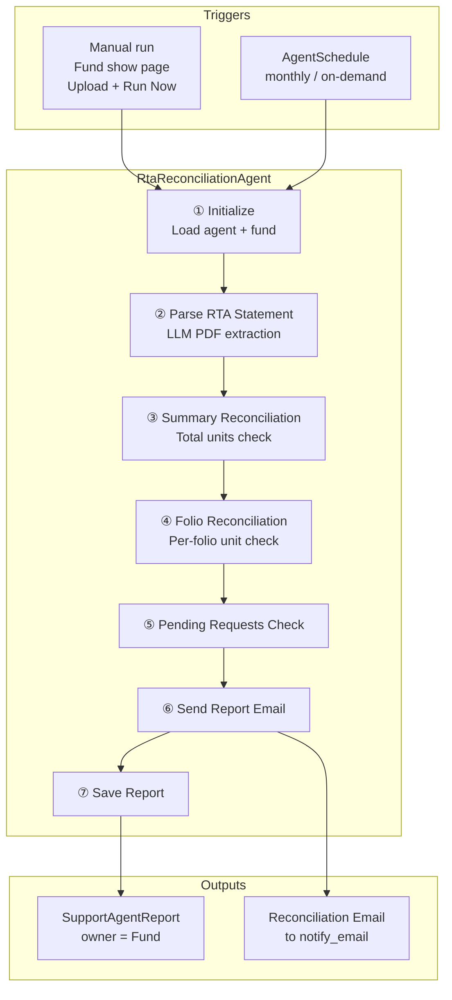
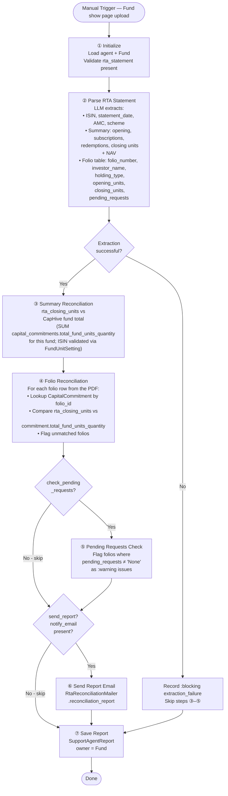
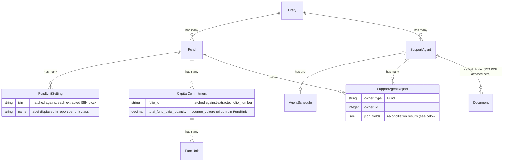
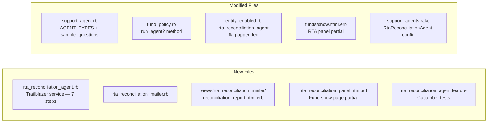

# PRD: RTA Unit Statement Reconciliation Agent

**Status:** Draft  
**Author:** Fund Operations  
**Date:** 2026-06-21  
**Last Updated:** 2026-06-21

---

## TL;DR

`RtaReconciliationAgent` is a support agent scoped to **one Fund per run** that accepts an uploaded RTA unit statement PDF, uses the LLM to extract structured data from it, and reconciles the extracted figures against CapHive's live `fund_units` / `capital_commitments` data at two levels: **summary** (total closing units for the fund) and **folio** (per-`capital_commitment.folio_id`). Discrepancies are flagged with severity and surfaced in a `SupportAgentReport` and an optional email. No new tables are required; the agent reuses `SupportAgent`, `SupportAgentReport`, and the existing Document attachment on the agent.

---

## 1. Problem Statement

Mutual fund RTAs (Registrar and Transfer Agents) issue periodic unit statements — typically monthly or quarterly — that contain the authoritative record of unit balances per folio. Fund administrators must manually cross-check these statements against CapHive's internal `fund_units` ledger to confirm that:

1. The **total units in issue** on the RTA statement matches CapHive's aggregate.
2. Each **individual folio's closing units** matches the corresponding investor's unit balance.

Today this check is performed entirely by hand: the ops team downloads the PDF, reads the folio table, pulls a report from CapHive, and compares figures in a spreadsheet. This is:

- **Error-prone** — manual transcription mistakes cause mis-flags and missed breaks.
- **Time-consuming** — a fund with 50+ folios takes 30–60 minutes per reconciliation cycle.
- **Undocumented** — no audit trail of when a reconciliation was performed or what was found.
- **Reactive** — breaks are only caught at reconciliation time, not as they accumulate.

---

## 2. Solution

**RtaReconciliationAgent** — a configurable support agent that runs per Fund. It accepts an uploaded RTA PDF, extracts all figures using the LLM, and performs a structured reconciliation against CapHive data. Results are stored in a `SupportAgentReport` and optionally emailed.

```
┌─────────────────────── RtaReconciliationAgent ────────────────────────┐
│                                                                        │
│  ① Parse Statement   LLM extracts ISIN, NAV, summary + folio table   │
│  ② Summary Check     RTA closing units vs CapHive fund total          │
│  ③ Folio Check       RTA folio rows vs CapHive capital_commitments    │
│  ④ Pending Requests  Surface folios with Pending Requests ≠ "None"   │
│  ⑤ Send Report       Email to configured address                      │
│  ⑥ Save Report       Persist SupportAgentReport owner = Fund          │
│                                                                        │
│  Each step is independently toggleable via json_fields.               │
└────────────────────────────────────────────────────────────────────────┘
```

### System Context



---

## 3. Goals

| Goal | Success Metric |
|---|---|
| Eliminate manual spreadsheet reconciliation | Zero manual cross-checks needed for a fund with RtaReconciliationAgent enabled |
| Detect unit breaks as soon as a statement is uploaded | All summary and folio discrepancies appear in the report within 2 minutes of upload |
| Create an audit trail for every reconciliation run | Every run produces a `SupportAgentReport` with timestamp, extracted figures, and comparison result |
| Surface pending-request folios before they cause breaks | Folios with `Pending Requests ≠ None` are flagged as `:warning` issues in every run |
| Zero new scheduling infrastructure | Reuses `SupportAgent`, `AgentSchedule`, `SupportAgentReport` unchanged |

---

## 4. Out of Scope (v1)

- Automatic parsing of multiple statements in a single run (one PDF per run).
- Writing reconciliation results back to `fund_unit` or `capital_commitment` records.
- Transaction-level reconciliation (subscriptions and redemptions line-by-line).
- NAV-based amount reconciliation (unit value × quantity cross-check deferred to v1.1).
- Generating a new RTA-format statement from CapHive data.
- Multi-RTA support where a single fund has statements from more than one RTA.
- Investor-facing visibility of reconciliation status.

---

## 5. User Stories

| Persona | Story |
|---|---|
| Fund Ops Admin | Upload an RTA statement for a fund and immediately see which folios are in break, so I can investigate without opening a spreadsheet. |
| Fund Accountant | Receive an email after each monthly reconciliation run listing any breaks and pending requests, so I can triage them without logging into CapHive. |
| Compliance Officer | Pull up the reconciliation history for a fund to show that unit balances were verified on a specific date, supporting NAV audit requirements. |
| Fund Manager | See a summary reconciliation badge on the Fund show page telling me whether the latest RTA statement matches, so I have a one-glance status. |

---

## 6. Functional Requirements

### 6.1 Agent Configuration

**FormType:** `SupportAgent / RtaReconciliationAgent`

```
┌─── Group ──────────────────────┬──── Fields ───────────────────────────────┐
│ Statement Input                 │ rta_statement (File upload)               │
│ Reconciliation                  │ tolerance_units (#), tolerance_pct (#)    │
│ Pending Requests                │ check_pending_requests (Y/N)              │
│ Reporting                       │ send_report (Y/N), notify_email (text)    │
│ Statement Metadata              │ statement_date (date override, optional)  │
└─────────────────────────────────┴───────────────────────────────────────────┘
```

| Field | Type | Default | Description |
|-------|------|---------|-------------|
| `rta_statement` | File | _(blank)_ | PDF unit statement from the RTA. Agent fails step ① if absent. |
| `tolerance_units` | NumberField | `0.01` | Maximum absolute unit difference (per folio or summary) before flagging a break. Accommodates minor rounding in the RTA PDF. |
| `tolerance_pct` | NumberField | `0` | Maximum percentage difference. A folio is flagged only if **both** absolute and percentage differences exceed their respective tolerances. Set to `0` to use absolute tolerance only. |
| `check_pending_requests` | Select (Yes/No) | Yes | Flag folios where the RTA statement shows `Pending Requests ≠ None`. |
| `send_report` | Select (Yes/No) | Yes | Email the reconciliation summary to `notify_email` after each run. |
| `notify_email` | TextField | _(blank)_ | Recipient for the reconciliation report email. |
| `statement_date` | DateField | _(blank)_ | Override the statement date extracted from the PDF. Useful when the PDF date format is non-standard. |

---

### 6.2 Execution Pipeline



| Step | Method | Toggle | Always runs? |
|---|---|---|---|
| ① Initialize | `initialize_agent` | — | Yes |
| ② Parse RTA Statement | `parse_rta_statement` | — | Yes |
| ③ Summary Reconciliation | `reconcile_summary` | — | Yes (skipped if ② fails) |
| ④ Folio Reconciliation | `reconcile_folios` | — | Yes (skipped if ② fails) |
| ⑤ Pending Requests Check | `check_pending_requests` | `check_pending_requests` | No |
| ⑥ Send Report Email | `send_reconciliation_report` | `send_report` + `notify_email` | No |
| ⑦ Save Report | `generate_progress_reports` | — | Yes |

---

### 6.3 Step ② — LLM Extraction

The agent sends the full PDF text to the LLM with a structured extraction prompt. A single PDF may contain **multiple ISIN blocks** — each with its own summary section and folio break-up table. The LLM returns an array of such blocks, one per ISIN. All downstream steps iterate over this array.

The prompt is deliberately **layout-agnostic**: RTAs differ in column order, heading labels, number formatting (Indian lakh vs. standard), and whether the folio table is separate from or embedded in the scheme section. The LLM is instructed to locate and interpret the data semantically rather than rely on fixed column positions.

**Extraction prompt:**

```
You are a fund operations assistant processing an RTA (Registrar and Transfer Agent) unit statement.
These statements vary in format across RTAs — column names, ordering, and layout differ.
Your job is to semantically identify and extract the data regardless of how it is presented.

Rules:
- A statement may cover one or more ISINs (unit classes / schemes). Produce one entry per ISIN.
- Column headings may vary: "Units", "No of Units", "Quantity" all mean the same thing.
- Numbers may use Indian lakh formatting (e.g. 2,78,465.00) — treat these as plain decimals.
- "Pending Requests" may be labelled "Pending TXN", "Outstanding Requests", etc.
- "Holding Type" may be labelled "Investor Type", "Residency", etc.
- If a field is not present in the statement, use null.
- Return ONLY a valid JSON object. No prose, no markdown fences outside the JSON.

Output schema:
{
  "amc":            string,           // AMC / fund house name
  "statement_date": string,           // statement period end date, any parseable format
  "schemes": [
    {
      "scheme":     string,           // scheme / fund name
      "isin":       string,           // ISIN code
      "nav":        number,           // NAV / unit value used in this statement
      "summary": {
        "opening_units":       number,
        "subscriptions_units": number,  // net new subscriptions during the period
        "redemptions_units":   number,  // net redemptions during the period (positive number)
        "closing_units":       number
      },
      "folios": [
        {
          "folio_number":     string,
          "investor_name":    string,
          "holding_type":     string,   // e.g. "Resident", "Non Resident"
          "opening_units":    number,
          "closing_units":    number,
          "pending_requests": string    // "None" or description of pending transaction
        }
      ]
    }
  ]
}

=== RTA STATEMENT ===
{statement_text}
```

**Validation — abort reconciliation if any field is null:**
- `schemes` must be a non-empty array
- Each scheme entry must have `isin`, `summary.closing_units`, and a non-empty `folios` array
- Schemes failing individual validation are skipped with a `:warning`; valid schemes still reconcile

---

### 6.4 Steps ③ & ④ — Reconciliation Loop (one iteration per ISIN block)

Steps ③ and ④ run as a single loop over `extracted[:schemes]`. Each iteration is independent — a failure in one ISIN block does not skip the others.

```mermaid
flowchart TD
    Loop([For each scheme in extracted.schemes]) --> ISINCheck

    ISINCheck{FundUnitSetting\nexists for this fund\nwith scheme.isin?}
    ISINCheck -->|No| ISINFail[:warning — isin_not_found\nskip this scheme]
    ISINCheck -->|Yes| SumQuery

    SumQuery["caphive_units =\nfund.capital_commitments\n  .where(unit_type: fus.name)\n  .sum(:total_fund_units_quantity)"]

    SumQuery --> SumCmp{|rta_closing - caphive|\n> tolerance?}
    SumCmp -->|No| SumPass[:pass — summary_match for this ISIN]
    SumCmp -->|Yes| SumFail[:blocking — summary_break for this ISIN]

    SumPass --> FolioLoop
    SumFail --> FolioLoop

    FolioLoop([For each folio in scheme.folios]) --> CommitLookup

    CommitLookup{CapitalCommitment\nfolio_id = folio_number\nAND fund_id = fund.id?}
    CommitLookup -->|No| UnmatchedFolio[:blocking — unmatched_folio]
    CommitLookup -->|Yes| FolioCmp

    FolioCmp{|rta_closing_units -\ncc.total_fund_units_quantity|\n> tolerance?}
    FolioCmp -->|No| FolioPass[:pass — folio_match]
    FolioCmp -->|Yes| FolioFail[:blocking — folio_break]

    FolioPass --> Next([Next folio →])
    FolioFail --> Next
    UnmatchedFolio --> Next
```

**CapHive query per ISIN block:**

```ruby
extracted[:schemes].each do |scheme|
  # Validate ISIN against FundUnitSetting
  fus = FundUnitSetting.find_by(fund: fund, isin: scheme[:isin])
  unless fus
    ctx[:scheme_results] << { isin: scheme[:isin], status: :warning, message: "ISIN not found in FundUnitSetting" }
    next
  end

  # Summary — use counter_culture pre-computed total per commitment, filtered by unit setting
  caphive_units = fund.capital_commitments
                      .where(unit_type: fus.name)
                      .sum(:total_fund_units_quantity)

  # Folio — per-commitment comparison
  scheme[:folios].each do |folio|
    cc = fund.capital_commitments.find_by(folio_id: folio[:folio_number])
    next record_unmatched(folio) unless cc

    diff = (folio[:closing_units] - cc.total_fund_units_quantity).abs
    record_folio_result(folio, cc, diff)
  end
end
```

`total_fund_units_quantity` is maintained automatically by `counter_culture` on `FundUnit` — no need to re-aggregate raw `fund_units` rows.

> **No migration required:** `capital_commitments` already has a `unit_type varchar(40)` column that stores the unit class name, and `FundUnitSetting.name` is that same value. The summary query filters by `unit_type: fus.name` — no new foreign key needed.

---

### 6.5 Missing Folio Check (reverse direction)

After processing all folio rows from the PDF, the agent checks the reverse: for each `CapitalCommitment` with a `folio_id` set on this fund, it verifies the folio appeared in the RTA statement. A commitment present in CapHive but absent from the PDF is recorded as a `:warning` issue:

```
"Folio 101 is in CapHive but missing from RTA statement"
```

This check runs once per scheme (per ISIN block) after its folio loop completes.

---

### 6.6 Step ⑤ — Pending Requests Check

For each folio where `pending_requests ≠ "None"` (case-insensitive):

```
Issue: { type: :warning, folio: "FX-001", message: "Pending Requests: Redemption of 500 units" }
```

These are not unit breaks but signal in-flight transactions that may cause a break in the next statement period.

---

### 6.7 Tolerance Rules

A break is flagged only when **both** configured tolerances are exceeded:

| Condition | Result |
|---|---|
| `abs_diff <= tolerance_units` | Pass (regardless of `tolerance_pct`) |
| `abs_diff > tolerance_units` AND `tolerance_pct = 0` | Break |
| `abs_diff > tolerance_units` AND `pct_diff <= tolerance_pct` | Pass |
| `abs_diff > tolerance_units` AND `pct_diff > tolerance_pct` | Break |

Default `tolerance_units = 0.01` accommodates the rounding commonly seen in RTA PDFs (e.g., folio sum = 31,378.67 vs. header closing balance = 31,379).

---

### 6.8 Processing Flow

```mermaid
sequenceDiagram
    participant User as Fund Ops Admin
    participant UI as Fund Show Page
    participant Job as SupportAgentJob
    participant Agent as RtaReconciliationAgent
    participant LLM as LLM (Claude)
    participant DB as Database
    participant Mail as Mailer

    User->>UI: Upload RTA PDF + click Run Now
    UI->>Job: enqueue(support_agent_id, fund_id)
    Job->>Agent: wtf?(target: fund)

    Agent->>Agent: read PDF text from attached document

    Agent->>LLM: extraction prompt + PDF text
    LLM-->>Agent: JSON {isin, statement_date, summary, folios}

    Agent->>Agent: validate extracted JSON (schemes array non-empty; each scheme has isin + closing_units + folios)

    loop For each scheme (ISIN block) in extracted.schemes
        Agent->>DB: FundUnitSetting.find_by(fund: fund, isin: scheme.isin)
        Note over Agent,DB: skips this scheme with :warning if ISIN not found
        Agent->>DB: fund.capital_commitments.where(fund_unit_setting_id: fus.id).sum(:total_fund_units_quantity)
        Agent->>Agent: compare rta scheme.closing_units vs caphive total → summary_issues[isin]

        loop For each folio in scheme.folios
            Agent->>DB: find CapitalCommitment by folio_id
            Agent->>Agent: compare rta_closing_units vs cc.total_fund_units_quantity → folio_issues[isin]
        end

        Agent->>Agent: check CapHive commitments not in RTA → missing_folio_issues[isin]
    end

    opt check_pending_requests = Yes
        Agent->>Agent: collect pending_requests ≠ None → pending_issues
    end

    opt send_report = Yes AND notify_email present
        Agent->>Mail: RtaReconciliationMailer.reconciliation_report
    end

    Agent->>DB: UPSERT SupportAgentReport (Fund)
```

---

## 7. Non-Functional Requirements

| Concern | Behaviour |
|---|---|
| **LLM cost** | One LLM call per run (PDF extraction). Reconciliation logic is deterministic SQL — no further LLM calls. |
| **PDF size limit** | PDF text truncated at 30,000 characters with a warning logged. RTAs rarely exceed this for <200 folios. |
| **Idempotency** | Re-running with the same or a newer PDF overwrites the existing `SupportAgentReport` — no duplicates. |
| **Soft failures** | LLM extraction failure is a soft-fail: recorded as `:blocking`, steps ③–⑤ skip, step ⑦ still saves the report. |
| **Authorization** | `Run Now` on the Fund show page requires `FundPolicy#run_agent?`. Report visible to entity employees only. |
| **Multi-tenancy** | `fund_id` always scoped to `entity_id`. No cross-entity data access. |
| **Rounding** | `tolerance_units = 0.01` default; all comparisons use `(rta - caphive).abs`. |

---

## 8. Data Model

> **Summary:** No new tables. One new agent type string; `SupportAgentReport` owned by `Fund`. The PDF is attached as a Document on the SupportAgent (reusing the existing `WithFolder` / Document pattern). No DB migrations required.



**`SupportAgentReport.json_fields` structure:**

```json
{
  "statement_date": "2024-12-31",
  "amc": "Demo Fund",
  "scheme_results": [
    {
      "isin": "INF123A010AX",
      "scheme": "Test Fund",
      "nav": 45.20,
      "fund_unit_setting_id": 7,
      "extracted_summary": {
        "opening_units": 6161,
        "subscriptions_units": 25218,
        "redemptions_units": 0,
        "closing_units": 31379
      },
      "caphive_total_units": 31379.0,
      "summary_match": true,
      "summary_diff": 0.0,
      "folio_results": [
        {
          "folio_number": "FX-001",
          "investor_name": "AE",
          "holding_type": "Non Resident",
          "rta_closing_units": 31375.0,
          "caphive_units": 31375.0,
          "diff": 0.0,
          "status": "match",
          "commitment_id": 42
        }
      ],
      "unmatched_rta_folios": [],
      "missing_rta_folios": [],
      "pending_request_folios": []
    }
  ],
  "issues": [
    { "type": "success", "message": "INF123A010AX: Summary match — 31379.0 units", "severity": "success" }
  ],
  "health_score": 100
}
```

**Changelog:**

| Record | Change |
|--------|--------|
| `SupportAgent::AGENT_TYPES` | `"RtaReconciliationAgent"` appended |
| `FormType` | New: `name: "SupportAgent", tag: "RtaReconciliationAgent"` |
| `FormCustomField` | 7 fields per §6.1 |
| `SupportAgentReport` (fund-level) | `owner_type: "Fund"` — full JSON schema above |
| `RtaReconciliationMailer` | New mailer — `reconciliation_report` action, to: `notify_email` |
| `entity_enabled.rb` | `:rta_reconciliation_agent` appended to `support_agents` flag list |

---

## 9. UI

### Component Map

```
Fund Show Page
└── RTA Reconciliation Panel   (entity employees only — FundPolicy#run_agent?)
    ├── Upload RTA Statement   (file picker — PDF only)
    ├── [Run Now] button        → triggers agent for this fund
    ├── Summary Badge           MATCHED ✓ / BREAK ✗ / PENDING ⚠
    ├── Summary row             RTA: 31,379  |  CapHive: 31,379  |  Diff: 0.00
    ├── Folio Table             (per folio: number, investor, RTA units, CapHive units, diff, status badge)
    ├── Pending Requests list   (folios with in-flight transactions)
    └── Last run: DD Mon YYYY HH:MM · [View Full Report]

Support Agent Admin (/support_agents/:id)
└── Reconciliation History tab
    ├── Table: run date | statement date | ISIN | summary status | break count
    └── Expandable row → full folio table
```

### Fund Show Page Panel — Wireframe

```
┌── RTA Reconciliation ─────────────────────── [Upload PDF] [Run Now] ┐
│                                                                      │
│  Statement: 31-Dec-2024 · ISIN: INF123A010AX · Demo RTA             │
│  Summary:  ✓ MATCHED   RTA 31,379.00  =  CapHive 31,379.00          │
│                                                                      │
│  Folio Breakdown                                                     │
│  ┌──────────┬────────────┬────────────┬────────────┬───────────┐   │
│  │ Folio    │ Investor   │ RTA Units  │ CapHive    │ Status    │   │
│  ├──────────┼────────────┼────────────┼────────────┼───────────┤   │
│  │ FX-001   │ AE         │ 31,375.00  │ 31,375.00  │ ✓ Match   │   │
│  │ 101      │ AA         │ 1.21       │ 1.21       │ ✓ Match   │   │
│  │ 102      │ AB         │ 2.46       │ 2.46       │ ✓ Match   │   │
│  └──────────┴────────────┴────────────┴────────────┴───────────┘   │
│                                                                      │
│  Pending Requests: None                                              │
│  Last run: 21 Jun 2026 17:30 · [View Full Report]                   │
└──────────────────────────────────────────────────────────────────────┘
```

**Break state (example):**

```
┌── RTA Reconciliation ─────────────────────── [Upload PDF] [Run Now] ┐
│                                                                      │
│  Statement: 31-Dec-2024 · ISIN: INF123A010AX                        │
│  Summary:  ✗ BREAK    RTA 31,379.00  ≠  CapHive 31,004.00          │
│            Difference: 375.00 units                                  │
│                                                                      │
│  Folio Breakdown                                                     │
│  ┌──────────┬────────────┬────────────┬────────────┬───────────┐   │
│  │ FX-001   │ AE         │ 31,375.00  │ 31,000.00  │ ✗ BREAK   │   │
│  │ 101      │ AA         │ 1.21       │ 1.21       │ ✓ Match   │   │
│  │ 102      │ AB         │ 2.46       │ 2.46       │ ✓ Match   │   │
│  └──────────┴────────────┴────────────┴────────────┴───────────┘   │
└──────────────────────────────────────────────────────────────────────┘
```

---

## 10. Provisioning

```bash
# Provision for an entity (idempotent — safe to re-run)
rake 'support_agents:setup[ENTITY_ID]'
```

**Default agent config:**

```ruby
{
  name:         "RTA Reconciliation",
  agent_type:   "RtaReconciliationAgent",
  enabled:      true,
  json_fields: {
    "tolerance_units"          => "0.01",
    "tolerance_pct"            => "0",
    "check_pending_requests"   => "Yes",
    "send_report"              => "Yes",
    "notify_email"             => ""
  }
  # No default schedule — runs on-demand at statement upload time
}
```

---

## 11. Implementation Scope



| Artifact | Action |
|----------|--------|
| `app/packs/ai/support_agents/services/rta_reconciliation_agent.rb` | **Created** — 7-step Trailblazer service |
| `app/packs/ai/support_agents/models/support_agent.rb` | **Modified** — `AGENT_TYPES` + `sample_questions` for `RtaReconciliationAgent` |
| `app/packs/ai/support_agents/mailers/rta_reconciliation_mailer.rb` | **Created** — `reconciliation_report` action, to: `notify_email` |
| `app/packs/ai/support_agents/mailers/views/rta_reconciliation_mailer/reconciliation_report.html.erb` | **Created** — mailer view |
| `app/packs/funds/funds/views/funds/show.html.erb` | **Modified** — add RTA Reconciliation panel partial |
| `app/packs/funds/funds/views/funds/_rta_reconciliation_panel.html.erb` | **Created** — panel partial with upload + results table |
| `app/packs/funds/funds/policies/fund_policy.rb` | **Modified** — add `run_agent?` method |
| `app/packs/core/entities/models/concerns/entity_enabled.rb` | **Modified** — append `:rta_reconciliation_agent` to `support_agents` flag list |
| `lib/tasks/support_agents.rake` | **Modified** — `RtaReconciliationAgent` added to `SUPPORT_AGENT_FORM_CONFIGS` |
| `features/rta_reconciliation_agent.feature` | **Created** — Cucumber acceptance tests |

No DB migrations required.

---

## 12. Open Questions

| # | Question | Owner | Status |
|---|----------|-------|--------|
| 1 | Should the agent support statement uploads from multiple RTAs for the same fund (e.g., CAMS + Karvy)? In v1 we assume one RTA per fund. | Product | Open |
| 2 | When a folio in CapHive has `folio_id = nil`, should it be excluded from the missing-folio check or flagged as a data quality issue? | Engineering | Open |
| 3 | Should the reconciliation history tab on the SupportAgent admin page show diffs over time (e.g., a units chart per month)? | Product | Open |
| 4 | Is NAV-based amount reconciliation (`closing_units × nav = total_amount`) required in v1 or deferred? The RTA PDF includes both unit value and total amount columns. | Product | Open |
| 5 | Should a failed reconciliation (break > tolerance) block the fund's monthly close checklist in CapHive, or remain advisory only? | Product | Open |
| 6 | The RTA PDF uses Indian number formatting (2,78,465.00). The extraction prompt instructs the LLM to handle this; if accuracy is insufficient, add a Ruby pre-processing normalisation step before sending. Monitor on first real-data runs. | Engineering | Open |
| 7 | **Multi-ISIN summary query:** Resolved — `capital_commitments.unit_type` (varchar 40) stores the unit class name and matches `FundUnitSetting.name`. Filter is `where(unit_type: fus.name)`. No migration required. | Engineering | **Closed** |

---

## 13. Acceptance Criteria

**Agent setup**
- [ ] Agent appears in the Support Agents index and can be created/edited.
- [ ] Provisioned via `rake 'support_agents:setup[ENTITY_ID]'` with default config.
- [ ] Agent is disabled (not in `AGENT_TYPES`) for entities where `:rta_reconciliation_agent` flag is unset.

**Statement parsing**
- [ ] Uploading a valid RTA PDF produces a `SupportAgentReport` with all extracted fields populated.
- [ ] A PDF with multiple ISIN blocks produces one `scheme_results` entry per ISIN — all are reconciled in a single run.
- [ ] Extraction works regardless of column label variations (e.g., "No of Units" vs "Quantity", "Pending TXN" vs "Pending Requests").
- [ ] Indian lakh-formatted numbers (e.g., 2,78,465.00) are correctly extracted as plain decimals (278465.00).
- [ ] When a scheme entry in the PDF is missing `isin` or `closing_units`, that scheme is skipped with a `:warning`; other valid schemes in the same PDF are still reconciled.
- [ ] When the PDF yields an empty `schemes` array, a `:blocking` extraction_failure issue is recorded and all reconciliation steps are skipped.

**Summary reconciliation**
- [ ] Each ISIN block is reconciled independently; a break or missing ISIN in one scheme does not skip others.
- [ ] When `rta_closing_units == caphive_total_units` (within tolerance) for a scheme, that scheme records `summary_match: true`.
- [ ] When the difference exceeds `tolerance_units` (and `tolerance_pct` if > 0), a `:blocking` issue is recorded including the ISIN and numeric difference.
- [ ] `caphive_total_units` per scheme is `fund.capital_commitments.where(unit_type: fus.name).sum(:total_fund_units_quantity)` — filtered by `FundUnitSetting.name` for the matched ISIN, using the pre-computed counter_culture rollup.
- [ ] When an extracted ISIN is not found in any `FundUnitSetting` for this fund, that scheme is skipped with a `:warning` so other schemes can still reconcile.

**Folio reconciliation**
- [ ] Each folio row from the PDF is matched to a `CapitalCommitment` by `folio_id`, scoped to this fund.
- [ ] Unmatched RTA folios (in PDF but not in CapHive) are listed as `:blocking` issues.
- [ ] Missing RTA folios (in CapHive with `folio_id` but absent from PDF) are listed as `:warning` issues.
- [ ] Folio comparison uses `capital_commitment.total_fund_units_quantity` — the counter_culture rollup — not a re-sum of raw `fund_units`.
- [ ] Within-tolerance folio differences are recorded as `:pass`.

**Pending requests**
- [ ] Folios with `pending_requests ≠ "None"` (case-insensitive) are listed as `:warning` issues when `check_pending_requests = Yes`.
- [ ] Pending requests check is skipped when `check_pending_requests = No`.

**Email**
- [ ] Reconciliation report email sent to `notify_email` when `send_report = Yes` and `notify_email` is present.
- [ ] Email includes summary status, break count, and folio-level detail.
- [ ] No email is sent when `notify_email` is blank.

**Reports**
- [ ] `SupportAgentReport` is owned by the `Fund` (`owner_type: "Fund"`).
- [ ] Re-running overwrites the existing report — no duplicate records accumulate.
- [ ] RTA Reconciliation panel is visible on the Fund show page with the latest report data.
- [ ] Panel is hidden when `:rta_reconciliation_agent` entity flag is unset.
- [ ] `Run Now` button is guarded by `FundPolicy#run_agent?`.
- [ ] Health score of 100% is recorded when all active checks pass.

---

## 14. Implementation Phases

Each phase ends with a `/code-review` gate before the next phase begins.

### Phase 1 — Foundation (No LLM, No UI)

Register the agent in the framework and wire up the skeleton pipeline. Deliverable: the agent can be provisioned, appears in the Support Agents UI, and runs a no-op two-step pipeline against a Fund.

| Task | File(s) |
|------|---------|
| Append `:rta_reconciliation_agent` to `support_agents` flag list | `entity_enabled.rb` |
| Add `"RtaReconciliationAgent"` to `SupportAgent::AGENT_TYPES` | `support_agent.rb` |
| Add `sample_questions` for `RtaReconciliationAgent` | `support_agent.rb` |
| Add `run_agent?` to `FundPolicy` | `fund_policy.rb` |
| Add `RtaReconciliationAgent` config to `SUPPORT_AGENT_FORM_CONFIGS` in the rake task | `lib/tasks/support_agents.rake` |
| Create bare 2-step agent: `initialize_agent` + `generate_progress_reports` | `rta_reconciliation_agent.rb` (new) |
| Cucumber: provision agent, verify it appears in Support Agents index | `rta_reconciliation_agent.feature` (new) |

**Gate:** `/code-review` — verify agent type registration, policy method, rake config.

---

### Phase 2 — PDF Extraction (LLM step)

Add the `parse_rta_statement` step. Deliverable: uploading an RTA PDF to the agent and running it produces a `SupportAgentReport` with the extracted `schemes` JSON in `json_fields`, even though no reconciliation has run yet.

| Task | File(s) |
|------|---------|
| Add `rta_statement` File field to agent form config | `support_agents.rake` |
| Implement `parse_rta_statement` step: read PDF from agent's document folder, call LLM with the generic layout-agnostic prompt, validate `schemes` array | `rta_reconciliation_agent.rb` |
| Soft-fail: if LLM returns empty/invalid JSON, record `:blocking extraction_failure` and proceed to save step | `rta_reconciliation_agent.rb` |
| Store raw `extracted` JSON in `ctx` for downstream steps | `rta_reconciliation_agent.rb` |
| Cucumber: upload sample PDF, verify `scheme_results` present in saved report | `rta_reconciliation_agent.feature` |

**Gate:** `/code-review` — verify LLM prompt, JSON validation, soft-fail path.

---

### Phase 3 — Reconciliation Engine

Add the full reconciliation loop and pending requests check. Deliverable: running the agent produces a complete `SupportAgentReport` with summary match/break, per-folio results, missing-folio warnings, pending request flags, and a health score.

| Task | File(s) |
|------|---------|
| Implement `reconcile_schemes` step: loop over `extracted[:schemes]`, ISIN → `FundUnitSetting.find_by(fund:, isin:)`, soft-skip with `:warning` if not found | `rta_reconciliation_agent.rb` |
| Summary check: `fund.capital_commitments.where(unit_type: fus.name).sum(:total_fund_units_quantity)` vs RTA closing units, apply tolerance | `rta_reconciliation_agent.rb` |
| Folio loop: `CapitalCommitment.find_by(fund:, folio_id:)`, compare `total_fund_units_quantity` vs RTA folio closing units, apply tolerance | `rta_reconciliation_agent.rb` |
| Reverse check: commitments with `folio_id` set but absent from RTA → `:warning` | `rta_reconciliation_agent.rb` |
| Implement `check_pending_requests` step: folios where `pending_requests !~ /none/i` → `:warning` | `rta_reconciliation_agent.rb` |
| Compute health score: % of active checks passing across all schemes | `rta_reconciliation_agent.rb` |
| Persist full `scheme_results` JSON in `SupportAgentReport.json_fields` | `rta_reconciliation_agent.rb` |
| Cucumber: scenario — all folios match (health 100%); scenario — one folio breaks; scenario — folio in CapHive missing from RTA; scenario — pending requests flagged | `rta_reconciliation_agent.feature` |

**Gate:** `/code-review` — verify tolerance logic, scheme loop independence, reverse-folio check.

---

### Phase 4 — UI

Surface the reconciliation results on the Fund show page. Deliverable: ops admin can upload a PDF, click Run Now, and see the summary badge + folio table without leaving the Fund page.

| Task | File(s) |
|------|---------|
| Create `_rta_reconciliation_panel.html.erb` partial: upload file picker (PDF only), Run Now button, summary badge (MATCHED/BREAK/PENDING) per ISIN, folio table (tabs per ISIN for multi-ISIN), pending requests list, last-run timestamp | `funds/_rta_reconciliation_panel.html.erb` (new) |
| Wire partial into Fund show page, gated on `entity.support_agents.set?(:rta_reconciliation_agent)` | `funds/show.html.erb` |
| Add Reconciliation History tab to SupportAgent admin show page: table of runs with statement date, ISINs, summary status, break count, expandable folio detail | `support_agents/show.html.erb`, `_rta_history_tab.html.erb` (new) |
| Cucumber: verify panel visible on Fund show page; verify panel hidden when flag unset; verify folio table renders break rows in red | `rta_reconciliation_agent.feature` |

**Gate:** `/code-review` — verify gating, partial structure, no inline styles (SCSS only).

---

### Phase 5 — Email & End-to-End

Add the reconciliation report mailer and run a full end-to-end test. Deliverable: after a run, `notify_email` receives an email with summary status, per-scheme break count, and folio-level detail.

| Task | File(s) |
|------|---------|
| Create `RtaReconciliationMailer` with `reconciliation_report` action | `rta_reconciliation_mailer.rb` (new) |
| Create mailer view: summary per ISIN (MATCHED/BREAK), folio break table, pending requests section | `reconciliation_report.html.erb` (new) |
| Wire `send_reconciliation_report` step into agent pipeline | `rta_reconciliation_agent.rb` |
| Cucumber: end-to-end — upload PDF, run agent, assert email delivered with correct summary and folio rows | `rta_reconciliation_agent.feature` |

**Gate:** `/code-review` — verify mailer, view, inline adapter usage in Cucumber.
