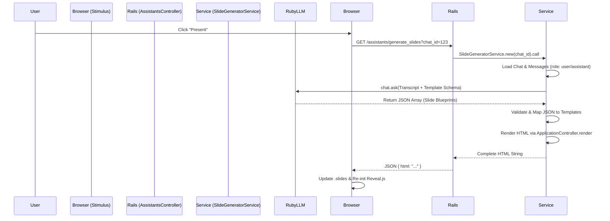

# AI-Powered Presentation Slides with Reveal.js

## Overview
This document outlines the proposed solution for transforming AI assistant chat conversations into professionally crafted HTML presentations using `RubyLLM` and the `reveal.js` library.

The goal is to replace the current client-side DOM-cloning approach with a sophisticated **Server-Side Generation** process that produces beautifully crafted slides using **Tailwind CSS** for modern, independent styling.

## Low-Level Design & Architecture (Server-Side with RubyLLM)

### Data Flow Diagram


### 1. Slide Template Definition (Tailwind & Isolation)
To achieve a modern, "Genspark-like" aesthetic, we will use **Tailwind CSS** for all slide templates.

**Independent Layout & Styling:**
We define a dedicated Rails layout `app/views/layouts/presentation.html.erb`.
- **CSS Isolation**: This layout includes a standalone Tailwind build and `reveal.js` core styles. It does NOT include the main application's CSS.
- **Glassmorphism & Gradients**: Following modern AI UI trends, templates will utilize:
    - Soft mesh gradients for backgrounds.
    - Glassmorphism (blur/transparency) for content containers.
    - Large, high-contrast typography (Inter/Montserrat).

**Template Structure (Partials):**
Partials in `app/views/assistants/presentation_templates/` utilize Tailwind classes directly.

#### Example: `_bullets.html.erb` (Tailwind Version)
```erb
<section class="h-full w-full flex flex-col justify-center items-start p-16 bg-gradient-to-br from-slate-50 to-blue-50">
  <div class="max-w-4xl w-full">
    <h2 class="text-5xl font-extrabold text-slate-900 mb-12 tracking-tight">
      <%= title %>
    </h2>
    <ul class="space-y-6">
      <% items.each do |item| %>
        <li class="flex items-start gap-4 text-2xl text-slate-700 leading-relaxed">
          <span class="flex-shrink-0 w-8 h-8 rounded-full bg-blue-500 flex items-center justify-center text-white text-sm mt-1">
            <i class="ti ti-check"></i>
          </span>
          <%= item %>
        </li>
      <% end %>
    </ul>
  </div>
</section>
```

### 2. The Conversion Process (Server-Side Mapping)

The `SlideGeneratorService` orchestrates the conversion from chat messages to Tailwind-styled slides.

#### Step A: Blueprint Generation (RubyLLM)
The service provides `RubyLLM` with the transcript and a strict JSON schema that maps to our Tailwind-designed templates.

**Prompt Concept:**
"Analyze this investment chat. Create a 6-slide summary deck. For each slide, choose one of these template types: `Hero`, `Insights`, `DataGrid`, `Comparison`. Provide high-impact titles and summarized content."

#### Step B: Server-Side Template Population
The service iterates through the `RubyLLM` blueprint and renders the corresponding Rails partials.

**The "Slide Registry":**
```ruby
# app/packs/ai/assistants/services/slide_generator_service.rb
SLIDE_TEMPLATES = {
  hero:     { partial: '.../hero',     required_keys: [:title, :subtitle] },
  insights: { partial: '.../bullets',  required_keys: [:title, :items] },
  datagrid: { partial: '.../split_chart', required_keys: [:title, :analysis, :chart_config] }
}
```

**Population Logic:**
- **Data Context**: Each slide template is treated as a "Component".
- **Dynamic Charting**: If a slide needs a chart, the service pulls the existing ChartJS config from the message metadata and passes it as `locals`.

## Technical Inspiration: The "Genspark" Approach
Genspark's design is characterized by **Visual Density and Hierarchy**:

1.  **Multi-Pane Layouts**: Frequently using split-screens (Left: Text, Right: Visual/Chart).
2.  **Visual Proof**: Every slide aims to provide "Proof" (a chart or data point) alongside the narrative.
3.  **Dynamic Refinement**: The server-side generation allows for real-time "regeneration" of specific slides without reloading the whole deck.
4.  **Tailwind Utility**: Using Tailwind allows for rapid iteration on themes (e.g., "Dark Mode", "Finance Blue") without complex CSS inheritance issues.

## Implementation Plan
1.  **Setup Tailwind for Presentation**: Configure a standalone Tailwind stylesheet for the presentation layout.
2.  **Create Modern Templates**: Build Tailwind-styled partials in `app/views/assistants/presentation_templates/`.
3.  **Implement SlideGeneratorService**: Integrate with `RubyLLM` for server-side transcript analysis.
4.  **Connect Endpoint**: Expose the generator via `AssistantsController`.
5.  **Reveal.js Integration**: Update the Stimulus controller to handle the new server-generated HTML.
