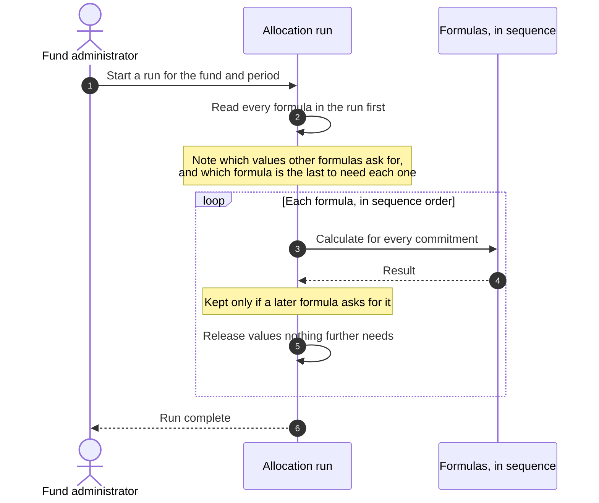

# Changes to How Fund Formulas Are Run

This explains a set of changes to the allocation engine and the Fund Formulas screens, in
business terms. It is for fund administrators, operations and anyone who owns a fund's
formula set.

Nothing here changes how any figure is calculated. The results of a run are unchanged.

---

## In Short

| | Before | Now |
|---|---|---|
| Keeping a formula's result for later formulas | Switched on by hand per formula, easy to forget | Worked out automatically before each run |
| Large fund runs | Could fail part-way through on very large funds | Complete reliably |
| Seeing which formulas depend on which | Not visible anywhere; worked out by reading formulas one by one | A diagram on the new **Dependencies** page |
| Finding a formula that reads a value that no longer exists | Only discovered when a run failed, or when a figure looked wrong | Flagged on screen before the run |

---

## Why This Changed

Formulas often build on each other: one calculates Net Income, the next uses that to
calculate a fee, a third combines both. For this to work the system has to hold on to the
results while a run is in progress — for **every commitment in the fund**.

On funds with many formulas and many commitments, that added up until a run could exhaust
the memory available to it and stop before finishing. The larger the fund, the more likely
it was — which is the opposite of what you want.

The cause was that the system kept **every** result, whether or not anything later used it.
In practice most results are never read by another formula: they are calculated, recorded,
and that is the end of them. They were being held for the whole run regardless.

## What Changed

### 1. The system now works out for itself what to keep

Before a run begins, the system reads through every formula that is going to run and notes
which values other formulas actually ask for. It then keeps only those, and releases each
one as soon as the last formula that needs it has finished.

### 2. "Add To Commitment Cache" is now automatic

Each formula has an **Add To Commitment Cache** setting. It used to be the only thing that
decided whether a formula's result stayed available to later formulas, and it had to be
ticked by hand. Forgetting it meant a later formula silently read an empty value.

**You no longer need to set this.** Leaving it off will not break a formula that depends on
another — the system keeps what is needed regardless.

The setting is still there for one rare case: a formula that refers to a value indirectly
rather than by name, which the automatic check cannot see. If a value ever goes missing at
run time and the Dependencies page shows no problem, ticking this on the formula that
*produces* the value restores the previous behaviour. Please report it if that happens, as
it means the automatic check missed something.

### 3. A new Dependencies page

On a fund's **Formulas** page there is a new **Dependencies** button. It shows every
formula as a card, with arrows between them: an arrow means the formula it points to uses a
value produced by the formula it points from, and the label on the arrow names that value.

From the diagram you can:

- **Hover** a formula to preview its calculation
- **Click** a formula to open its full details in a side panel, and edit it from there
- Press **Escape** or **×** to close the panel

### 4. Broken references are flagged

This is the part worth using regularly. If a formula reads a value that will not be there
when the run happens, a red panel lists it at the top of the page, and the formula is
outlined in red in the diagram.

Two things can be wrong:

**Nothing produces this value.** No formula in the fund creates it. Usually a spelling
mistake, or the formula that used to produce it was renamed or switched off.

**The value is produced too late.** The value exists, but the formula that creates it runs
at the same position or later in the sequence, so it has not been calculated yet when the
other formula asks for it. The fix is to change the sequence numbers so the producing
formula runs first.

Both have the same effect: the formula reads an empty value and either fails outright or
produces a figure that is wrong without looking wrong.

### 5. Unconnected formulas are hidden by default

Most funds have formulas that neither feed another nor read one. These are hidden so the
diagram shows the real chain of dependencies instead of a long column of isolated cards.
**Show N unconnected formulas** reveals them; the same button hides them again.

A formula with a broken reference is always shown, even when unconnected — a broken formula
is often unconnected *precisely because* it is broken, as the value it wants does not exist
and so there is no arrow to draw.

## What You Should Do

**Check each fund's Dependencies page.** This is the main action. It takes seconds per fund
and will show any formula reading a value that is not going to be there.

**Re-check after any of these**, which are the changes that break a dependency:

- renaming a formula
- disabling or deleting a formula
- changing sequence numbers
- importing a formula set into a new fund

**Compare one large run before and after the change goes live.** The figures should be
identical. If a run produces different numbers, that is a fault — please report it with the
fund and period rather than adjusting formulas to compensate.

**Nothing to do about the cache setting.** Existing formulas keep working. You do not need
to review or change the Add To Commitment Cache tick box on any formula.

## Something We Already Found

Reviewing funds with this page turned up live formulas that read a value which was renamed
some time ago. The old name no longer exists, so those formulas have been reading an empty
value ever since — quietly, on every run.

This is exactly the class of problem the page is meant to surface, and it is worth checking
your own funds rather than assuming they are unaffected. Where a value has been renamed, the
fix is to update the formulas to the current name; the underlying figure is the same.

Renames like this are the most common cause of a broken reference, because nothing at the
time of the rename points out what else was depending on the old name.

## Values The System Always Provides

These come from the system itself and are available to every formula regardless of what
else the fund contains. They will never be flagged as broken:

`@fund`, `@start_date`, `@end_date`, `@remittances_collected`, `@remittances_called`,
`@remittance_capital_fees`, `@remittance_other_fees`, `@distributions`,
`@income_before_start_date`, `@expense_before_start_date`, `@units`,
`@start_of_financial_year`

Anything else a formula reads has to be produced by a formula that runs earlier in the same
run.

## What This Does Not Cover

- **It does not check whether a figure is right.** It checks that the values a formula
  depends on will be available when it runs. Reviewing the numbers themselves is still a
  separate exercise.
- **It reflects one run's settings.** The diagram is built for the formulas that would run
  for the fund, so a formula excluded by rule type or tags is not considered.
- **It reads what a formula is written to ask for.** A formula that refers to a value
  indirectly rather than by name cannot be traced, which is the same rare case the Add To
  Commitment Cache setting still exists for.
