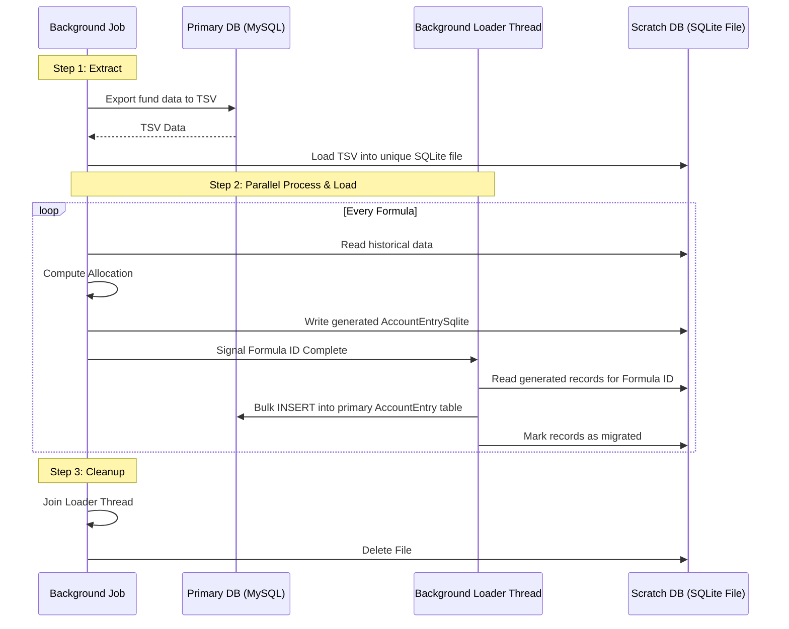

# Dynamic Allocation Process with Scratch SQLite

This document describes the high-performance allocation process that uses temporary, fund-specific SQLite databases to offload heavy computations from the primary MySQL database.

## Architecture Overview

The system follows a "Scratchpad" pattern where data is extracted, processed in isolation, and then re-integrated. This allows for **true concurrency** across background jobs, as each job operates on its own private database file, eliminating row contention and database-level locking on the primary MySQL server.

### High-Level Flow Diagram

## Component Breakdown

### 1. The Service Layer: `RunFormulas`
The `AccountEntryAllocation::RunFormulas` operation orchestrates the entire lifecycle:

1.  **`load_sqlite_db`**:
    - Generates a unique path based on Fund IDs (e.g., `/tmp/irm_data_101_102.sqlite3`).
    - Executes `script/load_sqlite3_from_mysql.sh` which handles the heavy lifting of exporting MySQL data via TSV and importing it into a fresh SQLite file.
    - **Optimization**: Uses WAL (Write-Ahead Logging) and synchronous=OFF in SQLite for maximum write performance.
2.  **`run_formulas` (The Parallel Loop)**:
    - Spawns a `loader_thread` to handle MySQL persistence in the background.
    - Iterates through enabled `FundFormula` records.
    - Each formula is executed within a `with_scratch_sqlite` block.
    - Completed formula IDs are pushed to a `Thread::Queue`.
3.  **`start_background_loader`**:
    - This thread waits for formula IDs from the queue.
    - For each ID, it triggers `migrate_entries_to_primary`.
    - It maintains its own connection to MySQL while sharing the SQLite connection pool with the main thread.
4.  **`migrate_entries_to_primary`**:
    - Reads records from `AccountEntrySqlite` where `migrated: false`.
    - Performs an `insert_all` into the primary MySQL `AccountEntry` table.
    - Marks records as `migrated: true` in SQLite to prevent double-processing.

### 2. The Connection Manager: `WithScratchSqlite`
This module is the infrastructure backbone that enables thread-safe access to multiple SQLite files.

- **Pool Registry**: It maintains a global registry of `ActiveRecord::ConnectionPool` objects keyed by the absolute file path.
- **Thread-Local Routing**:
    - When entering a `with_scratch_sqlite(path)` block, it either creates a new pool or retrieves the existing one for that path.
    - It checks out a connection and stores it in `Thread.current[:sqlite_scratch_connection]`.
    - **Nesting Support**: If a connection is already set in the current thread, it reuses it instead of checking out a new one.
- **Concurrency Safety**:
    - **Shared Concurrency**: Because the pool is keyed by path, the main job thread and its background loader thread share the *same* pool, allowing them to work on the same file safely.
    - **Isolation**: Threads from *different* background jobs use different paths, thus different pools, and never interfere with each other.

### 3. The Model Layer: `ApplicationRecordSqlite`
All SQLite models (e.g., `AccountEntrySqlite`, `CapitalCommitmentSqlite`) inherit from this class. It acts as the gateway for the dynamic routing logic.

- **Safety Firewall**: At load time, it calls `establish_connection(adapter: 'sqlite3', database: ':memory:')`. This ensures these models have their own connection handler and are physically isolated from `ActiveRecord::Base` (MySQL).
- **The Proxy Pool**:
    - We patch the `connection_pool` instance created by the firewall.
    - We override `pool.connection` and `pool.with_connection` to check `Thread.current[:sqlite_scratch_connection]`.
    - If a thread-local connection exists, it is returned.
    - **Fail-Closed**: If no thread-local connection is found, it defaults to the in-memory dummy database, preventing any accidental reads or writes to the production MySQL instance.

## Data Flow & Lifecycle Details

1. **Isolation**: Because each job generates a unique file path, and `WithScratchSqlite` routes connections per-thread, Job A never sees Job B's data.
2. **Performance**: Bulk exports/imports via TSV are significantly faster than individual `INSERT` statements over the network.
3. **Persistence**: Generated `AccountEntrySqlite` records are marked as `migrated: true` in the scratch DB once they have been successfully bulk-inserted into the primary `AccountEntry` table.

## Safety & Guardrails
- **Adapter Validation**: The system explicitly checks that any connection returned by a SQLite model is using the `sqlite3` adapter.
- **Fail-Closed**: If no scratch database is bound to the thread, the system defaults to the in-memory dummy DB, preventing production data corruption.

---

## Appendix: Why Separate SQLite Models?

A common question is why we maintain separate model classes (e.g., `AccountEntrySqlite`) instead of simply switching the connection of the original models (e.g., `AccountEntry`).

### 1. Hardened Safety (Production Guardrails)
The primary reason is the **prevention of catastrophic data corruption**. If we used the same model class for both MySQL and SQLite, a single bug in thread-local propagation or a missing `with_scratch_sqlite` block could cause the application to:
- Write temporary "scratchpad" data into the production MySQL database.
- Delete production records thinking it was clearing a temporary database.
By using `ApplicationRecordSqlite`, we ensure the model is physically isolated from the MySQL connection pool by default.

### 2. Reduced "Blast Radius"
Patching the connection logic for the core `ApplicationRecord` would affect every single model in the entire application. This would introduce overhead and risk to every request and background job. By localizing the complexity to the `*Sqlite` subclasses, we ensure that the "magic" of dynamic connection routing only happens where it is strictly required.

### 3. Schema Independence
While we strive for parity, the scratch SQLite schema is often a subset or a slight variation of the primary database (e.g., omitting specific constraints to speed up bulk loading). Separate models allow us to handle these differences (and distinct association logic) gracefully without polluting the primary domain logic.

### 4. Architectural Clarity
Maintaining separate models makes the "Transient vs. Persistent" state transition explicit in the code. When a developer sees `AccountEntrySqlite`, they immediately know they are working with temporary data that must eventually be migrated if it is to be saved permanently.
