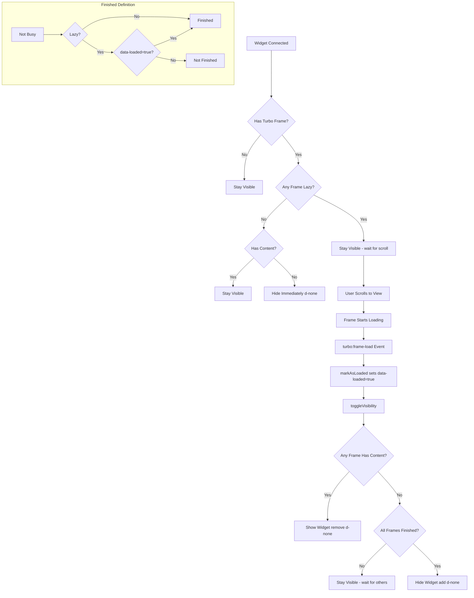

# Design Doc: Automatic Visibility Control for Dashboard Widgets

## Problem Statement
In the IRM dashboard, some widgets (like `_kycs.html.erb`) load their content asynchronously via `turbo_frame_tag`. In some cases, the backend returns an empty response (no data). Currently, this results in an empty "ghost" card appearing on the dashboard, which degrades the user experience.

## Proposed Solution
Implement a global Stimulus controller applied to all `WidgetCardComponent` instances that monitors the lifecycle of any nested `turbo-frame` and toggles the visibility of the widget based on whether content exists.

### Technical Mechanism

#### 1. Global Application in `WidgetCardComponent`
The `WidgetCardComponent` wrapper automatically includes the `turbo-frame-visibility` controller.

```erb
<%# app/packs/core/components/widget_card_component.html.erb %>
<%
  wrapper_options[:data][:controller] = "turbo-frame-visibility"
  wrapper_options[:data][:action] = "turbo:frame-load->turbo-frame-visibility#toggleVisibility"
%>
```

#### 2. Network-Aware Visibility
The controller ([`app/javascript/controllers/turbo_frame_visibility_controller.js`](app/javascript/controllers/turbo_frame_visibility_controller.js)) manages visibility with the following rules:

- **Initial State (`connect`):** If a widget contains any `turbo-frame` with a `src` attribute (meaning it will load content) but currently has no content, it is hidden immediately (`d-none`). **Exception:** If any frame has `loading="lazy"`, the widget is *not* hidden on connect, as the frame may not load until scrolled into view.
- **Dynamic Updates (`toggleVisibility`):** Triggered by the `turbo:frame-load` event (via `markAsLoaded`).
    - If **any** frame inside the widget has meaningful content, the widget is shown (`remove d-none`).
    - If **all** frames that were supposed to load have finished loading and are empty, the widget is hidden (`add d-none`).
    - **Lazy Loading Handling:**
        - A frame is considered "finished" if it is not `busy`.
        - For `loading="lazy"` frames, since they don't start loading until scrolled into view, we track an explicit `data-loaded` state.
        - The `markAsLoaded` method is triggered by the `turbo:frame-load` event. It sets `data-loaded="true"` on the specific frame and then calls `toggleVisibility`.
        - A lazy frame is only considered "finished" if it has `data-loaded="true"` or if it has content. If it's lazy, empty, and hasn't loaded yet, it's not considered finished, keeping the widget visible so it can eventually be scrolled into view.
- **Static Content Safety:** Widgets with no `turbo-frame` elements or frames without a `src` are never automatically hidden by this controller.

### Why this works:
1.  **Fully Automatic:** No need to manually add controller/target attributes to every new widget.
2.  **No Flicker:** Hiding on `connect` for async widgets ensures a clean dashboard load.
3.  **Robust:** Handles multiple frames and only hides when it's certain that no content will be rendered.
4.  **Clean Separation:** View files remain focused on content, while the component infrastructure handles layout visibility.

## Lifecycle Diagram


