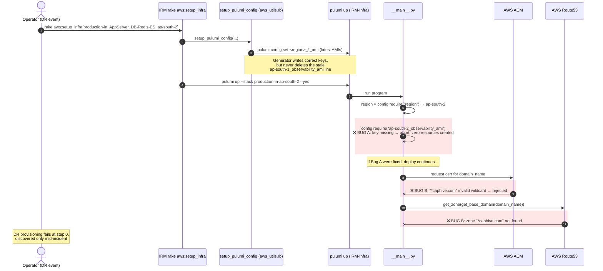

# DR Review — Point 1: Config errors in `Pulumi.production-in-ap-south-2.yaml`

**Status:** ✅ Applied (both fixes + explanatory inline comments added to the stack file)
**Repo affected:** `IRM-Infra`
**File affected:** `Pulumi.production-in-ap-south-2.yaml`
**Severity:** Critical for DR — the **IN production DR stack (ap-south-2) is currently un-deployable**. Both bugs abort `pulumi up` before any resource is created, and they would be discovered mid-incident.

---

## 1. Context: why this file matters for DR

The documented DR strategy (`IRM/lib/tasks/Caphive infra setup.md`) is:

> Every week the AMIs for the AppServer and DB-Redis-ES are created and copied to `AWS_BACKUP_REGION`. We will recover in `AWS_BACKUP_REGION`, which becomes the new `AWS_REGION`.

For the India (IN) deployment, production runs in **ap-south-1** and the backup/DR region is **ap-south-2**. The Pulumi stack file `Pulumi.production-in-ap-south-2.yaml` is therefore the exact configuration that gets used when recovering IN production. It is the one stack file that must always be deployable — and today it is not, for two independent reasons.

## 2. Current file content

```yaml
# This file is updated by the rake tasks, which sets the amis and region
# See rake aws:setup_pulumi_config
# rake "aws:setup_pulumi_config[staging, AppServer, DB-Redis-ES, ap-south-2]"
config:
  IRM-infra:ap-south-2_db_server_ami: ami-078f558c376edc81d
  IRM-infra:ap-south-2_key_name: caphive
  IRM-infra:ap-south-2_web_server_ami: ami-0e4bed58e2ae4d5ee
  IRM-infra:ap-south-1_observability_ami: ami-05f014af6e48af337   # <-- BUG A (line 8)
  IRM-infra:region: ap-south-2
  IRM-infra:domain_name: "*caphive.com"                           # <-- BUG B (line 10)
```

For comparison, the two sibling production stacks are internally consistent:

| Stack file | Region | Observability key | domain_name |
|---|---|---|---|
| `Pulumi.production-in-ap-south-1.yaml` | ap-south-1 | `ap-south-1_observability_ami` ✅ | `"*.caphive.com"` ✅ |
| `Pulumi.production-us-east-1.yaml` | us-east-1 | `us-east-1_observability_ami` ✅ | `"*.caphive.us"` ✅ |
| `Pulumi.production-in-ap-south-2.yaml` | **ap-south-2** | `ap-south-1_observability_ami` ❌ | `"*caphive.com"` ❌ |

---

## 3. Bug A — observability AMI stored under the wrong region key

### Code trace

The Python program derives config key names from the stack's own `region` value at runtime:

```python
# IRM-Infra/__main__.py
12  region = config.require('region')                              # -> "ap-south-2"
...
22  web_server_ami   = config.require(f"{region}_web_server_ami")  # ap-south-2_web_server_ami  -> found
23  db_ami           = config.require(f"{region}_db_server_ami")   # ap-south-2_db_server_ami   -> found
24  observability_ami = config.require(f"{region}_observability_ami")
    #                                   ^^^^^^^^ requires "ap-south-2_observability_ami"
    #                                            file only has "ap-south-1_observability_ami"
```

`pulumi.Config.require()` on a missing key is a **hard failure**. Both `pulumi preview` and `pulumi up` abort immediately with:

```
error: Missing required configuration variable 'IRM-infra:ap-south-2_observability_ami'
    please set a value using the command `pulumi config set IRM-infra:ap-south-2_observability_ami <value>`
```

No resources are created; the DR provisioning stops at step 0.

### Root cause

Manual copy-paste from the ap-south-1 stack file. Evidence:

1. The config generator writes the key **correctly** — `IRM/lib/tasks/aws_utils.rb:317`:
   ```ruby
   "IRM-infra:#{region}_observability_ami" => latest_ami("Observability", region).image_id
   ```
   Called with `region = ap-south-2` this produces `ap-south-2_observability_ami`. So the bad key was not generated; it was hand-edited.
2. The AMI ID differs from ap-south-1's observability AMI (`ami-05f014af6e48af337` vs `ami-0d6b6c4d3e66fd810`), suggesting the *value* is a genuine ap-south-2 copy that was filed under a pasted *key*.
3. `pulumi config set` only adds/updates keys — it never removes a wrongly named one — which is how the stale key survived any later generator runs.

### Proposed fix (one line)

```diff
-  IRM-infra:ap-south-1_observability_ami: ami-05f014af6e48af337
+  IRM-infra:ap-south-2_observability_ami: ami-05f014af6e48af337
```

Value unchanged; key renamed to match the stack's region.

### Durability

The fix will not be overwritten: `rake aws:setup_pulumi_config` writes the region-correct key (see above), and never writes region-mismatched keys.

---

## 4. Bug B — wildcard domain missing its leading dot

`domain_name: "*caphive.com"` should be `"*.caphive.com"`. The malformed value flows into **three** code paths and breaks all of them:

### 4.1 ACM certificate request — API rejection

```python
# IRM-Infra/certificate.py
20  certificate = acm.Certificate(f"cert-{region}-{stack}",
21                                domain_name=domain_name,        # "*caphive.com"
22                                validation_method="DNS", ...)
```

ACM only accepts a wildcard as a full leftmost label (`*.example.com`). `*caphive.com` is not a valid domain name for a certificate — the AWS API rejects the request and the deploy fails.

### 4.2 Route53 hosted-zone lookup — zone not found

```python
# IRM-Infra/certificate.py
 7  def get_base_domain(domain):
12      parts = domain.split('.')          # "*caphive.com" -> ["*caphive", "com"]  (2 parts)
14      if len(parts) > 2:                 # False — the '*' merged into the first label
15          return '.'.join(parts[-2:])
16      return domain                      # returns "*caphive.com" unchanged
...
26  hosted_zone = route53.get_zone(name=base_domain_name, ...)    # looks up zone "*caphive.com"
```

With the correct value `*.caphive.com` the split yields 3 parts and the function returns `caphive.com`. With the typo, Pulumi looks up a hosted zone literally named `*caphive.com`, which does not exist → hard failure of the `get_zone` invoke.

### 4.3 Grafana ALB listener rule — never-matching host header

```python
# IRM-Infra/alb.py
66  grafana_domain = f"grafana.{domain_name.replace('*.', '')}"
    # with "*.caphive.com" -> "grafana.caphive.com"     (correct)
    # with "*caphive.com"  -> "grafana.*caphive.com"    (no '*.' substring to strip)
```

Even if the deploy got this far, the ALB rule would route on host header `grafana.*caphive.com`, so the Grafana/observability endpoint would never be reachable.

### Root cause & durability

Manual edit — `rake aws:setup_pulumi_config` never touches `domain_name` (it only sets the three AMI keys and `region`, see `aws_utils.rb:314-331`), so this value is hand-maintained and the fix is durable.

### Proposed fix (one line)

```diff
-  IRM-infra:domain_name: "*caphive.com"
+  IRM-infra:domain_name: "*.caphive.com"
```

---

## 5. Where the DR flow breaks — sequence diagram



## 6. Blast radius of the fix

- Editing the YAML changes **nothing that is running**. Pulumi stack config is only read at the next `pulumi preview/up` of the `production-in-ap-south-2` stack.
- The live `production-in-ap-south-1` and `production-us-east-1` stacks have their own files and are untouched.
- No application code, credentials, or deploy files change.

## 7. Verification steps (after applying)

1. **Syntax/consistency check (no AWS creds needed):**
   `cd ../IRM-Infra && pulumi config --stack production-in-ap-south-2` — confirm all four region-prefixed keys show the `ap-south-2` prefix and `domain_name` shows `*.caphive.com`.
2. **AMI existence check (needs valid AWS creds — current local creds fail auth):**
   `aws ec2 describe-images --image-ids ami-05f014af6e48af337 --region ap-south-2`
   If the AMI is missing or stale, run `rake "aws:setup_pulumi_config[production-in, AppServer, DB-Redis-ES, ap-south-2]"` to refresh all three AMI keys from the weekly copies.
3. **Dry run:** `pulumi preview --stack production-in-ap-south-2` — should now plan resources instead of failing on missing config.

## 8. Adjacent observations (not part of this fix — queued for later points)

1. **Stack-name mismatch in the runbook:** the generator selects the stack as `"#{stack}-#{region}"` (`aws_utils.rb:321`), so producing `production-in-ap-south-2` requires passing `production-in` as the stack argument. The runbook (`Caphive infra setup.md:31-34`) says to pass `production`. → Point 4 (runbook refresh).
2. **Stale header comment** in the YAML itself references `[staging, ...]` — same runbook-drift theme. → Point 4.
3. **No validation gate:** nothing checks stack files for region-prefix consistency or domain format. A tiny CI lint (or a check inside `setup_pulumi_config`) would have caught both bugs when they were introduced. → Point 19 (CI).
