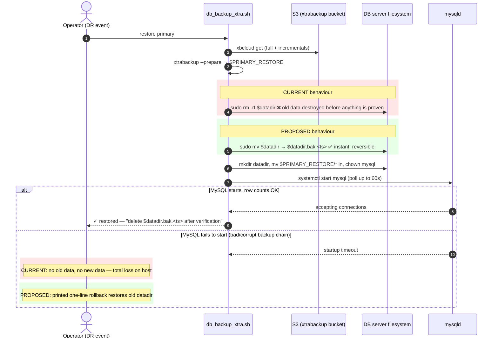

# DR Review — Point 2: Restore deletes the old MySQL datadir with no safety copy

**Status:** ✅ Applied (mv-park instead of rm -rf, rollback instructions on failure, cleanup note on success; `bash -n` syntax-checked)
**Repo affected:** `IRM`
**File affected:** `lib/tasks/db_backup_xtra.sh` (function `restore_primary_datadir`, lines 334–389)
**Severity:** Critical for DR — a restore that fails **after** line 360 leaves the server with **no old data and no new data**. The one scenario where you run this script is the one where you can least afford that.

---

## 1. Context: where this function sits in the DR flow

`db_backup_xtra.sh` is the Percona XtraBackup driver installed on the DB server. It handles the nightly full + half-hourly incremental backups to S3, and — during DR — the restore. `restore_primary_datadir` is the final, destructive step of a primary restore: it replaces MySQL's live data directory with the freshly prepared backup chain sitting in `$PRIMARY_RESTORE`.

Callers that reach this code path:

- Manual DR runbook step: `db_backup_xtra_production.sh restore primary` (`Caphive infra setup.md:39`)
- `DbRestoreService` → `db:restore_primary_db` / `db:restore_replica_db` (`backup_db.rake:14,24`), which SCPs this script to the target and runs it remotely
- The `recovery:*` Capistrano namespace during full-region rebuild (`config/deploy.rb:173-200`)

Note this file is a **template**: `rake xtrabackup:generate_backup_script` (`backup_db_xtra.rake:87-107`) substitutes `__BUCKET__`, credentials, etc. and emits `tmp/db_backup_xtra_<env>.sh`, which is what actually gets installed on DB boxes. Fixing the template fixes all future generated copies — but already-installed copies on servers must be regenerated and re-installed (see §6 Rollout).

## 2. The bug

```bash
# lib/tasks/db_backup_xtra.sh:352-360 (current)
  # To avoid 'mv' errors, construct a backup path that is explicitly a sibling of the datadir.
  local parent_dir
  parent_dir=$(dirname "$datadir")
  local base_name
  base_name=$(basename "$datadir")
  local backup_path="${parent_dir}/${base_name}.bak.$(date +%s)"

  # echo "  - Backing up old datadir to ${backup_path}..."     # <-- commented out
  sudo rm -rf "$datadir"                                        # <-- old data destroyed
```

Three observations:

1. **The safety copy was designed but never wired in.** `backup_path` is carefully constructed (sibling of the datadir, timestamped) — and then never used. The `echo` announcing the backup is commented out, and there is no `mv` to `$backup_path` at all. The variable is dead code; the intent is visible but the implementation was dropped.
2. **`rm -rf` runs before anything about the new data is proven.** After deletion, the function still has to: `mkdir` the datadir (l.364), `mv` the restored files in (l.367), `chown` (l.371), start MySQL (l.374), and pass a 60-second startup poll (l.379-386). Any failure in those five steps — partial/corrupt backup chain, wrong permissions, InnoDB refusing to start on the restored files, disk error mid-`mv` — strands the server with the old data already gone.
3. **The failure mode is silent data loss under maximum pressure.** This code only runs during a restore, i.e., when the primary is already in trouble. If the S3 backup chain turns out to be bad (which you only discover when MySQL fails to start at line 382), the local pre-restore data — possibly your best remaining copy — has been deleted at line 360.

### Failure scenario, concretely

```
1. Primary DB has an issue; operator runs: db_backup_xtra_production.sh restore primary
2. restore_latest_chain downloads + prepares the backup into $PRIMARY_RESTORE   ✓
3. restore_primary_datadir: sudo rm -rf /var/lib/mysql                          ← old data gone
4. mv $PRIMARY_RESTORE/* into datadir                                           ✓
5. systemctl start mysql → InnoDB reports corruption in the prepared backup     ✗
6. Line 382: "ERROR: MySQL failed to start within 60s after restore." exit 1
7. State: no running DB, no old datadir, backup chain proven bad. Total loss on this host.
```

## 3. Proposed fix

Park the old datadir aside with `mv` (instant, same-filesystem, no data copied), restore, and only tell the operator to delete the parked copy after the restore has passed verification. On failure, print explicit rollback instructions.

```bash
# lib/tasks/db_backup_xtra.sh:352-360 (proposed)
  # To avoid 'mv' errors, construct a backup path that is explicitly a sibling of the datadir.
  local parent_dir
  parent_dir=$(dirname "$datadir")
  local base_name
  base_name=$(basename "$datadir")
  local backup_path="${parent_dir}/${base_name}.bak.$(date +%s)"

  # Park the old datadir instead of deleting it: if the restored backup turns out
  # to be bad (discovered only when MySQL fails to start below), the pre-restore
  # data is still recoverable. mv on the same filesystem is instant and uses no
  # extra disk space.
  echo "  - Parking old datadir at ${backup_path} (rollback: sudo mv ${backup_path} ${datadir})"
  sudo mv "$datadir" "$backup_path"
```

And at the end of the function, after the startup poll and row-count check succeed:

```bash
  echo "✓ Primary MySQL instance started successfully (waited ${n}s)."
  get_table_counts "$DATABASE_NAME" "$MYSQL_USER"

  # Old datadir is intentionally kept until a human confirms the restore is good.
  echo "NOTE: old datadir kept at ${backup_path}"
  echo "      After verifying the restore, free the space with: sudo rm -rf ${backup_path}"
```

Additionally, improve the failure path of the startup poll (line 382) to remind the operator that rollback is possible:

```bash
      echo "ERROR: MySQL failed to start within ${max_wait}s after restore." >&2
      echo "       Old datadir is intact at ${backup_path}." >&2
      echo "       Roll back with: sudo systemctl stop mysql && sudo rm -rf ${datadir} && sudo mv ${backup_path} ${datadir} && sudo systemctl start mysql" >&2
      exit 1
```

### Why `mv`, not `cp -a`

- `mv` within a filesystem is a rename: instant regardless of data size, and consumes **zero** additional disk space. A `cp -a` of a large datadir would double disk usage and add minutes/hours to the restore.
- Peak disk usage is unchanged versus today: the restored data in `$PRIMARY_RESTORE` is already on disk before line 360 either way. The only difference is *when* the old data's space is freed — previously at restore time, now after human verification.

### Trade-off to be aware of

Until the operator deletes `${backup_path}`, the disk holds old + new data simultaneously. On a tight disk this could matter for the *next* backup cycle, which is why the fix prints the cleanup command loudly rather than silently keeping the copy. (An `aws:grow_disk` task already exists if a DB volume needs headroom.)

## 4. Sequence diagram — restore flow before vs after



## 5. Blast radius of the fix

- Behaviour change only inside `restore_primary_datadir` — the backup paths (`full_backup`, `incr_backup`), `restore_test`, and replica flows are untouched.
- The happy-path restore is identical except the old datadir survives as `<datadir>.bak.<timestamp>` until manually removed.
- No credentials, config keys, or calling conventions change; `DbRestoreService` and the Capistrano `recovery:*` tasks call the same subcommand.

## 6. Rollout

1. Fix the template `lib/tasks/db_backup_xtra.sh` (this change).
2. Regenerate: `RAILS_ENV=production rake xtrabackup:generate_backup_script` → `tmp/db_backup_xtra_production.sh`.
3. Install the regenerated script on the DB servers (same manual step as the existing runbook; automating this installation is Point 5 — codify the backup crontab/script install).

## 7. Verification steps (after applying)

1. `bash -n lib/tasks/db_backup_xtra.sh` — syntax check of the template.
2. On a scratch instance (the existing `restore_test` / `DbCheckInstance` path exercises restore end-to-end): run `restore primary`, confirm the parked `.bak.<ts>` directory appears and MySQL comes up.
3. Simulate failure: point the restore at an intentionally truncated chain, confirm the error path prints the rollback command and the old datadir is intact.

## 8. Adjacent observations (queued for later points)

1. **Two bucket-naming conventions** in `backup_db_xtra.rake`: the generated script gets `AWS_S3_BUCKET + "-backup-xtra"` (line 97) while `Helpers.s3_bucket` builds `AWS_S3_BUCKET + ".db-backup-xbcloud"` (line 68) — the helper (and its `ensure_s3_bucket_exists`) appears unused by any task. Consolidate or delete. → Points 6/8.
2. **Incremental cleanup TODO** (`db_backup_xtra.sh:5-8`): backups older than 30 days are never pruned by the script. → Point 8.
3. **No client-side encryption** on the xtrabackup stream. → Point 9.
4. The generated script embeds plaintext AWS + MySQL credentials in `tmp/` — acceptable on the DB host, but the runbook should say to install it with `0600` permissions. → Point 4/20.
