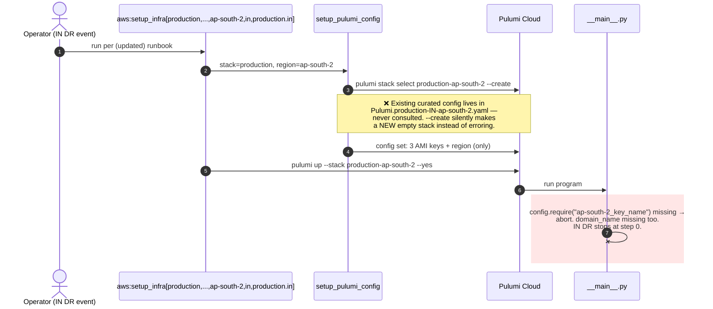

# DR Review — Point 4: Stale runbook + stack-naming mismatch that breaks the IN DR path

**Status:** ✅ Applied (Option A, extended for new-region flexibility):
- Renamed `Pulumi.production-in-ap-south-1/2.yaml` → `Pulumi.production-ap-south-1/2.yaml` (git mv) — matches the cloud stack name `production-ap-south-2` confirmed in the state export; staging/US files already followed this convention. Headers rewritten to document the naming rule.
- `setup_pulumi_config` (aws_utils.rb) now ends with `ensure_pulumi_stack_config`: guarantees `domain_name` + `<region>_key_name` are set, seeding them from `DOMAIN_NAME`/`AWS_KEY_NAME` env vars for a brand-new stack and failing fast with instructions otherwise. `--create` is now safe — a new region is a one-command, fully-configured stack.
- Added the missing `aws:setup_pulumi_config` rake task (referenced by YAML headers but never existed) — config-only refresh without `pulumi up`.
- Runbook (`Caphive infra setup.md`) fully rewritten: real 6-arg signature with IN/US examples, naming-convention table, prerequisites, post-restore steps, new-region procedure, sequence diagram, known-gaps list.
**Repos affected:** `IRM` (runbook, possibly `aws_utils.rb`), `IRM-Infra` (possibly stack file names)
**Severity:** High for DR — the documented DR command doesn't match the code, and for the IN variant the code doesn't even match itself. An operator following the runbook during an incident hits a wall at step 2.

---

## 1. What the runbook says vs what the code is

`lib/tasks/Caphive infra setup.md:31-34` instructs:

```
RAILS_ENV=env rake "aws:setup_infra[env, AppServer, DB-Redis-ES, region]"
ex. RAILS_ENV=production rake "aws:setup_infra[production, AppServer, DB-Redis-ES, ap-south-1]"
```

The actual task (`aws.rake:26`) takes **six** arguments:

```ruby
task :setup_infra, [:stack, :web_server_name, :db_server_name, :region, :env_variant, :env_name]
```

The two the runbook omits are load-bearing:

- **`env_variant`** (`in`/`us`) — selects which `.env.<stack>.<variant>` file gets the new ELASTIC_SEARCH_URL/REDIS_URL (`aws_utils.rb:357-359`), which credentials pair gets DB_HOST/DB_HOST_REPLICA (`aws_utils.rb:350-354`), which deploy stage file gets its IPs rewritten (`aws_utils.rb:362`), and which Capistrano stage all six deploy/recovery commands run against (`aws_utils.rb:377-385`).
- **`env_name`** — passed to `aws:environment` (`aws.rake:88-120`), which overloads `.env.<env_name>` via Dotenv and unlocks `config/credentials/<env_name>.yml.enc` with its matching `.key` to configure the AWS SDK. Without it you silently run with default credentials — plausibly against the wrong account/region.

Also stale in the runbook:
- References `lib/aws.rake` (line 23) — actual path is `lib/tasks/aws.rake`.
- Step 3c says the restore script is `db_backup_xtra_#{Rails.env}.sh` — the generator (`backup_db_xtra.rake:90`) emits `tmp/db_backup_xtra_<env>.sh`, and the subcommand is `restore primary` (not `restore_primary`... the script's usage is `restore primary|replica|test`).
- The stack-file header comments in IRM-Infra (e.g. `Pulumi.production-us-east-1.yaml:3`) show a `[staging, ..., ap-south-2]` example regardless of the file — copy-paste drift, same theme.

## 2. The deeper problem: four naming conventions, one `stack` argument

`setup_infra` derives four different names from its arguments:

| Purpose | Code | Pattern |
|---|---|---|
| Pulumi stack select/up | `aws_utils.rb:321,339` | `#{stack}-#{region}` |
| Env file update | `aws_utils.rb:357` | `.env.#{stack}.#{env_variant}` |
| Rails credentials | `aws_utils.rb:351-353` | `#{stack}` + `#{env_variant}` (e.g. `production.in.yml.enc`) |
| Capistrano stage | `aws_utils.rb:377-385` | `#{stack}_#{env_variant}` |

What exists on disk:

| Artifact | US variant | IN variant |
|---|---|---|
| Pulumi stack files | `Pulumi.production-us-east-1.yaml` | `Pulumi.production-in-ap-south-1.yaml`, `Pulumi.production-in-ap-south-2.yaml` |
| Env files | `.env.production.us` | `.env.production.in` |
| Credentials | `production.us.yml.enc` + `.key` | `production.in.yml.enc` + `.key` |
| Cap stages | `production_us.rb` | `production_in.rb` |

### Trace: US DR (`stack=production, region=us-east-1, env_variant=us, env_name=production.us`)

- Pulumi: `production-us-east-1` → **matches** the stack file ✅ (coincidence of naming: the region string starts with `us`)
- Env file: `.env.production.us` ✅ — credentials: `production.us` ✅ — cap: `production_us` ✅

**US is fully self-consistent.**

### Trace: IN DR — no working value of `stack`

With `stack=production` (as the runbook says):

- Pulumi: `pulumi stack select production-ap-south-2 --create` → does **not** match `Pulumi.production-in-ap-south-2.yaml`. The `--create` flag masks the error by silently creating a **brand-new empty stack**: the generator then sets the three AMI keys + region on it, but `domain_name` and `ap-south-2_key_name` are never set → `pulumi up` aborts on `config.require` (`__main__.py:13,21`). The curated config we fixed in Point 1 sits unused in a file the run never touches. ❌
- Env/credentials/cap: `.env.production.in`, `production.in`, `production_in` — all fine ✅

With `stack=production-in` (to make Pulumi match the files on disk):

- Pulumi: `production-in-ap-south-2` ✅ (and `__main__.py:18`'s `split("-")[0]` still yields `production` for tagging)
- Env file: `.env.production-in.in` ❌ (doesn't exist) — credentials: `production-in` + `in` ❌ — cap stage: `production-in_in` ❌

**Every choice breaks half the pipeline.** The IN DR path cannot run end-to-end as coded.

### How it likely happened

The committed state export (`pulumi.prod.export`) is for a stack named `production-ap-south-2` — *without* the `-in` infix. So the real Pulumi Cloud stacks probably predate the IN/US split; the local YAML files were later renamed with `-in` while the rake naming logic (`#{stack}-#{region}`) and the runbook stayed on the old convention. Classic drift between three sources of truth.

## 3. Sequence diagram — where the IN run dies



## 4. Proposed fixes

### 4.1 Rewrite the runbook (no decision needed — pure doc fix)

Rewrite `lib/tasks/Caphive infra setup.md` to:
- Show the real six-argument signature with a worked example per variant, e.g.
  `RAILS_ENV=production rake "aws:setup_infra[production, AppServer, DB-Redis-ES, ap-south-2, in, production.in]"`
- Explain what `env_variant` and `env_name` each control (env file, credentials pair, cap stage, AWS SDK creds).
- Fix the file path (`lib/tasks/aws.rake`), the restore command (`tmp/db_backup_xtra_production.sh restore primary`), and add the post-restore steps currently only in scattered puts/comments: `db:reset_replication`, manual migration replay when the backup predates the last deploy, regenerating the Prometheus targets (`aws:generate_prometheus_yml`), and Grafana provisioning.
- Add the prerequisites the doc omits: key pair present in target region, Route53 hosted zone, `MYSQL_ROOT_PASSWORD` in credentials (new, from Point 3), Pulumi login for the account that owns the stacks, both repos as siblings.
- Keep a Mermaid sequence diagram of the full DR flow.

### 4.2 Fix the naming mismatch (decision — see §5)

**Option A (recommended): drop the `-in` infix from the IN Pulumi stack files** — rename:
- `Pulumi.production-in-ap-south-1.yaml` → `Pulumi.production-ap-south-1.yaml`
- `Pulumi.production-in-ap-south-2.yaml` → `Pulumi.production-ap-south-2.yaml`
- (staging files similarly, after checking what the staging stacks are named in Pulumi Cloud)

Why A: the rake convention `#{stack}-#{region}` then works for **both** variants with `stack=production`; region already uniquely implies the variant (ap-south-* ⇒ IN, us-east-1 ⇒ US); the US file needs no change; and it matches the apparent Pulumi Cloud stack name (`production-ap-south-2` per the state export) — meaning the renamed local files re-attach to the real stacks instead of sitting orphaned. Zero Ruby/Python code changes.

**Option B: keep `-in` files, add variant to the rake naming** — change `aws_utils.rb` to `pulumi stack select #{stack}-#{env_variant}-#{region}`. But then the US side breaks (`production-us-us-east-1` doesn't match `Pulumi.production-us-east-1.yaml`), forcing a rename there plus conditional logic. More moving parts, no benefit.

**Required verification before renaming** (needs your Pulumi login; I can't do this without creds):
```
cd ../IRM-Infra && pulumi stack ls
```
This shows the authoritative stack names in Pulumi Cloud. If the cloud stacks are `production-ap-south-1/2` (as the export suggests), Option A's renames simply re-attach the curated config files. If the cloud names differ, we align to whatever `pulumi stack ls` shows and I'll adjust the plan.

### 4.3 Make the failure loud instead of silent (small code hardening)

Remove `--create` from `pulumi stack select` in `aws_utils.rb:321`. During DR you want "stack not found: production-ap-south-2" — a clear, immediate error — not a silently created empty stack that fails later with a confusing missing-config message. New-landing-zone creation (where `--create` is legitimate) gets its own explicit task in the Phase 3 work.

## 5. Decision needed from you

1. **Option A or B** for the naming fix (recommendation: A).
2. Confirm you can run `pulumi stack ls` and share the output, so the renames target the real cloud stack names.

## 6. Blast radius

- Runbook rewrite: doc only.
- Option A renames: local YAML file renames only — Pulumi Cloud state untouched; the files re-attach to existing stacks by name. Nothing running changes.
- Removing `--create`: `setup_infra` now fails fast on a missing stack instead of creating an empty one — behavioural change only in the error case, which is the point.

## 7. Verification steps (after applying)

1. `pulumi stack ls` shows the renamed files' stacks with their existing resources (not empty new stacks).
2. `pulumi config --stack production-ap-south-2` shows the curated config from the (renamed) Point 1 file: four `ap-south-2_*` keys + `domain_name: *.caphive.com`.
3. Dry-run the naming logic: `rake "aws:setup_pulumi_config[production, AppServer, DB-Redis-ES, ap-south-2]"` selects the existing stack (no `--create`) and `pulumi preview` plans against real state.
