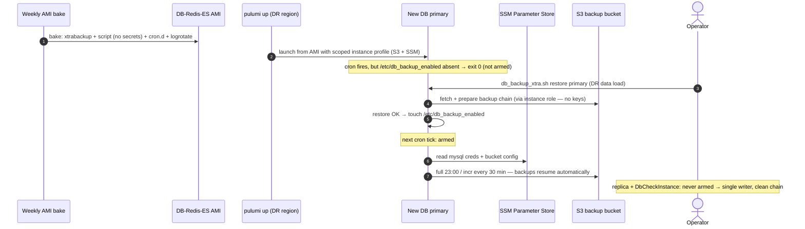

# DR Review — Point 5: Codify DB backup installation on the DB server

**Status:** ✅ Applied (bake-into-AMI design; using existing `DB_USER` per review decision — no dedicated backup MySQL user). All files syntax-checked incl. `packer validate -syntax-only`.

**Applied changes:**
- `db_backup_xtra.sh`: secret-free runtime config (legacy placeholders → `/etc/db_backup.env` → SSM via instance role); AWS keys now optional (instance-profile auth preferred); `full`/`incr` gated on `/etc/db_backup_enabled`; `restore_primary`/`restore_from_primary` arm the marker on success.
- `db_redis_es.ami.pkr.hcl`: bakes the script (root, 0700), `/etc/db_backup.env` (SSM_PREFIX), `/etc/cron.d/irm-db-backup`, logrotate. New `ssm_prefix` variable fed by packer.rake.
- `compute.py`: new scoped `db-backup-role-<region>-<stack>` IAM role + instance profile (S3 `*-backup-xtra` only, SSM `/irm/*/db_backup/*` read, KMS decrypt via-SSM) attached to DB primary and replica.
- `backup_db_xtra.rake`: new `xtrabackup:seed_ssm_params[env_name, region]` (idempotent, per-region, secrets never pass through a shell).
- `db_restore_service.rb`: disarms the marker pre-restore (reused instance) and post-verification (restore_primary arms it).
- Runbook updated: restore command is `restore_primary` (was misdocumented as `restore primary`), backup step is now "verify armed", SSM seeding added to prerequisites.

**Rollout order (operator):** 1) seed SSM in every DB region, 2) `pulumi up` per stack (adds instance profiles), 3) next weekly AMI bake picks up the baked tooling; instances launched from older AMIs keep using the legacy generated-script path.
**Repos affected:** `IRM` (script, packer template, rake) + `IRM-Infra` (IAM, user_data)
**Severity:** Highest RPO risk in the setup. After any DB-server rebuild, backups exist only if a human remembers to install the script and crontab by hand. Forget it, and the new region runs with **zero database backups** — silently, indefinitely.

---

## 1. Constraints discovered

1. The backup must run **on the DB-Redis-ES server** (xtrabackup reads the local datadir). Capistrano/whenever only reach app servers — they can't install this.
1b. **Network topology: DB servers are reachable only from the app servers** (private subnet; no direct SSH from an operator laptop). Any push-based install (SCP from the machine running rake) therefore doesn't work from a local box — it would have to be executed *from an app server*, adding a hop and another thing to remember. This also means `DbRestoreService` and any manual `restore primary` runs are executed from an app server today.
2. The script currently **embeds secrets at generation time** (`generate_backup_script` substitutes AWS keys, MySQL password, bucket — `backup_db_xtra.rake:97-103`). Baking that file verbatim would freeze credentials into an artifact copied across regions and kept for weeks.
3. The DB AMI is used by **three kinds of instances**: primary, replica (`compute.py:138-147`), and the throwaway `DbCheckInstance` used for restore verification. If the cron were armed unconditionally in the AMI, all three would push backups into the same S3 chain — two-plus writers means a corrupted/ambiguous restore lineage.
4. Good news that makes baking viable: the AMI **already installs `percona-xtrabackup-84`** (`db_redis_es.ami.pkr.hcl:168`), and the missing piece for keyless S3 access is just an instance profile — the DB instance currently has none (`compute.py` gives one only to web servers).

## 2. Design: bake everything except secrets; arm only the real primary

### 2.1 What gets baked into the DB AMI (Packer)

- `/usr/local/bin/db_backup_xtra.sh` — the script, **with no `__PLACEHOLDER__` substitution**. All config is resolved at runtime (§2.2).
- `/etc/cron.d/irm-db-backup` — the schedule, present from first boot:

```cron
# Baked by Packer (db_redis_es AMI). Runs only when /etc/db_backup_enabled exists — see runbook.
SHELL=/bin/bash
0 23 * * *      root /usr/local/bin/db_backup_xtra.sh full >> /var/log/db_backup.log 2>&1
0,30 0-22 * * * root /usr/local/bin/db_backup_xtra.sh incr >> /var/log/db_backup.log 2>&1
```

- A logrotate stanza for `/var/log/db_backup.log`.

### 2.2 Runtime config instead of baked secrets

- **AWS credentials: none.** The DB instance gets an IAM instance profile (new, in Pulumi) scoped to `s3:PutObject/GetObject/ListBucket` on the backup bucket. `xbcloud` picks up the instance role automatically — the leaked-keys class of problem disappears for backups entirely.
- **MySQL user/password + bucket name + bucket region**: read at runtime from **SSM Parameter Store** (SecureString, e.g. `/irm/production/db_backup/mysql_password`), fetched with the same instance role. SSM parameters are regional → seeding them in the DR/new region becomes a small codified step in `aws:provision_s3_buckets`-style tooling (one command, idempotent), not a manual copy.
  - Fallback order in the script: `/etc/db_backup.env` (if an operator needs a local override) → SSM → fail loudly.

### 2.3 Arming: backups start exactly when real data exists

The cron entries are baked but the script's `full`/`incr` subcommands **exit 0 immediately unless `/etc/db_backup_enabled` exists** (one log line: "backups not armed on this host").

Who creates the marker:

- **`restore primary` creates it on success** — in DR (and per the philosophy, every new region starts by restoring a backup), backups arm themselves the moment a real dataset is in place. No baked-stale-DB junk enters the chain, no operator step.
- The **replica** never runs `restore primary` → never armed → no duplicate writers.
- **`DbCheckInstance`** runs `restore_primary` too — so `DbRestoreService` explicitly removes the marker (one `ssh.exec!` line) after its verification restore; it already stops services/cron on that box (`db_restore_service.rb:486-503`), this joins that cleanup.
- Manual arm/disarm for edge cases: `sudo touch /etc/db_backup_enabled` / `sudo rm`.

### 2.4 What changes where

| Repo | File | Change |
|---|---|---|
| IRM | `lib/tasks/db_backup_xtra.sh` | Read config from env-file/SSM at runtime; add arming guard to `full`/`incr`; `restore primary` touches the marker on success |
| IRM | `config/deploy/templates/packer/db_redis_es.ami.pkr.hcl` | Provisioner: copy script to `/usr/local/bin` (0700 root), write `/etc/cron.d/irm-db-backup` + logrotate |
| IRM | `lib/tasks/backup_db_xtra.rake` | New `xtrabackup:seed_ssm_params[env_name, region]` task (idempotent SecureString puts); `generate_backup_script` kept for manual/legacy use |
| IRM | `app/packs/core/base/services/db_restore_service.rb` | Remove `/etc/db_backup_enabled` during DbCheckInstance cleanup |
| IRM-Infra | `compute.py` | New scoped IAM role + instance profile for the DB instances (S3 backup bucket RW + SSM read of `/irm/<env>/db_backup/*`); attach to primary and replica |
| IRM | runbook | Post-restore step 3 becomes "verify backups armed" (`ls /etc/db_backup_enabled`, check log) instead of an install procedure |

### 2.5 Why this beats the SCP-install alternative

A `rake xtrabackup:install_backup` task (v1 of this doc) is ruled out by the network topology: DB servers accept SSH only from app servers, so a push-based install can't run from an operator's laptop at all — it would have to be staged through an app server, keeping a multi-hop human procedure in the loop. Baking means a DB instance launched from the AMI is *born* with backup capability, and arming is data-driven (restore success), not operator-driven. For the stated goal — DR and new landing zones that are seamless — the AMI is the right home. Credential rotation also improves: rotate in SSM, no re-bake, no reinstall (script reads SSM on every run).

Cost: this touches Pulumi IAM (a `pulumi up` on each stack to add the instance profile) and the next weekly AMI bake must happen before a DR would benefit. Both are one-time.

## 3. Sequence diagram — DR with baked backups



## 4. Blast radius

- Until the next AMI bake + `pulumi up`, nothing changes anywhere (all changes are inert in templates/scripts).
- Existing hand-installed crontabs on the **current** live DB servers keep working; when their instances are eventually replaced by AMI-launched ones, remove the old manual entries (runbook note) so there's a single schedule source.
- The script keeps `__PLACEHOLDER__`-free runtime lookup as the only path in the AMI; `generate_backup_script` still exists for ad-hoc/manual use during transition.
- New IAM role is additive and scoped (backup bucket + `/irm/<env>/db_backup/*` params only) — far tighter than the web servers' current `AmazonS3FullAccess`.

## 5. Verification steps

1. `packer validate` the modified template; bake a staging DB AMI.
2. Launch a staging DB instance from it: cron file present, script `-rwx------ root`, `full` run logs "not armed" and exits 0.
3. Run `restore primary` on it: marker created; next `incr` pushes to S3 via instance role (no keys anywhere on the box).
4. `xtrabackup:seed_ssm_params` run twice → idempotent.
5. DbCheckInstance verification cycle: confirm marker removed afterwards, no backups from that instance in the bucket.

## 6. Open question for you

The MySQL backup user: today the script uses the app's `DB_USER`/`DB_PASS`. While we're here, a dedicated `backup` MySQL user with only `BACKUP_ADMIN, RELOAD, LOCK TABLES, REPLICATION CLIENT, PROCESS` grants (what xtrabackup needs) would be tighter and means app-credential rotation doesn't touch backups. Include it in this change, or keep using `DB_USER` for now?
