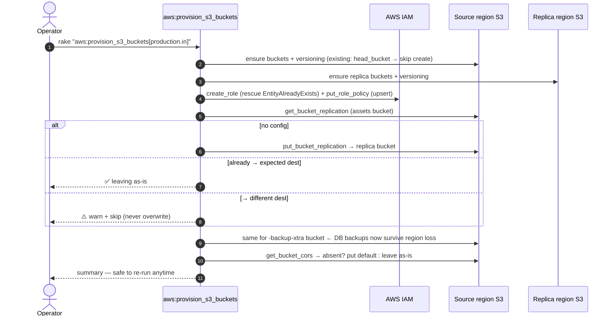

# DR Review — Point 6: Codify S3 cross-region replication + CORS

**Status:** ✅ Applied (`ruby -c` passes)
**Repo affected:** `IRM`
**File:** `lib/tasks/aws.rake` (`aws:provision_s3_buckets`)
**Severity:** High — the xtrabackup bucket previously had **no** codified cross-region replication, so in a region-loss DR the DB backups could be sitting in the dead region. Replication and CORS were "must be set up manually" notes.

---

## 1. What was wrong

`aws:provision_s3_buckets` created the four buckets (app assets + `-backup-xtra`, source + replica) and enabled versioning — then printed four warnings telling the operator to configure replication and CORS by hand. Consequences:

- **DB backups did not survive region loss by construction.** The `-backup-xtra` bucket lives in the source region; nothing codified copies it to the DR region. The whole DR plan assumes restoring from S3 backups — from a region that may be the thing that failed.
- Manual replication/CORS setup is exactly the kind of step that gets missed in a new landing zone (and is invisible until an incident or a browser upload failure).

## 2. What the task now does (all idempotent, never clobbers)

Same task, three new phases after bucket creation:

1. **Replication IAM role** — one per env (`irm-s3-replication-<source_bucket>`, truncated to IAM's 64-char cap): trust for `s3.amazonaws.com`, minimal read permissions on both source buckets, minimal replicate permissions on both destination buckets. `create_role` is exists-guarded; `put_role_policy` is an upsert.
2. **Replication config** for both pairs:
   - `<bucket>` → `<bucket_replica>` (app assets)
   - `<bucket>-backup-xtra` → `<bucket_replica>-backup-xtra` (**DB backups — the DR-critical one**)
   Rule: whole bucket, priority 1, **delete-marker replication disabled** — a bad delete or ransomware event on the source must not propagate to the DR copy.
3. **CORS** on the two app-assets buckets (backup buckets are never browser-facing). Origins resolved from `S3_CORS_ORIGINS` (comma-separated) → else `https://*.<BASE_DOMAIN>` + apex → else `*` with a loud warning.

### The idempotency contract (per review requirement)

Existing, already-live regions are never silently modified:

| Existing state | Behaviour |
|---|---|
| No replication config | Create the standard rule |
| Replication already → expected destination | Leave untouched (hand-tuned configs survive), say so |
| Replication → a *different* destination | **Warn and skip** — never overwrite; operator reconciles |
| No CORS | Apply default rules |
| Any CORS present | Leave untouched, say so |
| Role/policy exist | Role kept, policy upserted to the standard document |

Re-running the task any number of times, against fresh or live regions, converges to the same state without destructive writes.

## 3. Sequence diagram

## 4. Notes & follow-ups

- **Replication covers new objects only.** The task prints the backfill command (`aws s3 sync` / S3 Batch Replication) when it creates a new rule. For the backup bucket the nightly full means the DR copy is complete within 24h of enabling anyway.
- `S3CheckJob` already verifies the newest **asset** object replicated; extending freshness checks to the backup bucket is Point 7 (backup-freshness alert).
- The Glacier lifecycle task (`aws:setup_s3_glacier`) remains separate — queued with retention work (Point 8).
- Existing-region rollout: run once per env (`production.in`, `production.us`, staging pair) — live buckets get replication added (or detected), nothing else changes.
