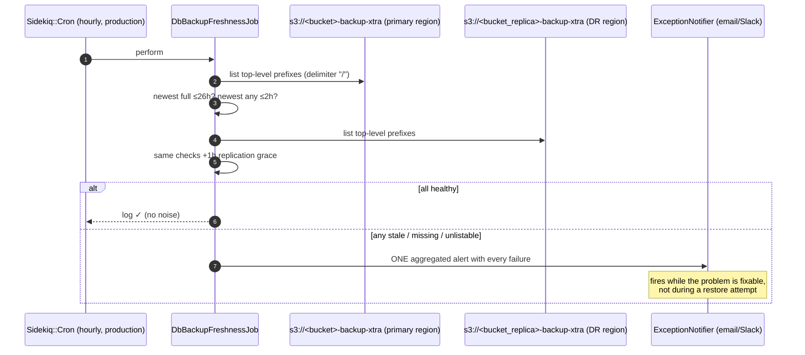

# DR Review — Point 7: Backup-freshness alerting

**Status:** ✅ Applied (`ruby -c` passes on all three files)
**Repo affected:** `IRM`
**Files:** new `app/packs/core/base/jobs/db_backup_freshness_job.rb`; `config/initializers/sidekiq.rb` (hourly cron); `lib/tasks/backup_s3.rake` (manual entry point)
**Severity:** High — every earlier fix (baked cron, armed marker, SSM config, replication) can still fail *silently later*. Without freshness alerting, stale backups are discovered during a restore — the worst possible moment.

---

## 1. What it does

`DbBackupFreshnessJob` runs hourly (Sidekiq::Cron, production only — same mechanism as `S3CheckJob`) and checks **both** xtrabackup buckets:

| Bucket | Checks | Threshold |
|---|---|---|
| `<bucket>-backup-xtra` (primary region) | newest backup of any kind | ≤ 2h (`INCR_MAX_AGE`) |
| | newest FULL backup | ≤ 26h (`FULL_MAX_AGE`) |
| | any backups at all / bucket listable | — |
| `<bucket_replica>-backup-xtra` (DR region) | same checks | + 1h `REPLICA_LAG` grace |

The replica-side check is what closes the loop on Point 6: healthy primary backups + broken cross-region replication now pages instead of hiding until a region-loss DR.

Failure modes it catches: DB cron dead or never armed (`/etc/db_backup_enabled` missing after a rebuild), SSM parameter rotated wrong, IAM/bucket policy drift (an unlistable bucket is itself an alert — a restore would hit the same wall), replication rule deleted/broken, and "incrementals but no full" (unrestorable chain).

Alerts go through `ExceptionNotifier.notify_exception` — the same channel `S3CheckJob` uses — as one aggregated message listing every failure.

## 2. Design details

- **Cheap listing:** xbcloud stores each backup under a top-level prefix (`<%F_%H%M%S>-full/` or `-incr/`). The job lists prefixes with `delimiter: "/"` (one entry per backup, paginated) instead of walking every chunk object — stays fast even with the unimplemented >30-day cleanup (Point 8).
- **Time source:** timestamps are parsed from the prefix names (written by the DB server's clock, UTC on the Ubuntu AMIs). Thresholds are deliberately generous (2h for a 30-min cadence; 26h for a nightly full) to absorb slow runs and drift without false alarms.
- **Manual entry point:** `rake s3:check_backup_freshness` — run it right after a DR restore or new-region setup to confirm the chain is alive before walking away (added to the runbook's verify step).

## 3. Sequence diagram

## 4. Verification steps

1. `rake s3:check_backup_freshness` against production — should pass (or immediately reveal a real gap, which is the point).
2. Temporarily set `INCR_MAX_AGE` to `1.minute` in console and `perform_now` — confirm the alert email arrives with the aggregated message.
3. After the next deploy, confirm `DbBackupFreshnessJob` appears in the Sidekiq-Cron dashboard alongside `S3CheckJob`.

## 5. Notes

- Thresholds are constants at the top of the job — adjust there if the backup schedule changes (they document the schedule assumption inline).
- Grafana alert-rule provisioning (`grafana:provision`) is a possible future home for a dashboard view, but the ExceptionNotifier path works today with zero new infrastructure and matches the existing S3CheckJob pattern.
