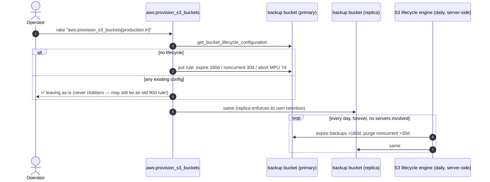

# DR Review — Point 8: Backup retention via S3 lifecycle (180 days)

**Status:** ✅ Applied (`ruby -c` / `bash -n` pass). Retention window: **180 days** (raised from the original 90, via 120, in Aug 2026; `DB_BACKUP_RETENTION_DAYS` env var overrides).
**Repo affected:** `IRM`
**Files:** `lib/tasks/aws.rake` (`aws:provision_s3_buckets`), `lib/tasks/db_backup_xtra.sh` (TODO note), `lib/tasks/backup_db_xtra.rake` (`xtrabackup:cleanup_old_backups`)

> **⚠️ 90/120→180 migration caveat:** `ensure_lifecycle!` never overwrites an existing
> lifecycle config, so any bucket provisioned while the default was 90d **still
> expires backups at 90d** — re-running provisioning cannot fix it. Update the
> rule manually (or delete it and re-provision) on each such bucket. The
> `xtrabackup:cleanup_old_backups` task prints a 🚨 warning when it detects a
> bucket whose lifecycle expiry is shorter than the configured retention.
**Severity:** Medium — unbounded growth: the backup script's ">30 days cleanup" was an unimplemented TODO and `aws:setup_s3_glacier` was a one-shot manual task excluded from `run_all_cleanup`. The backup buckets grow forever (cost) and every restore-chain listing slowly degrades.

---

## 1. Design

A single S3 **lifecycle rule** per backup bucket, applied by `aws:provision_s3_buckets` right after replication/CORS, under the same idempotency contract (existing lifecycle config of any kind → left untouched with a message; only buckets with none get the rule):

| Action | Setting | Why |
|---|---|---|
| `expiration` | 180 days (`DB_BACKUP_RETENTION_DAYS` overridable) | With a nightly full, ~180 restore points always exist |
| `noncurrent_version_expiration` | 30 days | The buckets are versioned (required for replication) — expired objects linger as billed noncurrent versions without this |
| `abort_incomplete_multipart_upload` | 7 days | xbcloud uploads multipart; failed uploads leave invisible billed parts |

Applied to **both** backup buckets (`<bucket>-backup-xtra` and `<bucket_replica>-backup-xtra`) because S3 does not replicate lifecycle actions — each side enforces its own retention. App-asset buckets are deliberately excluded (assets are kept forever).

### Why lifecycle instead of script-side cleanup

- Runs inside S3 — cannot silently stop when a DB server is rebuilt, a cron dies, or the marker is unarmed (the exact failure modes Points 5–7 dealt with for backups themselves).
- No IAM delete permissions needed on the DB instance role (which Point 5 scoped deliberately tight — it keeps `DeleteObject` for xbcloud chunk management, but retention no longer depends on it).
- Chain-integrity is preserved trivially: a full and its dependent incrementals age out together (all named by creation date).

### Interaction with existing pieces

- `db_backup_xtra.sh` TODO #2 ("Cleanup intermediate incr from S3 for > 30 days") — marked DONE-elsewhere in the script header, pointing here.
- `aws:setup_s3_glacier` (30-day Glacier transition, manual one-shot) — **superseded for the backup buckets**: buckets with existing lifecycle config are skipped by the new code, and buckets it configures get expiry-only. Glacier transition was deliberately *not* included: Glacier retrieval takes hours, which is exactly what you can't afford mid-DR; at ~90 nightly fulls the storage saving isn't worth the retrieval risk. If cost becomes a concern, add a `transition` to `GLACIER_IR` (instant retrieval) at day 30 inside the same rule.
- `DbBackupFreshnessJob` (Point 7) lists top-level prefixes — retention keeps that listing permanently small as a side benefit.
- `xtrabackup:cleanup_old_backups[env_name]` (added Aug 2026) — chain-safe, manually-run rake task that permanently deletes object **versions** of snapshots older than retention, oldest-first. It exists because live buckets never received the lifecycle rule (see the caveat above) and had accumulated a year+ of snapshots. Dry-run by default (`CONFIRM=1` deletes); keeps the newest full at-or-before the cutoff so no in-window incremental loses its base; cleans both primary and replica buckets. **Nothing schedules it automatically** — run it by hand, or add a cron/whenever entry if the lifecycle rules can't be trusted on a given env.

## 2. Sequence diagram

## 3. Verification steps

1. Re-run `rake "aws:provision_s3_buckets[production.in]"` — new rule appears on both backup buckets; second run reports "leaving as-is".
2. `aws s3api get-bucket-lifecycle-configuration --bucket <bucket>-backup-xtra` — shows `irm-backup-retention-180d` (a `-90d` or `-120d` rule id here means the bucket predates the raise — see the migration caveat at the top).
3. After ~24h, S3 metrics/inventory show expirations beginning for objects older than 180 days (existing over-age backlog drains gradually).

## 4. Note on the existing backlog

If the buckets already hold months of un-pruned backups, the first lifecycle sweep (or the first `CONFIRM=1` run of `xtrabackup:cleanup_old_backups`) will delete everything older than 180 days. That is the intended retention policy — but if you want a snapshot of the historical backlog first, copy it aside before running against production.
