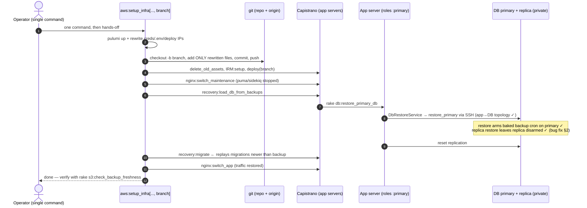

# DR Review — Points 10+11: Fully non-interactive DR (one command, no pauses)

**Status:** ✅ Applied (`ruby -c` passes on all five files):
- `DbRestoreService`: disarm is now instance-aware — primary (`DB-Redis-ES`) stays armed after a DR restore; `DbCheckInstance` and the replica are disarmed (fixes the Point 5 regression).
- `setup_infra` takes an optional `branch_name`: given → auto-commit (only the 3 rewritten files) + push + fully unattended sequence with `recovery:load_db_from_backups` and the new `recovery:migrate`; omitted → legacy pause/prompt unchanged.
- New cap task `recovery:migrate` (roles :primary) replays migrations before `nginx:switch_app`.
- `db:reset_replication` duplicate definition removed (rake merges same-named tasks — it ran twice per call).
- Runbook rewritten around the one-command mode; legacy documented as fallback.
**Repo affected:** `IRM`
**Files:** `lib/tasks/aws.rake` + `lib/tasks/aws_utils.rb` (orchestration), `config/deploy.rb` (one new cap task), `lib/tasks/backup_db.rake` (duplicate-task fix), `app/packs/core/base/services/db_restore_service.rb` (**bug fix from Point 5**), runbook
**Severity:** High — today a DR requires a human at a keyboard for the whole run: a STDIN pause mid-task, a manual SSH restore, a manual commit, a hand-typed branch name, then manual migrations and replication reset afterwards. Under incident pressure, every manual step is an error opportunity.

---

## 1. Key discovery: the "manual" restore is already automated — it's just never called

The pause in `setup_infra` says *"Manually load the backup DB into the primary… then enter a branch name"*. But:

- `db:restore_primary_db` (`backup_db.rake:14`) runs `DbRestoreService.run!(instance_name: "DB-Redis-ES", stop_instance_flag: false)` — it finds the **real primary** by tag, SSHes from the app server (satisfying the "DB reachable only from app servers" topology), restores from S3, verifies with a row count, **and already resets replication**.
- `recovery:load_db_from_backups` (`deploy.rb:175`) chains primary + replica restore as a cap task on `roles(:primary)`.

So the interactive pause guards a step the codebase already knows how to do. The redesign is mostly *wiring*, not new machinery.

## 2. Bug fix required first (introduced in Point 5)

Point 5 made `DbRestoreService#cleanup` disarm the baked backup cron (`sudo rm -f /etc/db_backup_enabled`) after every restore — correct for the throwaway `DbCheckInstance`, **wrong for the other two callers**:

| Caller | Target instance | After restore, marker should be |
|---|---|---|
| `DbRestoreJob` (4-hourly verification) | `DbCheckInstance` | **removed** (current behaviour ✓) |
| `db:restore_primary_db` (real DR) | `DB-Redis-ES` | **kept** — it IS the primary; disarming kills backups right after DR ✗ |
| `db:restore_replica_db` | `DB-Redis-ES-Replica` | **removed** — the restore script arms whatever it restores; an armed replica means two writers on one backup chain ✗ |

**Fix:** `run!` remembers its `instance_name`; cleanup disarms **unless** the target is the primary (`DB-Redis-ES`). One conditional, three callers correct.

## 3. Proposed non-interactive flow

### 3.1 New signature (backwards compatible)

```
# 7th arg = branch name → fully non-interactive
RAILS_ENV=production rake "aws:setup_infra[production, AppServer, DB-Redis-ES, ap-south-2, in, production.in, dr_prod_in_2026_07_08]"

# branch omitted → legacy behaviour (pause + prompt), nothing breaks
```

### 3.2 What replaces the pause

When `branch` is given, after Pulumi + config rewrite the task itself:

1. `git checkout -b <branch>` (or reuse if it exists)
2. `git add` **only the files the task just rewrote** — `config/credentials/<stack>.<variant>.yml.enc`, `.env.<stack>.<variant>`, `config/deploy/<stack>_<variant>.rb` — never a blanket `git add -A`
3. `git commit` with a message recording stack/region/timestamp
4. `git push -u origin <branch>` — required because Capistrano deploys by cloning the remote repo; an unpushed branch would fail the deploy

> ⚠️ **Explicit call-out:** this makes the task auto-commit and auto-push during DR. It only ever happens when you opt in by passing a branch name; the no-branch path keeps today's manual commit flow. Scoped `git add` means stray local changes on the operator's machine are never swept into the DR commit.

### 3.3 The full orchestrated sequence (branch mode)

```
pulumi config + up
rewrite credentials/.env/deploy IPs
auto-commit + push <branch>                        ← replaces STDIN pause
cap recovery:delete_old_assets
cap IRM:setup
cap deploy                                          (branch=<branch>)
cap nginx:switch_maintenance                        (stops puma/sidekiq first)
cap recovery:load_db_from_backups                   ← replaces manual SSH restore
                                                      (primary + replica + replication reset;
                                                       restore arms the baked backup cron on
                                                       the primary — Points 5+7 take over)
cap recovery:migrate                                ← NEW (Point 11): replays migrations
                                                      newer than the restored backup
cap nginx:switch_app                                (restarts puma/sidekiq)
```

`recovery:migrate` is a new ~5-line cap task: `on roles(:primary): execute :rake, "db:migrate RAILS_ENV=..."` — closing the documented gap ("if the last backup is before the last deployment it may not have the required migrations"). Running it after the restore and before traffic makes the old failure mode (stale schema serving requests) impossible.

### 3.4 Small cleanup in the same pass

`backup_db.rake` defines `task :reset_replication` **twice** (lines 7 and 31). Rake *merges* same-named tasks — invoking `db:reset_replication` runs both blocks, resetting replication twice. Harmless today but confusing; the duplicate gets removed.

## 4. Sequence diagram (branch mode)



## 5. Blast radius

- No-branch invocations behave exactly as today (pause + prompt) — zero change for existing habits.
- The auto-commit path is opt-in and touches only the three rewritten files.
- `DbRestoreService` fix changes behaviour only for the marker file; restore logic untouched.
- `recovery:migrate` is additive; `db:reset_replication` dedup removes a double-execution, not a capability.

## 6. Verification

1. `ruby -c` on all touched files; `cap -T | grep recovery` shows the new task.
2. Dry-run the git flow on a scratch branch (no AWS needed): confirm only the three files are committed.
3. Full rehearsal = the Point 13 DR drill (staging, DR region) — this change is what makes that drill runnable unattended.
