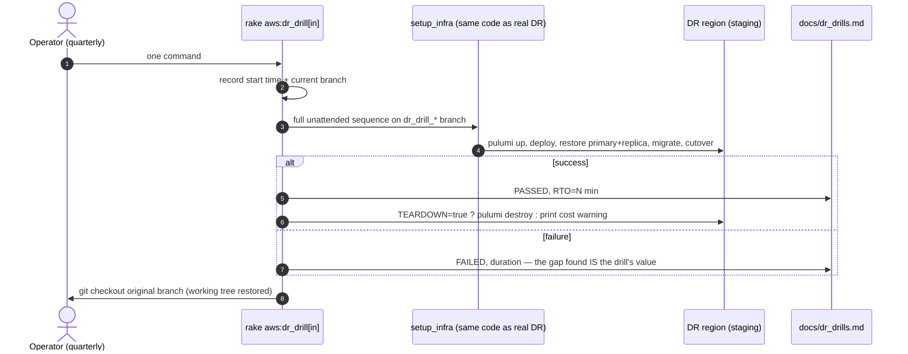

# DR Review — Points 12+13: Org-owned Pulumi state + DR drill

**Status:** ✅ Code applied; Point 12 execution requires your Pulumi login (procedure below)
**Repos affected:** `IRM-Infra` (migration script), `IRM` (drill task)

---

## Point 12: Move Pulumi state out of the personal account

### The problem

State lives in Pulumi Cloud under **`owner: thimmaiah`** (visible in the old state export). Consequences:

- If that personal login is unavailable during an incident (locked out, MFA device lost, account issue), **nobody can run `pulumi up`** — the entire IaC layer is hostage to one person's SaaS account.
- Secrets in stack config are encrypted with keys held by that account.
- No company control, audit, or recovery path.

### The fix (recommended: self-managed S3 backend)

S3 backend over a Pulumi Cloud organization, deliberately:

- State lives **in your own AWS account**, next to everything else DR already protects — versioned (state history = rollback), encrypted, public-access-blocked, and replicable cross-region with the same S3 machinery as Points 6/8.
- No new SaaS dependency or subscription; no per-seat cost.
- Trade-off: secrets move from Pulumi-managed KMS to a **passphrase** provider — `PULUMI_CONFIG_PASSPHRASE` must be in the environment for every pulumi command (store it in Rails credentials). Only 1 encrypted value exists across all six stacks today, so the migration surface is minimal.

### The procedure (needs your login — I cannot run it)

Everything is scripted in **`IRM-Infra/migrate_state_to_s3.sh`** (syntax-checked, executable):

```bash
cd ../IRM-Infra
pulumi login                                   # your current Pulumi Cloud login
export AWS_ACCESS_KEY_ID=... AWS_SECRET_ACCESS_KEY=...
PULUMI_CONFIG_PASSPHRASE='<choose a strong one>' \
  ./migrate_state_to_s3.sh irm-pulumi-state ap-south-1
```

The script: creates the state bucket (versioned + encrypted + public-blocked) → exports all six stacks with secrets → `pulumi login s3://…` → re-inits each stack with the passphrase provider → imports state → runs `pulumi preview --diff` per stack so you can confirm **no changes** before trusting it. It ends with the manual follow-ups: store the passphrase in credentials, point everyone/CI at the S3 backend, replicate the state bucket cross-region, and only then delete the old cloud stacks (avoiding split-brain state).

### Rollback safety

The old Pulumi Cloud stacks are untouched until you explicitly remove them (step 4 of the script's next-steps). The exports are kept on disk until you confirm. At any point before deletion, `pulumi logout && pulumi login` returns you to the working cloud backend.

## Point 13: The DR drill — `rake aws:dr_drill`

### Why

Every piece is now codified, but an untested DR plan is a hypothesis. The drill turns it into a measurement by running **the exact same code path as a real production DR** (`setup_infra` in branch mode) against **staging** in the DR region.

### Usage

```bash
rake "aws:dr_drill[in]"                 # staging IN → $AWS_BACKUP_REGION
rake "aws:dr_drill[in, ap-south-2]"     # explicit region
TEARDOWN=true rake "aws:dr_drill[in]"   # pulumi destroy the drill infra afterwards
```

### What it does

1. Loads the staging env (`staging.<variant>`), records the start time and your current git branch.
2. Runs the full unattended sequence on a `dr_drill_<variant>_<timestamp>` branch: Pulumi provision → config rewrite → auto-commit (3 files only) → deploy → maintenance → primary+replica restore from S3 → migrations → cutover.
3. **Always** (even on failure): returns your working tree to the original branch, and appends a row to **`docs/dr_drills.md`** — date, variant, region, PASSED/FAILED, measured RTO in minutes, branch. That log is your audit trail that DR is *tested*, with a number attached.
4. On success: `TEARDOWN=true` destroys the drill stack; otherwise it prints the destroy command and a cost warning.

### What a passing drill proves

AMIs exist and boot in the DR region · the Pulumi stack config is deployable · S3 DB backups are restorable and recent · deploy + migrations + nginx cutover work · the backup cron arms on the new primary. I.e., every point from this review, end to end.

### Suggested cadence

Quarterly, per variant (IN and US), calendar-scheduled. Each drill also rotates fresh eyes over `docs/dr_drills.md` — a rising RTO trend is an early warning.

## Sequence diagram — drill



## Verification

- Point 13: `ruby -c` passes; first real run = the drill itself (start with `TEARDOWN=true` against staging IN).
- Point 12: the script's built-in `pulumi preview --diff` per stack is the verification gate — migrate only counts as done when all six previews are clean and one real `pulumi up` has been exercised from the S3 backend.
