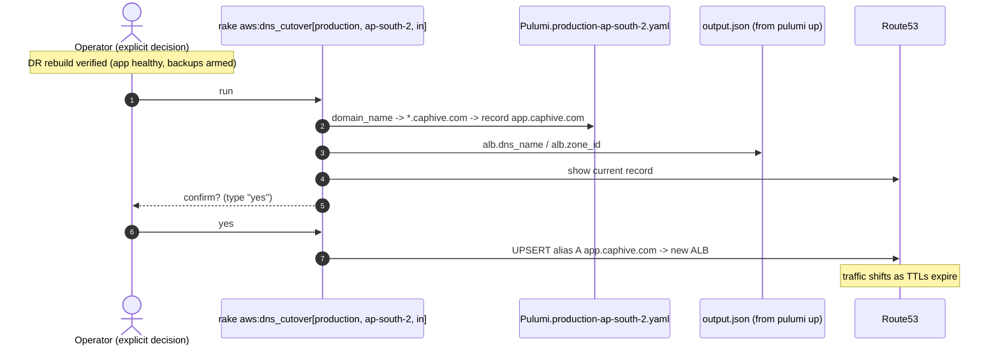

# DR Review — Point 16: SES + DNS cutover — automated, but manual-only by design

**Status:** ✅ Applied (all syntax checks pass)
**Repos affected:** `IRM-Infra` (SES integration, ALB outputs), `IRM` (`aws:dns_cutover` task + a latent-bug fix)
**Design constraint (per review):** both capabilities are tools an operator *invokes*, never side effects of the automatic flow — DR drills have no DNS name, and neither DNS cutover nor email-identity registration should ever happen unattended.

---

## 1. DNS cutover — `rake aws:dns_cutover[stack, region, env_variant, record?]`

The last manual console step of a real DR ("point the domain at the new ALB") is now one auditable command — but it is **never called** by `aws:setup_infra` or `aws:dr_drill`:

1. Reads the domain from the target stack's own `Pulumi.<stack>-<region>.yaml` (single source of truth) and derives the record with the same convention as `derive_webhook_host`: production → `app.<domain>`, staging → `dev.<domain>` (override with the 4th arg).
2. Reads the ALB's `dns_name`/`zone_id` from `output.json` — newly exported by `outputs.py` (requires one `pulumi up` on the stack before first use).
3. Shows the **current** record, then requires the operator to type `yes` — the prompt is deliberate here (this is the flip-the-switch moment; unattended is exactly what we don't want).
4. UPSERTs a Route53 **alias A record** to the ALB.

## 2. SES — fully codified, opt-in per stack

`create_ses_resources` (in `ses_bounce_tracking.py`) now sets up everything the runbook called "manual": SES **domain identity**, the `_amazonses` **verification TXT** record, the three **DKIM CNAMEs** (same dynamic-Route53 pattern as ACM validation), and the existing bounce/complaint tracking (config set + SNS → app webhook).

It runs from `__main__.py` **only when the stack sets `manage_ses: true`**:

```bash
pulumi config set manage_ses true --stack production-ap-south-2 && pulumi up
```

Default is off — a drill or fresh stack never registers email identities as a side effect. The orphaned standalone entrypoint still works but the integrated flag is now the canonical path. (Remaining truly-manual SES step: taking a brand-new region out of the SES sandbox — that's an AWS support request, not codifiable.)

## 3. Latent bug fixed on the way: nil IPs into credentials

While wiring the ALB export, cross-checking `output.json`'s real shape (via git history) against `aws_utils.rb` revealed the reads used a non-existent `"IPs"` wrapper key: `pulumi_output.dig("IPs", "private_ips", ...)` → **nil**. In a real run of `setup_infra`, nil would have been written into `DB_HOST` / `DB_HOST_REPLICA` credentials and the deploy files would keep their stale IPs — mid-DR. Fixed: correct top-level keys, `AppServers` double-nesting handled (it's `[["ip1","ip2"]]`), and explicit raises when any expected output is missing so a malformed handoff dies loudly at the source. (The deeper fix — replacing the `output.json` file handoff with `pulumi stack output --json` — remains Point 17.)

## 4. Sequence diagram — real DR cutover (the only place these run)



## 5. Verification

1. `ruby -c` / `py_compile` — all pass.
2. After next `pulumi up` on any stack: `output.json` contains the `alb` key.
3. Rehearse cutover safely against **staging**: `rake "aws:dns_cutover[staging, ap-south-1, in]"` — flips `dev.altconnects.com` between the existing stack's own ALB (a no-op UPSERT) and shows the whole flow.
4. SES: enable `manage_ses` on staging first; confirm the identity turns "verified" in the SES console within minutes (DKIM records land via the dynamic provider) and bounce webhooks arrive.

## 6. Runbook impact

- "Point DNS at the LB" step → `rake aws:dns_cutover[...]` with confirmation.
- "SES must be set up manually" → `pulumi config set manage_ses true && pulumi up` (+ sandbox-exit note).
