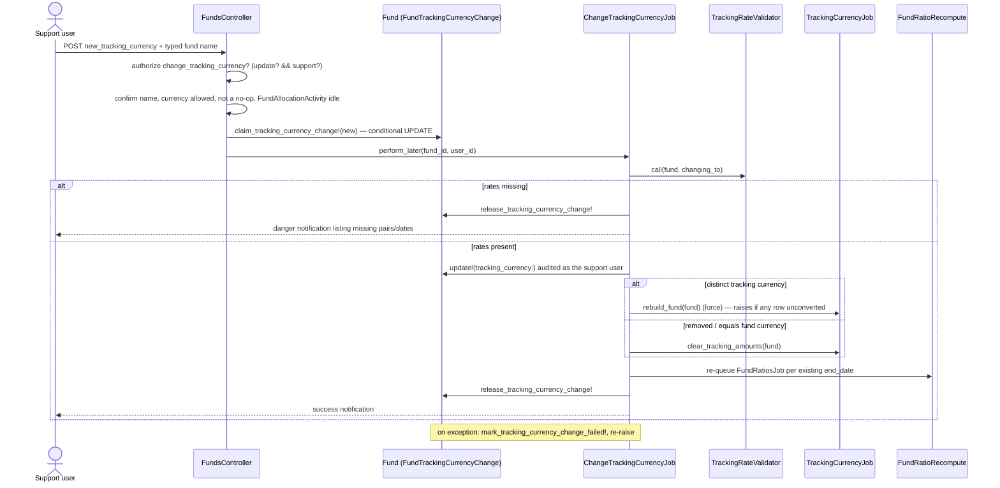
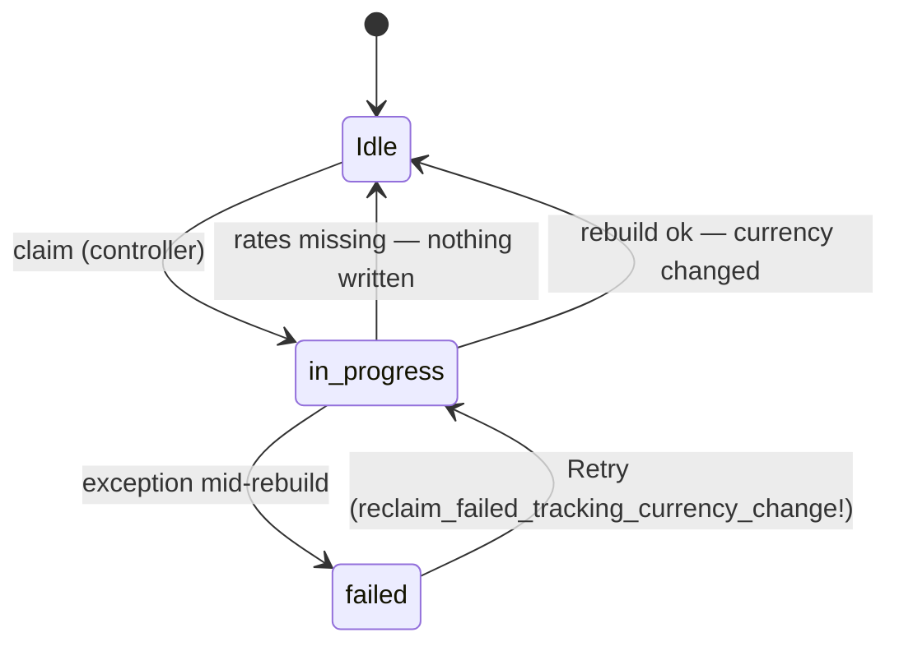

# Change Tracking Currency (support-only)

Status: **implemented** on branch `change_tracking_currency`. This started as the plan for "option C".
It now describes what was built, and lists where the build departed from the plan and why.

## Problem

Since `c360fb417`, support could edit `funds.tracking_currency` on the fund edit form after
creation. That was a bare column write:

- Every stored `tracking_*` amount kept the **old** currency's numbers.
  `monetize ... with_currency: ->(i) { i.fund.tracking_currency.presence || i.fund.currency }` then
  showed them with the **new** currency's label. Nothing raised an error.
- The nightly `TrackingCurrencyJob` runs without `force`, so it only converts rows whose tracking
  amount is still `0`. Old rows were never fixed, and totals mixed two currencies.
- Clearing the field made `has_tracking_currency?` false, so the job skipped the fund and the stale
  values were relabelled as fund currency.
- A missing exchange rate left the fund partly converted, reported only by email.
- Ratios named `XIRR (EUR)` survived until someone regenerated that end date.

## What was built





### Components

| Piece | File | Role |
|---|---|---|
| Migration | `db/migrate/20260927100000_add_tracking_currency_change_to_funds.rb` | `funds.tracking_currency_change_state` (nil / `in_progress` / `failed`), `funds.tracking_currency_changing_to` |
| State + lock | `app/packs/funds/funds/models/concerns/fund_tracking_currency_change.rb` | claim / reclaim / fail / release, `without_tracking_currency_change` scope, `tracking_currency_options` |
| Rate check | `app/packs/funds/funds/services/tracking_rate_validator.rb` | one `MIN(date)` per source, then one rate lookup per source |
| Job | `app/packs/funds/funds/jobs/change_tracking_currency_job.rb` | validate → save (audited) → rebuild or clear → ratios → release |
| Rebuild | `app/packs/funds/funds/jobs/tracking_currency_job.rb` | new `rebuild_fund`, `clear_tracking_amounts`, `fix_tracking_rollups`; sweeps skip funds mid-change |
| Ratios | `app/packs/funds/funds/services/fund_ratio_recompute.rb` | extracted from `ChangeFundCurrencyJob`, used by both jobs |
| Policy | `FundPolicy#change_tracking_currency?`, `#retry_tracking_currency_change?`, `#force_generate_tracking_numbers?` | support only |
| Controller | `FundsController#change_tracking_currency` (GET form / POST), `#retry_tracking_currency_change`, `#update` refuses the field, `#generate_tracking_numbers` gates `force` | |
| Allocation guard | `AllocationRun` create validation, `AllocationRun#rerun!`, `FundAllocationActivity#reason`, `FundsController#allocate` | no run while a change is pending |
| UI | `funds/change_tracking_currency.html.erb`, `funds/_tracking_currency_change_banner.html.erb`, Actions → Misc menu item, edit form field locked | |

### Rate validation: one query per source

`WithExchangeRate#get_exchange_rate` uses the latest rate with `as_of <= date` for the exact
`from`/`to` pair. It never uses an inverse rate. So if a rate exists on or before a source's
**earliest** date, every later date in that source is covered too. The validator takes `MIN(date)`
from each source and then runs one `exists?` against `exchange_rates`. It never loads rows, even from
`account_entries`.

| Source | Date |
|---|---|
| account entries | `reporting_date` |
| remittance payments / distribution payments | `payment_date` |
| remittances | `remittance_date` |
| commitment adjustments | `as_of` |
| commitments | `commitment_date` |
| portfolio investments (incl. proforma) | `investment_date` |
| tracking FMV | earliest of each instrument's latest `valuation_date` |

On the production copy this catches a commitment on fund 321 dated `1899-12-30`, an Excel
zero-date, which has no rate before it. The nightly job skips those rows and only mentions them in
an email. A change now refuses until the rate is added or the date is fixed. That is deliberate:
without it the change would report success on a partly converted fund.

## Decisions

1. **Save the currency first, then rebuild**, as `ChangeFundCurrencyJob` does. `TrackingCurrencyJob`
   reads `fund.tracking_currency`. The state marker covers the window in which the amounts are only
   partly rebuilt.
2. **The marker is a column, not a cache key.** Production uses `solid_cache_store`, which evicts
   entries, and a lock that disappears on its own would let the nightly job or an allocation write
   in the middle of a rebuild. The claim is `UPDATE ... WHERE tracking_currency_change_state IS NULL`
   and requires exactly one affected row.
3. **Keep the state and the target in separate columns.** A nil target is how removal is
   represented, so the target alone can't also say "a change is pending".
4. **Removal zeroes every tracking column**: rows, commitment and API rollups, and fund totals.
   Keeping the old figures would show them under the fund-currency label.
5. **A partial rebuild counts as a failure.** `TrackingCurrencyJob` rescues a missing rate per date,
   so `rebuild_fund` returns the problems as data and the job raises if there are any. The failed
   state keeps the target so that Retry is a single click. Every step is idempotent: the save is
   skipped once the currency is already set, and the rebuild always uses force.
6. **Ratios need no separate delete.** `FundRatiosJob#_delete_previous_fund_ratios` deletes by
   `(fund, capital_commitment, end_date)`. Investor-KYC-level ratios are stored against the commitment
   they were computed through, so they are covered too (verified in `FundRatioCalcInitializer`).
7. **The audit row names the person.** The currency save runs inside
   `Audited.audit_class.as_user(support_user)`. The bulk rewrites run as `"ChangeTrackingCurrencyJob"`.
8. **No sandbox requirement.** Tracking figures are derived entirely from fund-currency data and can
   always be rebuilt. The controls are: support only, the fund name typed to confirm, and validation
   before any write.
9. **One path to change it.** After creation the edit-form field is disabled for everyone, and
   `FundsController#update` refuses a changed `tracking_currency`, support included, with a message
   pointing to the new action.

## Deviations from the original plan

- **State + target columns** replace the planned `changing_to` + `failed_at`. See decision 3.
- **`enable_tracking_currency` is not required** by `change_tracking_currency?`. Without it, support
  could not fix a bad tracking currency on a fund whose entity has the feature switched off.
- **`TrackingCurrencyJob` rollups were broken, not only unverified.** The convert methods write with
  `update_all`/`update_columns`, which skip counter_culture. As a result:
  - `funds.tracking_call/collected/distribution_amount_cents` kept their pre-conversion values
  - so did `capital_commitments.tracking_collected/distribution_amount_cents`
  - `funds.tracking_committed_amount_cents` was never written anywhere, although the fund header
    shows it

  `fix_tracking_rollups` now re-counts the first two per column (`only:` + `column_name:` + a `where`
  on the target table) and sums the third. This runs on every tracking pass, nightly included.
- **`ChangeFundCurrencyJob` step 18 was broken.** It called `TrackingCurrencyJob.new.update_fund`,
  which merges into `@error_msg`, and only `#perform` sets that up. So a currency change on a fund
  with a tracking currency raised `NoMethodError` at the tracking step. It now calls `rebuild_fund`
  and reports any unconverted rows.
- **Force Regeneration is support-only.** The fund page's `?debug=true` button, and the `force`
  param on `generate_tracking_numbers`, now require `FundPolicy#force_generate_tracking_numbers?`.
  The entity-level button on the Exchange Rates page is unchanged.
- **Allocation blocking** goes through `FundAllocationActivity#reason` and an `AllocationRun` create
  validation, so group runs and rake tasks are covered along with the allocate screen, instead of
  through `AllocationRunReadiness`.

## Verified against the production copy (mysql-restored, port 33066)

All checks were read-only or ran inside rolled-back transactions. The copy is at schema 2026-09-20
and has no marker columns, so the job's state handling was exercised on the small `mysql8:3306`
database. Everything data-dependent below ran on 33066.

**Who uses tracking currency.** 322 live funds:
- 17 have a tracking currency distinct from the fund currency (INR→USD 9, USD→INR 7, SGD→USD 1).
- 252 have it equal to the fund currency.
- 53 hold an empty string.

**None of the 17 was set when the fund was created.** The audit log shows every one was set by a
later update:
- nine first-time sets from blank;
- funds 180, 364 and 365 went from one value to another.

Since `c360fb417` (and still in this change), only support can do either. See the open question
below.

**Rate check.** `TrackingRateValidator` runs in 0.02–3.8s per fund; the slowest is fund 317 with
1.84M account entries. Against each fund's current tracking currency:
- 15 of 17 pass;
- fund 321 fails on a commitment dated `1899-12-30` (an Excel zero-date);
- fund 386 has no INR→USD rates at all.

Changes on those two will be refused until the data is fixed, which is what we want.

**Existing damage.** Recomputing each fund's account entries at today's rates:
- fund 180: 30 of 581 stored tracking amounts disagree;
- fund 364: 2 of 63 (plus 2 of 2 remittance payments);
- fund 365: 3 of 98 (plus 3 of 6 remittance payments).

Those rows were converted before a currency change or a rate correction, and only a forced rebuild
fixes them. Entity 6991's rates look like test data (INR→USD = 1.1696).

**Rollup bug confirmed in production.**
- Funds 316, 317, 318, 320, 321 and 378: fund-level tracking **call** total is 0 against real row
  sums.
- Funds 316, 317, 318, 320, 321, 364 and 365: tracking **collected** total is 0.
- Every fund except 338 and 386 has **Tracking Committed** = 0.
- Commitment-level tracking collected is wrong on every commitment of funds 316–321.
- Commitment-level tracking distributed is wrong on all of funds 320 and 378.

`fix_tracking_rollups` corrects them (checked on 317 and 319). It costs 1.8–2.9s on the largest
funds, per nightly pass.

**Rebuild and clear timings:**
- `rebuild_fund` on fund 316 (246k entries): 214s. That is the existing forced conversion, and it
  scales to roughly 25 minutes for fund 317.
- `clear_tracking_amounts`: 31s for fund 342, 147s for fund 316.

**Bug found and fixed here.** `clear_tracking_amounts` first used `in_batches` + `update_all` on
`account_entries`. MySQL plans that batch UPDATE (`id IN (...)` on the partitioned table) as a full
PRIMARY index scan: EXPLAIN shows ~6.9M rows scanned and locked per batch. On the copy it failed with
"total number of locks exceeds the lock table size" even for a 4k-entry fund. It now updates one
`reporting_date` at a time, like `convert_account_entries`. EXPLAIN for that form shows one partition
and an index merge on `fund_id` and `reporting_date`.

**Other checks.**
- 321 of 322 live funds pass validation, so the job's `update!` won't fail on them. The exception is
  fund 283 ("Documents is invalid"), which has no tracking currency.
- Fund 342's `(INR)` ratios come from ratio formula labels, not an old tracking currency.

Cucumber was not run. Commands:

```
TEST_ENV_NUMBER=$RANDOM bundle exec cucumber features/fund/change_tracking_currency.feature \
  features/fund/fund_tracking_currency_lock.feature features/fund/tracking_currency_job.feature
```

(`tracking_currency_job.feature` is included because `fix_tracking_rollups` now runs on every pass.)

## Open question

Every production tracking currency was first set *after* the fund was created. Should company admins
be allowed to use **Change Tracking Currency** when the fund has no tracking currency yet (blank or
equal to the fund currency)? That is the same validated job, but restricted to a first-time set, with
changing an existing tracking currency staying support-only. Today every first-time setup needs
support.

## Deploy notes

- The migration adds two nullable columns to `funds`. It is a quick `ALTER` on a small table.
- After deploy, the first nightly run changes the fund-page **Tracking Currency** card on most of
  the 17 tracking funds, from 0 to the real totals (see the rollup findings above). Warn support,
  since customers will see numbers appear. A normal, non-forced run is enough, because the rollups
  are re-counted on every pass.
- Funds 180, 364 and 365 hold tracking amounts that disagree with current rates. A support
  **Force Regeneration** fixes them. Entity 6991's rates should be checked first.
- User guide FAQs changed (`docs/user_guides/tracking_currency_guide.md`). Sync them with
  `bin/rails guide_faqs:import_markdown REFRESH=1` and `bin/rails guide_search:reindex`.
