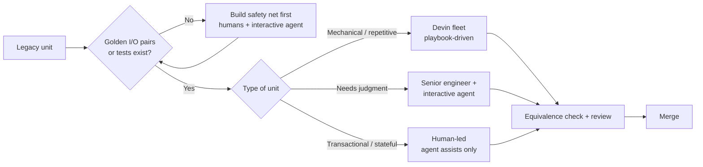
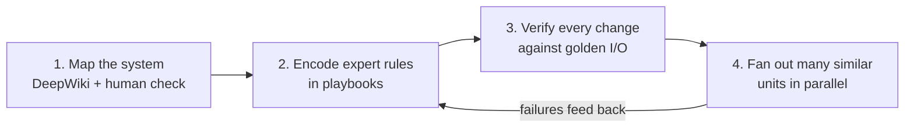
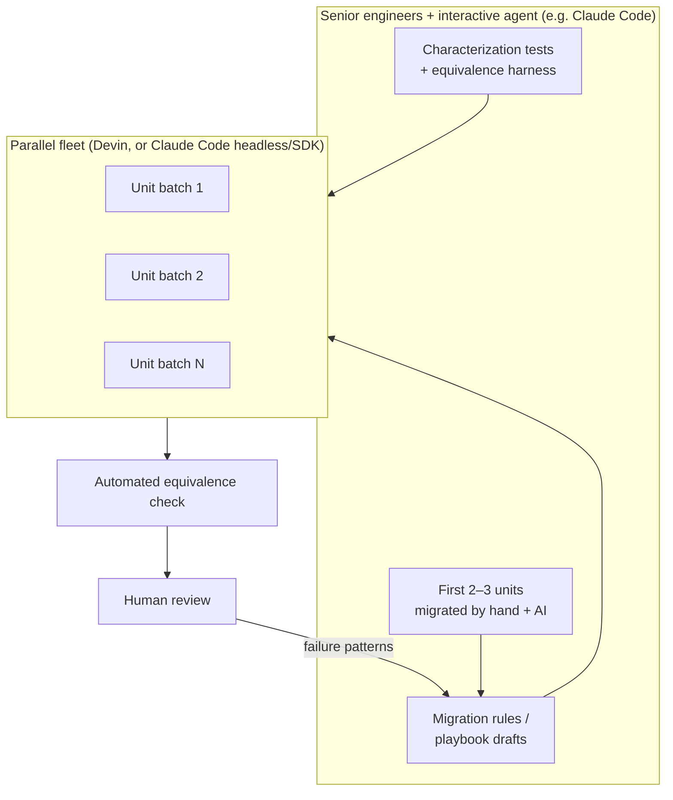
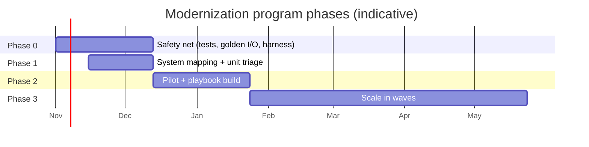
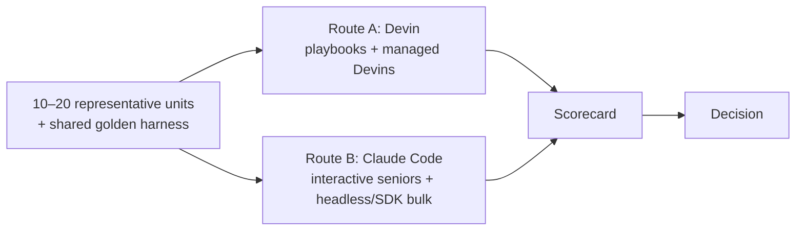

# Devin for Legacy Modernization — Primer

*Researched October 2026. Pricing and features change quickly — verify against Cognition before committing.*

> **Disclosure:** this was written with Claude (Anthropic). The Claude Code comparison is
> therefore not neutral — it leans on documented facts, but validate it in your own pilot.

## TL;DR

Devin works for large-scale modernization **when the work can be cut into many small,
repetitive, verifiable units with an automated "did behaviour change?" check**. Programs
succeed when Devin is treated as a parallel workforce executing a process designed by
senior engineers. They fail when it is handed an outcome like "modernize the platform".

The single biggest success factor is not the tool — it is building **characterization
tests and an equivalence harness before any code is migrated**.

---

## 1. What Devin is (late 2026)

- **Product:** Cognition's autonomous coding agent. You assign a task (Slack, Jira, web app,
  API); it works in **its own cloud VM** (shell, editor, browser) and returns a **pull
  request**. You review results rather than watching it work.
- **Company:** Cognition acquired the Windsurf IDE (July 2025), ships its own coding models
  (SWE-1.5), and is pushing hard into enterprise modernization via AWS, MongoDB and
  Cognizant partnerships.

### Features that matter for modernization

| Feature | What it does | Why it matters for legacy work |
|---|---|---|
| **DeepWiki / Ask Devin** | Indexes the codebase; traces call chains and data flow | Recovers knowledge from undocumented legacy systems; scopes tasks before coding |
| **Playbooks** | Reusable, versionable instructions; can be generated from a successful session | Encodes migration rules so every change respects them |
| **Knowledge** | Persistent facts about your codebase and conventions | Carries learning across sessions |
| **Managed Devins (MultiDevin)** | A coordinator splits work and runs child sessions in parallel, each in its own VM | Fan out the same migration across hundreds of modules; auto-approval can be turned off to review batches first |
| **API / MCP / Schedules** | Programmatic session control | Drive Devin from CI or your own orchestration |
| **Enterprise** | VPC deployment options, SSO, audit logs, SOC 2 Type 2 | Needed before legacy code and data leave your estate |

### Pricing model

Billing is usage-based in **ACUs** (Agent Compute Units, about 15 minutes of active agent
work each). Third-party sources put it at roughly **$2.00–2.25 per ACU**, a Team plan around
**$500/month** (≈250 ACUs), and custom Enterprise pricing. Cognition has been changing the
pricing model, so confirm current rates.

---

## 2. Evidence — sorted by how much to trust it

### Vendor and partner case studies (real, but selected)

| Customer | Work | Claimed result |
|---|---|---|
| Itaú Unibanco | COBOL refactoring across hundreds of programs | 5–6x faster, "zero production errors" |
| Automotive manufacturer | 25k-line COBOL customs workflow → Python | ~73% migration cost reduction |
| Nubank | ETL migration, millions of lines | Completion rate doubled after fine-tuning on past manual migrations; ~40 → 10 min per sub-task |
| Sapporo city government | ~1M lines of legacy code | ~¼ of an estimated 200 engineer-months |
| Odyssey Logistics (via Cognizant) | Legacy conversion | 37% net cost saving |

### Independent evaluation

**Answer.AI (January 2025):** 3 successes out of 20 tasks (14 failures, 3 inconclusive). They
found it unpredictable, saw it spend days on dead ends, and saw it invent platform features
that didn't exist. This was the old Devin and the product has improved a lot since. The
failure pattern still applies: **an autonomous agent given an open-ended or impossible task
keeps going instead of stopping.**

### What every success has in common

Cognition's own COBOL write-up states that **transactional workloads remain out of reach**:
there is no isolated environment to replicate them in and no clean input/output pairs to
test against. That is the most important caveat in this document.

**Ignore** benchmark tables on "Devin vs Claude Code" blogs (e.g. "45.8% vs 88.6% on
SWE-bench"). They compare different versions, setups and dates. They are marketing, not data.

---

## 3. Pros and cons

### Pros

- **Parallel scale.** Dozens of isolated sessions at once is the real strength. It suits
  migrations that apply the same change across hundreds of modules.
- **Asynchronous, ticket-shaped workflow.** It fits Jira + PR review, and people who aren't
  power users can assign work.
- **Codebase understanding.** DeepWiki is useful for recovering knowledge from undocumented code.
- **Process memory.** Playbooks and Knowledge carry learning between sessions, so the process
  improves over the program.
- **Enterprise posture.** VPC options, SSO, audit logs, SOC 2 Type 2, plus delivery partners
  (Cognizant, AWS) who can add capacity.
- **Isolated VM.** It can build and run unfamiliar legacy toolchains without touching
  developer machines.

### Cons

- **Less steering mid-task.** You find out it went the wrong way at PR time, after ACUs are spent.
- **Unpredictable cost.** Vague tasks burn ACUs while it loops. Spend is hard to predict until
  you have per-task measurements.
- **Weak on judgment.** Architecture, unclear domain rules, transactional and stateful systems.
- **Review is the bottleneck.** Ten parallel agents produce PRs faster than seniors can
  review them properly.
- **Lock-in.** Playbooks, Knowledge and the workflow live in Devin's format, so the value of
  your process builds up in a vendor's system.
- **Environment setup work.** Odd compilers, licensed tools and mainframe dependencies must be
  reproduced inside Devin's VM.

---

## 4. Devin vs Claude Code

| | **Devin** | **Claude Code** |
|---|---|---|
| Default mode | Delegate a task, get a PR back | Engineer works with the agent in a terminal, IDE, web or desktop app; headless mode also available |
| Where it runs | Cognition cloud VMs (VPC options) | Your machine, your CI, or Anthropic cloud sessions |
| Parallelism | Built in (managed Devins) | Subagents, background/cloud sessions, workflows, Agent SDK; you build the orchestration yourself |
| Reusable process | Playbooks, Knowledge | CLAUDE.md, skills, hooks, slash commands, all **plain files in your repo** |
| Steering | Mostly before and after the task | Continuous, so wrong turns get corrected early |
| Best at | High volume of well-specified, verifiable, similar units | Hard reasoning, design, unclear tasks, building the migration tooling itself |
| Pricing | ACUs (compute time) | Per seat or API tokens |
| Lock-in | Higher | Lower: config is files in git, and the SDK is scriptable |

### How to split the work in practice

Many teams use both:

Which tool is cheaper for the fleet layer is exactly what a pilot should measure.

---

## 5. How to make the program succeed

### Phase 0: build the safety net before any code changes (the most important step)

- Write **characterization tests** and record **golden input/output pairs** from production
  for every unit in scope. Without an automated way to show behaviour didn't change, the
  agent's output can't be checked.
- Build a harness that runs old and new code side by side on the same inputs and diffs the
  outputs.

### Phase 1: map the system (2–4 weeks)

- Use DeepWiki / Ask Devin for dependency maps, data flow and a module inventory.
  **Have humans check them.** A wrong map multiplies errors across every later task.
- Sort units into three groups: **mechanical** (most of them), **needs judgment**, and
  **transactional/stateful** (keep humans in charge of these).

### Phase 2: pilot and build playbooks (4–6 weeks)

- Choose about 10 representative units. Your best engineers migrate the first 2–3
  **with** Devin, then turn those sessions into a playbook.
- Hold playbooks to the same standard as code: version them, review them, and update them
  after every failure pattern.
- Keep each task to **about 3 hours of human-equivalent work or less** (Devin's own
  documented guideline), with **explicit acceptance criteria**, for example: "golden tests
  pass, no new lint violations, public interface unchanged".

### Phase 3: scale in waves

- Use managed Devins with auto-approval **turned off** at first.
- Size each wave to **review capacity**, not to how many agents you can run.
- Every week, review merge rate, rework rate and ACUs per merged PR. Fix the playbook
  before you increase parallelism.

### Organization

- Name a **migration lead** who owns the playbooks and the definition of done.
- Plan for senior engineers to spend about **50% of their time** reviewing and fixing the
  process. This is the actual cost of the program.
- Keep **domain experts** available. In every successful case study they encoded the
  constraints.

### Metrics to track from day one

| Metric | Why |
|---|---|
| PRs merged without major rework | Real throughput, not activity |
| ACUs ($) per merged unit vs human baseline | The ROI number |
| Escaped defects (staging / prod) | Quality guard |
| Review time per PR | Detects the review bottleneck early |
| Behaviour-equivalence pass rate | Detects playbook gaps |

---

## 6. What to watch out for

1. **Tests that agree with the bug.** If the agent writes both the code and its tests, the
   tests may simply confirm whatever the code does. Golden tests must come from the legacy
   system's real behaviour, never from the new code.
2. **Quiet changes to business rules:** rounding, date handling, character encodings
   (EBCDIC), null handling, numeric precision. These are the classic ways a migration gets
   behaviour wrong. Put each one in the playbook explicitly.
3. **Persisting on impossible tasks.** Set ACU caps per session and stop rules ("if X fails
   twice, stop and report").
4. **Review fatigue.** Rubber-stamping agent PRs is how defects reach production. Smaller
   PRs and automated equivalence checks help.
5. **Data and security.** Your legacy code (and often PII) will be in a vendor VM. Confirm VPC
   deployment, data retention, and that secrets and production data never enter sessions.
   Use synthetic or masked golden data.
6. **Inflated ROI expectations.** "8 months to 8 days" stories are the best cases. Build the
   business case on pilot numbers, not vendor slides.
7. **Lock-in.** Keep a plain-markdown copy of your playbook rules in your own repo so the
   process outlives any one tool.
8. **Transactional cores.** Don't let the pilot's success push the program into stateful or
   transactional systems on the same assumptions.

---

## 7. Recommendation: run a bake-off

Run a **4–6 week bake-off** on the same 10–20 representative units, with the same
golden-test harness, through two routes:

| Scorecard metric | Route A (Devin) | Route B (Claude Code) |
|---|---|---|
| Cost per merged unit | | |
| Rework rate | | |
| Escaped defects | | |
| Reviewer hours per unit | | |
| Equivalence pass rate (first attempt) | | |
| Setup effort (env, playbooks/skills) | | |

Whichever tool wins, the factor that most decides success is **Phase 0**: the
characterization tests and the equivalence harness.

---

## Sources

- [Cognition: How Devin is modernizing COBOL at Fortune 500 companies](https://cognition.com/blog/how-devin-is-modernizing-cobol-at-fortune-500-companies)
- [Devin docs: Advanced capabilities (managed Devins, playbooks)](https://docs.devin.ai/work-with-devin/advanced-capabilities)
- [Devin docs: When to use Devin](https://docs.devin.ai/essential-guidelines/when-to-use-devin)
- [Devin docs: Instructing Devin effectively](https://docs.devin.ai/essential-guidelines/instructing-devin-effectively)
- [Nubank case study](https://devin.ai/financial-services)
- [Fortune: Japan taps 'Devin-kun' for legacy code](https://fortune.com/2026/07/03/devin-kun-cognition-ai-japan-russell-kaplan/)
- [Cognizant/Cognition at Odyssey Logistics](https://news.cognizant.com/2026-09-23-Cognizant-and-Cognition-put-autonomous-AI-engineering-into-production-at-Odyssey-Logistics,-with-a-37-percent-net-cost-saving)
- [Cognition & MongoDB modernization](https://devin.ai/blog/devin-for-mongodb-modernizations)
- [AWS & Cognition partnership](https://cryptobriefing.com/aws-cognition-devin-enterprise-software-modernization/)
- [eWeek: Cognition $26B valuation](https://www.eweek.com/news/cognition-devin-ai-coding-agent-funding/)
- [The Register: Answer.AI testing of Devin](https://www.theregister.com/2025/01/23/ai_developer_devin_poor_reviews)
- [Devin pricing overview (third-party)](https://pensero.ai/blog/devin-pricing)
- [Devin enterprise features (third-party)](https://fast.io/resources/devin-enterprise-guide/)
- [Sacra: Cognition profile](https://sacra.com/research/cognition)
- [Devin vs Claude Code (third-party comparison)](https://www.morphllm.com/comparisons/devin-vs-claude-code)
