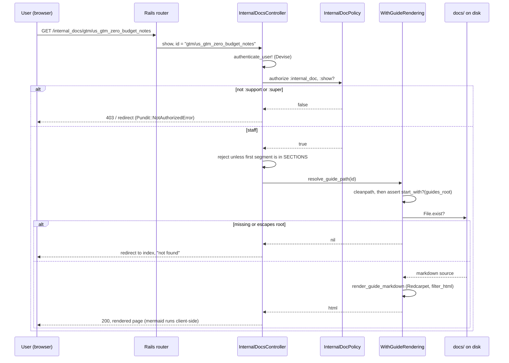

# Internal Docs Viewer — Implementation Note

**Status:** Specified, not built. Hand this to an implementing agent or developer.
**Goal:** A private, in-app browser for CapHive's **marketing and commercial documentation**, visible only to CapHive staff — not to customers, and not to the public internet. Technical documentation is explicitly out of scope.
**Effort estimate:** 2–3 hours. Almost all of the mechanism already exists; this is a mirror of the user-guides viewer with a stricter policy and a directory whitelist.

---

## 1. Why This Shape (Read Before Proposing Alternatives)

The team wants an internal website for ~330 markdown files under `docs/`. Three approaches were rejected for concrete reasons — do not re-open them without new information:

| Rejected approach | Why |
|---|---|
| **GitHub Pages** | Pages published from a private repo is still a **public** website unless the account is on GitHub Enterprise Cloud. `ausangshukla/IRM` is a personal account. Publishing would expose the pricing bands in `docs/gtm/us_gtm.md` §4.2, the competitive analysis, and the GTM playbook. |
| **Serve from `public/website`, gated by login** | Architecturally impossible without unwinding a deliberate design. In production **nginx serves the apex directly from `public/website` and puma never sees the request** (`config/deploy/templates/nginx_conf.erb:90-91`). In dev/test the `Website` middleware is inserted at **position 0, ahead of the session store** (`config/initializers/website.rb:14`), and `lib/middleware/website.rb:16-19` states the shared session cookie is deliberately never set for anonymous website traffic — so there is no session to authorize against. Separately, `public/website` is regenerated by `rake website:build` from `website_src`, so internal docs placed there would be one careless build from shipping to caphive.com. |
| **A `UserEnabled` permissions flag as the gate** | Wrong primitive. Those flags are ANDed with the entity's own permissions (`get_permissions.x? && entity&.permissions&.x?` in `app/packs/core/users/models/concerns/user_enabled.rb`) — they are *customer feature entitlements*, not staff access. |

The correct gate already exists: the `:support` and `:super` roles used by `UserPolicy#login_as?` (`app/packs/core/users/policies/user_policy.rb:66-71`).

---

## 2. The Existing Pattern to Mirror

The signed-in user-guides viewer already implements everything except the policy and the whitelist. Read these first:

| File | What it gives us |
|---|---|
| `app/packs/core/base/controllers/user_guides_controller.rb` | `index` (globs `**/*.md`, groups by subdirectory, builds titles and descriptions) and `show`; `after_action :verify_authorized`; `force_html_format` |
| `app/packs/core/base/controllers/concerns/with_guide_rendering.rb` | `resolve_guide_path` (the directory-traversal guard), `render_guide_markdown` (Redcarpet), `guide_title` |
| `app/packs/core/base/controllers/public_guides_controller.rb` | The login-less subset — shows how the concern is reused by a second controller |
| `app/packs/core/base/views/user_guides/index.html.erb`, `show.html.erb`, `_guide_body.html.erb` | The view structure; `_guide_body` is already shared between two controllers |
| `config/routes.rb:134-135` | `resources :user_guides, only: [:index]` plus a globbed `get 'user_guides/*id' … format: false` |
| `app/packs/core/base/views/layouts/_sidebar.html.erb:237` | How the nav entry is rendered |

`redcarpet` is already in the Gemfile (line 265). No new dependency is required for markdown.

**What differs:** `UserGuidePolicy` is permissive by design (`user.present? && user.curr_role != "investor"`) because user guides are customer-facing. Internal docs are not.

---

## 3. Design

### 3.1 Routes

Mirror the user-guides pair in `config/routes.rb`:

```ruby
# Internal documentation browser (CapHive staff only — see InternalDocPolicy).
# Globbed *id with format: false for the same reason as the user_guides route
# above: a plain :id segment rejects dots, which would break ids containing them.
resources :internal_docs, only: [:index]
get 'internal_docs/*id', to: 'internal_docs#show', as: :internal_doc, format: false
```

Use `/internal_docs`, **not** `/internal/docs` — `config/routes.rb:105-107` already uses the `/internal/*` prefix for machine-to-machine sync endpoints (`users_sync`), and colliding namespaces there would be confusing.

### 3.2 Generalize the rendering concern — do not copy it

`WithGuideRendering` hardcodes `GUIDES_ROOT`. Extract the root into an overridable method rather than duplicating the concern. Its own header comment explains why:

> a divergence in either would be a security or a formatting bug depending on which copy drifted

A drifted traversal guard on the tree holding pricing, security reviews and DR procedures is precisely the bug to avoid.

```ruby
# In WithGuideRendering — replace direct GUIDES_ROOT references with this method.
# Defaults to the user-guides tree so existing callers are unchanged.
def guides_root
  GUIDES_ROOT
end
```

Then `resolve_guide_path` uses `guides_root` in place of `GUIDES_ROOT`, keeping `cleanpath` and the `start_with?("#{guides_root}/")` containment check exactly as they are. `InternalDocsController` overrides `guides_root` to return `Rails.root.join("docs")`.

**Verify `PublicGuidesController` still behaves identically after this refactor** — it shares the concern and serves login-less pages.

### 3.3 Section whitelist — `gtm/` only

Rooting at `docs/` alone would expose every subdirectory, including security reviews and DR procedures. The whitelist is both the navigation structure and a security boundary — `resolve_guide_path` must reject any id whose first path segment is not listed.

```ruby
# Only these trees are browsable. Everything else under docs/ — modules/,
# engineering/, operations/, security/, archive/ and the rest — is
# unreachable even to a staff user. Adding a directory here is a deliberate act,
# not a convenience.
SECTIONS = {
  "Go-To-Market" => %w[gtm]
}.freeze
```

**Why one directory.** The commercial set originally lived in two trees: marketing docs under `docs/marketing/`, and the parent strategy document they all link to (`us_gtm.md` — ICP, personas, pricing framework, sales playbook) plus its US feature specs under `docs/features/`. Whitelisting `features/` to keep those links alive also exposed 40+ unrelated product specs. Both trees were merged into `docs/gtm/`:

| Path | Contents |
|---|---|
| `gtm/us_gtm.md` | Parent strategy document |
| `gtm/us_gtm/` | US feature specs indexed by `us_gtm.md` |
| `gtm/outbound/` | Outbound sequences, tracker, personalization and testing plans |
| `gtm/prerequisites/` | Working notes and evidence behind `us_gtm_prerequisites.md` |
| `gtm/linkedin_posts/` | LinkedIn drafts (source for `build_blog_from_drafts.mjs`) |
| `gtm/*.md` | Plans, runbooks and notes |

Deliberate exclusions, each for a reason:

- **All technical trees** (`modules/`, `engineering/`, `operations/`, `security/`, `archive/`) — out of scope by decision. `security/` is also the most sensitive content in the repo.
- **`user_guides/`** — already has its own viewer at `/user_guides`. Duplicating it here would create two URLs for the same content under different policies.
- **`release_notes/`** — customer-facing; belongs with the user guides, not here.
- **`features/`, `product/`** and **`business_requirements/`** — product specs rather than commercial material.

### 3.4 Controller

`app/packs/core/base/controllers/internal_docs_controller.rb`, mirroring `UserGuidesController`:

- `include WithGuideRendering`
- `after_action :verify_authorized`
- `before_action :force_html_format, only: :show`
- `index` — glob only within whitelisted sections, group by section then subdirectory
- `show` — `authorize :internal_doc, :show?`, resolve via `resolve_guide_path`, redirect to the index with an alert when the path is nil
- Override `guides_root` to `Rails.root.join("docs")`
- Enforce the `SECTIONS` whitelist on the first path segment **before** rendering

### 3.5 Policy

`InternalDocPolicy` — every new controller action needs a matching policy method, or Pundit raises `NoMethodError`:

```ruby
class InternalDocPolicy < ApplicationPolicy
  # CapHive staff only. Note this is deliberately STRICTER than UserGuidePolicy:
  # user guides are customer-facing, internal docs hold pricing, GTM strategy,
  # security reviews and DR procedures. Deny by default.
  def index?
    staff?
  end

  def show?
    staff?
  end

  private

  # Same roles that authorize support impersonation in UserPolicy#login_as?.
  def staff?
    user.present? && (user.has_cached_role?(:support) || user.has_cached_role?(:super))
  end
end
```

### 3.6 Views and navigation

Mirror `user_guides/index.html.erb` and `show.html.erb`, reusing the existing `user_guides/_guide_body` partial for the rendered body so styling stays consistent. Add a sidebar entry alongside the user-guides link at `app/packs/core/base/views/layouts/_sidebar.html.erb:237`, **rendered only when the policy passes** — a visible link that 403s is a bad experience and advertises the URL to customers.

### 3.7 Mermaid

The marketing and technical docs use ```mermaid fences heavily; the user guides largely do not, so this path has probably never needed it. Redcarpet with `fenced_code_blocks: true` emits `<pre><code class="language-mermaid">`, which renders as raw text without a client-side script.

**Vendor mermaid into the asset pipeline rather than loading from a CDN** — the app's CSP would likely block an external script, and an internal tool should not depend on a third-party CDN. Initialise it against the rendered container only on the internal-docs pages.

Note `render_guide_markdown` passes `filter_html: true`; confirm this does not strip the code block attributes mermaid needs.

---

## 4. Request Flow



---

## 5. Security Requirements (Non-Negotiable)

1. **Deny by default.** The role check lives in the policy, not the controller. `after_action :verify_authorized` must be present so a missing `authorize` call fails loudly.
2. **Traversal guard reused, never reimplemented.** Use `resolve_guide_path`. Do not build a second path resolver.
3. **Whitelist enforced server-side**, on the first path segment, before any file read.
4. **This app has real customer logins** (GP and LP users). The policy is the only boundary between a customer account and CapHive's pricing and strategy. Treat a policy gap here as a data-exposure bug, not a UX bug.
5. **No new public route.** Nothing in this feature may be reachable without authentication — contrast `PublicGuidesController`, which is deliberately login-less and must not be extended to cover these files.

---

## 6. Test Plan (Cucumber — this project does not use RSpec)

Add a feature covering:

| Scenario | Expected |
|---|---|
| `:support` user visits `/internal_docs` | 200, sees the Go-To-Market section |
| `:super` user visits a doc under `gtm/` | 200, content rendered |
| Ordinary GP user (no staff role) visits `/internal_docs` | Denied |
| Investor-role user visits `/internal_docs` | Denied |
| Anonymous visitor | Redirected to login |
| Traversal attempt (`../../config/database`) | Redirected with "not found", no file read |
| Non-whitelisted section — `engineering/...`, `security/...`, `modules/...` | Redirected with "not found" (assert on all three; these are the trees the whitelist exists to protect) |
| Existing `/user_guides` behaviour after the concern refactor | Unchanged |
| Existing `PublicGuidesController` behaviour after the refactor | Unchanged |

Cucumber runs with the `:inline` ActiveJob adapter and SQLite in the test environment; nothing here should need either, but do not introduce raw SQL. Set `TEST_ENV_NUMBER` to a random value under 40000 when running locally.

---

## 7. Decisions the Implementer Should Confirm First

1. **`docs/features/`** — *Resolved:* `us_gtm.md`, its feature specs and `docs/marketing/` were merged into `docs/gtm/`, and the whitelist narrowed to that one directory (see §3.3). The retired `/features/*` redirect now forwards to `/internal_docs/gtm/*`.
2. **Search** — the user-guides index has no search. With ~65 files in scope this is tolerable, but a client-side filter on the index is cheap. Out of scope unless asked for.
3. **Later expansion** — if technical docs are ever added, they are a new entry in `SECTIONS`, nothing more. The design does not need revisiting; the exclusion is a scope decision, not a structural one.

---

## 8. Related

- `docs/modules/website/website_serving.md` — how the public site is served, and why it cannot be the host for this
- `docs/gtm/us_gtm_zero_budget_notes.md`, `docs/gtm/us_gtm_prerequisites.md` — among the documents this viewer is intended to surface
