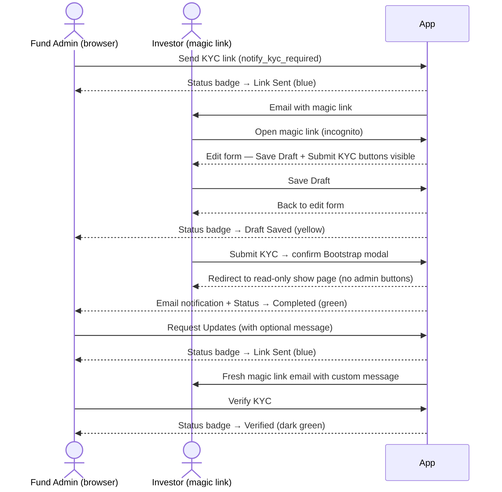

# Manual QA — Investor KYC Notifications & Investor Updates

Branch: `feature/investor-kyc-status-workflow`  
Feature: Status tracking, magic-link emails, investor save/submit flow, fund-admin request-updates

---

## Flow Overview

---

## Prerequisites

- At least one entity with an investor, an investor KYC record in `not_sent` state, and at least one notification user configured on the investor.
- Two browser sessions: one logged in as a **fund admin** (employee with `investor_kyc_update` permission), one for the **investor** (use the magic link from the email, or log in as the investor user).
- Emails visible via LetterOpener or ActionMailer preview (`/rails/mailers`).

---

## 1. Initial State

### 1a. Verify default status on new KYC

1. Create a new `InvestorKyc` (or find an existing one that has never been sent).
2. Open the KYC show page.
3. **Expect:** Status badge reads **"Not sent"** (grey).

---

## 2. Send KYC Link (Fund Admin)

### 2a. Single send via "Send to Investor" button

1. On the KYC show page, click **Send to Investor** (`notify_kyc_required` action).
2. Check LetterOpener / ActionMailer preview for the outbound email.
3. **Expect email contains:**
   - A magic link URL containing `signed_id=` parameter.
   - Expiry text mentioning ~30 days.
4. Back on the KYC show page (refresh).
5. **Expect:** Status badge reads **"Link sent"** (blue). `Link sent` date shown.

### 2b. Bulk send from index

1. Go to the KYC index page.
2. Use the filter to find KYCs in "Not Sent" state, or select a mix that includes completed/verified.
3. Click **Bulk Actions → Send KYC Link**.
4. Confirm the prompt.
5. **Expect:**
   - KYCs in `not_sent` or `link_sent` or `draft_saved` state receive emails.
   - KYCs in `completed` or `verified` state are skipped (no email, no status change).
   - Flash message confirms count dispatched.

---

## 3. Investor Fills via Magic Link

### 3a. Open magic link (unauthenticated)

1. Copy the magic link from the email (contains `signed_id=...`).
2. Open in an **incognito window** (no session).
3. **Expect:** KYC edit form loads without a login prompt.

### 3b. Save Draft

1. Fill in some fields on the first wizard step.
2. Click **Save Draft**.
3. **Expect:**
   - Page redirects back to the edit form (with `signed_id` still in URL).
   - Flash notice: "Investor kyc was successfully saved."
4. In the fund-admin session, refresh the KYC show page.
5. **Expect:** Status badge reads **"Draft saved"** (yellow).
6. In the investor session, reload the edit URL.
7. **Expect:** Previously filled values are retained.

### 3c. Submit KYC

1. (Investor session) Complete all wizard steps.
2. On the final step, click **Submit KYC**.
3. **Expect:** A Bootstrap confirmation modal appears (not a browser alert) with:
   - Title: "Submit KYC?"
   - Two icon cards explaining the KYC will be locked and the fund team notified.
   - **Cancel** and **Yes, Submit KYC** buttons.
4. Click **Yes, Submit KYC**.
5. **Expect:**
   - Page redirects to the KYC **show** page (read-only, not back to the edit form).
   - Flash notice: "KYC submitted. The fund team has been notified."
6. **Expect on show page:** No Edit, Delete, KYC Actions, or any fund-admin buttons visible.
7. Check LetterOpener for a `notify_kyc_updated` email to fund admin.
8. **Expect email:** Subject/body confirms investor submitted. No magic link in this email.
9. In the fund-admin session, refresh KYC show page.
10. **Expect:** Status badge in the Attributes panel reads **"Completed"** (green). `Submitted on <date>` sub-text visible.
11. In the investor session, try to reopen the magic link **edit** URL.
12. **Expect:** Redirected immediately to the show page (no edit form shown). No Save/Submit buttons visible. No fund-admin buttons visible.

---

## 4. Fund Admin — Request Updates

### 4a. Request Updates button visible only on eligible statuses

1. View a KYC in `not_sent` or `link_sent` state.
2. **Expect:** No "Request Updates" button (only available after submission).
3. View a KYC in `completed` state.
4. **Expect:** **Request Updates** button visible.

### 4b. Send update request

1. On a `completed` KYC, click **Request Updates**.
2. In the modal, optionally enter a custom message (e.g. "Please re-upload your PAN card.").
3. Click **Send Update Request**.
4. **Expect:**
   - Flash notice: "Update request sent to investor with a fresh link."
   - KYC show page now shows status badge **"Link sent"** (blue).
   - `Submitted on` timestamp is gone.
5. Check LetterOpener for `notify_updates_requested` email.
6. **Expect email contains:**
   - The custom message (or default if left blank).
   - A **fresh** magic link with `signed_id=`.
   - No reference to the old/previous magic link.
7. Open the **old** magic link from step 2a.
8. **Expect:** Old link is now stale (the original `signed_id` was valid for 30 days from when it was generated, but the KYC was reset — test by checking that the old link still allows editing, confirming token expiry is time-based, not status-based).

### 4c. Investor re-fills and resubmits

1. Open the fresh link from the update-request email (incognito).
2. Make changes and click **Submit KYC**.
3. **Expect:** Status → `completed` again. Fund admin receives another `notify_kyc_updated` email.

---

## 5. Reminder Job (KycReminderJob)

### 5a. Completed/verified KYCs skipped

1. Trigger `KycReminderJob` via Rails console for the entity: `KycReminderJob.perform_now(user_id: admin_user.id)`.
2. **Expect:** No reminder emails sent for KYCs in `completed` or `verified` state.
3. **Expect:** Reminder emails sent for KYCs in `link_sent` or `draft_saved` state.
4. Check that reminder emails contain a fresh magic link (not just a login link).

---

## 6. Investor Pending Dashboard

### 6a. Investor sees pending KYCs

1. Log in as an investor user who has KYCs in `link_sent` or `draft_saved` state.
2. Navigate to `/investor_kycs/investor_pending` (or use the **Pending KYC Requests** button on the KYC index).
3. **Expect:** Table lists each pending KYC with: Fund name, Investor name, KYC Type, Status badge, Link Sent date, "Fill in KYC" link.
4. Click **Fill in KYC** for one entry.
5. **Expect:** KYC edit form loads (authenticated session, no magic link needed).

### 6b. Completed/verified KYCs excluded

1. **Expect:** KYCs in `completed` or `verified` state do not appear in the list.

### 6c. Fund admin cannot access investor_pending

1. As a fund admin, navigate to `/investor_kycs/investor_pending`.
2. **Expect:** 403 Pundit unauthorized error (policy requires `investor` role).

---

## 7. Status Filters on Index

1. On the KYC index, open the filter dropdown.
2. Click **Send Status: Link Sent**.
3. **Expect:** Only KYCs with `link_sent` status are shown.
4. Repeat for each status: Not Sent, Draft Saved, Completed, Verified.

---

## 8. Expired / Invalid Magic Link

1. Manually construct a tampered signed_id URL (change a character in the token).
2. Open in browser.
3. **Expect:** Inline page with "This link has expired or is invalid" message. No exception page. No redirect.

---

## 9. Boolean Sync

1. Via Rails console, set `investor_kyc.update(submission_status: "completed")`.
2. Reload the record.
3. **Expect:** `investor_kyc.completed_by_investor == true`.
4. Set `investor_kyc.update(submission_status: "verified")`.
5. **Expect:** Both `completed_by_investor == true` and `verified == true`.
6. Set `investor_kyc.update(submission_status: "link_sent")`.
7. **Expect:** Both `completed_by_investor == false` and `verified == false`.

---

## 10. Regression — Existing Fund Admin Save

1. As fund admin, open a KYC in `link_sent` state.
2. Edit some fields and click **Save** (the regular admin save, not investor Submit KYC).
3. **Expect:** Save succeeds. Status remains `link_sent` (not regressed or advanced). No investor notification fired.

---

## 11. Regression — Advisor Notification Bug

1. Configure an investor that has an `investor_advisor` user as a notification user.
2. Trigger `notify_kyc_required` from the show page.
3. **Expect:** Email dispatched to the advisor without errors. No `NoMethodError` or `ActiveRecord::RecordNotFound` in logs.
