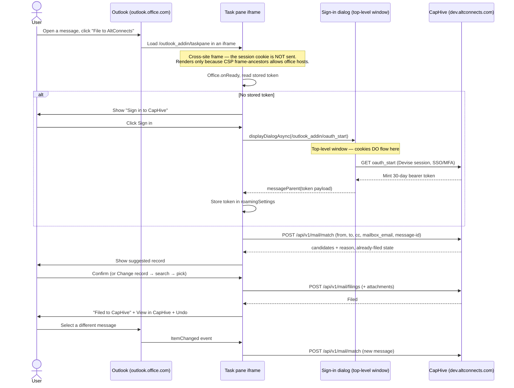

# Manual QA — Outlook Add-in on Staging

Host: `https://dev.altconnects.com` (staging_in)
Manifest: `https://dev.altconnects.com/manifests/altconnects_outlook_addin.xml`
Ribbon button: **File to AltConnects**, in the **AltConnects** group

**Why this document exists.** The Gmail add-on has been validated end-to-end against a real
mailbox. The Outlook task pane never has. Everything below the API layer is covered by the
Cucumber suite; nothing has exercised Office.js, the dialog channel, or the ribbon. Several
items here are the *first* execution of that code in a real host, and they are marked
**FIRST RUN**.

---

## Flow Overview

---

## Prerequisites

- [ ] Staging is deployed from `main` and serving the current assets.
      Check: `curl -sI https://dev.altconnects.com/outlook_addin/taskpane | grep -i frame`
      → expect a `content-security-policy: frame-ancestors …` header and **no**
      `x-frame-options`. If `x-frame-options: SAMEORIGIN` is present, stop — the pane
      cannot render inside Outlook and nothing below is testable.
- [ ] A CapHive login on staging, in an entity that has investors.
- [ ] An investor whose **primary email** is a real address you can send from or receive from.
- [ ] An investor with an **approved investor access** contact address, for the contact tier.
- [ ] An investor whose primary email is on a **distinctive domain** (not gmail/outlook/etc),
      for the domain tier.
- [ ] Know your **CapHive login address** and your **Outlook mailbox address** — for several
      cases below they must be *different*, which is the normal situation.
- [ ] An Outlook mailbox you can sideload into (Outlook on the web is the quickest).

---

## A. Installation and rendering

| # | Step | Expected | ✅ |
|---|---|---|---|
| A1 | Settings → Add-ins → My add-ins → Add from URL, paste the manifest URL | Installs without a manifest validation error | ☐ |
| A2 | Open any message | **File to AltConnects** appears in the toolbar, under the **AltConnects** group | ☐ |
| A3 | Look at the ribbon icon | The orange CapHive hexagon, not a broken image and not a red circle | ☐ |
| A4 | **FIRST RUN** Click the button | The pane renders content. A blank/white pane means the framing headers are wrong — capture the browser console | ☐ |
| A5 | Check the pane header | CapHive logo renders (not a broken image icon) | ☐ |
| A6 | Confirm no simulator | The dev **Simulator** panel must **not** appear on staging | ☐ |

---

## B. Sign-in

| # | Step | Expected | ✅ |
|---|---|---|---|
| B1 | Open the pane with no prior session | Shows **Sign in to CapHive**, not an error and not a login form inside the pane | ☐ |
| B2 | **FIRST RUN** Click **Sign in to CapHive** | A separate window opens on `dev.altconnects.com`, showing the normal login page | ☐ |
| B3 | Sign in | The window closes by itself and the pane updates to **Signed in as <your name>** | ☐ |
| B4 | Confirm no password is ever requested by the pane itself | The pane never shows an email/password field | ☐ |
| B5 | Close the pane, reopen it | Still signed in — no second sign-in prompt | ☐ |
| B6 | Close Outlook entirely, reopen, open the pane | Still signed in (the token is stored in Outlook's roaming settings) | ☐ |

---

## C. Matching — the rules that changed

Matching is **sender-only**. To and CC never influence the result, and your own addresses are
excluded. These cases exist because the first real-mailbox test of the Gmail add-on matched the
same investor on *every* email.

| # | Step | Expected | ✅ |
|---|---|---|---|
| C1 | Open an email **from** an investor's approved contact address | Single match, reason **Matched on a known investor contact** | ☐ |
| C2 | Open an email **from** an investor's primary email | Single match, reason **Matched on the investor's primary email** | ☐ |
| C3 | Open an email from a different person **at the same domain** as an investor's primary email | Single match, reason **Matched on email domain** | ☐ |
| C4 | Open an email from an unrelated sender (e.g. a newsletter) | **No matching record found** — not a match | ☐ |
| C5 | Open an email in your **Sent** folder, addressed to an investor | **No match** (you are the sender). Search and file manually | ☐ |
| C6 | Set some investor's primary email to **your own mailbox address**, then open any inbox email | **No match.** If every email suddenly matches that investor, the mailbox-address exclusion is not working — reset it afterwards | ☐ |
| C7 | Open an email from a sender at a generic domain (gmail.com) not otherwise known | No match on domain alone | ☐ |
| C8 | Open an email from a contact with approved access to **two** investors | **Multiple** candidates offered, user picks — never a silent guess | ☐ |

---

## D. Filing

| # | Step | Expected | ✅ |
|---|---|---|---|
| D1 | With a suggested record, click **File to CapHive** | Confirms **Filed to CapHive** | ☐ |
| D2 | Click **View in CapHive** | Opens the filed email on that investor's record | ☐ |
| D3 | Check the filed record in CapHive | Subject, HTML body with formatting intact, From, To, CC, sent date, and who filed it | ☐ |
| D4 | File an email **with attachments** | Attachments appear on the investor's documents | ☐ |
| D5 | Use **Change record** → search by name | Results appear and are limited to investors you can see | ☐ |
| D6 | Search for a name you have no access to | Not returned | ☐ |
| D7 | File against a manually chosen record | Files against the chosen one, not the suggestion | ☐ |
| D8 | Click **Undo** immediately after filing | Confirms **Filing removed**, and the record disappears from CapHive | ☐ |
| D9 | After Undo, check the investor's other filed emails and their documents | Still intact — Undo must not remove anything else | ☐ |

---

## E. Duplicates and cross-client behaviour

| # | Step | Expected | ✅ |
|---|---|---|---|
| E1 | Open an email you already filed | Panel says **Already filed**, naming who filed it and against which record | ☐ |
| E2 | File the same email again against the **same** record | No duplicate created; reports it was already filed | ☐ |
| E3 | File the same email against a **different** record | Allowed — a second filing against the other investor | ☐ |
| E4 | File an email from **Gmail**, then open the same email in Outlook | Outlook reports it as already filed. This proves both clients key on the same message identity | ☐ |
| E5 | Have a colleague file an email, then open it yourself | Shows **Already filed by <their name>** | ☐ |

---

## F. Live behaviour and edge cases

| # | Step | Expected | ✅ |
|---|---|---|---|
| F1 | **FIRST RUN** With the pane open, click a **different message** in the list | The pane re-checks the new message by itself, without being closed and reopened | ☐ |
| F2 | Open an email with **no subject** | Handled, shown as "(no subject)" — no crash | ☐ |
| F3 | Open an email with a very long subject | Wraps in the pane; no horizontal scrolling | ☐ |
| F4 | Open a meeting invite or calendar item | Either handled or cleanly ignored — no error dialog | ☐ |
| F5 | Open a message in a **shared mailbox** | Files correctly, or fails with a readable message | ☐ |
| F6 | Narrow the Outlook window | Pane content reflows; nothing is cut off | ☐ |
| F7 | Leave the pane open for a while, then file | Either works or says the session expired and offers **Sign in** — never a raw error | ☐ |

---

## G. Cross-platform

| # | Step | Expected | ✅ |
|---|---|---|---|
| G1 | Repeat A4, B2 and D1 in **Outlook on the web** | Pass | ☐ |
| G2 | Repeat A4, B2 and D1 in **Outlook for Windows (new)** | Pass | ☐ |
| G3 | Repeat A4, B2 and D1 in **Outlook for Windows (classic)** | Pass | ☐ |
| G4 | Repeat A4, B2 and D1 in **Outlook for Mac** | Pass | ☐ |
| G5 | Open Outlook on a **phone** | The manifest declares desktop only, so the button is simply absent — it must not appear and fail | ☐ |

---

## Known gaps — do not raise these as bugs

- **Mobile form factor is deliberately not declared.** G5 expects absence, not function.
- **`SupportUrl` in the manifest points at a page that does not exist.** Harmless for
  sideloading; it would block a Microsoft store submission.
- **Sent mail never auto-matches** (C5). That is the intended product behaviour, not a defect.

---

## If the pane is blank (A4)

This is the failure mode most likely to appear first, and the one with a specific cause.

1. Open the browser developer console while the pane is open.
2. A message about refusing to display in a frame means the framing headers are wrong. Confirm
   with the header check in Prerequisites.
3. A JavaScript error naming Office.js means the pane loaded but the host integration failed —
   capture the full error, which Outlook version, and whether it is web or desktop.

Attach the console output to any bug raised from this section; a screenshot of a blank pane on
its own is not diagnosable.
