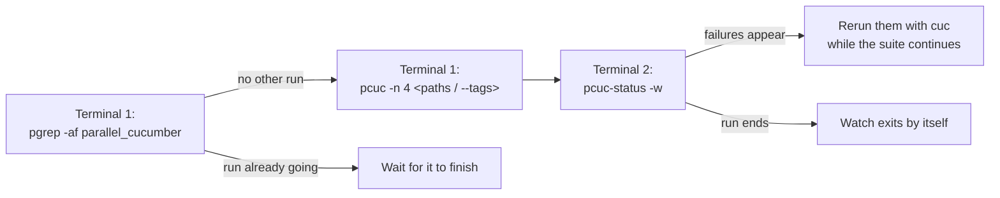

# Running Cucumber with `pcuc` and watching it with `pcuc-status -w`

A short note on how I run the Cucumber suite day to day. The scripts live in `bin/`
(`pcuc`, `cuc`, `pcuc-status`, and the shared `pcuc-lib.zsh`); their header comments have the
full detail.

## One-time setup

Symlink the scripts into a directory on your `PATH`, so you can type `pcuc` instead of
`bin/pcuc`. Run this once, **from the repo root** (`$PWD` must be the checkout):

```sh
mkdir -p ~/.local/bin
ln -s "$PWD"/bin/{pcuc,cuc,pcuc-status} ~/.local/bin/
```

Then check that `~/.local/bin` is on your `PATH`, and confirm the links:

```sh
echo $PATH | tr ':' '\n' | grep -x ~/.local/bin   # no output? add the next line to ~/.zshrc
export PATH="$HOME/.local/bin:$PATH"

ls -l ~/.local/bin/{pcuc,cuc,pcuc-status}          # each should point into <repo>/bin/
which pcuc pcuc-status                            # should print ~/.local/bin/...
```

Notes:

- **Use symlinks, not copies.** Because the links point at the files in `bin/`, a
  `git pull` updates the commands too. A copy would stay old.
- **`pcuc-lib.zsh` does not need its own link.** `pcuc` and `cuc` follow their symlink back to
  `bin/` and load the lib from there.
- **`pcuc` must still be run from the repo root.** The link only saves typing `bin/`; the
  scripts use relative paths like `features/` and `tmp/`.
- **Moved or re-cloned the repo?** The links break. Recreate them with `ln -sf` (same
  command) from the new checkout.
- They are scripts rather than shell functions or aliases, so every terminal always runs the
  current version without re-sourcing `~/.zshrc`.

## How I use them



### 1. Check nothing else is running

```sh
pgrep -af parallel_cucumber
```

Every `pcuc` run uses the same worker databases (`/dev/shm/test_1..N.sqlite3`). Two runs at
the same time (including one started by another Claude session) reload the schema into the same
files, and nearly every scenario then fails with `FOREIGN KEY constraint failed`. Those failures
come from the clash, not from the code. If that happens, delete the affected
`/dev/shm/test_N.sqlite3` files; `pcuc` rebuilds missing ones on the next run.

### 2. Start the run with 4 workers

```sh
pcuc -n 4 features/fund                       # a directory
pcuc -n 4 features/core/document.feature      # one file (file:line works too)
pcuc -n 4 --tags @notification                # by tag
pcuc -n 4 --tags '@notification and not @javascript'   # fast, browser-free subset
pcuc -n 4                                     # whole suite
```

I always pass `-n 4`. On this 12-core machine, 5 or 8 workers pushed the load to about 19 and
caused flaky failures. Without `-n`, `pcuc` uses up to 8 workers, or 3 when any selected feature
is `@javascript` (each browser worker starts its own Chromium).

What `pcuc` does for you:

- **Tags narrow the file list**: only feature files that contain the tag are handed to
  workers, so workers don't boot Rails for files that have nothing to run. A tag that matches
  no file stops the run instead of quietly running the whole suite.
- **Creates missing worker DBs** before starting.
- **Splits work by measured time**: per-scenario times are kept in
  `tmp/pcuc_scenario_times.tsv` (updated after every run, including ones stopped with Ctrl-C),
  so workers finish at about the same time.
- **Keeps the output quiet**: step `puts`/`ap` output is hidden (`VERBOSE=1 pcuc ...` shows it),
  and a progress line is printed every 30 s and shown in the terminal title:
  `pcuc: 412/1530 scenarios (27%) · 3 failed · 12:03 elapsed · ETA ~33m`.

### 3. Watch it from a second terminal

```sh
pcuc-status -w          # redraw every 15 s
pcuc-status -w 5        # every 5 s
pcuc-status             # one snapshot
pcuc-status 12345       # a specific run, if several are going
```

The watch screen shows:

```
pcuc run 12345 · features/fund · 4 workers · started 10:02:11 · 0:12 elapsed
412/1530 scenarios (27%) · 3 failed · ETA ~33m (≈10:47)
████████████████░░░░░░░░░░░░░░░░░░░░░░░░░░░░░░░░░░░░░░░░░░░░  27%

w1    98 done · now fund/capital_call.feature:40  Create a call ...   0:42
w2   110 done · now fund/portfolio.feature:12     Valuation ...       3:15 slow
w3   104 done · finished
w4   100 done · starting

by folder: fund 412/1530

failed so far:
  features/fund/capital_call.feature:88             Remittance notification ...
```

What I look for:

- **`failed so far`**: lists failing scenarios (with `file:line`) as they happen, so I can
  start fixing or rerun them (`cuc features/fund/capital_call.feature:88`) before the suite
  ends. Use a random DB number for that side run (`TEST_ENV_NUMBER=$RANDOM cuc ...`) so it
  doesn't share a DB with a pcuc worker.
- **`slow`**: a scenario running for more than 3 minutes is usually a browser step waiting for
  something that will never appear.
- **ETA**: a straight-line estimate from the rate so far. One slow worker near the end can make
  it optimistic.

The watch exits by itself when the run ends. It also works for a `parallel_cucumber` run
started without `pcuc` (exact counts from `tmp/pcuc_progress/<pid>`), and falls back to an
approximate count from `log/test_N.log` for older runs.

## Single-process runs

`cuc` is plain `cucumber` with the same 30-second progress line. Always give it a random DB
number so it never shares a DB with another run:

```sh
TEST_ENV_NUMBER=$RANDOM cuc features/core/document.feature
```
