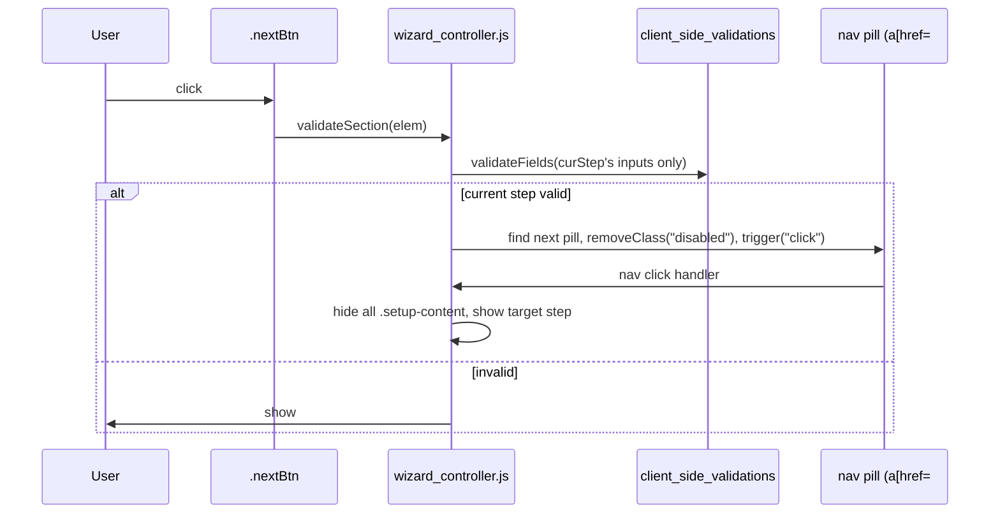

# Wizard Form Patterns

IRM has a reusable multi-step wizard pattern built on one generic Stimulus controller and
one shared stylesheet. Three forms use it today:

| Wizard | Files | Notable extras |
|---|---|---|
| KPI Report | `app/packs/startups/kpis/views/kpi_reports/_form.html.erb` | Async server-side upload validation panel (step 3); no Review & Save step — last step submits directly |
| Custom Notification | `app/packs/core/notifications/views/custom_notifications/_form.html.erb` | Classic-form toggle; the one wizard with a live Review & Save summary step (§3) |
| Capital Call | `app/packs/funds/capital_calls/views/capital_calls/_form.html.erb` | Classic-form toggle; no Review & Save step; one partial shared by both `new` and `edit` (§8), with a call-date-change confirmation flow wired in only on edit |

**The Review & Save step (§3) is optional — default to skipping it.** KPI Report and Capital
Call both end their last step with a plain Back/Save row, same as any other step. Custom
Notification is the deliberate exception: it composes free-text email content (subject, Trix
body, WhatsApp text) across three earlier steps, so a recap that shows exactly what will be
sent is worth the extra Stimulus controller. A wizard that only collects a handful of
plain-value fields (selects, numbers, dates) doesn't need one — Back already lets the user
check earlier steps, and a recap step just adds another click before Save. Add one only when
the wizard genuinely composes something the user can't otherwise glance back at (long free text,
several interacting toggles that change what gets sent, etc.) — Custom Notification is the bar
to clear, not the default to copy.

Custom Notification is the more complete reference — it also demonstrates how to retain an
existing flat form as an alternative mode instead of deleting it. Read this doc alongside
that file rather than the KPI one if you're building something new.

The Classic Form toggle (§4) is powered by one shared, form-agnostic
`app/javascript/controllers/form_mode_controller.js` (identifier `form-mode`) — both Custom
Notification and Capital Call wire `data-controller="wizard form-mode"` on their
`wizard_container` and reuse the same `data-form-mode-target`/`data-action` names. Don't fork
a per-form copy of this controller; if a third wizard needs the toggle, point it at the same
file.

---

## 1. Core mechanics

**Shared engine**: `app/javascript/controllers/wizard_controller.js` (generic, jQuery-based,
`data-controller="wizard"`) + `app/assets/stylesheets/custom/wizard.scss` (`.stepwizard`,
`.stepwizard-step`, `.wizard_container`). Don't fork these per-wizard — both are already
shared by two unrelated forms and are written to be reusable.

**DOM shape** — one `form_with` wraps every step. Each step is a `<div class="col-md-8
setup-content" id="step-N">` (hidden/shown via jQuery, not routing/Turbo Frames); a separate
nav-pill row (`.setup-panel` inside `.stepwizard`) mirrors the same step IDs via `href="#step-N"`
anchors, all but the first `disabled` initially:

```erb
<div class="wizard_container" data-controller="wizard">
  <div class="stepwizard hidden col-md-8">
    <div class="stepwizard-row setup-panel">
      <div class="stepwizard-step">
        <a href="#step-1" class="btn btn-outline-primary btn-outline-circle">1</a>
        <p>What to Expect</p>
      </div>
      <!-- ...step-2..step-N nav pills, all `disabled` except the first... -->
    </div>
  </div>

  <%= form_with(model: record, validate: true, class: "wizard_form row justify-content-md-center") do |form| %>
    <div class="col-md-8 setup-content" id="step-1">
      <div class="card">
        <div class="card-header">1. What to Expect</div>
        <div class="card-body">
          ...
          <button class="btn btn-outline-primary nextBtn btn-lg" type="button">Let's get started</button>
        </div>
      </div>
    </div>

    <div class="col-md-8 setup-content" id="step-2">
      <div class="card">
        <div class="card-header">2. ...</div>
        <div class="card-body">
          ...
          <button class="btn btn-outline-secondary prevBtn" type="button">Back</button>
          <button class="btn btn-outline-primary nextBtn btn-lg" type="button">Next</button>
        </div>
      </div>
    </div>

    <!-- last step's card-body ends with form.submit instead of a nextBtn -->
  <% end %>
</div>
```

**Navigation flow** — `wizard_controller.js`'s `initialize()` hides all `.setup-content`,
shows step 1, and wires three click handlers:



Clicking Submit on the **last** step re-uses the same `validateSection` path, but since there's
no "next" pill it just returns `false` (don't `preventDefault`) and the real form submit proceeds
— so the last step's own fields are validated, but **earlier steps are not re-validated at submit
time** (they were already gated by their own Next click). This is an accepted trade-off, not a bug
— see §4 for how Classic mode differs.

Back (`.prevBtn`) is intentionally **not** re-validated — the step you're leaving already passed
validation to get here.

---

## 2. Step content conventions

- **Step 1 is always orientation, never inputs** — "What to Expect": what this form does, a
  "How this works" mini step-map, and any sharp edges called out up front (e.g. "leaving this
  blank means nothing is sent"). Look at Custom Notification's step 1 for the tone/format:
  icon-badge cards (`bg-*-subtle` + `kpi-info-icon` circle) for 2-3 key facts, then a 4-across
  step-map row, then a single warning callout.
- **One card per step**, `card-header` shows the step number, e.g. `"2. Notification & Recipients"`.
- **Hints live inside the step**, not in a separate help page. For anything with a non-obvious
  syntax (wildcard patterns, comma-escaping, etc.), use a bulleted "How to fill this in" box
  (`bg-light border small`) with `<code>` examples instead of one dense paragraph — see the
  `attachment_names` field in Custom Notification step 4 for the exact shape. If checking the box
  reveals more fields, say so explicitly ("As soon as you type something here, two more options
  appear below") so the reveal doesn't read as a bug.
- **Last step ends with Back + Save, same as any other step's Back + Next row** — that's the
  default (KPI Report, Capital Call). Only add a dedicated "Review & Save" recap step (§3) if
  the wizard clears the bar described there; don't add one by default.

---

## 3. Building a live "Review & Save" summary step

**Optional — see the callout at the top of this doc.** Custom Notification is currently the only
wizard with one. If your wizard clears that bar, don't duplicate values by hand: read the other
fields live via a small Stimulus controller (`notification_summary_controller.js` is the
reference implementation), so the summary can never drift from what will actually be saved.

Wire it up on the form tag itself so one delegated listener catches every descendant field:

```erb
<%= form_with(..., data: {
  controller: "... notification-summary",
  action: "input->notification-summary#refresh change->notification-summary#refresh trix-change->notification-summary#refresh"
}) do |form| %>
```

Targets live in the Review step and get filled by `refresh()`, called once on `connect()` and
again on every `input`/`change`/`trix-change` bubbling up from any field.

**Two gotchas that will silently break this**, both discovered building the Custom Notification
wizard:

1. **Trix fields don't fire native `input`/`change`.** A `<trix-editor>` is contenteditable, but
   Trix intercepts native input handling and dispatches its own `trix-change` custom event
   instead (which does bubble). If you only wire `input`/`change` on the form, edits to a
   `rich_text_area` field will never refresh the summary — it'll look "stuck" at whatever it
   showed on page load. Always add `trix-change->your-controller#refresh` alongside the other two
   whenever a wizard has a rich-text field feeding a summary.

2. **`.innerText` returns `""` for elements inside a hidden ancestor.** Since the Review step is
   always the *last* step, any earlier step (where a Trix editor or any other field lives) is
   `display:none` while Review is showing. `.innerText` depends on actual layout/rendering and
   silently returns empty for hidden elements — `.innerHTML`/`.textContent` don't have this
   problem since they walk the DOM tree, not the render tree. To get a plain-text preview from a
   Trix body, read `.innerHTML`, convert block breaks to newlines yourself, then strip tags via a
   detached container:

   ```javascript
   bodyPreview() {
     const editor = document.querySelector('[data-notification-placeholders-target="editor"]')
     if (!editor) return { text: "", empty: true }
     const container = document.createElement("div")
     container.innerHTML = editor.innerHTML.replace(/<\/(div|p)>/gi, "\n").replace(/<br\s*\/?>/gi, "\n")
     const text = container.textContent.trim()
     return text ? { text, empty: false } : { text: "", empty: true }
   }
   ```

   This generalizes beyond Trix: **any summary/preview logic that inspects a field living in a
   different (possibly hidden) step must avoid `.innerText`/`offsetWidth`/`getBoundingClientRect`**
   — anything render-dependent — and use DOM-tree-only APIs instead.

Also worth copying: render an empty/off value as a **muted, explicit placeholder** ("(no subject
set)", "(none — no attachments will be sent)") rather than blank space, and mute the "off" case of
a plain-language toggle sentence ("Not included") so the eye lands on what's actually turned on.
Put a prominent color-coded banner (`alert-success`/`alert-warning` + a matching
`ti-circle-check`/`ti-alert-triangle` icon) at the top of Review for whatever single field most
determines "does this do anything at all" (here: the enabled toggle) — don't bury it in a table row.

---

## 4. Retaining an existing flat form as a "Classic Form" toggle

If you're converting an existing single-page form into a wizard, don't delete the old layout —
add a mode toggle instead, matching Custom Notification's pattern. The key design decision: **one
`<form>`, one set of inputs, shown two different ways** — not two parallel forms. Two forms with
the same field names would double-submit params (or silently collide on duplicate ids); a single
form sidesteps that entirely and means nothing is lost switching modes mid-edit.

**CSS** does the state switch (`app/assets/stylesheets/custom/wizard.scss`):

```scss
.wizard_container.mode-classic {
  .stepwizard { display: none !important; }
  .setup-content { display: block !important; } // overrides wizard_controller's inline display:none
  .nextBtn, .prevBtn { display: none !important; }
}
```

**JS** (`form_mode_controller.js`, identifier `form-mode` — shared across every wizard that
offers this toggle, not forked per-form) just toggles the class and — this is the part
that's easy to miss — reconciles the submit-button intercept:

- **Switching to wizard**: re-run the sibling `wizard` controller's public `initialize()` method
  (via `this.application.getControllerForElementAndIdentifier(element, "wizard")`) to re-wire
  step-scoped validation on the submit button. `wizard_controller.js`'s `.off().on()` pattern makes
  this idempotent.
- **Switching to classic**: `.off("click")` the submit button to drop the wizard's "validate only
  the current step" intercept, so the plain submit — and the form's whole-form
  `client_side_validations` binding on the `submit` event — runs instead, matching how the
  form validated before the wizard existed. Skipping this step means Classic mode inherits the
  wizard's per-step-only validation, silently reintroducing the exact limitation Classic mode was
  supposed to avoid.

Put the toggle buttons above the step nav so they're visible regardless of mode, and mention the
toggle in step 1's copy ("switch to Classic Form at any time — nothing you've entered will be
lost").

---

## 5. Toggle switches instead of checkboxes

Use the existing `.toggle-row` / `.ios-toggle` component (first built for
`app/packs/core/base/views/admin/users/_form.html.erb`) for any boolean field, not a plain
`form.check_box`:

```erb
<div class="toggle-row">
  <div>
    <%= form.label :some_flag, raw('<i class="ti ti-icon-name me-1"></i>Some Flag'), class: "toggle-row-label" %>
    <small class="form-text text-muted d-block">Explanation of what On/Off does.</small>
  </div>
  <label class="ios-toggle">
    <%= form.check_box :some_flag, class: "ios-toggle-input" %>
    <span class="ios-toggle-slider"></span>
  </label>
</div>
```

**Why not plain Bootstrap `.form-switch`**: `app/assets/stylesheets/custom/scaffolds.scss` has a
global `.form-check-input { width: 1.5em !important; height: 1.5em !important; }` rule (for
regular checkboxes elsewhere in the app) that collapses Bootstrap's switch pill shape if applied
to a `.form-switch` input. `.ios-toggle-input` sidesteps this by not being a `.form-check-input`
at all — it's visually hidden (`position:absolute; opacity:0`) with the pill/knob rendered by the
sibling `.ios-toggle-slider` span instead. Don't reach for `.form-check.form-switch` in a new
wizard even though a few older pages in the codebase still use it — `.toggle-row`/`.ios-toggle` is
the current standard.

For one toggle that's meaningfully more consequential than the others on its step (e.g. a master
enabled/disabled switch), a plain `.border.rounded-3.p-3` wrapper around the `.toggle-row` gives it
visual weight — but keep it to a single wrapper level; nesting it inside another bordered container
reads as a rendering bug (double box), not emphasis. Note that `.toggle-row` already renders its own
border/background (see `scaffolds.scss`), so don't add a second `.border.rounded-3` wrapper around
it for that purpose — that *is* the double-box bug, not the emphasis case above.

**Icon-badge + tooltip variant**: when a toggle's label benefits from a bigger visual anchor than
the small inline `ti-name me-1` icon (section 6) — e.g. it's the first thing on the step, or there
are only one or two toggles and they can afford the room — pair a circular icon badge with an
inline tooltip on the label instead of relying on the one-line `small` caption alone:

```erb
<div class="toggle-row">
  <div class="d-flex align-items-start gap-3">
    <span class="rounded-circle d-flex align-items-center justify-content-center flex-shrink-0 kpi-info-icon bg-primary-subtle">
      <i class="ti ti-icon-name fs-5 text-primary-emphasis"></i>
    </span>
    <div>
      <%= form.label :some_flag, class: "toggle-row-label" do %>
        Some Flag
        <i class="ti ti-info-circle text-muted ms-1" data-bs-toggle="tooltip" data-bs-placement="top"
           data-bs-title="Longer explanation of exactly what turning this on/off does."></i>
      <% end %>
      <small class="form-text text-muted d-block">One-line summary, same as the plain variant.</small>
    </div>
  </div>
  <label class="ios-toggle">
    <%= form.check_box :some_flag, class: "ios-toggle-input" %>
    <span class="ios-toggle-slider"></span>
  </label>
</div>
```

`kpi-info-icon` is the 40×40 circle-badge class from `wizard.scss` (originally for the "What to
Expect" step's orientation cards) — reuse it here rather than inventing a new size. The tooltip
needs a `tooltip`-controller ancestor to activate — see §6 for the controller wiring and the
"pick one help level" rule (a tooltip here replaces the caption's job of holding the *long*
explanation; keep the `small`/`text-muted` line for a short one-sentence summary alongside it, not
both saying the same thing). See `capital_calls/_common_form_fields.html.erb`'s
`send_call_notice_flag`/`send_payment_notification_flag` toggles for a working example. Reach for
this variant deliberately, not by default — most toggles are fine with the plain version above.

---

## 6. Icons and help text

Every field label and every `dt` in the Review step should carry a small leading
[Tabler](https://tabler.io/icons) icon (`<i class="ti ti-name me-1">`) — muted (`text-muted`) in
review-summary contexts, unstyled inline with form labels. Reuse the same icon for the same
concept across the wizard and its Review step (e.g. `ti-tag` for an internal tag field everywhere
it appears) so the Review step reads as a recap of the same visual vocabulary, not a different
page. `form.label` needs the icon markup passed as a `.html_safe`/`raw()` string as the label text
argument:

```erb
<%= form.label :tag, raw('<i class="ti ti-tag me-1"></i>Tag') %>
```

Don't add icons to the numbered step-nav pills — the number is the primary affordance there and
an icon competes with it rather than adding information.

**Pick one of three help levels per field, not several stacked together:**

1. A short, always-visible caption (`<small class="text-muted">...</small>`, or a plain
   `<div class="text-muted mt-1">` where the surrounding block already sits at normal font size —
   see the codebase-wide "no `small`/reduced font in cards or panels" rule) — the default for
   anything that needs one clarifying sentence, e.g. `amount_to_be_called`'s "Total amount to be
   called, Call basis will be used for each folio."
2. A `ti-info-circle` tooltip (below) — for a longer explanation that would clutter the step if it
   were always visible, or that only matters to someone about to flip a non-obvious setting.
3. A bulleted "How to fill this in" hint box (§2) — only for genuinely non-obvious syntax with
   `<code>` examples (wildcard patterns, comma-escaping, etc.).

Don't add a tooltip that just repeats the caption word-for-word — pick the one level that fits how
much explanation the field actually needs.

**Tooltips**: append a `ti-info-circle` icon after the label text, with the explanation on
`data-bs-title` rather than a second caption line:

```erb
<%= form.label :fee_formula_ids do %>
  <i class="ti ti-calculator me-1"></i>Call Fee Formulas
  <i class="ti ti-info-circle text-muted ms-1" data-bs-toggle="tooltip" data-bs-placement="top"
     data-bs-title="Formulas defined for this fund that compute additional fees on top of the call amount — select any that apply to this call."></i>
<% end %>
```

**Don't wrap the label in `d-flex align-items-center`** to lay out the text + tooltip icon — it's
tempting since that's how the icon-badge variant above lays out its *outer* row, but here it
misaligns the icon vertically against the label text. The label's plain text is a bare text node,
not an element, so inside a flex container it sits in a browser-generated anonymous flex item that
uses the surrounding font's normal line-height (~1.5), while the `<i>` icon is a real flex item
whose line-height Tabler's CSS forces to `1` — two different box heights, so `align-items: center`
centers each on a different axis and the icon ends up visibly off the text baseline. Just let the
label, icon-before, and icon-after all sit inline (the default for a `<label>`/`<i>`) the same way
every other label icon in this doc does — no wrapper class at all — with `ms-1`/`me-1` for spacing.
This bit the Capital Call wizard's fee-row labels (`_call_fee_fields.html.erb`) and the toggle
variant above; both were fixed by dropping the flex wrapper.

Tooltips need a `tooltip`-controller ancestor to activate —
`app/javascript/controllers/tooltip_controller.js` scans its own element for
`[data-bs-toggle='tooltip']` on `connect()` and again on Turbo frame loads/renders. Add `tooltip`
to the `wizard_container`'s `data-controller` list **once per wizard**
(e.g. `data-controller="wizard form-mode tooltip"`), not on individual fields — see
`capital_calls/_form.html.erb`. Without that controller connected somewhere up the tree, `<i
data-bs-toggle="tooltip" data-bs-title="...">` renders as an inert icon — nothing shows on hover,
and nothing errors, so this is easy to ship broken and not notice locally.

Don't use a bare `title="..."` attribute instead — without `data-bs-toggle="tooltip"` (and the
controller to initialize it) that renders the browser's native, unstyled tooltip after a long
delay, not Bootstrap's. `data-bs-placement="top"` is the house default; only override it when
`top` would clip against the viewport or a sibling element.

**Tooltips inside a cocoon nested-fields partial** (e.g. Capital Call's `_call_fee_fields.html.erb`,
added via `link_to_add_association`): a row present on page load gets its tooltips from the
`tooltip` controller's `connect()` pass same as anything else, but a row the user adds later is
inserted straight into the DOM by `@nathanvda/cocoon`, not through a Turbo frame — so it wouldn't
be caught by the `turbo:frame-load`/`turbo:render` listeners already in `tooltip_controller.js`.

The controller also listens for `cocoon:after-insert` and re-scans on it — generic, already wired
up, no per-wizard setup needed. Two gotchas stacked here, both discovered building this:

1. **This has to be a jQuery handler, not `document.addEventListener`**:
   `vendor/javascript/cocoon.min.js` fires this event via jQuery's
   `.trigger("cocoon:after-insert", [$(node), e])`, and jQuery's event system does not bridge
   custom (non-native) event names out to native `addEventListener` listeners — only jQuery's own
   `.on()` sees it. A native listener silently never fires: no error, correct HTML, the tooltip on
   the new row just never gets a `bootstrap.Tooltip` instance.
2. **Don't try to scope the rescan to just the inserted node.** The natural-looking fix is
   `$(document).on("cocoon:after-insert", (event, $insertedNode) => this.initTooltips($insertedNode[0]))`
   — `$insertedNode` being the jQuery collection cocoon passes as the extra trigger argument. This
   throws `root.querySelectorAll is not a function`: cocoon builds that collection by parsing the
   rendered partial as an **HTML string** (`$(htmlString)`), and jQuery's string-to-DOM parsing can
   put a stray text node (leading whitespace from the ERB template) at index `0` — so
   `$insertedNode[0]` isn't reliably an `Element`. Skip the unwrapping entirely and just re-run the
   full scan: `this.onCocoonInsert = () => this.initTooltips(this.element)`. `getOrCreateInstance`
   is idempotent, so re-touching already-initialized tooltips on every insert is harmless, and it
   sidesteps this whole class of "is index 0 actually the element" bugs.

If you add tooltips inside *any* other cocoon `fields_for` partial, this fix covers you for free.

**How to actually verify a tooltip works, don't just eyeball the markup**: correct `data-bs-toggle`/
`data-bs-title` attributes in the DOM are necessary but not sufficient — the only real proof is
`bootstrap.Tooltip.getInstance(el)` returning a non-null instance in the console (select the icon in
Elements, then run `bootstrap.Tooltip.getInstance($0)`). A jQuery-vs-native event mismatch like the
one above produces perfectly correct HTML with zero console errors and simply never attaches an
instance — nothing about reading the rendered markup would tell you that.

---

## 7. Testing a wizard with Cucumber

**The problem**: steps 2+ start `display:none` (set by `wizard_controller.js`'s `allWells.hide()`
on `connect()`). Since `Capybara.ignore_hidden_elements` defaults to `true`, any `fill_in`/
`select`/`check` targeting a field on a step other than the first will raise
`Capybara::ElementNotFound` unless that step is actually showing.

Two established ways to deal with this, both already in the codebase:

1. **Click through it** — `.nextBtn`/`.prevBtn` are real buttons; a scenario can just
   `click_on("Next")` (or whatever label) between filling fields on each step. This is the
   literal user flow, so it's the most faithful, but the KPI wizard's own test helper
   (`features/support/kpi_wizard_helpers.rb`) found "clicking through proved unreliable to
   script" and force-shows the target step instead via `page.execute_script(...)` — reach for this
   only if click-through is flaky for your wizard.

2. **Switch to Classic mode first, if your wizard has the toggle from §4** — this is what
   `features/step_definitions/custom_notification_ui.rb`'s shared navigation step does:

   ```ruby
   When('I click {string} in the new notification dropdown') do |option|
     step 'I open the new notification dropdown'
     click_on(option)
     click_on("Classic Form") if page.has_button?("Classic Form", wait: 5)
   end
   ```

   This makes every field visible at once (no Next-clicking needed in the test), and doubles as
   real coverage that the toggle itself works — it's not a test-only shortcut.

If you're converting an existing flat-form feature file to a wizard, **audit every scenario that
`fill_in`/`select`/`check`s a field, or asserts `have_content` on JS-rendered text, on that page**
before you ship — a `cucumber --dry-run` only confirms steps *resolve*, it does not catch a step
that will raise `ElementNotFound` because its target field is now hidden behind step 2. Read the
step's underlying selector/target against the new step boundaries by hand. This includes any step
that `visit`s an edit URL directly and fills fields without going through a link click — it needs
the same Classic Form switch as everything else.

---

## 8. Sharing one wizard partial between `new` and `edit`

Custom Notification and Capital Call both render the exact same `_form.html.erb` from `new.html.erb`
*and* `edit.html.erb` (`render "form", capital_call: @capital_call` either way) rather than keeping
a second, parallel edit-only template. Gate the parts that only make sense for one action off a
single local, computed once at the top of the partial:

```erb
<% editing = capital_call.persisted? %>
```

Use it for three kinds of difference, all seen in the Capital Call wizard:

- **Copy** — step 1's framing text, and any step's warning callout, can read differently for
  "you're creating X" vs. "you're editing X" (`<% if editing %>...<% else %>...<% end %>` around
  just the text, not the surrounding markup).
- **Read-only vs. editable fields** — a field that's only safe to set once (Capital Call's
  `call_basis`, `fund_closes`, and amounts — changing them after remittances exist isn't exposed
  in the UI) can render as a plain `<dl>` recap when `editing`, and the real `form.select`/
  `form.number_field` otherwise. Both branches stay inside the *same* step so the step numbering
  and nav pills never have to change between modes — don't try to skip/renumber a step
  conditionally, `wizard_controller.js` doesn't support that.
- **Edit-only side controllers** — Capital Call's call-date-change cascade warning
  (`date_change_warning_controller.js` + `_call_date_change_modal.html.erb`) only makes sense once
  remittances exist to cascade to. Build the container's `data-controller` string and the
  form's `data-action` conditionally (append `date-change-warning` / `submit->date-change-warning#interceptSubmit`
  only `if editing`), and render the confirmation modal partial with `if editing` too. A target
  attribute on a field for a controller that isn't connected in the `new` case (e.g.
  `data-date-change-warning-target="input"` on the date field) is inert, not an error — safe to
  leave unconditional if it simplifies the markup.

---

## Checklist for a new wizard

1. Copy the DOM shape in §1 (`wizard_container` / `stepwizard` / `setup-content` / `wizard_form`).
   Don't touch `wizard_controller.js` or the shared bits of `wizard.scss`.
2. Step 1 = orientation only, last step ends with a plain Back/Save row like any other step.
   Middle steps group fields the same way an experienced support person would explain the form
   verbally. Only add a dedicated "Review & Save" recap step if the wizard clears the bar in
   §3 — that's the exception, not the default.
3. If a step's syntax isn't obvious, add a bulleted hint box with `<code>` examples inline —
   not a link to external docs.
4. If (and only if) you're adding a Review & Save step, build its summary via a Stimulus
   controller reading live DOM state (§3), not a duplicated server-rendered snapshot. Watch for
   the Trix `trix-change` and `.innerText`-on-hidden gotchas if any field lives in Trix or behind
   an earlier step.
5. Use `.toggle-row`/`.ios-toggle` for every boolean (§5), Tabler icons on every label (§6), and
   pick one help level per field — caption, tooltip, or hint box — rather than stacking several (§6).
6. Decide up front whether the old flat form (if one exists) needs to stay reachable as "Classic
   Form" (§4) — retrofit is possible but redesigning the CSS-mode-switch after the fact is more
   error-prone than building it in from the start.
7. If the model this wizard edits also has a separate edit form, consider sharing one partial
   between `new` and `edit` (§8) instead of maintaining two — gate the differences off a single
   `editing = record.persisted?` local rather than forking the template.
8. Before considering it done, walk every existing Cucumber scenario that touches the page and
   fix any that now target a field hidden behind a later step (§7) — `--dry-run` will not catch
   this, and includes scenarios that `visit` an edit URL directly.
