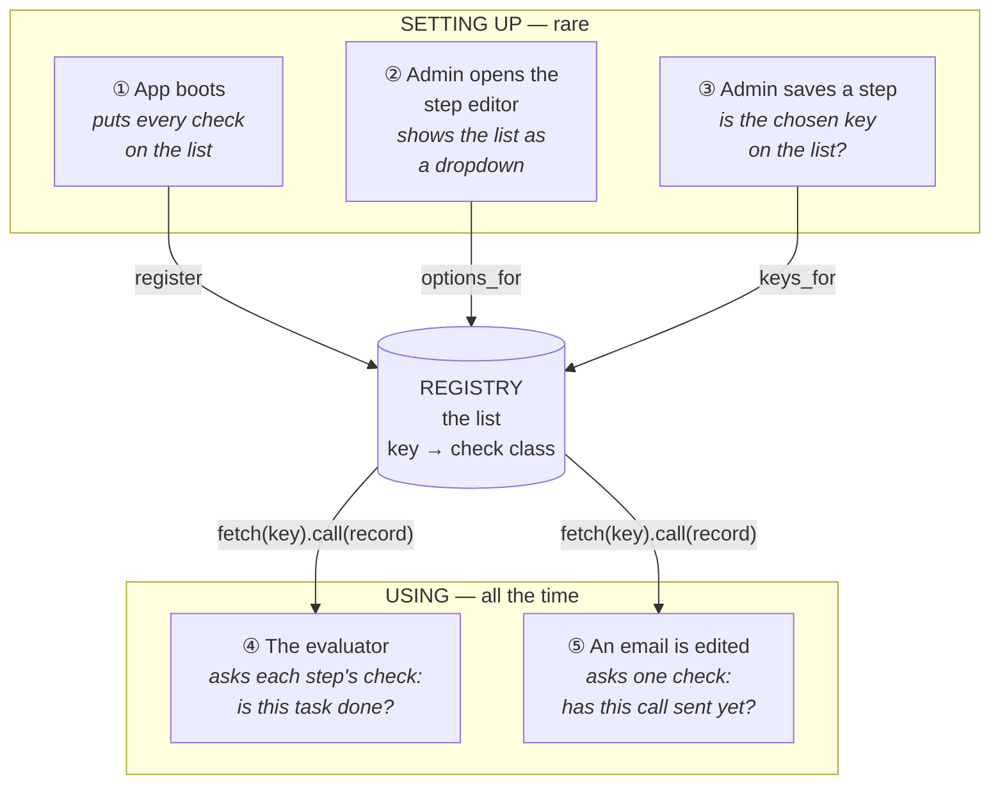
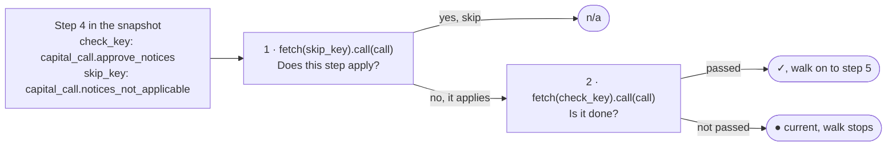
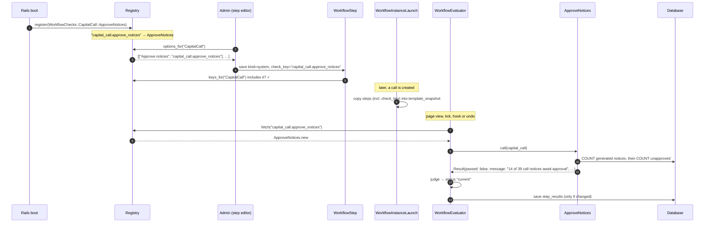
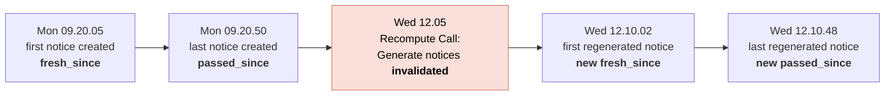
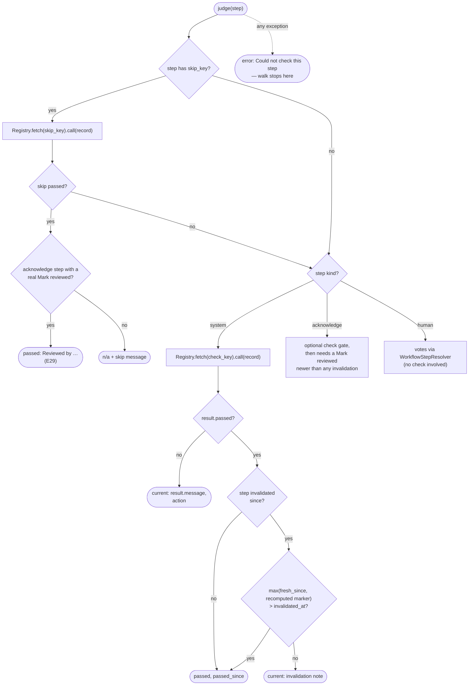
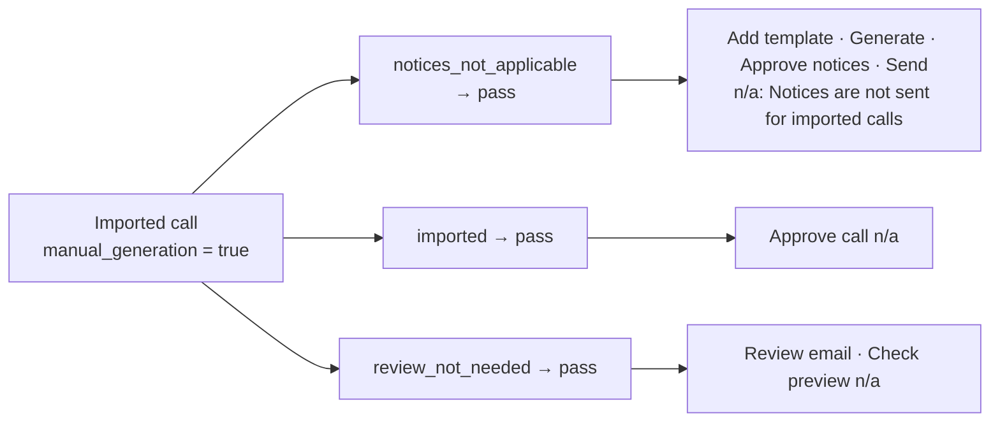
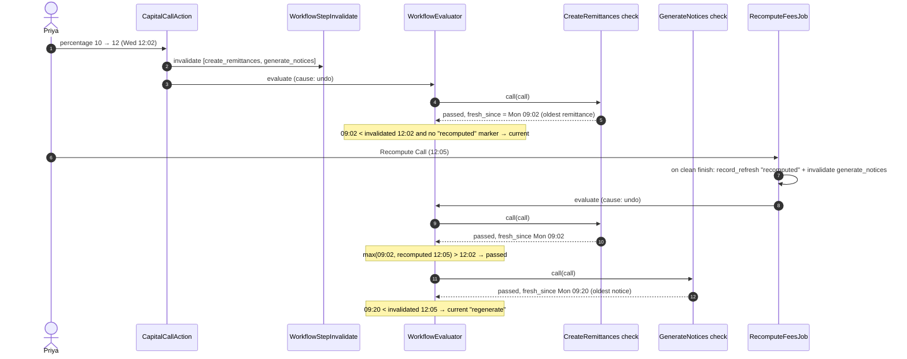

# WorkflowChecks: how journeys know a task is done

> **Audience:** a developer new to the codebase who needs to read, debug or add a workflow check.
> **Origin:** introduced by the capital call journey
> ([openspec/changes/archive/2026-10-02-capital-call-journey](../../openspec/changes/archive/2026-10-02-capital-call-journey/design.md)),
> since reused by the capital distribution and investor KYC journeys.
> Every snippet below is copied from the code as it stands; `…` marks a cut.

---

## Contents

1. [The idea in one minute](#1-the-idea-in-one-minute)
2. [Where the code lives](#2-where-the-code-lives)
3. [The big picture: who uses checks](#3-the-big-picture-who-uses-checks)
4. [A check's life, from boot to the step bar](#4-a-checks-life-from-boot-to-the-step-bar)
5. [The four building blocks](#5-the-four-building-blocks)
6. [The Result: five answers, not one](#6-the-result-five-answers-not-one)
7. [How the evaluator judges a check's answer](#7-how-the-evaluator-judges-a-checks-answer)
8. [The capital call checks, one by one](#8-the-capital-call-checks-one-by-one)
9. [Three checks read line by line](#9-three-checks-read-line-by-line)
10. [Skip checks and "n/a"](#10-skip-checks-and-na)
11. [Checks and invalidation (staleness)](#11-checks-and-invalidation-staleness)
12. [Readiness warnings: a neighbour, not a check](#12-readiness-warnings-a-neighbour-not-a-check)
13. [The rules every check follows](#13-the-rules-every-check-follows)
14. [Other check families: distributions and KYC](#14-other-check-families-distributions-and-kyc)
15. [How checks are tested](#15-how-checks-are-tested)
16. [Adding a new check, step by step](#16-adding-a-new-check-step-by-step)
17. [Debugging a check from the console](#17-debugging-a-check-from-the-console)
18. [FAQ](#18-faq)

---

## 1. The idea in one minute

A journey is a step bar on a record (a capital call, a distribution, a KYC) showing which task the
record is on. Nobody ticks the tasks. The app works it out from the record's own data.

A **check** is the piece that makes that possible. It is a small, read-only class that answers
**one yes/no question** about one record's data, together with a sentence a person can act on.

> *"Is any generated call notice on this call still unapproved?"*
> → **No, not done:** "14 of 39 call notices await approval" · button: *View notices to approve*

There is one check per task, and they are looked up by a string **key** such as
`"capital_call.approve_notices"`. The key is what gets stored on the workflow step, never the class.

A check **reports**. The `WorkflowEvaluator` **judges**. A check never decides where the journey is,
never writes, never sends email, and never looks at other steps. That split is the most important
thing to understand about this code (see [§7](#7-how-the-evaluator-judges-a-checks-answer)).

---

## 2. Where the code lives

```
app/packs/core/workflow_templates/workflow_checks/      ← the engine half (type-agnostic)
├── base.rb          WorkflowChecks::Base      parent class every check inherits
├── result.rb        WorkflowChecks::Result    the answer object a check returns
└── registry.rb      WorkflowChecks::Registry  key → class lookup

app/packs/funds/capital_calls/workflow_checks/         ← the capital call half
├── capital_call/
│   ├── support.rb                    shared helpers + DOM ids of the call page's buttons
│   ├── create_remittances.rb         ┐
│   ├── add_call_notice_template.rb   │
│   ├── generate_notices.rb           │
│   ├── approve_notices.rb            │
│   ├── review_email.rb               │  11 task checks, one per step of the
│   ├── check_preview.rb              │  "Capital Call — Full" journey
│   ├── approve_call.rb               │
│   ├── send_notices.rb               │
│   ├── collect_payments.rb           │
│   ├── verify_remittances.rb         │
│   ├── allocate_units.rb             ┘
│   ├── imported.rb                   ┐
│   ├── notices_not_applicable.rb     │  4 skip checks ("this task doesn't apply")
│   ├── no_unit_prices.rb             │
│   └── review_not_needed.rb          ┘
└── capital_call_warnings.rb          readiness warnings (not a check; reuses Support)

app/packs/funds/capital_distributions/workflow_checks/capital_distribution/   ← distributions
app/packs/core/investor_kycs/workflow_checks/investor_kyc/                    ← KYC

config/initializers/workflow_checks.rb      registers every check class at boot
features/support/workflow_test_checks.rb    test-only checks (test.flag_1, test.raises, …)
```

The split matters. The engine half lives in `core` and **never names `CapitalCall`**. The
evaluator only ever says "give me the check for this key". Capital calls, distributions and KYC
each plug in their own folder of checks, and the engine doesn't change.

---

## 3. The big picture: who uses checks

### 3.1 The short version

A check is just a function: **give it a record, get back an answer.**

```ruby
answer = check.call(capital_call)   # => a WorkflowChecks::Result
```

Nobody in the app refers to a check class by name. Every caller goes through the **Registry**, a
list that maps a key (a string such as `"capital_call.approve_notices"`) to the check class. Ask it
for a key and it hands you the check.

Five places in the code use that list. They fall into two groups:

- **Setting up** happens rarely: when the app boots, or when an admin edits a journey.
- **Using** happens all the time: whenever the app needs to know where a record's journey stands.



| # | Who | When | What it asks the registry | What it gets back |
|---|---|---|---|---|
| ① | `config/initializers/workflow_checks.rb` | Rails boots (and on every dev code reload) | "Add this class to the list" | — |
| ② | The step editor form | An admin edits a journey step | "Which checks may a Capital Call step use?" | A dropdown list of labels and keys |
| ③ | `WorkflowStep` validation | The admin clicks Save | "Is this key on the list for Capital Call?" | Yes, or a form error |
| ④ | `WorkflowEvaluator` | Page view, the 15-minute tick, the daily reminder job, a vote or Mark reviewed, a forward or undo hook | "Give me the check for this key", then runs it on the record | A `Result` per step |
| ⑤ | `JourneyEmailEdit` | Someone edits a Capital Call email | "Give me the *send notices* check", then runs it on each call | A `Result`: sent or not |

Only ④ and ⑤ **run** checks. ①–③ only manage the list.

The next five subsections take each caller in turn, with an example.

---

### 3.2 ① The app boots: filling the list

**When:** every time Rails starts, and in development after every code change.

**What happens:** the initializer empties the list, then adds every check class from a fixed list of
names.

```ruby
# config/initializers/workflow_checks.rb (excerpt)
Rails.application.config.to_prepare do
  WorkflowChecks::Registry.reset!
  check_classes = %w[
    WorkflowChecks::CapitalCall::CreateRemittances
    WorkflowChecks::CapitalCall::AddCallNoticeTemplate
    …
  ]
  check_classes.each { |name| WorkflowChecks::Registry.register(name.constantize) }
end
```

`register` files each class under its own `key`:

```ruby
def register(klass)
  @checks[klass.key] = klass          # "capital_call.approve_notices" => ApproveNotices
end
```

**Example: the list after boot** (a few of its 47 entries: 15 capital call, the rest distribution and KYC)

| Key | Class | For record type |
|---|---|---|
| `capital_call.create_remittances` | `WorkflowChecks::CapitalCall::CreateRemittances` | CapitalCall |
| `capital_call.approve_notices` | `WorkflowChecks::CapitalCall::ApproveNotices` | CapitalCall |
| `capital_call.imported` | `WorkflowChecks::CapitalCall::Imported` | CapitalCall |
| `capital_distribution.create_payments` | `WorkflowChecks::CapitalDistribution::CreatePayments` | CapitalDistribution |
| `investor_kyc.verify` | `WorkflowChecks::InvestorKyc::Verify` | InvestorKyc |

You can see it from a console:

```ruby
WorkflowChecks::Registry.registered?("capital_call.approve_notices")   # => true
WorkflowChecks::Registry.keys_for("CapitalCall").size                   # => 15
```

**Why it matters:** this is the **only** place where a name is turned into a class
(`constantize`), and the names come from this fixed list. A key typed into a form, or read from the
database, is only ever used to look something up in the list. It can never load an arbitrary class.

---

### 3.3 ② The admin opens the step editor: showing the list

**When:** an admin goes to *Settings → Workflow Templates → Capital Call — Full → edit a step*.

**What happens:** the form asks the registry for every check allowed on this template's record
type, and shows them in two dropdowns: **Check** (decides when the step is done) and **Skip when**
(decides when the step doesn't apply).

```erb
<%# app/packs/core/workflow_templates/views/workflow_steps/_form.html.erb (excerpt) %>
<% check_options = WorkflowChecks::Registry.options_for(@workflow_template.workflowable_type) %>
<%= form.select :check_key, check_options, { include_blank: "Select a check" } %>
<%= form.select :skip_key,  check_options, { include_blank: "Never skip" } %>
```

`options_for` returns `[label, key]` pairs. The admin sees the label, and the key is what gets saved:

```ruby
WorkflowChecks::Registry.options_for("CapitalCall")
# => [["Add call notice template", "capital_call.add_call_notice_template"],
#     ["Allocate units",           "capital_call.allocate_units"],
#     ["Approve call",             "capital_call.approve_call"],
#     ["Approve notices",          "capital_call.approve_notices"],
#     …
#     ["Skip: imported call",      "capital_call.imported"],
#     …]
```

**Example:**

| Admin is editing… | The Check dropdown shows… | It does not show… |
|---|---|---|
| a step on *Capital Call — Full* | the 15 `capital_call.*` checks | any `investor_kyc.*` or `capital_distribution.*` check |
| a step on a KYC journey | the `investor_kyc.*` checks | any `capital_call.*` check |

The filtering comes from each class's `workflowable_type`. A check with `workflowable_type = nil`
would appear for every type; only the test-only checks do that.

---

### 3.4 ③ The admin saves the step: checking the key

**When:** the admin clicks Save, or anything else saves a `WorkflowStep`, such as the journey setup service.

**What happens:** the dropdown is only a convenience; a request can be forged. So the model checks
the key again against the same list:

```ruby
# app/packs/core/workflow_templates/models/workflow_step.rb
def check_keys_must_be_registered
  type = workflow_template&.workflowable_type
  allowed = WorkflowChecks::Registry.keys_for(type)
  type_label = type.present? ? type.titleize : "general"

  missing_check = check_key.blank? && !kind_human?
  unknown_check = check_key.present? && allowed.exclude?(check_key)
  errors.add(:base, "Check must be a #{type_label} check") if missing_check || unknown_check
  errors.add(:base, "Skip when must be a #{type_label} check") if skip_key.present? && allowed.exclude?(skip_key)
end
```

**Examples:**

| The admin saves… | Result | Worked example |
|---|---|---|
| kind **System**, check *Approve notices* | saved | — |
| kind **System**, check left blank | ✗ "Check must be a Capital Call check" (a system step with no question could never pass) | X1 |
| kind **System**, check `investor_kyc.verify` (forged request) | ✗ "Check must be a Capital Call check" | X2 |
| kind **Human**, check left blank | saved (approvers vote; no check needed) | — |
| skip `capital_call.no_such_thing` | ✗ "Skip when must be a Capital Call check" | — |

---

### 3.5 ④ The evaluator: running checks, the main user

This is where checks do their real work. Everything else in this section is setup around it.

**When:** any time the app needs to know where a journey stands:

| Trigger | Example |
|---|---|
| Someone opens the call page | Arjun opens Q3 Drawdown |
| The 15-minute tick | 16:15, nobody is looking |
| The daily reminder job | 06:00, before deciding who to chase |
| Someone votes or clicks Mark reviewed | Priya marks the email reviewed |
| A forward hook | notices approved on the Documents screen |
| An undo hook | Priya edits the call from 10% to 12% |

**What happens:** the evaluator walks the steps from the call's frozen snapshot, top to bottom. For
each step it reads the step's two keys, fetches each check from the registry and runs it:



In code, these are two short methods:

```ruby
# WorkflowEvaluator (excerpts)
def skip_result(step, record)
  return nil if step[:skip_key].blank?
  WorkflowChecks::Registry.fetch(step[:skip_key]).call(record)
end

def judge_system(step, record, history)
  result = WorkflowChecks::Registry.fetch(step[:check_key]).call(record)
  return current_from(result) unless result.passed?
  …
end
```

**Example: one evaluation of Q3 Drawdown.** It's Tuesday 11:00, Arjun opens the call. There are 40
remittances, the fund has a template, 39 notices have been generated and 25 are approved. Here is every
check the evaluator runs, in order:

| Step | Kind | Skip check asked → answer | Check asked → answer | Step becomes |
|---|---|---|---|---|
| 1 Create remittances | system | — | `create_remittances` → **passed** "40 remittances created" | ✓ |
| 2 Add call notice template | system | `notices_not_applicable` → not passed ("Notices apply") | `add_call_notice_template` → **passed** | ✓ |
| 3 Generate notices | system | `notices_not_applicable` → not passed | `generate_notices` → **passed** "39 notices generated" | ✓ |
| 4 Approve notices | system | `notices_not_applicable` → not passed | `approve_notices` → **not passed** "14 of 39 call notices await approval" | **● current, the walk stops** |
| 5 Review email | acknowledge | `review_not_needed` → not passed | *not asked* | ○ later |
| 6 Check preview | acknowledge | `review_not_needed` → not passed | *not asked* | ○ later |
| 7 CFO sign-off | human | no skip key (but a human step with no approver picked counts as n/a) | *no check: votes decide* | ○ later |
| 8 Approve call | system | `imported` → not passed | *not asked* | ○ later |
| 9–12 | system | each step's skip check, if it has one | *not asked* | ○ later |

Two things to notice in that table:

- **After the current step, only skip checks run.** The step bar still needs to know which later
  steps are n/a, so it can grey them out. Whether they're done doesn't matter yet: the walk has
  stopped.
- **Human steps never use a check.** Votes decide them (`WorkflowStepResolver`). The registry isn't
  involved.

The evaluator calls the registry from four places. The capital call journey uses the first three:

| Evaluator method | Which key | Used for |
|---|---|---|
| `skip_result` | `skip_key` | n/a decisions, on every step |
| `judge_system` | `check_key` | system steps: is it done? |
| `judge_acknowledge` | `check_key` | acknowledge steps: the check is only a gate; the Mark reviewed click is what passes it |
| `closing_step` | `check_key` of a check marked `closes_journey` | KYC only: a passing closing check closes the earlier unfinished steps ([§14](#14-other-check-families-distributions-and-kyc)) |

If any of these raises (bad data, or a key that's no longer on the list), the evaluator catches it.
The step shows "Could not check this step — support has been notified", and the walk stops there
(X6).

---

### 3.6 ⑤ An email is edited: running one check as a plain question

**When:** someone creates, edits or deletes a Capital Call email, either on one call or on the fund.

**The problem it solves:** Priya clicked *Mark reviewed* on "Review email" for every open call in
the fund. If the fund's email wording now changes, those reviews no longer cover what investors will
receive, so they must be reset. But a call that has **already sent** its notices doesn't need a new
review: the old email has already gone out.

So `JourneyEmailEdit` asks one check for each call: *have you sent yet?* It doesn't ask
for a whole evaluation, just that one check.

```ruby
# app/packs/core/workflow_templates/services/journey_email_edit.rb (excerpts)
CONFIGS = {
  "CapitalCall" => {
    review_keys: %w[capital_call.review_email capital_call.check_preview].freeze,
    sent_key: "capital_call.send_notices"
  },
  …
}

records_for(notification, type).find_each do |record|
  next if WorkflowChecks::Registry.fetch(config[:sent_key]).call(record).passed?   # already sent → leave alone

  WorkflowStepInvalidate.call(record:, check_keys: config[:review_keys], actor:, reason: REASON)
  record.journey_undo_evaluate(note: REASON, actor:, started_at:)
end
```

**Example:** Alpha Fund I has two calls with journeys, and Priya edits the fund's Capital Call email.

| Call | `send_notices` check answers | What happens |
|---|---|---|
| Q2 Drawdown, notices sent last month | **passed** "39 notices sent" | skipped: nothing changes (E24) |
| Q3 Drawdown, not sent yet | **not passed** "39 notices not yet sent" | Review email and Check preview are reset: "Email template changed after review" (E12) |

This shows that a check isn't tied to the journey machinery. It's an ordinary data question, so any
code that needs that answer can ask it. The service deliberately asks the check rather than reading
the step's cached status. A call can have emailed investors while its journey is still stopped at an
earlier step (for example, never approved in the app), and the cached status would then wrongly say
"not sent".

---

### 3.7 Who does **not** run checks

These come up a lot, so it's worth being explicit:

| Thing | Uses checks? | What it does instead |
|---|---|---|
| The call page's step bar and panel | **No**, not directly | Shows the results the evaluator just produced (`step_results`). The page asks the evaluator, which runs the checks |
| The 15-minute tick and daily reminder job | **Only through the evaluator** | They call `WorkflowEvaluator`; they never fetch a check themselves |
| Undo and forward hooks (`journey_undo`, `journey_progress!`) | **Only through the evaluator** | Same |
| `WorkflowStepInvalidate` | **No** | Matches steps by their `check_key` *string* to stamp them stale, but never runs the check |
| Readiness warnings (`CapitalCallWarnings`) | **No** | Not on the list at all. It reuses the same `Support` helpers but is called directly by the panel ([§12](#12-readiness-warnings-a-neighbour-not-a-check)) |
| Human (vote) steps | **No** | Decided by votes through `WorkflowStepResolver` |


---

## 4. A check's life, from boot to the step bar



Three things to notice:

- **The key is copied into the frozen snapshot** when a call's journey launches. That is why
  [keys are permanent](#13-the-rules-every-check-follows): a call launched months ago still holds
  the old key.
- **A fresh instance per `fetch`.** Checks hold no state between calls.
- **The check runs on every evaluation**: page view, the 15-minute tick, the daily reminder job,
  forward hooks and undo hooks. That is why checks must be cheap ([§13](#13-the-rules-every-check-follows)).

---

## 5. The four building blocks

### 5.1 `WorkflowChecks::Base`: the parent class

```ruby
# app/packs/core/workflow_templates/workflow_checks/base.rb
module WorkflowChecks
  class Base
    class_attribute :key, :label, :workflowable_type, instance_writer: false

    # A closing check: when it passes, every earlier step not yet done (or n/a) is shown as n/a with
    # closing_note, so the journey can complete (e.g. a KYC verified before every task was done).
    class_attribute :closes_journey, instance_writer: false, default: false
    class_attribute :closing_note, instance_writer: false, default: "Done without this step"

    def call(_record)
      raise NotImplementedError, "#{self.class.name} must implement #call(record)"
    end

    private

    def pass(**) = WorkflowChecks::Result.pass(**)
    def fail_with(**) = WorkflowChecks::Result.fail(**)
  end
end
```

| Attribute | Meaning | Example |
|---|---|---|
| `key` | The permanent string stored on steps and snapshots | `"capital_call.approve_notices"` |
| `label` | What the step editor's dropdown shows | `"Approve notices"` |
| `workflowable_type` | Which record type may use it; `nil` = any type | `"CapitalCall"` |
| `closes_journey` | KYC only so far: when this passes, close every unfinished earlier step | `false` |

`pass` and `fail_with` are shorthands so check bodies read naturally. (It's `fail_with` rather than
`fail` because `fail` is a Ruby keyword alias for `raise`.)

### 5.2 `WorkflowChecks::Registry`: the lookup table

```ruby
# app/packs/core/workflow_templates/workflow_checks/registry.rb (excerpt)
def register(klass)
  raise ArgumentError, "#{klass.name} has no key" if klass.key.blank?
  @checks[klass.key] = klass
end

def fetch(key)
  @checks.fetch(key.to_s).new          # KeyError for an unknown key
end

def keys_for(workflowable_type)
  @checks.select { |_key, klass| klass.workflowable_type.nil? || klass.workflowable_type == workflowable_type.to_s }.keys.sort
end

def options_for(workflowable_type)
  keys_for(workflowable_type).map { |key| [@checks[key].label.presence || key, key] }
end
```

It's a plain module-level hash with no database table. `fetch` raises `KeyError` for an unknown key,
and the evaluator turns that into the "Could not check this step" error state ([§7](#7-how-the-evaluator-judges-a-checks-answer)).

### 5.3 The initializer: filling the registry

```ruby
# config/initializers/workflow_checks.rb (excerpt)
Rails.application.config.to_prepare do
  WorkflowChecks::Registry.reset!

  # Class names, constantized here at boot (never from user input)
  check_classes = %w[
    WorkflowChecks::CapitalCall::CreateRemittances
    WorkflowChecks::CapitalCall::AddCallNoticeTemplate
    …
    WorkflowChecks::InvestorKyc::NoAmlMatch
  ]
  check_classes.each { |name| WorkflowChecks::Registry.register(name.constantize) }
end
```

- `to_prepare` runs at boot and **again on every development code reload**, so edited classes are
  re-registered.
- `reset!` first, so a deleted class doesn't linger.
- This is the **only** place class names are turned into classes, from a fixed list. User input
  (a posted `check_key`) is only ever used as a hash key, never `constantize`d.

### 5.4 `WorkflowChecks::CapitalCall::Support`: shared helpers

Every capital call check does `include Support`. It holds three kinds of thing:

**1. DOM ids of buttons that already exist on the call page.** The journey panel's button presses the
real control instead of re-implementing it (design Decision 21, H18):

```ruby
GENERATE_DOCS_BTN = "capital_call_generate_docs_btn".freeze
APPROVE_BTN = "capital_call_approve_btn".freeze
NOTIFY_BTN = "capital_call_notify_btn".freeze
ALLOCATE_UNITS_BTN = "capital_call_allocate_units_btn".freeze
RECOMPUTE_BTN = "capital_call_recompute_fees_btn".freeze
REMITTANCES_TAB = "#remittances-tab".freeze
VIEW_NOTICES_TO_APPROVE_BTN = "capital_call_view_notices_to_approve_btn".freeze
```

**2. Shared scopes**, so every check uses the same definition of, for example, "notifiable":

```ruby
# Remittances that get a notice and an email
def notifiable_remittances(call)
  remittances(call).where.not(capital_commitment_id: ::CapitalCommitment.skip_doc_gen_ids(call.fund.capital_commitments))
end

# Generated call notices (not templates) on this call's remittances
def generated_notices(call, remittance_scope = remittances(call))
  ::Document.not_templates.where(owner_type: "CapitalRemittance", owner_id: remittance_scope.select(:id),
                                 owner_tag: "Generated")
end

def notices_not_applicable?(call)
  call.manual_generation || !call.send_call_notice_flag
end

# True once every notifiable remittance has been sent its notice (and there is at least one)
def notices_all_sent?(call)
  scope = notifiable_remittances(call)
  scope.exists? && !scope.exists?(notification_sent: false)
end
```

**3. Paths** for the panel's fallback link (`call_path`, `pending_notices_path`, `notices_path`).

> **Why `skip_doc_gen_ids` is Ruby, not SQL:** `skip_doc_gen` lives inside the
> `capital_commitments.json_fields` JSON column. The MySQL way to read it (`JSON_UNQUOTE`) doesn't
> exist in SQLite, which the Cucumber suite runs on. So it plucks two narrow columns for one fund's
> commitments and filters in Ruby:
>
> ```ruby
> # app/packs/funds/capital_commitments/models/capital_commitment.rb
> def self.skip_doc_gen_ids(scope)
>   scope.pluck(:id, :json_fields).filter_map do |id, fields|
>     fields = JSON.parse(fields) if fields.is_a?(String)
>     id if fields.to_h["skip_doc_gen"].to_s.strip.casecmp?("yes")
>   end
> end
> ```

---

## 6. The Result: five answers, not one

```ruby
# app/packs/core/workflow_templates/workflow_checks/result.rb (excerpt)
Result = Data.define(:passed, :message, :action_label, :action_path, :action_target,
                     :passed_since, :fresh_since, :review) do
  def self.pass(message: nil, passed_since: nil, fresh_since: nil, action_label: nil, action_path: nil, action_target: nil)
    new(passed: true, message:, action_label:, action_path:, action_target:, passed_since:,
        fresh_since: fresh_since || passed_since, review: nil)
  end

  def self.fail(message:, action_label: nil, action_path: nil, action_target: nil)
    new(passed: false, message:, action_label:, action_path:, action_target:, passed_since: nil, fresh_since: nil, review: nil)
  end
  …
  alias_method :passed?, :passed
end
```

`Data.define` makes it an immutable value object.

| Field | What it's for | Example (Approve notices, partly done) |
|---|---|---|
| `passed` | Is the task done, according to the data? | `false` |
| `message` | The panel's status line: what exactly is missing | `"14 of 39 call notices await approval"` |
| `action_label` | Text of the panel's button | `"View notices to approve"` |
| `action_target` | DOM id of the real control on the record's own page; the panel clicks it | `"capital_call_view_notices_to_approve_btn"` |
| `action_path` | Fallback URL when that control isn't on the page | `/documents?…approved_eq=false` |
| `passed_since` | When the task became true: the **newest** evidence | time the last notice was approved |
| `fresh_since` | The **oldest** evidence; only used after an invalidation | time the first notice was made |
| `review` | Acknowledge steps only (KYC): `:confirmed` / `:requested` / `nil` | `nil` |

### Why two timestamps?

Take the 39 call notices of the Q3 Drawdown example, generated in one batch:



- **`passed_since` (newest)** answers *when did this become true?* A task is done when its **last**
  missing piece arrives, so for Generate notices that's 09:20:50. The evaluator stamps the step's
  "passed at", and the next step's "current since", from it. That's why a step noticed at 09:30 by
  the tick is still recorded as passing at 09:20:50 (H15).
- **`fresh_since` (oldest)** answers *is every piece of evidence newer than the invalidation?*
  On Wednesday the old notices are still there and `passed` is still `true`. But the oldest notice
  (Mon 09:20:05) is older than the invalidation (Wed 12:05), so the evaluator rules the step not done.
  After regeneration the oldest is 12:10:02 > 12:05, and it passes.

`Result.pass` defaults `fresh_since` to `passed_since` when a check gives only one time.

### When the data has no timestamp

Some answers have no exact time in the data. Checks then use the closest column that can only be
**later** than the truth, never earlier, so a reminder may come slightly late but never early:

| Check | `passed_since` from | Quality |
|---|---|---|
| CreateRemittances | `MAX(capital_remittances.created_at)` | exact |
| AddCallNoticeTemplate | `MIN(documents.created_at)` of the fund's templates | exact; clamped by the evaluator (see below) |
| GenerateNotices | `MAX(documents.created_at)` of generated notices | exact |
| ApproveNotices | `MAX(documents.updated_at)`: there is no `approved_at` column | later-only |
| ApproveCall | the latest audit that set `approved` to true | exact |
| SendNotices | nothing: `notification_sent` is written with `update_column` | evaluator uses "now" |
| CollectPayments | `MAX(capital_remittance_payments.created_at)` | exact |
| VerifyRemittances | `MAX(capital_remittances.updated_at)`: no `verified_at` column | later-only |
| AllocateUnits | `MAX(fund_units.created_at)` | exact |

The evaluator then **clamps** every time: never earlier than the previous step passed, never later
than now. That's why a fund template uploaded months ago doesn't make "Add call notice template" look
months old:

```ruby
# WorkflowEvaluator#run (excerpt)
passed_at = clamp(outcome[:passed_since] || now, previous_passed_at, now)
```

---

## 7. How the evaluator judges a check's answer

The evaluator walks the journey's steps in order. For each step it calls `judge`, which may ask up to
two checks: the **skip check** first, then the **step's own check**.



The system-step branch, verbatim:

```ruby
# app/packs/core/workflow_templates/services/workflow_evaluator.rb
def judge_system(step, record, history)
  result = WorkflowChecks::Registry.fetch(step[:check_key]).call(record)
  return current_from(result) unless result.passed?

  # After an invalidation, the evidence (or a refresh marker such as "recomputed") must be newer
  invalidated_at = history.last_at(step[:position], "invalidated")
  if invalidated_at
    fresh = [result.fresh_since, history.last_at(step[:position], "recomputed")].compact.max
    unless fresh && fresh > invalidated_at
      return { status: "current", message: history.last_note(step[:position], "invalidated") || "Needs to be done again",
               action_label: result.action_label, action_path: result.action_path, action_target: result.action_target }
    end
  end

  { status: "passed", message: result.message, passed_since: result.passed_since }
end
```

And the safety net around every check call:

```ruby
def judge(step, record, instance, history)
  …
rescue StandardError => e
  report(e, instance, step)      # log + Sentry
  { status: "error", message: "Could not check this step — support has been notified" }
end
```

### Check vs evaluator: who decides what

| Question | Answered by | Why there |
|---|---|---|
| Are all notices approved? | **Check** | Only it knows the record's tables |
| Is the evidence fresh enough after an edit? | **Evaluator** | Invalidations live in journey history, which the check must not know about |
| Does this step apply to this call? | **Skip check** | A data question |
| Does a real review survive the skip? | **Evaluator** | Needs the step's responses |
| Which step is current? Did it move back? | **Evaluator** | Needs all steps and the previous results |
| Who gets reset or emailed? | **Evaluator** | Needs the cause (undo or progress) |

### Acknowledge steps: the check is a gate, the click is the answer

For `review_email` and `check_preview` the check always passes. It only supplies the panel's link:

```ruby
# app/packs/funds/capital_calls/workflow_checks/capital_call/review_email.rb
def call(call)
  pass(message: "Review the call email", action_label: "Open the call", action_path: call_path(call))
end
```

What makes the step done is a `WorkflowActorResponse(state: "Reviewed")` newer than any
invalidation. If an acknowledge check returns `passed: false`, the step stays current with that
message, so a check can hold back a review until something is ready.

---

## 8. The capital call checks, one by one

The task checks, in Full-journey order:

| # | Key | Question | Fails with (example) | Panel action → target | `passed_since` / `fresh_since` |
|---|---|---|---|---|---|
| 1 | `capital_call.create_remittances` | Generated: every commitment in the call's closes with a positive amount has a remittance. Upload: remittances exist and no import is running or failed | "12 of 40 remittances created" · "Remittance upload in progress" · "Remittance upload failed — fix and re-import" | Recompute Call → `RECOMPUTE_BTN` / `REMITTANCES_TAB` | MAX / MIN remittance `created_at` |
| 2 | `capital_call.add_call_notice_template` | The fund has a document with `owner_tag: "Call Template"` | "The fund has no call notice template" | Open the fund (path only) | MIN template `created_at` |
| 3 | `capital_call.generate_notices` | Every notifiable remittance has a generated notice | "37 of 39 notices generated" · "2 investors have unverified KYC — notices are not generated for them" | Generate Documents → `GENERATE_DOCS_BTN` | MAX / MIN notice `created_at` |
| 4 | `capital_call.approve_notices` | No generated notice is unapproved | "14 of 39 call notices await approval" | View notices to approve → `VIEW_NOTICES_TO_APPROVE_BTN` | MAX notice `updated_at` |
| 5 | `capital_call.review_email` | always passes (acknowledge) | — | Open the call | — |
| 6 | `capital_call.check_preview` | always passes (acknowledge) | — | Open the call | — |
| 7 | `capital_call.approve_call` | `call.approved` | "The call is not approved yet" | Approve → `APPROVE_BTN` | the audit that set `approved` |
| 8 | `capital_call.send_notices` | No notifiable remittance has `notification_sent: false` | "39 notices not yet sent" | Send Notification → `NOTIFY_BTN` | none |
| 9 | `capital_call.collect_payments` | No remittance collected less than `call + other fees − 10 cents` | "Collected 62%" | View remittances → `REMITTANCES_TAB` | MAX payment `created_at` |
| 10 | `capital_call.verify_remittances` | No remittance with `verified: false` | "12 of 40 remittances not verified" | View remittances → `REMITTANCES_TAB` | MAX remittance `updated_at` |
| 11 | `capital_call.allocate_units` | Every verified remittance has a `FundUnit` | "40 verified remittances have no units yet" | Allocate Units → `ALLOCATE_UNITS_BTN` | MAX fund unit `created_at` |

The skip checks ([§10](#10-skip-checks-and-na)):

| Key | "Yes, skip" when | Used on |
|---|---|---|
| `capital_call.notices_not_applicable` | imported (`manual_generation`) or `send_call_notice_flag` off | template, generate, approve notices, send |
| `capital_call.review_not_needed` | notices n/a **or** already all sent | review email, check preview |
| `capital_call.imported` | `manual_generation` | approve call |
| `capital_call.no_unit_prices` | `unit_prices.blank?` | allocate units |

---

## 9. Three checks read line by line

### 9.1 ApproveNotices: the typical shape

```ruby
# app/packs/funds/capital_calls/workflow_checks/capital_call/approve_notices.rb
module WorkflowChecks
  module CapitalCall
    class ApproveNotices < WorkflowChecks::Base
      include Support

      self.key = "capital_call.approve_notices"
      self.label = "Approve notices"
      self.workflowable_type = "CapitalCall"

      def call(call)
        notices = generated_notices(call)                     # ① a relation, nothing loaded
        total = notices.count                                 # ② SELECT COUNT(*)
        waiting = notices.where(approved: false).count        # ③ SELECT COUNT(*) … approved = false
        if total.positive? && waiting.zero?
          # updated_at only moves later than the approval, so this is never earlier than the truth
          return pass(message: "#{total} notices approved", passed_since: notices.maximum(:updated_at))
        end

        fail_with(message: "#{waiting} of #{total} call notices await approval", action_label: "View notices to approve",
                  action_path: pending_notices_path(call), action_target: VIEW_NOTICES_TO_APPROVE_BTN)
      end
    end
  end
end
```

Worked through for Q3 Drawdown on Tuesday at 11:00 (39 notices, 25 approved):

| Line | SQL (shape) | Value |
|---|---|---|
| ② | `COUNT(*) FROM documents WHERE owner_type='CapitalRemittance' AND owner_id IN (…) AND owner_tag='Generated'` | 39 |
| ③ | same `AND approved = false` | 14 |
| result | `fail_with` | `"14 of 39 call notices await approval"` |

Note the `total.positive?` guard. Zero notices must **not** count as "none unapproved". Without it,
a call whose notices haven't been generated would pass Approve notices vacuously. (In practice the
walk stops at Generate notices first, but the check must be right on its own.)

### 9.2 GenerateNotices: "notifiable", and a smarter message

```ruby
# app/packs/funds/capital_calls/workflow_checks/capital_call/generate_notices.rb (body)
def call(call)
  notifiable = notifiable_remittances(call)                 # excludes Skip Doc Gen commitments
  total = notifiable.count
  notices = generated_notices(call, notifiable)
  with_notice = notices.distinct.count(:owner_id)           # remittances that have ≥1 notice
  missing = total - with_notice
  return pass(message: "#{with_notice} notices generated", passed_since: notices.maximum(:created_at),
              fresh_since: notices.minimum(:created_at)) if total.positive? && missing.zero?

  unverified = notifiable.where.not(id: notices.select(:owner_id))
                         .left_joins(capital_commitment: :investor_kyc)
                         .where("investor_kycs.id IS NULL OR investor_kycs.verified = ?", false).count
  message = if unverified.positive? && unverified == missing && with_notice.positive?
              "#{unverified} #{'investor'.pluralize(unverified)} #{unverified == 1 ? 'has' : 'have'} unverified KYC — notices are not generated for them"
            else
              "#{with_notice} of #{total} notices generated"
            end
  fail_with(message:, action_label: "Generate Documents", action_path: call_path(call), action_target: GENERATE_DOCS_BTN)
end
```

What's going on:

- **Notifiable.** Q3 Drawdown has 40 remittances, but one investor is Skip Doc Gen, so
  `total = 39`. Skipping that investor is deliberate, so it must not hold the step forever.
- **`distinct.count(:owner_id)`** counts remittances that have a notice, not notices. A remittance
  with two generated documents still counts once.
- **The better message (E20).** If every missing notice belongs to an investor with unverified KYC,
  saying "37 of 39" would send the user to click Generate again, which would do nothing because the
  doc job skips unverified KYC. So the check names the real cause. It still fails, because a notice
  is still owed.
- **Two timestamps.** Here `fresh_since` (MIN) matters: after Recompute invalidates this step, every
  notice must be newer than the recompute ([§11](#11-checks-and-invalidation-staleness)).

### 9.3 CreateRemittances: two kinds of call, and a deliberately old `fresh_since`

```ruby
# app/packs/funds/capital_calls/workflow_checks/capital_call/create_remittances.rb (body)
def call(call)
  call.call_basis == "Upload" ? uploaded(call) : generated(call)
end

def generated(call)
  expected = call.applicable_to.where("capital_commitments.committed_amount_cents > 0")
  expected_count = expected.count
  missing = expected.where.not(id: remittances(call).select(:capital_commitment_id)).count
  if expected_count.zero? || missing.positive?
    created = expected_count - missing
    return fail_with(message: "#{created} of #{expected_count} remittances created",
                     action_label: "Recompute Call", action_path: call_path(call), action_target: RECOMPUTE_BTN)
  end
  done(call, "#{remittances(call).count} remittances created")
end

def uploaded(call)
  unless remittances(call).exists?
    return fail_with(message: "No remittances uploaded yet", …)
  end
  uploads = ::ImportUpload.where(id: remittances(call).where.not(import_upload_id: nil).select(:import_upload_id))
  return fail_with(message: "Remittance upload in progress") if uploads.where(status: nil).where("processed_row_count < total_rows_count").exists?(created_at: 1.day.ago..)
  if uploads.where.not(status: [nil, "", "Completed"]).or(uploads.where(failed_row_count: 1..)).exists?
    return fail_with(message: "Remittance upload failed — fix and re-import", …)
  end
  done(call, "#{remittances(call).count} remittances uploaded")
end

def done(call, message)
  pass(message:, passed_since: remittances(call).maximum(:created_at), fresh_since: remittances(call).minimum(:created_at))
end
```

- **Generated calls:** "expected" is commitments in the call's closes with a **positive** amount,
  checked live rather than counted at creation. Design Decision 13 records why: a count taken at creation
  disagreed with production data on 96 of 200 calls (the generator skips zero commitments and adds
  remittances for commitments admitted later).
- **Upload calls:** "every investor has a remittance" is the wrong question, because the file decides who's
  in. The right question is whether the upload has finished cleanly. "Running" means blank status, not all
  rows processed, created within the last day (so a stuck import from last month doesn't block for
  ever). A failed row only shows in `failed_row_count`, because the upload itself still ends "Completed".
- **`fresh_since` = oldest remittance `created_at`, on purpose.** After a figures edit (10% → 12%)
  invalidates this step, Recompute updates rows in place, so `created_at` doesn't move. This check
  alone can therefore never satisfy the invalidation. Only the `recomputed` marker that
  Recompute writes on a clean finish can ([§11](#11-checks-and-invalidation-staleness)). The design
  rejected using `updated_at` because Rails doesn't touch unchanged rows and Recompute rescues errors
  row by row, so timestamps can't prove that a full recompute succeeded.

---

## 10. Skip checks and "n/a"

A skip check is an ordinary check whose **"yes" means "this step does not apply"**. It's named on
the step's `skip_key`. The evaluator asks it **before** the step's own check:

```ruby
# WorkflowEvaluator#skip_result (excerpt)
return nil if step[:skip_key].blank?
WorkflowChecks::Registry.fetch(step[:skip_key]).call(record)
```

A passing skip result turns the step into `status: "na"`, and its `message` becomes the hover
reason on the greyed step:

```ruby
# app/packs/funds/capital_calls/workflow_checks/capital_call/notices_not_applicable.rb
def call(call)
  return pass(message: "Notices are not sent for imported calls") if call.manual_generation
  return pass(message: "This call is set to not notify investors") unless call.send_call_notice_flag

  fail_with(message: "Notices apply")
end
```



`review_not_needed` builds on another check rather than duplicating it:

```ruby
# app/packs/funds/capital_calls/workflow_checks/capital_call/review_not_needed.rb
def call(call)
  not_applicable = NoticesNotApplicable.new.call(call)
  return not_applicable if not_applicable.passed?
  return pass(message: "Notices have already been sent") if notices_all_sent?(call)

  fail_with(message: "Review needed")
end
```

**One exception lives in the evaluator, not the check (E29).** If someone did Mark reviewed before
the notices were sent, the review stays **passed** with their name even though `review_not_needed`
now says skip. The skip only stands in for a missing review; it never erases a real one. The check
can't know about responses, so the evaluator handles it:

```ruby
# WorkflowEvaluator#judge (excerpt)
if skip&.passed?
  response = acknowledgement(step, instance, history) if step[:kind].to_s == "acknowledge"
  return reviewed(response) if response
  return { status: "na", message: skip.message }
end
```

---

## 11. Checks and invalidation (staleness)

Some changes leave the data looking fine. After editing a call from 10% to 12%, the 40 remittances
and 39 notices still exist, so every check would say "passed". The undoing action has to say
explicitly: *don't trust evidence older than now*. That's an **invalidation**: a
`WorkflowStateChange(to_state: "invalidated")` on the steps whose `check_key` matches.

```ruby
# app/packs/core/workflow_templates/services/workflow_step_invalidate.rb (excerpt)
instance.snapshot_steps.each do |step|
  next unless keys.include?(step[:check_key].to_s)          # matched by CHECK KEY, not position
  WorkflowStateChange.create!(workflow_instance: instance, step_position: position, to_state: "invalidated",
                              note: reason, actor:, channel: :system)
  …
end
```

Matching by `check_key` is why the invalidating code doesn't care where an admin moved the step, or
which journey (Full or Light) the call is on.

The whole sequence for the 10% → 12% edit:



The refresh marker, which Recompute writes only when no row failed:

```ruby
# WorkflowStepInvalidate.record_refresh (excerpt)
WorkflowStateChange.create!(workflow_instance: instance, step_position: step[:position].to_i, to_state: "recomputed",
                            note:, actor:, channel: :system)
```

**Email edits** go through `JourneyEmailEdit`, which uses a check to decide whether a record still
needs its reviews invalidated. If the record has already sent, a new email wording changes nothing
for it (E24):

```ruby
# app/packs/core/workflow_templates/services/journey_email_edit.rb (excerpt)
next if WorkflowChecks::Registry.fetch(config[:sent_key]).call(record).passed?

WorkflowStepInvalidate.call(record:, check_keys: config[:review_keys], actor:, reason: REASON)
record.journey_undo_evaluate(note: REASON, actor:, started_at:)
```

This is a check being used outside the evaluator, as a plain data question. Its comment explains
why it asks the data rather than the cached step status: a record can have emailed investors while
its journey is still stopped at an earlier task.

---

## 12. Readiness warnings: a neighbour, not a check

`WorkflowChecks::CapitalCallWarnings` lives in the same folder and reuses `Support`, but it isn't
registered and isn't on any step. It produces the ⚠ lines under the panel before sending:

```ruby
# app/packs/funds/capital_calls/workflow_checks/capital_call_warnings.rb (excerpt)
def to_a
  return [] if notices_not_applicable?(@call) || notices_all_sent?(@call)
  [subscriber_warning, skip_doc_gen_warning].compact
end

# Same source as the approve-time validation rule, so the two never disagree
def subscriber_warning
  names = CapitalCallRuleContextProvider.new.send(:investors_without_notification_subscribers, @call)
  …
end
```

| Check | Warning |
|---|---|
| Decides whether a step is done | Never blocks anything |
| One per step, registered by key | One class, called by the panel |
| Runs on every evaluation | Runs only when the panel renders, and only before sending (the subscriber query is relatively heavy) |

---

## 13. The rules every check follows

| Rule | Why | Where it bit, or would have |
|---|---|---|
| **Read-only.** No writes, no email, no jobs | Checks run on GET page views, every 15 minutes, and inside other people's transactions | — |
| **Count, never load.** `count`, `exists?`, `sum`, `maximum`/`minimum`, `select(:id)` subqueries; never `.to_a`, `.each`, `.present?` on a relation | Remittances and documents are large tables (CLAUDE.md). Every evaluation runs ~11 checks | E19 proves it: a 5,000-remittance call, and a query-counter assertion that nothing selects all remittance columns |
| **One question; don't look at other steps** | Steps can be reordered by an admin; the evaluator owns ordering | — |
| **Deterministic output.** The same data must give an identical `Result` | The evaluator writes `step_results` only when they change, and broadcasts each change to open pages | `pending_notices_path` once used `RansackQueryBuilder.multiple`, which generates random group keys. Every evaluation looked like a change, so it wrote and broadcast in a loop |
| **Keys are permanent** | Launched journeys hold the key in `template_snapshot` | A changed meaning gets a **new** key (design Decision 19) |
| **Scope through the record** | Tenant isolation: a check can only see the record's own data | `generated_notices` filters by this call's remittance ids |
| **Timestamps may be late, never early** | A reminder must never fire before a task really became current | `ApproveNotices`, `VerifyRemittances` use `updated_at` because there's no `approved_at`/`verified_at` |
| **Guard the empty case** | "None unapproved" is vacuously true with zero notices | `total.positive? && …` in most checks |
| **Portable SQL** | Cucumber runs on SQLite | `skip_doc_gen_ids` filters JSON in Ruby |
| **Let exceptions raise** | The evaluator rescues per step, reports to Sentry, shows "Could not check this step", and stops the walk there | X6 |

---

## 14. Other check families: distributions and KYC

The same engine serves three journeys. Each family has its own folder, `Support` module and
`workflowable_type`, so the step editor only offers matching checks:

| Family | Folder | Examples |
|---|---|---|
| `CapitalCall` | `app/packs/funds/capital_calls/workflow_checks/capital_call/` | described above |
| `CapitalDistribution` | `app/packs/funds/capital_distributions/workflow_checks/capital_distribution/` | `create_payments`, `complete_payments`, `email_investors`, `redeem_units`, skips `no_email`, `notices_not_used` |
| `InvestorKyc` | `app/packs/core/investor_kycs/workflow_checks/investor_kyc/` | `send_form`, `submit`, `upload_documents`, `validate_documents`, `run_aml`, `clear_aml_match`, `verify`, skips `aml_off`, `no_aml_match`, `filled_by_fund` |

The KYC journey added two capabilities to the engine that capital call checks don't use:

- **`review: :confirmed` / `:requested`** on `Result` (acknowledge steps). `Result.confirmed(...)`
  lets the data itself confirm a review, for example when AI validated every document, so no click is needed.
  `Result.review(...)` still needs Mark reviewed but shows the check's message and a second button.
- **`closes_journey`** on `Base`. When such a check passes (e.g. the KYC is verified), every
  unfinished earlier step shows n/a with `closing_note`, so the journey can complete even if it got
  there by a shortcut.

Both are opt-in. With them unset, a check behaves exactly as described in this document.

---

## 15. How checks are tested

Cucumber only. There are two layers.

**Engine scenarios use fake checks**, so they can drive the evaluator without building a capital call:

```ruby
# features/support/workflow_test_checks.rb (excerpt)
class WorkflowTestFlagCheck < WorkflowChecks::Base
  def call(record)
    flag = self.class.key.delete_prefix("test.")
    value = record.json_fields.to_h[flag].to_s
    value == "yes" ? pass(message: "#{flag} is set", passed_since: record.updated_at) : fail_with(message: "Waiting for #{flag}")
  end
end

%w[flag_1 flag_2 flag_3 skip].each do |flag|
  klass = Class.new(WorkflowTestFlagCheck) do
    self.key = "test.#{flag}"
    self.label = "Test #{flag.humanize.downcase}"
  end
  WorkflowChecks::Registry.register(klass)
end
```

| Test check | Used to prove |
|---|---|
| `test.flag_1..3` | Steps pass and move back as a `json_fields` value flips (H4, H8, E9, E10c, E11) |
| `test.skip` | Skip keys produce n/a |
| `test_kyc.flag` (`workflowable_type: "InvestorKyc"`) | A Capital Call template can't use another type's check (X2) |
| `test.raises` | A raising check shows the error state and stops the walk (X6) |
| `test.always` | Acknowledge steps, whose real gate is the click |

**Capital call scenarios use real checks** against real data, seeded in a shared Background through
`CapitalCallJourneySetup`, and assert the journey through the evaluator's results:

```gherkin
# features/fund/capital_call_journey_undo.feature (excerpt) — E13
Scenario: After a figures edit, Recompute Call passes the remittances and marks the notices stale
  Given there is a capital call "percentage_called=10"
  And the call is ready for sign-off
  When I change the call's percentage called to "12"
  And I recompute the call
  Then the call's journey should show:
    | task               | status  |
    | Create remittances | passed  |
    …
```

| Feature file | Checks exercised |
|---|---|
| `features/core/workflow_step_kinds.feature` | registry validation (E1, X1, X2) |
| `features/core/workflow_evaluated_steps.feature` | test checks through the evaluator |
| `features/fund/capital_call_journey.feature` | every capital call check on real data, incl. E19 (5,000 remittances), E20, E21 |
| `features/fund/capital_call_journey_undo.feature` | checks + invalidation (E7, E8, E12, E13, E24) |
| `features/fund/capital_call_journey_ui.feature` | messages and `action_target` in the browser (H3, H18) |

---

## 16. Adding a new check, step by step

Say the Full journey needs a task: *"every remittance has a due date"*. (This is only an example;
no such check exists.)

**1. Write the class** in the family's folder:

```ruby
# app/packs/funds/capital_calls/workflow_checks/capital_call/set_due_dates.rb   (illustrative)
# Every remittance on the call has a due date.
module WorkflowChecks
  module CapitalCall
    class SetDueDates < WorkflowChecks::Base
      include Support

      self.key = "capital_call.set_due_dates"         # permanent: never rename once used
      self.label = "Set due dates"
      self.workflowable_type = "CapitalCall"

      def call(call)
        total = remittances(call).count
        missing = remittances(call).where(due_date: nil).count
        if total.positive? && missing.zero?
          return pass(message: "#{total} due dates set", passed_since: remittances(call).maximum(:updated_at))
        end

        fail_with(message: "#{missing} of #{total} remittances have no due date", action_label: "View remittances",
                  action_path: call_path(call), action_target: REMITTANCES_TAB)
      end
    end
  end
end
```

**2. Register it** in `config/initializers/workflow_checks.rb` by adding the class name to `check_classes`.

**3. Put it on a step.** An admin can pick it in the step editor straight away (it appears in
`options_for("CapitalCall")`). To seed it for every company, add it to `CapitalCallJourneySetup`.
That only reaches companies set up afterwards, because setup never edits an existing template.

**4. If some action can make it stale without the data showing it,** add the key to that action's
`WorkflowStepInvalidate` call. If something makes it apply only sometimes, write a skip check too.

**5. If work on the page completes it,** make sure that work triggers an evaluation
(`journey_progress!` for forward work, `journey_undo` for undoing work). Otherwise the step only
moves at the next 15-minute tick.

**6. Test it** with a Cucumber scenario in `features/fund/capital_call_journey.feature`: data that
fails, data that passes, and the message.

Checklist before merging:

- [ ] Counts and `exists?` only; no relation is loaded or `present?`-ed
- [ ] The empty case fails rather than passing vacuously
- [ ] Same data → identical `Result` (no random or time-dependent strings or paths)
- [ ] `passed_since` is never earlier than the truth
- [ ] `action_target` is a DOM id that really exists on the record's page (or omit it and use `action_path`)
- [ ] Worked-example IDs referenced in the class comment

---

## 17. Debugging a check from the console

Ask one check directly. This has no side effects:

```ruby
call = CapitalCall.find(1234)
WorkflowChecks::Registry.fetch("capital_call.approve_notices").call(call)
# => #<data WorkflowChecks::Result passed=false, message="14 of 39 call notices await approval",
#      action_label="View notices to approve", action_path="/documents?…", action_target="capital_call_view_notices_to_approve_btn",
#      passed_since=nil, fresh_since=nil, review=nil>
```

Run every check on a call's journey, in step order:

```ruby
instance = call.current_workflow_instance
instance.snapshot_steps.each do |s|
  next if s[:check_key].blank?
  r = WorkflowChecks::Registry.fetch(s[:check_key]).call(call)
  puts format("%2d %-28s %-6s %s", s[:position], s[:name], r.passed?, r.message)
end
```

See what the evaluator would decide without saving (`persist: false`):

```ruby
WorkflowEvaluator.call(instance:, persist: false)[:results].each { |r| puts r.values_at("position", "name", "status", "message").join(" | ") }
```

What the page last showed (the cached memo), and why a step is stale:

```ruby
instance.step_result(3)
instance.workflow_state_changes.where(step_position: 3, to_state: %w[invalidated recomputed]).order(:created_at)
  .pluck(:to_state, :created_at, :note)
```

If a step says *"Could not check this step"*, the check raised. Sentry has the exception with the
entity, instance, check key and record. Re-running the `fetch(...).call(call)` line above in a
console reproduces it with the full backtrace.

---

## 18. FAQ

**Why is a check a class per question instead of one method that knows every task?**
Each check stays small and can be tested on its own. An admin can pick it in the step editor. A new
journey (distributions, KYC) is a folder of new classes, and the engine doesn't change. One big
method would have to know every record type, which is exactly what the engine must not do.

**Why does the registry store keys instead of class names on the step?**
Because the key is data that an admin selects and that gets frozen into snapshots. Storing a class
name would mean `constantize`-ing a database value. Keys are only ever hash lookups into a list fixed
at boot, so a forged key fails with `KeyError` and can never load an arbitrary class.

**What happens if a key in an old snapshot no longer exists?**
`Registry.fetch` raises `KeyError`, the evaluator rescues it, the step shows "Could not check this
step", and Sentry is alerted. That is why keys are never removed while a snapshot uses them.

**Why doesn't the check itself handle invalidations? It knows the data best.**
Invalidations are journey history (`workflow_state_changes`), not record data. Keeping them in the
evaluator means every check gets staleness handling for free, and a check stays usable outside a
journey: `JourneyEmailEdit` calls one as a plain data question.

**Can a check depend on another check?**
Only by calling it directly as a data question, as `ReviewNotNeeded` calls `NoticesNotApplicable`.
It must never look at another step's status in the journey.

**My check passes, but the step bar still shows ↺. Why?**
The step was invalidated, and the check's `fresh_since` (or a `recomputed` marker) isn't newer than
the invalidation. Look at the step's `invalidated` history row ([§17](#17-debugging-a-check-from-the-console)).
For Create remittances, only a clean Recompute clears it.

**Why do some checks set `action_target` and others only `action_path`?**
`action_target` is for work done by a button on the record's own page: the panel clicks it so its
confirmation and rule checks run. `action_path` is for work on another screen (the fund's template,
the Documents list), and is the fallback whenever the target isn't on the page, for example when the
viewer can't see that button.

**Does a check run for calls without a journey?**
No. The evaluator returns early unless the record has an `evaluated` workflow instance, so checks
are never called for pre-rollout calls or for approval-only workflows.
