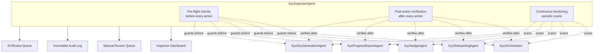
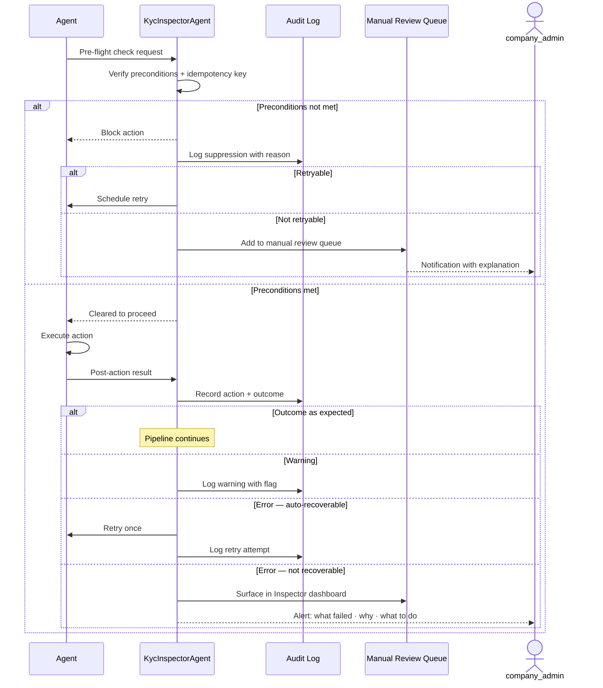
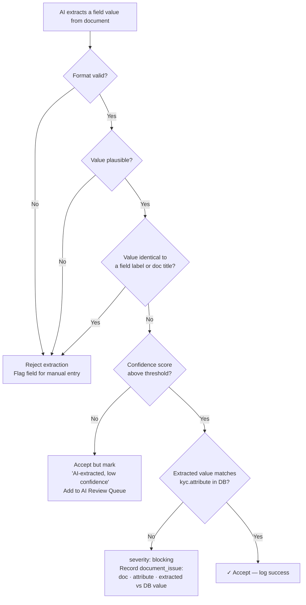
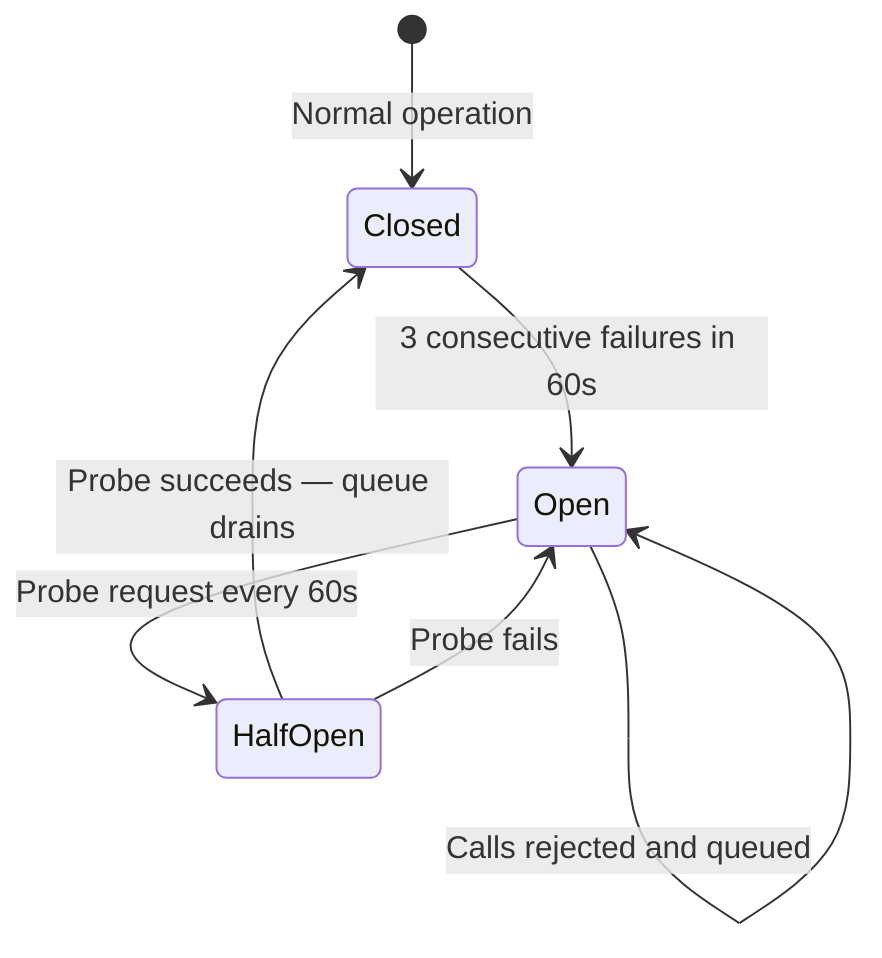
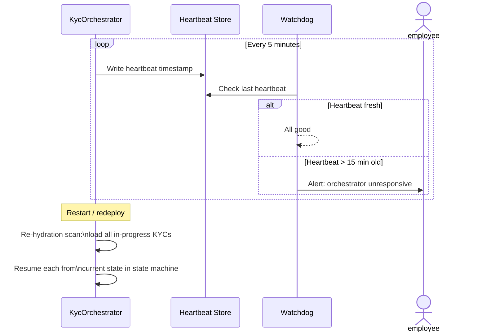

# KYC Inspector Agent & System Resilience

> This document is a companion to the [Autonomous KYC Onboarding PRD](autonomous_kyc_onboarding_prd.md). It covers the KycInspectorAgent in full, system resilience patterns, success metrics, and out-of-scope items.

---

## 1. The Inspector Agent (KycInspectorAgent)

Automation at scale fails in predictable ways: emails fire twice, AI extracts a field label instead of a value, an agent retries after a timeout and duplicates a record, a KYC silently stalls because a background job crashed without logging. The KycInspectorAgent is the system's internal auditor — it runs continuously alongside all other agents, checking their inputs, outputs, and side-effects, and surfacing anything that needs human attention before it becomes a problem.

The Inspector does not fix errors. It **detects, explains, and routes them** — either to an automated retry, to the review queue, or to a developer alert depending on severity.

> **Roles used in this document**
> | Role | App role | Who |
> |---|---|---|
> | `company_admin` | `:company_admin` | Full system access; can perform all KYC onboarding functions |
> | `employee` | `:employee` + `investor_kyc_onboarding` flag | Can perform all KYC onboarding functions — equivalent to `company_admin` within this feature |
> | `investor` | `:investor` | Submits their own KYC; receives nudges; uses the Q&A agent |
>
> Within this feature, `company_admin` and `employee` (with `investor_kyc_onboarding` flag) are equivalent — either can handle AML review, Issues screen, verification sign-off, and all escalation digests. Where this document says "company_admin" or "employee" in an onboarding context, either role applies. The only distinction is that `company_admin` has broader system-wide access outside of onboarding.

### Architecture



> **Key Takeaways**
> - Three operating modes: pre-flight (before every action), post-action (after every action), continuous monitoring (periodic scans).
> - Four output channels: Inspector Dashboard, Manual Review Queue, Immutable Audit Log, AI Review Queue.
> - The Inspector has no coupling to agent internals — it receives check requests and action results; it does not inspect agent state directly.

### Action Flow



> **Key Takeaways**
> - The Inspector is in the critical path of every agent action — both before and after. No agent action runs outside Inspector oversight.
> - "Cleared to proceed" from pre-flight does not guarantee success — post-action may still catch a bad outcome.
> - Every event is logged regardless of outcome — suppressed actions and retries both appear in the audit log with their reason.
> - Retries are scheduled by the Inspector, not by the agent — the agent does not retry itself.

---

### Checklist by Agent

#### KycOrchestrator

| Check | What to look for | Action on failure |
|---|---|---|
| Duplicate orchestration | Has this KYC been picked up by two concurrent runs? | Kill the duplicate; log the collision |
| Stuck in transition | Has a KYC been in the same in-progress state for > 2 hours? | Alert employee; surface in manual review queue |
| Phase regression | Has a KYC moved backwards (e.g. Phase 2 back to Phase 1)? | Flag as anomaly; block further automation until reviewed |
| Wrong form type assigned | Does the KYC's form type tag match the fund's configured regime? | Flag for company_admin correction; do not send invitation until resolved |

> **Key Takeaways**
> - Phase regression (state moving backwards) blocks all further automation and never auto-resolves — it always requires a human to review.
> - Wrong form type blocks the invitation — the investor is never contacted until the configuration is corrected.

---

#### KycNudgeAgent

Sending an email to the wrong investor, or the same email twice, is the most visible failure mode.

| Check | What to look for | Action on failure |
|---|---|---|
| Duplicate send prevention | Was this email type already sent to this investor for this KYC within the last 24 hours? | Block send; log suppression reason |
| State freshness | Has the investor already taken the action that triggered this nudge? | Cancel nudge; it is no longer relevant |
| Valid recipient address | Is the email address present and valid? | Block send; surface as data error in manual queue |
| Bounce tracking | Did a previously sent email hard-bounce? | Block all future sends to this address; surface in EOD digest for manual contact |

> **Infrastructure note — bounce detection:** The app currently sends email via **AWS SES**. SES delivers bounce and complaint notifications via SNS → webhook, but there is no existing webhook handler in the app. Bounce detection for the nudge agent requires building: (1) an SNS subscription endpoint that receives SES bounce/complaint events, (2) a bounce record store keyed on the recipient email address, and (3) a pre-send check in the nudge agent that blocks sends to any address with a recorded hard bounce. Until this is built, the "Bounce tracking" check above cannot be enforced automatically — bounces will be invisible to the system and operators will need to detect them manually.
| Opt-out check | Has the investor unsubscribed? | Block all automated sends; surface case as "manual contact required" in EOD digest |
| Invitation link expiry | Has the investor's onboarding link expired (default: 30 days)? | Issue a fresh link automatically; send a re-invitation nudge; log link refresh |
| Placeholder resolution | Are all `{variables}` in the template resolvable? | Block send; surface template error |
| Cadence integrity | Has timing drift occurred across retries? | Recalculate from original trigger timestamp, not retry timestamp |
| Escalation threshold | Was the GP CC threshold crossed but GP not actually copied? | Retry escalation send; alert if retry fails |
| EOD digest delivery | Did the EOD digest send successfully (delivery receipt within 10 min)? | Retry up to 3x; if all fail, surface on Inspector dashboard as critical error |
| Digest recipient validity | Are all employee recipients still active CapHive users with fund access? | Remove inactive members; if list becomes empty, alert a company_admin directly |

> **Key Takeaways**
> - The 24-hour duplicate window prevents the most common failure mode: a Sidekiq retry sending the same email twice to the same investor.
> - State freshness check prevents the race condition where an investor acts right before a nudge fires — the nudge is cancelled, not sent to someone who already acted.
> - Cadence timing is always recalculated from the original trigger timestamp, not the retry timestamp. Without this, retries compound and nudges arrive progressively later.
> - EOD digest failure (3 retries exhausted) surfaces as a critical error on the dashboard — it is never silently dropped.

---

#### KycOnboardingAgent

This is the highest-risk agent for silent errors. AI extraction produces plausible-looking wrong answers; verification APIs return soft errors that look like successes.

**AI Extraction Checks**



**Field-to-document consistency** (`check_field_to_document_consistency`): For each document attached to the KYC, the agent uses the LLM to extract the field values defined in the FormType's `doc_extraction` custom fields. Each extracted value is then compared against the corresponding attribute on the `InvestorKyc` record in the DB:

- **String fields**: case-insensitive, whitespace-normalised (e.g. extracted PAN `ABCDE1234F` vs `kyc.PAN`)
- **Date fields**: parsed and compared as dates (handles format variations in scanned documents)
- **Numeric fields**: compared as decimals

A mismatch produces a `severity: :blocking` `document_issue` with the document name, attribute name, extracted value, and DB value — surfaced to the onboarding user for resolution. A fully matching document logs `severity: :success`. An LLM parse failure on the document logs `severity: :warning` and surfaces for review without blocking.

**Verification API Checks — PAN and Bank**

> **Implementation:** Reuse existing jobs — do not duplicate verification logic.
> - **PAN:** Call `investor_kyc.validate_pan_card` (defined in `InvestorKycConcern`) — this enqueues `VerifyPanJob`, which is already used by the existing save flow (`InvestorKycAction#validate_pan_card`). The job is guarded by `pan_verification_enabled?` (reads `entity.entity_setting.pan_verification`) and checks PAN number, name, and DOB match against the API response.
> - **Bank:** Call `investor_kyc.validate_bank` (defined in `InvestorKycConcern`) — enqueues `VerifyBankJob`, also used by the existing save flow. Guarded by `bank_verification_enabled?` (reads `entity.entity_setting.bank_verification`). Uses fuzzy name match with a score threshold of 50.
> - Both methods are idempotent — they skip re-verification if the relevant field hasn't changed and a response already exists. No backward-compatibility changes needed.

| Check | What to look for | Action on failure |
|---|---|---|
| API timeout / 5xx | Did the API return an error rather than a result? | Retry once after 5 min; if retry fails, mark "API error" and surface in onboarding queue |
| Soft pass detection | Did verification pass with a low match score or caveats? | Flag as "pass with caveats"; show raw response to onboarding user rather than auto-advancing |
| Result persistence | Was the result written before the job completed? | On restart, re-read record before re-running — never run verification twice if result exists |
| Timestamp integrity | Is the verification timestamp plausible? | Flag as data integrity error |

**KRA Enrichment Checks**

> **Implementation:** Reuse `CkycKraService` — do not duplicate KRA logic.
> - Use `CkycKraService#fetch_kra_data(investor_kyc, create: true)` to find or create a `KycData` record (keyed on `PAN + birth_date`, `source: :kra`).
> - Use `CkycKraService#get_kra_data(kra_data)` to call the KRA API (`KycVerify#get_kra_pan_response`) and check for "KYC details have been successfully verified" in the response.
> - `InvestorKyc#kra_data` returns the last matching KRA record (`kyc_datas.kra.where(PAN: self.PAN).last`) — use this to check whether enrichment has already been applied before triggering.
> - No changes needed to `CkycKraService`; call it from the agent without modification.

| Check | What to look for | Action on failure |
|---|---|---|
| Already enriched | Does `investor_kyc.kra_data` already have `status: "Success"`? | Skip fetch; do not re-assign |
| Field ownership | Is the system about to overwrite a field the investor explicitly filled? | Only fill genuinely empty fields; never overwrite investor-entered data |
| Implausible enrichment | Does the KRA name differ from the on-file name by more than the fuzzy threshold? | Do not auto-assign; surface discrepancy for manual review |

**AML Checks**

> **Implementation:** Reuse `InvestorKyc#generate_aml_report(user_id)` — do not duplicate AML logic.
> - `generate_aml_report` enqueues `GenerateAmlReportJob` on the `serial` queue (concurrency 1, `retry: 0`). This is the same job used by the existing manual AML flow and handles rate limiting (random jitter up to `DELAY_SECONDS`, reschedules on "Rate limit reached"), multiple AML reports per KYC (`additional_aml_report_attributes` custom field), and error broadcasting.
> - The agent should call `generate_aml_report(system_user_id)` passing a designated system user rather than a human user id, so error emails go to the right place.
> - Backward compatible: the job signature (`investor_kyc_id, user_id`) is unchanged; no modifications needed.

| Check | What to look for | Action on failure |
|---|---|---|
| AML API availability | Is the AML API reachable before calling? | Apply circuit breaker — queue call; retry when circuit closes |
| AML prerequisites met | Are PAN + name + DOB all present before triggering AML? | Defer check; re-trigger automatically when all three become available |
| AML flag unreviewed | Has an AML-flagged case not been reviewed within 48h? | Surface in next EOD digest with "AML unreviewed" label |
| AML flag stale | Was the AML check run > 30 days ago and the case is still open? | Re-run AML silently; flag if result changes |
| Double AML run | Does an `AmlReport` with a `request_id` already exist for this KYC? | Block re-run; use stored result unless explicitly overridden |

> **Key Takeaways**
> - AI extraction passes a four-step filter: format valid → value is plausible → not a field label → confidence above threshold. Failing any step rejects or flags the extraction.
> - Field-to-document consistency compares extracted document values against the KYC record in the DB (`kyc.attribute`), not against other documents. Which fields to check is driven by `doc_extraction` custom fields on the FormType — configurable per fund and per form type.
> - A mismatch (e.g. PAN card shows `ABCDE1234F` but `kyc.PAN` is `XYZPQ9876K`) is `severity: :blocking` — the case cannot advance until resolved by the onboarding user.
> - A soft pass (verification API returns "pass with caveats") is not the same as a clean pass — it is flagged and shown to the onboarding user rather than auto-advancing the case.
> - KRA never overwrites: it fills only genuinely empty fields. Investor-entered data is always preserved regardless of what KRA returns.
> - AML prerequisites (PAN + name + DOB) are checked before the AML call is made. If they are not all present, the check is deferred and re-triggered automatically — the Inspector manages this, not the agent.

---

#### KycQnAAgent

The Q&A agent is investor-facing — a hallucinated answer about status, missing fields, or process is immediately visible and damages trust.

| Check | What to look for | Action on failure |
|---|---|---|
| Source grounding | Is the answer grounded in the investor's actual KYC record, not a general inference? | Reject ungrounded answers; respond with "I don't have enough information — please contact your fund admin" |
| Status currency | Is the KYC record being read at query time, not from a cached snapshot? | Always read live record before answering status questions |
| Scope boundary | Is the question about a field or process outside this system's knowledge? | Acknowledge the boundary explicitly; do not guess |
| PII leakage | Does the answer contain another investor's data or fields not belonging to the querying investor? | Block response; log as critical security error |
| Investor vs. GP context | Is a GP-level question (e.g. "how many investors are verified?") being answered to an investor session? | Block; route to company_admin view |
| Confidence floor | Is the answer confidence below the minimum threshold for an investor-facing response? | Respond with "I'm not certain — please check with your fund admin" rather than a low-confidence answer |

> **Key Takeaways**
> - PII leakage is treated as a critical security error — the response is blocked and dev is alerted immediately, not surfaced in the EOD digest.
> - The confidence floor exists to prevent the failure mode where a plausible-sounding but uncertain answer misleads the investor. Uncertainty is expressed explicitly, not suppressed.
> - Investor vs. GP context is enforced at the session level — an investor asking a fund-wide question is blocked and routed, not answered.
> - Source grounding is non-negotiable: every answer must trace to the investor's actual KYC record or the fund's onboarding documentation. General inference is rejected.

---

#### KycProgressReportAgent

| Check | What to look for | Action on failure |
|---|---|---|
| Count consistency | Do summary counts match a direct count of KYC records at report generation time? | Recompute from source records; log discrepancy |
| Duplicate report prevention | Has a report already been sent for this fund in this reporting period? | Suppress duplicate; log suppression |
| Stale data | Was report generated > 15 min after the data snapshot it is based on? | Regenerate from a fresh snapshot before sending |
| Escalation accuracy | Are "blocked" KYCs in the report still actually blocked? | Re-check each listed KYC at send time; remove resolved cases |
| Recipient validation | Are all digest recipients still active CapHive users with fund access? | Remove inactive recipients; alert a company_admin |

> **Key Takeaways**
> - Reports are re-validated at send time, not just at generation time — a KYC that resolved in the window between generation and send is removed from the blocked list before the digest goes out.
> - Stale data threshold is 15 minutes: if the underlying snapshot is older than that at send time, the report regenerates from a fresh snapshot.
> - Duplicate prevention is period-based — one report per fund per reporting period, not per generation attempt.

---

#### KycDocGenerationAgent

> **KycDocGenerationAgent is optional.** It is enabled per fund via configuration and defaults to off. The checks below apply only when doc generation is enabled; funds with it disabled skip this agent entirely and proceed directly from `ReadyToClose` to the verification queue.

> **Implementation:** Reuse the existing doc generation stack — do not duplicate it.
> - **Generator:** `KycDocGenerator` (includes `DocumentGeneratorBase`). It uses the **Sablon gem** to render a Word template (.docx) against a context hash, then **soffice (LibreOffice)** to convert the rendered .docx to an accessible PDF. Entry point for async runs: `KycDocGenJob`.
> - **Placeholder check (pre-generation):** `DocumentGeneratorBase#extract_merge_fields(template_path)` parses the Word template's DOCX XML and returns all `MERGEFIELD` names the template expects. Call this before rendering and diff against `context.keys` — any field name present in the template but absent from the context will be unresolved.
> - **Placeholder check (post-generation):** Run `extract_merge_fields(output_docx_path)` on the rendered `.docx`. Sablon removes MERGEFIELDs it successfully substitutes; any that remain in the output file were unresolved. Collect and surface these by name before e-sign send.
> - **Duplicate doc prevention:** `DocumentGeneratorBase#upload` already destroys existing documents with the same name (`where(name: ...).where.not(owner_tag: "signed").find_each(&:destroy)`) before saving the new one. No additional logic needed.
> - Backward compatible: `KycDocGenerator`, `KycDocGenJob`, and `DocumentGeneratorBase` are unchanged — the agent calls them as-is.

| Check | What to look for | Action on failure |
|---|---|---|
| Pre-generation completeness | Are all required KYC fields populated? | Block generation; surface missing fields to onboarding user |
| Placeholder resolution (pre-generation) | Does `extract_merge_fields(template)` return fields not present in the context? | Block generation; surface the list of unresolved field names |
| Placeholder resolution (post-generation) | Does `extract_merge_fields(output_docx)` still return any MERGEFIELDs? | Block e-sign send; alert onboarding user with the list |
| Duplicate doc prevention | Does a generated (non-signed) doc with the same name already exist for this KYC? | Handled automatically by `upload` — existing doc is replaced; only signed docs are preserved |
| E-sign acknowledgement | *(E-signing enabled only)* Did the e-sign platform acknowledge receipt within 60 seconds? | Retry once; if unacknowledged, surface in onboarding queue |

> **Key Takeaways**
> - Generation uses the existing `KycDocGenerator` / `DocumentGeneratorBase` stack (Sablon + soffice). No new doc generation code is needed.
> - Placeholder resolution is a two-step check: before rendering (compare template field names against context keys) and after rendering (verify no MERGEFIELDs remain in the output .docx). Both steps use the existing `extract_merge_fields` method.
> - Duplicate doc replacement is already handled by `upload` — it destroys non-signed documents with the same name before saving the new one.
> - The e-sign acknowledgement window is 60 seconds — if the provider does not confirm receipt in that window, it is treated as a send failure and retried once.

---

### Inspector Dashboard

```
┌─────────────────────────────────────────────────────────────┐
│  KYC Inspector — Fund III  ·  Updated 2 min ago             │
│                                                             │
│  🔴 Errors requiring action             3                   │
│     › Email bounced: R. Sharma                              │
│     › Doc generation failed (blank section): A. Patel       │
│     › PAN API timeout — retry #2 pending: S. Mehta          │
│                                                             │
│  🟡 Warnings (auto-handled, FYI)        7                   │
│     › 4 nudges suppressed (investor acted before send)      │
│     › 3 KRA extractions flagged low-confidence              │
│                                                             │
│  🟢 Last 24h clean actions             142                  │
│     Nudges sent: 31 · Checks run: 67 · Docs generated: 8   │
│                                                             │
│  [View full log]  [AI Review Queue (3)]  [Export report]   │
└─────────────────────────────────────────────────────────────┘
```

Every error entry links directly to the affected KYC record and shows what was attempted, what the Inspector detected, what was done automatically, and what the company_admin needs to do — in plain language. The Inspector log is immutable and timestamped throughout.

> **Key Takeaways**
> - Three severity tiers: Red (requires human action), Yellow (auto-handled, surfaced for awareness), Green (clean action count for the last 24h).
> - Every red entry is actionable in plain language — it tells the company_admin what failed, what the Inspector did automatically, and what still needs a decision.
> - The AI Review Queue surfaces low-confidence extractions for human spot-checking — separate from the manual review queue for errors.
> - The audit log is immutable — no entry can be edited or deleted after it is written.

---

### Inspector Metrics (Continuous)

| Metric | Why it matters |
|---|---|
| AI extraction rejection rate per field | A rising rate means document quality is degrading or extraction rules need updating |
| Nudge suppression rate | High suppression = cadence too aggressive; loosen timing |
| Email bounce rate per fund | A spike indicates a bad data batch was imported |
| Verification API error rate | Sustained errors indicate an API-level issue, not a data issue |
| Mean time stuck in Phase 2 | Increasing over time = nudge cadence not converting; investigate copy or timing |
| Manual intervention rate | Share of KYCs requiring human action beyond final sign-off; target < 30% |
| False-pass rate | Verifications that passed but were later corrected by a company_admin |

These metrics are included in the weekly GP digest and available on the Inspector dashboard at any time.

> **Key Takeaways**
> - Rising AI extraction rejection rate = document quality degrading or extraction rules need updating. Investigate the field with the highest rejection rate first.
> - High nudge suppression rate needs a reason breakdown — healthy suppression (investor acted first) looks the same as unhealthy suppression (bounce, bad address) in aggregate.
> - False-pass rate (verifications passed but later corrected by compliance) is the most important signal of systemic data quality issues in the pipeline.

---

> **Key Takeaways**
> - The Inspector does not fix errors. Scheduling a retry is routing — the Inspector has no idea why an API failed or what the right answer is. Fixing always requires the API to recover or a human to decide.
> - Pre-flight is a gate that runs before an action and can block it. Post-action is a receipt check that runs after and catches outcomes that appeared to succeed but didn't.
> - AI extraction checks include a guard for "value equals a field label" — LLMs on dense forms sometimes extract the label text (e.g. "Date of Birth") instead of the value next to it.
> - Nudge suppression is not always bad. "Investor acted before nudge fired" is healthy suppression — the system worked. "Email bounced" is unhealthy — it surfaces in the EOD digest. The ratio between the two tells you whether cadence is calibrated.
> - A stuck KYC is surfaced to the review queue, not auto-advanced. The Inspector does not know why it is stuck; a human or corrective company_admin action resolves it.
> - Field-to-document consistency compares each extracted document value against the live DB record (`kyc.attribute`). A mismatch is `severity: :blocking` and surfaces to the onboarding user with the document name, attribute, extracted value, and DB value side-by-side.

---

## 2. Agent Quality — What to Review and How

The Inspector catches runtime errors: a duplicate email, a stuck state, a failed API call. A separate question is **product quality**: did the agent do the right thing, not just the technically correct thing?

Most of KYC onboarding is procedural — state transitions, API calls, nudges. Failures in this layer are either hard errors (thrown exceptions, circuit breaker trips) or outcome degradation (completion rates fall, time-to-verified rises). Both self-surface without any sampling infrastructure.

The two agents that produce generative prose — `KycQnAAgent` and `KycProgressReportAgent` — are where quality can silently slip. These need a lightweight human review loop.

---

### Exception-First Review

**The Issues screen is already the review queue.** Instead of sampling random traces, review every escalated or failed KYC. The system self-selects what needs attention. An employee opens the Issues screen each morning and works the list.

This is better than random sampling for a low-to-medium volume workflow: failure cases are rarer than successes, so sampling is wasteful — you spend most of your time reading healthy traces to find the one that went wrong.

The weekly EOD digest surfaces aggregate exception counts. If a category is growing (nudge suppression rate rising, bank verification errors spiking), that is the signal to investigate — not a sampled trace.

> **Key Takeaways**
> - The Issues screen is the review queue — no additional tooling required. The system self-selects what needs attention.
> - A growing exception category in the EOD digest is the investigation trigger. Individual cases self-surface; categories tell you if there is a systemic problem.
> - Random sampling is inefficient at this volume: you read 100 healthy traces to find 1 bad one. Exception-first skips straight to the bad ones.

---

### Outcome Metrics

Track these at the fund level. A degrading trend is the leading indicator that something is wrong before individual failures accumulate.

| Metric | What it tells you |
|---|---|
| KYC completion rate | Are investors finishing, or dropping off? |
| Median time from creation to verified | Is the pipeline getting slower? |
| Dropout point distribution | Which state do stalled KYCs cluster in? (Indicates where the nudge cadence or the form is failing investors) |
| Nudge-to-action rate | What % of nudges result in investor action within 48h? Below 60% = adjust timing or copy |
| Manual intervention rate | What % of KYCs needed a human action beyond final sign-off? Target < 30% |
| AML unreviewed > 48h count | Compliance response time indicator |

These are shown on the Inspector dashboard and included in the weekly digest.

> **Key Takeaways**
> - Dropout point distribution is the most diagnostic metric — it shows which state is the bottleneck, not just that a bottleneck exists.
> - Nudge-to-action rate below 60% is the trigger to review email content and timing. Below that threshold the nudges are not converting; the issue is the message, not the data.
> - Manual intervention rate above 30% means the system is creating coordination work rather than eliminating it — investigate which failure types are driving manual actions.

---

### QnA and Progress Report: Thumbs Up / Down

These are the only agents where "technically correct but wrong" is a real failure mode.

**KycQnAAgent** — investor rates every answer with a thumbs up or down after receiving it. An employee reviews all thumbs-down responses weekly. Each reviewed response either:
- Gets a corrective prompt or assertion added (if the agent will hit this again)
- Gets a note in `internal_notes` on the KYC if it was a one-off investor misunderstanding

**KycProgressReportAgent** — a company_admin can flag a digest as misleading from the email itself ("This report missed X"). Flags appear in the Inspector dashboard alongside the report trace.

> **Key Takeaways**
> - Thumbs-down is a review trigger, not a running score. Each bad QnA response either becomes an assertion (if the pattern will recur) or an internal note (if it was a one-off).
> - Flagging a digest "from the email" is deliberate — it captures the feedback in the moment rather than requiring the company_admin to log in and find the report to comment on it.
> - These two channels (thumbs-down + digest flag) are the only human quality feedback loops in the system. Everything else is automated.

---

### From Observed Failure to Automated Assertion

When a thumbs-down or a flag reveals a repeatable pattern, convert it into a specific pre-send assertion. Keep this table in `config/kyc_eval_assertions.yml`.

| Observed failure | Assertion added |
|---|---|
| Nudge said "bank account unverified" but the blocker was the IFSC code — investor fixed the wrong thing | Before sending a bank-failure nudge: assert that the specific sub-field (account number / IFSC / name) is named in the body, not just "bank account" |
| QnA said "PAN is missing" when PAN had been submitted and was awaiting verification | Before answering a status question: read from the verification result table, not raw field presence |
| Progress digest showed "82% complete" but buried 8 long-stalled escalations | Weekly digest must call out any KYC in Escalated state > 14 days in a dedicated section |
| KRA enrichment overwrote the investor's own correct DOB entry | Enrichment only writes to genuinely null fields — never overwrites a present value |

Each assertion links to the failure instance that produced it so it can be retired if the behaviour changes.

---

> **Key Takeaways**
> - The Inspector checks structure; §2 checks substance. A nudge can pass every Inspector check and still tell the investor to fix their bank account when the actual blocker was their IFSC code — only a human reading the rendered email catches that.
> - Thumbs up/down applies only to QnA and ProgressReport because nudge quality degrades in outcome metrics (nudge-to-action rate), not in subjective ratings. You don't need a rating to detect a bad nudge cadence.
> - Inspector checks are written upfront from known invariants. Eval assertions are discovered from real production failures and added incrementally. Both live in code but for different reasons.
> - Retire an assertion when the behaviour it was written to catch no longer exists in the code. Assertions that can never fire become false confidence.

---

## 3. Resilience

The following design principles are baked into the system to ensure it remains correct and predictable under failures, retries, concurrent load, and edge cases.

---

### Idempotency Keys on All Agent Actions

Every action an agent takes carries a deterministic idempotency key. If the same action is attempted twice — due to a retry, a job restart, or a duplicate event — the second attempt is a no-op at the queue level. The Inspector is not the primary defence against duplicates; idempotency makes duplicates structurally impossible.

| Agent | Action | Idempotency key |
|---|---|---|
| KycNudgeAgent | Send email | `(kyc_id, email_type, trigger_event_id)` |
| KycOnboardingAgent | Run PAN verification | `(kyc_id, "pan_verify", pan_hash)` |
| KycOnboardingAgent | Run bank verification | `(kyc_id, "bank_verify", account_hash)` |
| KycOnboardingAgent | Assign KRA data | `(kyc_id, "kra_assign", kra_record_id)` |
| KycDocGenerationAgent | Generate agreement | `(kyc_id, template_id)` |
| KycDocGenerationAgent | Send e-sign request | `(kyc_id, document_id)` |
| KycOrchestrator | Create KYC record | `(investor_id, fund_id, form_type_id)` |

The key is computed before the action is taken and stored atomically with the action result. On retry, the system checks for an existing result under that key before executing.

> **Key Takeaways**
> - Idempotency is the primary defence against duplicates. The Inspector is a secondary signal — by the time Inspector runs a duplicate check, idempotency should have already prevented it.
> - Keys include content hashes (pan_hash, account_hash), not just record IDs. A field change that invalidates a previous result produces a new key, triggering a fresh run rather than reusing a stale one.
> - The key is written atomically with the result in the same DB transaction — a crash leaves either both present or neither, never a key without a result.

---

### Circuit Breakers for External APIs

When an external API (PAN verification, bank verification, KRA, AML) starts failing, the current retry-per-record approach floods the Inspector with identical errors and hammers a failing endpoint. Circuit breakers prevent both.



Each external API has its own circuit breaker. When the circuit opens:
- All pending verification calls for that API are queued, not retried individually
- The Inspector logs a single "circuit open" event, not one error per KYC
- When the circuit closes, the queue drains automatically in controlled batches
- No manual intervention required for normal API outages

> **Key Takeaways**
> - Three states: Closed (normal), Open (calls queued, no API requests), HalfOpen (one probe every 60s). The circuit never goes directly from Open to Closed.
> - One "circuit open" event per API per outage — not one error per affected KYC. An outage affecting 200 investors produces one entry, not 200.
> - Queue drains in controlled batches on recovery, not all at once — preventing a thundering herd that could re-open the circuit immediately.

---

### Orchestrator Heartbeat and Re-hydration

The orchestrator monitors all agents but nothing monitors the orchestrator itself. A silent crash stops all KYC advancement with no visible signal.



On restart, the orchestrator re-hydrates by reading the current state of all open KYC records and resumes from wherever each one left off. It does not re-run actions that already have a stored idempotency result.

> **Key Takeaways**
> - The heartbeat window is 5 minutes written / 15 minutes stale before alert. That gives three missed writes before the watchdog triggers.
> - Re-hydration works because all state is in the DB, not in memory. The orchestrator is stateless between runs — it derives its work queue from `onboarding_state` on every restart.
> - The orchestrator does not need to know what it was doing when it crashed. It reads current state and determines the next action from the state machine rules.

---

### Stale KYC Archival

A KYC that remains in Escalated state beyond the fund's maximum open window is no longer an active case — it is a zombie. Treating it as active distorts the progress dashboard, inflates "mean time in Phase 2" metrics, and causes company_admins to lose trust in the queue.

Once a KYC crosses the stale threshold:
- It moves to **Stale** state and is removed from all active dashboards and reports
- It is retained in full for audit purposes and remains searchable
- The company_admin receives a one-time notification per stale case explaining why it was archived
- Re-activation is a deliberate company_admin action ("Resume onboarding"), not automatic
- The stale threshold is configurable per fund (default: maximum open window + 15 days)

This keeps the active dashboard meaningful — every case shown is genuinely actionable.

> **Key Takeaways**
> - Stale is not a failure state — it is a deliberate archive. The KYC is fully retained in the DB and auditable; it is just removed from active dashboards and queues.
> - Re-activation requires a deliberate company_admin action. The system never auto-resumes a stale case, even if the investor later submits data.
> - The stale threshold is fund-configurable (default: maximum open window + 15 days). Adjust it based on how long your company_admin team can realistically work escalated cases.

---

> **Key Takeaways**
> - The idempotency key is computed and written before the action executes so that a crash at any point leaves either both the key and the result written, or neither — preventing duplicate execution on retry.
> - Circuit breakers are per-API, not per-record. When an API is down, all calls queue silently and one probe fires every 60 seconds. The Inspector logs one "circuit open" event, not one error per KYC.
> - Re-hydration on orchestrator restart reads `onboarding_state` from the DB for all active KYCs and resumes from wherever each left off. Idempotency keys ensure nothing already done is repeated.
> - Escalated = blocked but actively being worked. Stale = past the maximum open window with no resolution — removed from active dashboards but fully retained in the DB. Re-activation is a deliberate human action.
> - The watchdog is a Sidekiq cron job, not a process — Sidekiq's own supervision handles its continuity. Known gap: if Sidekiq and the orchestrator crash simultaneously, the watchdog fires on recovery and alerts.

---

## 4. Failure Mode Reference

A consolidated view of what can go wrong across every phase, how it is detected, and whether it resolves autonomously or requires human intervention. **Auto** = system handles without human involvement. **HITL** = surfaces to a human with context and options.

### Setup Wizard

| Failure | Detection | Resolution | Owner |
|---|---|---|---|
| Uploaded file is corrupt or empty | Step 2 format validation | Show error; prompt re-upload | HITL — company_admin / employee |
| KYC Type or Form Tag column has unrecognised values | Step 2 validation | Surface invalid values and allowed options; block import until corrected | HITL — company_admin / employee |
| Import partially completes (crash mid-run) | On restart, re-read import progress; idempotency prevents duplicates | Resume from last committed row | Auto |
| Placeholder FormType creation fails | System error logged in Step 2 | Abort import; surface error; allow retry | Auto retry → HITL |
| Two onboarding users editing the wizard concurrently | Session lock per fund on wizard | Second session sees "wizard in use by [name]"; read-only until lock releases | Auto (lock) |
| AML alert recipient assigned in Step 6 is no longer active | Pre-launch check at Step 7 | Block launch; prompt reassignment | HITL — company_admin / employee |
| Raw import data fails to resolve into custom fields for some records | Post-FormType-save check | Surface affected records; allow inline correction | HITL — company_admin / employee |

> **Key Takeaways**
> - Most wizard failures are HITL — they require an onboarding user (company_admin or employee with the flag) to correct data or configuration. There is no automated recovery from a malformed spreadsheet.
> - The concurrent editing lock is automatic and non-disruptive — the second session sees a "wizard in use" notice, not an error page.
> - AML alert recipient validity is checked at Step 7 (launch gate), not Step 6 — giving the onboarding user time to verify the assignment before hitting the final confirmation.

---

### Phase 1 — Per-Investor Setup

| Failure | Detection | Resolution | Owner |
|---|---|---|---|
| AML API down at creation time | Circuit breaker | Defer AML; send invitation immediately; re-run AML when circuit closes | Auto |
| Invitation email bounces on first send | Bounce tracking in NudgeAgent | Block all future sends; surface in EOD digest as "bad address" | Auto detect → HITL — company_admin / employee |
| Investor's onboarding link has expired | Link validation on click | Show "link expired" page; auto-issue fresh link; trigger re-invitation nudge | Auto |
| AML flags investor but compliance never reviews | Inspector time-based scan: unreviewed AML flags > 48h | Surface in EOD digest; escalate directly after 7 days | HITL — company_admin / employee |
| AML flag cleared by compliance | Onboarding user marks as reviewed: cleared | State machine transitions back to InvitationSent (pre-submission) or ChecksRunning (post-submission) | Auto (state transition) |
| AML flag confirmed by compliance — investor should not proceed | Onboarding user marks as reviewed: do not proceed | Transition to Stale; archive with reason | HITL → Auto (archive) |

> **Key Takeaways**
> - AML API down at creation is Auto — the invitation still goes out immediately; only the AML check is deferred. The investor is not blocked by an infrastructure outage.
> - Expired invitation links auto-renew — the investor is never stranded on a broken link. A re-invitation nudge is sent automatically with the fresh link.
> - Both AML clearance transitions (InvitationSent and ChecksRunning) are state machine operations driven by the onboarding user's decision (company_admin or employee with flag). The system executes whichever path the decision maps to.

---

### Phase 2 — Nudges and Monitoring

| Failure | Detection | Resolution | Owner |
|---|---|---|---|
| PAN / Bank / KRA / AML API hard down | Circuit breaker | Queue all pending calls; drain in batches when circuit closes | Auto |
| PAN verification passes but data is later found fraudulent | Onboarding user flags post-sign-off | Revert verification result; return case to ChecksFailed; surface in queue | HITL — company_admin / employee |
| Investor updates a field after a check already passed | Field change detection on verified fields | Re-trigger affected checks automatically | Auto |
| Investor opts out of all emails | Unsubscribe link click | Suppress all nudges permanently; surface case in EOD digest as "manual contact required" | Auto suppress → HITL — company_admin / employee |
| Nudge sent to investor who has already completed the action (race condition) | State freshness check pre-send | Cancel nudge; log suppression | Auto |
| EOD digest fails to send | Delivery receipt check within 10 min | Retry up to 3x; if all fail, surface on Inspector dashboard as critical | Auto retry → HITL — dev alert |
| All configured recipients inactive at digest send time | Recipient validation | Fall back to escalation CC list; alert a company_admin directly if CC list also empty | Auto fallback → HITL |
| Nudge timing drifts due to retry using wrong timestamp | Cadence integrity check | Recalculate from original trigger timestamp | Auto |
| KycQnAAgent answers with incorrect investor status | Confidence scoring + live record read | Low-confidence answers blocked; investor directed to fund admin | Auto block |
| KycQnAAgent leaks another investor's data | PII scope check pre-response | Block response; log as critical security error; alert dev | Auto block → dev alert |

> **Key Takeaways**
> - A field change that invalidates a previously passed check re-triggers that check automatically. Investors cannot lock in a passing result by modifying data after the fact.
> - PII leakage is the most severe Phase 2 failure — it triggers both an immediate block and a dev alert. It is never routed through the EOD digest.
> - If all configured onboarding recipients are inactive when the digest is due, the system falls back to the escalation CC list. If that is also empty, a company_admin is alerted directly.

---

### Phase 3 — Close

> Doc generation failures (first four rows) apply only when KycDocGenerationAgent is enabled. Funds with doc generation disabled go directly from `ReadyToClose` to the verification queue; only the sign-off rows apply to them.

| Failure | Detection | Resolution | Owner |
|---|---|---|---|
| KYC agreement template not configured for this fund/segment | Pre-generation pre-flight check | Block doc generation; surface in Inspector dashboard | HITL — company_admin / employee |
| Generated document contains unresolved placeholders or blank sections | Post-generation check | Block e-sign send; surface to onboarding user with field list | HITL — company_admin / employee |
| E-sign provider unresponsive | Acknowledgement check within 60s | Retry once; surface in onboarding queue | Auto retry → HITL |
| Investor data changes after document generated (pre-sign-off) | Change detection on core fields | Void existing document; regenerate; re-send e-sign if enabled; notify onboarding team | Auto |
| Onboarding user accidentally signs off wrong KYC | Confirmation modal pre-sign-off + 1h reversal window | Show confirmation; allow reversal within 1h; lock after that | HITL — company_admin / employee |
| Sign-off recorded but downstream state not updated (crash post-write) | Post-action verification on state transition | On restart, re-hydrate and re-apply state; idempotency prevents double-verification | Auto |

> **Key Takeaways**
> - Template not configured is caught by pre-flight before generation starts. The document is never partially generated.
> - Blank sections and unresolved placeholders are caught post-generation, before the e-sign send. The document exists in the DB for manual inspection even though the send is blocked.
> - Sign-off crash recovery is automatic via re-hydration and idempotency — the state is re-applied cleanly without double-verification.

---

### Cross-Cutting

| Failure | Detection | Resolution | Owner |
|---|---|---|---|
| Orchestrator crashes silently | Heartbeat watchdog (> 15 min stale) | Alert onboarding team; auto-restart; re-hydrate all in-progress KYCs | Auto recover → HITL alert |
| Agent produces duplicate actions (retry race) | Idempotency key check before execution | Second attempt is a no-op; logged | Auto |
| KYC state regresses (moves backward in state machine) | Phase regression scan in Inspector | Block further automation; surface for manual review | HITL |
| Onboarding user re-imports a spreadsheet after onboarding is live | Re-import detection (fund + segment already active) | Surface warning with impact preview; require explicit confirmation | HITL — company_admin / employee |
| Audit log integrity compromised | Immutable log store with hash chaining | Developer alert; incident raised | Dev |

---

> **Key Takeaways**
> - "Auto → HITL" in the Owner column means the system tries an automated recovery first; if that fails or isn't possible, the case escalates to a human via the Issues screen or EOD digest.
> - Pure "Auto" (no HITL) is only used where the resolution is deterministic and judgment-free — nudge suppressed because investor already acted; import resumes from last committed row. HITL on these would flood the queue with non-decisions.
> - Not everything goes through the EOD digest. Critical failures (PII leak, audit log compromise, orchestrator crash) trigger immediate alerts regardless of time of day.
> - AML flag resolution has two paths — InvitationSent or ChecksRunning — chosen by the company_admin's "cleared" decision. The state machine enforces which transition is valid; there is no system judgment here.
> - Document voiding and regeneration after a data change is safe to automate because the original document has no legal standing until signed, and the employee still performs the final sign-off on the new document.

---

## 5. Success Metrics

| Metric | Target (v1) |
|---|---|
| Time to complete fund setup wizard | Under 60 minutes for up to 300 investors and 3 investor segments |
| Data import error rate | < 5% of rows require manual correction post-wizard |
| Median time from KYC creation to verified KYC | Reduced by 50% vs. current manual process |
| Percentage of KYCs closed without manual admin coordination | ≥ 70% of standard (non-AML-flagged) cases |
| Investor nudge-to-action rate | ≥ 60% of nudges result in investor action within 48 hours |
| GP escalations as a share of total onboardings | ≤ 15% |
| employee time per KYC sign-off | < 5 minutes for queue-ready cases |

> **Key Takeaways**
> - The 50% reduction in median time-to-verified is the headline metric — the clearest signal that automation is working end-to-end.
> - 70% of KYCs closing without manual coordination is the autonomy target. Below that means the system is creating as much work as it saves.
> - employee sign-off under 5 minutes validates the queue-ready design. If sign-offs are consistently taking longer, cases are entering the verification queue before checks have fully completed.

---

## 6. Out of Scope / Future Phases

- Automated final compliance verification (sign-off remains human in v1).
- CKYC integration.
- Multi-jurisdiction regulatory regimes beyond SEBI, GIFT City, and Default.
- Bulk re-onboarding for KYC renewals (expired KYC refresh).
- Integration with external fund administrator systems.
- Re-running the setup wizard to modify an existing fund's form configuration after launch (schema changes post-launch are handled through the standard FormType admin UI).

> **Key Takeaways**
> - Final compliance sign-off is out of scope for automation in v1 by deliberate design — it is a trust boundary, not a gap to close later.
> - Wizard re-configuration after launch is handled through the existing FormType admin UI. Re-running the wizard on a live fund is not supported and would require explicit future design.
> - CKYC, multi-jurisdiction, and bulk renewal are deferred — not because they are unimportant, but because v1 must prove the core loop works first.
