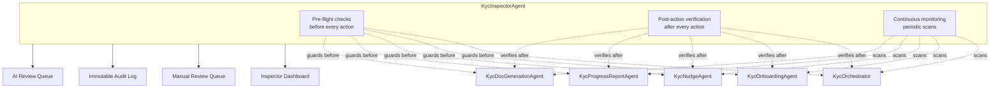
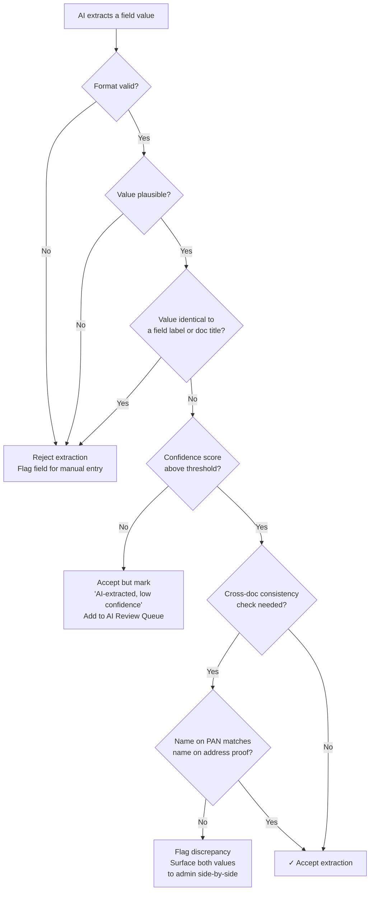
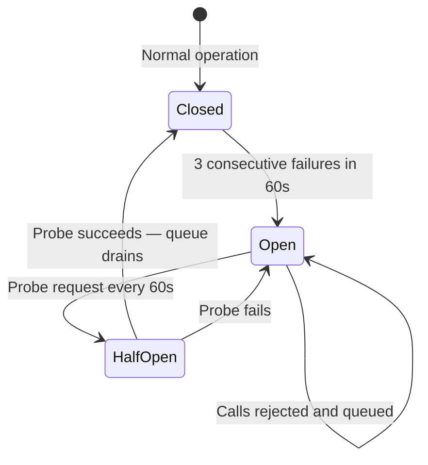

# KYC Inspector Agent & System Resilience

> This document is a companion to the [Autonomous KYC Onboarding PRD](autonomous_kyc_onboarding_prd.md). It covers the KycInspectorAgent in full, system resilience patterns, success metrics, and out-of-scope items.

---

## 1. The Inspector Agent (KycInspectorAgent)

Automation at scale fails in predictable ways: emails fire twice, AI extracts a field label instead of a value, an agent retries after a timeout and duplicates a record, a KYC silently stalls because a background job crashed without logging. The KycInspectorAgent is the system's internal auditor — it runs continuously alongside all other agents, checking their inputs, outputs, and side-effects, and surfacing anything that needs human attention before it becomes a problem.

The Inspector does not fix errors. It **detects, explains, and routes them** — either to an automated retry, to the GP/compliance queue, or to a developer alert depending on severity.

### Architecture



### Action Flow


---

### Checklist by Agent

#### KycOrchestrator

| Check | What to look for | Action on failure |
|---|---|---|
| Duplicate orchestration | Has this KYC been picked up by two concurrent runs? | Kill the duplicate; log the collision |
| Stuck in transition | Has a KYC been in the same in-progress state for > 2 hours? | Alert ops; surface in manual review queue |
| Phase regression | Has a KYC moved backwards (e.g. Phase 2 back to Phase 1)? | Flag as anomaly; block further automation until reviewed |
| Commitment without KYC | Is there a commitment recorded > 1 hour ago with no KYC created? (KYCs may also exist without a commitment — this check applies only where commitments are linked) | Alert ops; attempt re-trigger once |
| Wrong form type assigned | Does the KYC's form type tag match the fund's configured regime? | Flag for admin correction; do not send invitation until resolved |

---

#### KycNudgeAgent

Sending an email to the wrong investor, or the same email twice, is the most visible failure mode.

| Check | What to look for | Action on failure |
|---|---|---|
| Duplicate send prevention | Was this email type already sent to this investor for this KYC within the last 24 hours? | Block send; log suppression reason |
| State freshness | Has the investor already taken the action that triggered this nudge? | Cancel nudge; it is no longer relevant |
| Valid recipient address | Is the email address present and valid? | Block send; surface as data error in manual queue |
| Bounce tracking | Did a previously sent email hard-bounce? | Block all future sends to this address; surface in EOD digest for manual contact |
| Opt-out check | Has the investor unsubscribed? | Block all automated sends; surface case as "manual contact required" in EOD digest |
| Invitation link expiry | Has the investor's onboarding link expired (default: 30 days)? | Issue a fresh link automatically; send a re-invitation nudge; log link refresh |
| Placeholder resolution | Are all `{variables}` in the template resolvable? | Block send; surface template error |
| Cadence integrity | Has timing drift occurred across retries? | Recalculate from original trigger timestamp, not retry timestamp |
| Escalation threshold | Was the GP CC threshold crossed but GP not actually copied? | Retry escalation send; alert if retry fails |
| EOD digest delivery | Did the EOD digest send successfully (delivery receipt within 10 min)? | Retry up to 3x; if all fail, surface on Inspector dashboard as critical error |
| Digest recipient validity | Are all onboarding team members still active CapHive users with fund access? | Remove inactive members; if list becomes empty, alert the GP directly |

---

#### KycOnboardingAgent

This is the highest-risk agent for silent errors. AI extraction produces plausible-looking wrong answers; verification APIs return soft errors that look like successes.

**AI Extraction Checks**



**Verification API Checks**

| Check | What to look for | Action on failure |
|---|---|---|
| API timeout / 5xx | Did the API return an error rather than a result? | Retry once after 5 min; if retry fails, mark "API error" and surface in ops queue |
| Soft pass detection | Did verification pass with a low match score or caveats? | Flag as "pass with caveats"; show raw response to compliance rather than auto-advancing |
| Result persistence | Was the result written before the job completed? | On restart, re-read record before re-running — never run verification twice if result exists |
| Timestamp integrity | Is the verification timestamp plausible? | Flag as data integrity error |

**KRA Enrichment Checks**

| Check | What to look for | Action on failure |
|---|---|---|
| Already enriched | Has KRA data already been assigned to this KYC? | Block re-assignment; do not overwrite without explicit admin instruction |
| Field ownership | Is the system about to overwrite a field the investor explicitly filled? | Only fill genuinely empty fields; never overwrite investor-entered data |
| Implausible enrichment | Does the KRA name differ from the on-file name by more than the fuzzy threshold? | Do not auto-assign; surface discrepancy for manual review |

**AML Checks**

| Check | What to look for | Action on failure |
|---|---|---|
| AML API availability | Is the AML API reachable before calling? | Apply circuit breaker — queue call; retry when circuit closes |
| AML prerequisites met | Are PAN + name + DOB all present before triggering AML? | Defer check; re-trigger automatically when all three become available |
| AML flag unreviewed | Has an AML-flagged case not been reviewed within 48h? | Surface in next EOD digest with "AML unreviewed" label |
| AML flag stale | Was the AML check run > 30 days ago and the case is still open? | Re-run AML silently; flag if result changes |
| Double AML run | Has AML already been run and a result stored for this KYC? | Block re-run; use stored result unless explicitly overridden by compliance |

---

#### KycQnAAgent

The Q&A agent is investor-facing — a hallucinated answer about status, missing fields, or process is immediately visible and damages trust.

| Check | What to look for | Action on failure |
|---|---|---|
| Source grounding | Is the answer grounded in the investor's actual KYC record, not a general inference? | Reject ungrounded answers; respond with "I don't have enough information — please contact your fund manager" |
| Status currency | Is the KYC record being read at query time, not from a cached snapshot? | Always read live record before answering status questions |
| Scope boundary | Is the question about a field or process outside this system's knowledge? | Acknowledge the boundary explicitly; do not guess |
| PII leakage | Does the answer contain another investor's data or fields not belonging to the querying investor? | Block response; log as critical security error |
| Investor vs. GP context | Is a GP-level question (e.g. "how many investors are verified?") being answered to an investor session? | Block; route to GP portal |
| Confidence floor | Is the answer confidence below the minimum threshold for an investor-facing response? | Respond with "I'm not certain — please check with your onboarding team" rather than a low-confidence answer |

---

#### KycProgressReportAgent

| Check | What to look for | Action on failure |
|---|---|---|
| Count consistency | Do summary counts match a direct count of KYC records at report generation time? | Recompute from source records; log discrepancy |
| Duplicate report prevention | Has a report already been sent for this fund in this reporting period? | Suppress duplicate; log suppression |
| Stale data | Was report generated > 15 min after the data snapshot it is based on? | Regenerate from a fresh snapshot before sending |
| Escalation accuracy | Are "blocked" KYCs in the report still actually blocked? | Re-check each listed KYC at send time; remove resolved cases |
| Recipient validation | Are all digest recipients still active CapHive users with fund access? | Remove inactive recipients; alert the GP |

---

#### KycDocGenerationAgent

| Check | What to look for | Action on failure |
|---|---|---|
| Pre-generation completeness | Are all required KYC fields populated? | Block generation; surface missing fields to admin |
| Placeholder resolution | Does the generated document contain unresolved `{{placeholders}}`? | Block e-sign send; alert ops with the list |
| Blank section detection | Does any section render empty when it should have content? | Block e-sign send; flag for manual review |
| Duplicate doc prevention | Does a generated doc already exist for this KYC? | Block re-generation; surface existing doc for review |
| E-sign acknowledgement | *(E-signing enabled only)* Did the e-sign platform acknowledge receipt within 60 seconds? | Retry once; if unacknowledged, surface in ops queue |

---

### Inspector Dashboard

```
┌─────────────────────────────────────────────────────────────┐
│  KYC Inspector — Fund III  ·  Updated 2 min ago             │
│                                                             │
│  🔴 Errors requiring action             3                   │
│     › Email bounced: R. Sharma                              │
│     › Doc generation failed (blank section): A. Patel       │
│     › PAN API timeout — retry #2 pending: S. Mehta          │
│                                                             │
│  🟡 Warnings (auto-handled, FYI)        7                   │
│     › 4 nudges suppressed (investor acted before send)      │
│     › 3 KRA extractions flagged low-confidence              │
│                                                             │
│  🟢 Last 24h clean actions             142                  │
│     Nudges sent: 31 · Checks run: 67 · Docs generated: 8   │
│                                                             │
│  [View full log]  [AI Review Queue (3)]  [Export report]   │
└─────────────────────────────────────────────────────────────┘
```

Every error entry links directly to the affected KYC record and shows what was attempted, what the Inspector detected, what was done automatically, and what the admin needs to do — in plain language. The Inspector log is immutable and timestamped throughout.

---

### Inspector Metrics (Continuous)

| Metric | Why it matters |
|---|---|
| AI extraction rejection rate per field | A rising rate means document quality is degrading or extraction rules need updating |
| Nudge suppression rate | High suppression = cadence too aggressive; loosen timing |
| Email bounce rate per fund | A spike indicates a bad data batch was imported |
| Verification API error rate | Sustained errors indicate an API-level issue, not a data issue |
| Mean time stuck in Phase 2 | Increasing over time = nudge cadence not converting; investigate copy or timing |
| Manual intervention rate | Share of KYCs requiring human action beyond final sign-off; target < 30% |
| False-pass rate | Verifications that passed but were later corrected by the compliance officer |

These metrics are included in the weekly GP digest and available on the Inspector dashboard at any time.

---

## 2. Resilience

The following design principles are baked into the system to ensure it remains correct and predictable under failures, retries, concurrent load, and edge cases.

---

### Idempotency Keys on All Agent Actions

Every action an agent takes carries a deterministic idempotency key. If the same action is attempted twice — due to a retry, a job restart, or a duplicate event — the second attempt is a no-op at the queue level. The Inspector is not the primary defence against duplicates; idempotency makes duplicates structurally impossible.

| Agent | Action | Idempotency key |
|---|---|---|
| KycNudgeAgent | Send email | `(kyc_id, email_type, trigger_event_id)` |
| KycOnboardingAgent | Run PAN verification | `(kyc_id, "pan_verify", pan_hash)` |
| KycOnboardingAgent | Run bank verification | `(kyc_id, "bank_verify", account_hash)` |
| KycOnboardingAgent | Assign KRA data | `(kyc_id, "kra_assign", kra_record_id)` |
| KycDocGenerationAgent | Generate agreement | `(kyc_id, template_id)` |
| KycDocGenerationAgent | Send e-sign request | `(kyc_id, document_id)` |
| KycOrchestrator | Create KYC record | `(investor_id, fund_id, form_type_id)` |

The key is computed before the action is taken and stored atomically with the action result. On retry, the system checks for an existing result under that key before executing.

---

### Circuit Breakers for External APIs

When an external API (PAN verification, bank verification, KRA, AML) starts failing, the current retry-per-record approach floods the Inspector with identical errors and hammers a failing endpoint. Circuit breakers prevent both.



Each external API has its own circuit breaker. When the circuit opens:
- All pending verification calls for that API are queued, not retried individually
- The Inspector logs a single "circuit open" event, not one error per KYC
- When the circuit closes, the queue drains automatically in controlled batches
- No manual intervention required for normal API outages

---

### Orchestrator Heartbeat and Re-hydration

The orchestrator monitors all agents but nothing monitors the orchestrator itself. A silent crash stops all KYC advancement with no visible signal.


On restart, the orchestrator re-hydrates by reading the current state of all open KYC records and resumes from wherever each one left off. It does not re-run actions that already have a stored idempotency result.

---

### Stale KYC Archival

A KYC that remains in Escalated state beyond the fund's maximum open window is no longer an active case — it is a zombie. Treating it as active distorts the progress dashboard, inflates "mean time in Phase 2" metrics, and causes compliance officers to lose trust in the queue.

Once a KYC crosses the stale threshold:
- It moves to **Stale** state and is removed from all active dashboards and reports
- It is retained in full for audit purposes and remains searchable
- The GP receives a one-time notification per stale case explaining why it was archived
- Re-activation is a deliberate GP action ("Resume onboarding"), not automatic
- The stale threshold is configurable per fund (default: maximum open window + 15 days)

This keeps the active dashboard meaningful — every case shown is genuinely actionable.

---

## 3. Failure Mode Reference

A consolidated view of what can go wrong across every phase, how it is detected, and whether it resolves autonomously or requires human intervention. **Auto** = system handles without human involvement. **HITL** = surfaces to a human with context and options.

### Setup Wizard

| Failure | Detection | Resolution | Owner |
|---|---|---|---|
| Uploaded file is corrupt or empty | Step 2 format validation | Show error; prompt re-upload | HITL — fund manager |
| KYC Type or Form Tag column has unrecognised values | Step 2 validation | Surface invalid values and allowed options; block import until corrected | HITL — fund manager |
| Import partially completes (crash mid-run) | On restart, re-read import progress; idempotency prevents duplicates | Resume from last committed row | Auto |
| Placeholder FormType creation fails | System error logged in Step 2 | Abort import; surface error; allow retry | Auto retry → HITL |
| Two admins editing the wizard concurrently | Session lock per fund on wizard | Second session sees "wizard in use by [name]"; read-only until lock releases | Auto (lock) |
| Compliance officer assigned in Step 6 is no longer active | Pre-launch check at Step 7 | Block launch; prompt reassignment | HITL — fund manager |
| Raw import data fails to resolve into custom fields for some records | Post-FormType-save check | Surface affected records; allow inline correction | HITL — fund manager |

---

### Phase 1 — Per-Investor Setup

| Failure | Detection | Resolution | Owner |
|---|---|---|---|
| AML API down at creation time | Circuit breaker | Defer AML; send invitation immediately; re-run AML when circuit closes | Auto |
| Invitation email bounces on first send | Bounce tracking in NudgeAgent | Block all future sends; surface in EOD digest as "bad address" | Auto detect → HITL — onboarding team |
| Investor's onboarding link has expired | Link validation on click | Show "link expired" page; auto-issue fresh link; trigger re-invitation nudge | Auto |
| AML flags investor but compliance never reviews | Inspector time-based scan: unreviewed AML flags > 48h | Surface in EOD digest; escalate directly after 7 days | HITL — compliance officer |
| AML flag cleared by compliance | Compliance officer marks as reviewed: cleared | State machine transitions back to InvitationSent (pre-submission) or ChecksRunning (post-submission) | Auto (state transition) |
| AML flag confirmed by compliance — investor should not proceed | Compliance officer marks as reviewed: do not proceed | Transition to Stale; archive with reason | HITL → Auto (archive) |

---

### Phase 2 — Nudges and Monitoring

| Failure | Detection | Resolution | Owner |
|---|---|---|---|
| PAN / Bank / KRA / AML API hard down | Circuit breaker | Queue all pending calls; drain in batches when circuit closes | Auto |
| PAN verification passes but data is later found fraudulent | Compliance officer flags post-sign-off | Revert verification result; return case to ChecksFailed; surface in queue | HITL — compliance officer |
| Investor updates a field after a check already passed | Field change detection on verified fields | Re-trigger affected checks automatically | Auto |
| Investor opts out of all emails | Unsubscribe link click | Suppress all nudges permanently; surface case in EOD digest as "manual contact required" | Auto suppress → HITL — onboarding team |
| Nudge sent to investor who has already completed the action (race condition) | State freshness check pre-send | Cancel nudge; log suppression | Auto |
| EOD digest fails to send | Delivery receipt check within 10 min | Retry up to 3x; if all fail, surface on Inspector dashboard as critical | Auto retry → HITL — dev alert |
| All onboarding team members inactive at digest send time | Recipient validation | Fall back to escalation CC list; alert GP | Auto fallback → HITL |
| Nudge timing drifts due to retry using wrong timestamp | Cadence integrity check | Recalculate from original trigger timestamp | Auto |
| KycQnAAgent answers with incorrect investor status | Confidence scoring + live record read | Low-confidence answers blocked; investor directed to onboarding team | Auto block |
| KycQnAAgent leaks another investor's data | PII scope check pre-response | Block response; log as critical security error; alert dev | Auto block → dev alert |

---

### Phase 3 — Close

| Failure | Detection | Resolution | Owner |
|---|---|---|---|
| KYC agreement template not configured for this fund/segment | Pre-generation pre-flight check | Block doc generation; surface in Inspector dashboard | HITL — ops |
| Generated document contains unresolved placeholders or blank sections | Post-generation check | Block e-sign send; surface to ops with field list | HITL — ops |
| E-sign provider unresponsive | Acknowledgement check within 60s | Retry once; surface in ops queue | Auto retry → HITL |
| Investor data changes after document generated (pre-sign-off) | Change detection on core fields | Void existing document; regenerate; re-send e-sign if enabled; notify compliance officer | Auto |
| Compliance officer accidentally signs off wrong KYC | Confirmation modal pre-sign-off + 1h reversal window | Show confirmation; allow reversal within 1h; lock after that | HITL — compliance officer |
| Both compliance officer and deputy inactive > 48h | Dual inactivity scan | Alert onboarding team lead in EOD digest: "verification queue stalled" | HITL — onboarding team |
| Compliance sign-off recorded but downstream state not updated (crash post-write) | Post-action verification on state transition | On restart, re-hydrate and re-apply state; idempotency prevents double-verification | Auto |

---

### Cross-Cutting

| Failure | Detection | Resolution | Owner |
|---|---|---|---|
| Orchestrator crashes silently | Heartbeat watchdog (> 15 min stale) | Alert ops; auto-restart; re-hydrate all in-progress KYCs | Auto recover → HITL alert |
| Agent produces duplicate actions (retry race) | Idempotency key check before execution | Second attempt is a no-op; logged | Auto |
| KYC state regresses (moves backward in state machine) | Phase regression scan in Inspector | Block further automation; surface for manual review | HITL |
| Fund manager re-imports a spreadsheet after onboarding is live | Re-import detection (fund + segment already active) | Surface warning with impact preview; require explicit confirmation | HITL — fund manager |
| Audit log integrity compromised | Immutable log store with hash chaining | Developer alert; incident raised | Dev |

---

## 4. Success Metrics

| Metric | Target (v1) |
|---|---|
| Time to complete fund setup wizard | Under 60 minutes for up to 300 investors and 3 investor segments |
| Data import error rate | < 5% of rows require manual correction post-wizard |
| Median time from KYC creation to verified KYC | Reduced by 50% vs. current manual process |
| Percentage of KYCs closed without manual admin coordination | ≥ 70% of standard (non-AML-flagged) cases |
| Investor nudge-to-action rate | ≥ 60% of nudges result in investor action within 48 hours |
| GP escalations as a share of total onboardings | ≤ 15% |
| Compliance officer time per KYC sign-off | < 5 minutes for queue-ready cases |

---

## 4. Out of Scope / Future Phases

- Automated final compliance verification (sign-off remains human in v1).
- CKYC integration.
- Multi-jurisdiction regulatory regimes beyond SEBI, GIFT City, and Default.
- Bulk re-onboarding for KYC renewals (expired KYC refresh).
- Integration with external fund administrator systems.
- Re-running the setup wizard to modify an existing fund's form configuration after launch (schema changes post-launch are handled through the standard FormType admin UI).
