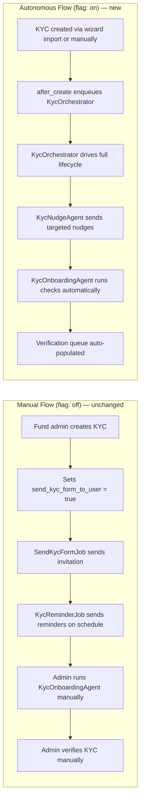
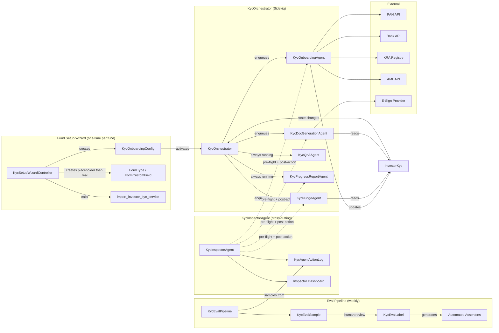
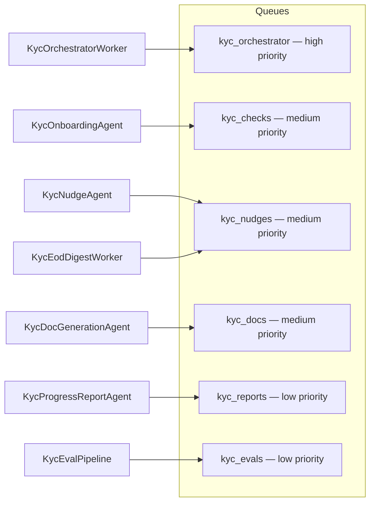

# High Level Design: Autonomous KYC Onboarding

> **Companion documents:**
> - [PRD](autonomous_kyc_onboarding_prd.md) — business requirements, user flows, state machine
> - [Inspector Agent & Resilience](autonomous_kyc_inspector_agent.md) — Inspector, Evals, Resilience, Failure Mode Reference

---

## 1. Backward Compatibility & Feature Flag

### The Core Constraint

Autonomous KYC onboarding is **opt-in per entity**. Tenants who do not enable it continue using the existing manual flow — existing screens, existing jobs, existing `submission_status` enum, existing `send_kyc_form_to_user` flag — with zero changes. Nothing in the existing flow is modified.

### The Flag

A single boolean added to `entity_settings`:

```ruby
# db/migrate/YYYYMMDD_add_autonomous_kyc_onboarding_to_entity_settings.rb
add_column :entity_settings, :autonomous_kyc_onboarding, :boolean, default: false, null: false
```

```ruby
# app/packs/core/entities/models/entity_setting.rb
def autonomous_kyc_onboarding?
  autonomous_kyc_onboarding == true
end
```

Follows the exact same pattern as the existing `aml_enabled`, `pan_verification`, `bank_verification`, and `ckyc_kra_enabled` flags already on `EntitySetting`. Added to the admin entity settings dashboard and the entity settings form.

### What the Flag Gates

Every entry point into the autonomous pipeline checks this flag. If the entity does not have it enabled, execution stops immediately and the manual flow continues unchanged.

| Component | Gate check location | Behaviour when flag is off |
|---|---|---|
| `KycOrchestratorWorker` | First line of `perform` | Early return — no orchestration |
| `InvestorKyc` `after_create` callback | Before enqueuing orchestrator | Does not enqueue — manual flow unchanged |
| `KycNudgeAgent` | `initialize_agent` step | Raises `FeatureDisabledError` — job exits |
| `KycReminderJob` (existing) | Added guard at top | Runs normally if flag off; skips if flag on (to prevent double-nudging) |
| Setup Wizard controller | `before_action` | 404 if flag off |
| Inspector dashboard | `before_action` policy | 404 if flag off |
| `KycQnAAgent` endpoint | Policy check | 404 if flag off |
| Eval pipeline cron jobs | Check flag per entity | Skip entity if flag off |

### The Two Flows Side by Side



### Switching the Flag On Mid-Operation

An entity switching from manual to autonomous while KYCs are already in progress is supported but requires care:

- Existing KYC records with `submission_status` of `link_sent`, `draft_saved`, `completed` are **not** automatically enrolled into the orchestrator. They remain in manual mode until either: (a) the fund manager explicitly re-enrolls them via a "Re-enqueue for autonomous processing" bulk action, or (b) a new event occurs on the record (e.g. investor submits) which triggers the `after_save` callback, which now enqueues the orchestrator.
- The `onboarding_state` column defaults to `nil` for all existing records. The orchestrator sets it on first touch. A `nil` `onboarding_state` on an autonomous-entity KYC means "not yet picked up by orchestrator" — treated as `created`.
- `KycReminderJob` and `SendKycFormJob` remain in Sidekiq's queue even after the flag is turned on. Any already-queued jobs for existing KYCs will execute and then the guard check in each job prevents future scheduling for that entity.

---

## 2. Scope & Existing Foundation

### What Already Exists

The design builds on — not around — the existing KYC stack:

| Existing component | Where | Role in new system |
|---|---|---|
| `InvestorKyc` model | `core/investor_kycs/models/investor_kyc.rb` | Central record; extended with `onboarding_state` |
| `SupportAgentService < Trailblazer::Operation` | `ai/support_agents/services/` | Base class for all new agents |
| `KycOnboardingAgent` | `ai/support_agents/services/kyc_onboarding_agent.rb` | Extended with AML, deferred checks, circuit breaker awareness |
| `SendKycFormJob` | `core/investor_kycs/jobs/send_kyc_form_job.rb` | Reused for invitation send |
| `KycReminderJob` | `core/investor_kycs/jobs/kyc_reminder_job.rb` | Unchanged for manual-flow entities; guard added to skip if `autonomous_kyc_onboarding?` is on, preventing double-nudging |
| `KycDocGenJob` / `KycDocGenerationAgent` | `core/investor_kycs/jobs/` | Wrapped by new close phase |
| `KycVerify` | `core/investor_kycs/services/kyc_verify.rb` | PAN and bank verification; wrapped by `KycOnboardingAgent` |
| `CkycKraService` | `core/investor_kycs/services/ckyc_kra_service.rb` | KRA enrichment; wrapped by `KycOnboardingAgent` |
| `import_investor_kyc_service.rb` | `core/investor_kycs/services/` | Reused by Setup Wizard Step 2 |
| `FormType` / `FormCustomField` | `misc/form_custom_fields/` | Placeholder and real FormTypes |
| `AmlReport` | existing table | AML results stored here |
| `SupportAgent` | `ai/support_agents/models/support_agent.rb` | Per-agent config record |
| Sidekiq | infrastructure | All background jobs |
| `Noticed` gem | infrastructure | In-app notifications |

### What Is Net-New

- `KycOrchestrator` — new Sidekiq worker + state coordinator
- `KycNudgeAgent` — new agent (replaces ad-hoc reminders)
- `KycProgressReportAgent` — new agent
- `KycQnAAgent` — new agent
- `KycInspectorAgent` — new agent (cross-cuts all others)
- `KycEvalPipeline` — new eval infrastructure
- Six new database tables (see §4)
- Two new columns on `investor_kycs`
- Fund Setup Wizard — new Rails wizard controller + Stimulus frontend

---

## 2. System Architecture



---

## 3. KYC State Machine

### New `onboarding_state` Column

The existing `submission_status` enum (`not_sent → link_sent → draft_saved → completed → verified`) is **kept as-is** for backward compatibility. A new `onboarding_state` string column is added to `investor_kycs` to track the autonomous pipeline state independently.

```ruby
# db/migrate/YYYYMMDD_add_onboarding_state_to_investor_kycs.rb
#
# Nullable with no default — existing records and manual-flow entities
# never have this column populated. A nil value means "not enrolled in
# autonomous pipeline". The orchestrator sets it to "created" on first touch.
add_column :investor_kycs, :onboarding_state, :string, default: nil
add_column :investor_kycs, :onboarding_state_updated_at, :datetime
add_column :investor_kycs, :aml_deferred, :boolean, default: false, null: false
add_column :investor_kycs, :opted_out_at, :datetime
add_index  :investor_kycs, :onboarding_state
```

### State Transitions (AASM)

```ruby
# app/packs/core/investor_kycs/concerns/investor_kyc_concern.rb (extend)
#
# AASM is only engaged for autonomous-flow entities. For manual-flow
# entities onboarding_state stays nil and AASM transitions are never called.
include AASM

aasm column: :onboarding_state, no_direct_assignment: true do
  state :created, initial: true
  state :aml_flagged
  state :invitation_sent
  state :submitted
  state :checks_running
  state :checks_failed
  state :docs_required
  state :ready_to_close
  state :doc_generated
  state :awaiting_esig
  state :verification_queue
  state :verified
  state :escalated
  state :stale

  event :flag_aml         do transitions from: [:created, :checks_running], to: :aml_flagged end
  event :send_invitation  do transitions from: [:created, :aml_flagged],     to: :invitation_sent end
  event :investor_submits do transitions from: :invitation_sent,              to: :submitted end
  event :start_checks     do transitions from: :submitted,                    to: :checks_running end
  event :fail_checks      do transitions from: :checks_running,               to: :checks_failed end
  event :resolve_checks   do transitions from: :checks_failed,                to: :checks_running end
  event :require_docs     do transitions from: :checks_running,               to: :docs_required end
  event :docs_complete    do transitions from: :docs_required,                to: :ready_to_close end
  event :checks_complete  do transitions from: :checks_running,               to: :ready_to_close end
  event :generate_doc     do transitions from: :ready_to_close,               to: :doc_generated end
  event :request_esig     do transitions from: :doc_generated,                to: :awaiting_esig end
  event :esig_complete    do transitions from: :awaiting_esig,                to: :verification_queue end
  event :skip_esig        do transitions from: :doc_generated,                to: :verification_queue end
  event :verify           do transitions from: :verification_queue,           to: :verified end
  event :escalate         do transitions from: [:checks_failed, :docs_required, :invitation_sent], to: :escalated end
  event :go_stale         do transitions from: [:escalated, :aml_flagged],   to: :stale end
  event :clear_aml_pre    do transitions from: :aml_flagged,                  to: :invitation_sent end
  event :clear_aml_post   do transitions from: :aml_flagged,                  to: :checks_running end
end
```

Every AASM transition fires an `after_transition` callback that:
1. Records a `KycAgentActionLog` entry (idempotency + audit)
2. Enqueues the appropriate `KycOrchestrator` job for the new state

---

## 4. New Database Tables

### 4.1 `kyc_onboarding_configs`

Stores the output of the Setup Wizard. One record per entity (fund entity).

```ruby
create_table :kyc_onboarding_configs do |t|
  t.bigint   :entity_id,                null: false
  t.bigint   :compliance_officer_id               # User
  t.bigint   :deputy_compliance_officer_id         # User, optional
  t.date     :onboarding_deadline
  t.integer  :max_open_window_days,     default: 30
  t.boolean  :esigning_enabled,         default: false
  t.json     :onboarding_team_user_ids             # array of User ids
  t.text     :escalation_cc_emails                 # comma-separated external emails
  t.string   :launch_mode,             default: "all_at_once"  # all_at_once | pilot_first
  t.json     :pilot_investor_ids                   # array, populated if launch_mode=pilot_first
  t.string   :status,                  default: "draft"        # draft | active | paused
  t.datetime :launched_at
  t.timestamps
  t.index :entity_id, unique: true
end
```

### 4.2 `kyc_email_journey_steps`

Each row is one configurable email in the fund's onboarding journey.

```ruby
create_table :kyc_email_journey_steps do |t|
  t.bigint  :kyc_onboarding_config_id, null: false
  t.string  :step_key,                 null: false  # invitation | nudge_not_started | nudge_correction | ...
  t.string  :trigger_event                          # on_creation | on_state | on_schedule
  t.string  :trigger_state                          # invitation_sent | checks_failed | ...
  t.integer :trigger_delay_days,       default: 0
  t.string  :subject,                  null: false
  t.text    :body,                     null: false
  t.string  :sender_name
  t.boolean :enabled,                  default: true
  t.integer :position,                 null: false   # display order
  t.timestamps
  t.index [:kyc_onboarding_config_id, :step_key], unique: true
end
```

### 4.3 `kyc_agent_action_logs`

Idempotency store and immutable audit trail. Written before and after every agent action.

```ruby
create_table :kyc_agent_action_logs do |t|
  t.bigint  :investor_kyc_id,   null: false
  t.bigint  :entity_id,         null: false
  t.string  :agent,             null: false   # KycOnboardingAgent | KycNudgeAgent | ...
  t.string  :action,            null: false   # pan_verify | send_nudge | generate_doc | ...
  t.string  :idempotency_key,   null: false   # deterministic composite key
  t.string  :status,            null: false   # pending | success | failure | suppressed | retrying
  t.json    :input_snapshot                   # state and inputs before action
  t.json    :output_snapshot                  # result, API response, decisions
  t.json    :flags_raised                     # Inspector-raised flags on this action
  t.string  :failure_reason
  t.integer :retry_count,       default: 0
  t.datetime :executed_at
  t.timestamps
  t.index [:investor_kyc_id, :agent, :action]
  t.index :idempotency_key, unique: true
  t.index [:entity_id, :status]
end
```

### 4.4 Internal Notes — ActionText

No new table. Internal notes are stored via Rails ActionText, using the existing `action_text_rich_texts` polymorphic table already in the schema.

```ruby
# app/packs/core/investor_kycs/models/investor_kyc.rb
has_rich_text :internal_notes
```

That is the entire implementation. ActionText handles storage, retrieval, and rich text editing via the existing Trix editor. The note is a single rich-text field on the KYC record — the onboarding team edits it in place on the KYC detail view, the same way notes are already handled on `Approval`, `InvestorNotice`, and `Deal` models in this codebase.

Access control is enforced at the view and policy layer — the `internal_notes` field is never exposed to investor-facing views or the `KycQnAAgent`.

### 4.5 `kyc_eval_traces`

Full execution trace per agent action, written to support the Evals Pipeline.

```ruby
create_table :kyc_eval_traces do |t|
  t.bigint  :kyc_agent_action_log_id, null: false   # links to action log
  t.bigint  :investor_kyc_id,         null: false
  t.string  :agent,                   null: false
  t.string  :action,                  null: false
  t.json    :full_trace,              null: false    # trigger, inputs, tool_calls, reasoning, output
  t.string  :onboarding_state_in
  t.string  :onboarding_state_out
  t.integer :duration_ms
  t.float   :confidence_score
  t.boolean :sampled,                 default: false
  t.boolean :anomaly_flagged,         default: false
  t.timestamps
  t.index [:agent, :sampled]
  t.index :investor_kyc_id
end
```

### 4.6 `kyc_eval_labels`

Dictator review labels written against sampled traces.

```ruby
create_table :kyc_eval_labels do |t|
  t.bigint  :kyc_eval_trace_id,  null: false
  t.bigint  :reviewer_id,        null: false   # User (the Benevolent Dictator)
  t.string  :verdict,            null: false   # pass | product_failure | technical_failure
  t.text    :critique                          # free-text Dictator notes
  t.string  :failure_mode                      # short slug: misdirected_nudge | stale_status | ...
  t.boolean :assertion_written,  default: false  # has this critique been turned into an automated check?
  t.string  :assertion_ref                       # reference to the automated check
  t.timestamps
  t.index :kyc_eval_trace_id
  t.index [:reviewer_id, :verdict]
end
```

---

## 5. Agent Design

All agents inherit from `SupportAgentService < Trailblazer::Operation`. Each agent has a `SupportAgent` record in the DB (existing table) for config, LLM model selection, and feature flags.

Every agent's `initialize_agent` step — the first step in every operation — checks the flag before doing anything:

```ruby
def initialize_agent(ctx, target:, **)
  super
  investor_kyc = target
  unless investor_kyc.entity.entity_setting.autonomous_kyc_onboarding?
    ctx[:skip_reason] = :feature_disabled
    return false  # Trailblazer treats false as failure — operation exits cleanly
  end
  # ... rest of initialization
end
```

For `KycReminderJob` (existing manual-flow job), a symmetric guard is added at the top:

```ruby
# app/packs/core/investor_kycs/jobs/kyc_reminder_job.rb
def perform(investor_kyc_id)
  kyc = InvestorKyc.find(investor_kyc_id)
  return if kyc.entity.entity_setting.autonomous_kyc_onboarding?  # NudgeAgent handles this
  # ... existing implementation unchanged
end
```

### 5.1 KycOrchestrator

Not a `SupportAgentService` — it is a Sidekiq worker that coordinates state transitions and dispatches work to other agents.

```ruby
# app/packs/core/investor_kycs/workers/kyc_orchestrator_worker.rb
class KycOrchestratorWorker
  include Sidekiq::Worker
  sidekiq_options queue: :kyc_orchestrator, retry: 3

  def perform(investor_kyc_id, trigger_event)
    kyc = InvestorKyc.find(investor_kyc_id)
    KycOrchestrator.new(kyc).handle(trigger_event)
  end
end

class KycOrchestrator
  TRIGGER_TO_HANDLER = {
    "kyc_created"        => :on_created,
    "form_submitted"     => :on_submitted,
    "checks_complete"    => :on_checks_complete,
    "docs_uploaded"      => :on_docs_uploaded,
    "nudge_exhausted"    => :on_nudge_exhausted,
    "aml_cleared"        => :on_aml_cleared,
    "compliance_sign_off"=> :on_verified,
    "heartbeat"          => :on_heartbeat,
  }.freeze
  # ...dispatches to per-state handler methods
end
```

**Re-hydration on restart:** A separate `KycOrchestratorHeartbeatWorker` writes a timestamp to Redis every 5 minutes. A watchdog checks staleness and alerts. On redeploy, `KycOrchestrator.rehydrate_all!` scans all non-terminal KYC states and re-enqueues their current trigger.

### 5.2 KycOnboardingAgent

Extends the existing agent with new steps and circuit breaker awareness.

```ruby
class KycOnboardingAgent < SupportAgentService
  step :initialize_agent
  step :check_aml_prerequisites        # NEW — run AML if PAN+name+DOB present, else defer
  step :check_field_completeness       # existing
  step :check_document_presence        # existing
  step :check_document_validity        # existing
  step :check_field_to_document_consistency # existing
  step :run_pan_verification           # wraps KycVerify; circuit-breaker aware
  step :run_bank_verification          # wraps KycVerify; circuit-breaker aware
  step :run_kra_enrichment             # wraps CkycKraService; circuit-breaker aware
  step :evaluate_overall_status        # NEW — determine next state
  step :write_action_log               # NEW — idempotency + audit
end
```

**Circuit breaker** for each external API is stored in Redis (`kyc:circuit:<api_name>:state`). The check runs before the API call; a failed probe updates Redis state.

**Idempotency key format:**
- PAN verify: `kyc_onboarding_agent:pan_verify:#{kyc_id}:#{pan_hash}`
- Bank verify: `kyc_onboarding_agent:bank_verify:#{kyc_id}:#{account_hash}`
- KRA enrich: `kyc_onboarding_agent:kra_assign:#{kyc_id}:#{kra_record_id}`

### 5.3 KycNudgeAgent

New agent. Replaces `KycReminderJob` for the autonomous pipeline.

```ruby
class KycNudgeAgent < SupportAgentService
  step :initialize_agent
  step :check_opt_out              # block if investor opted out
  step :check_state_freshness      # cancel if investor already acted
  step :check_duplicate_send       # idempotency: same email type in last 24h?
  step :check_recipient_validity   # valid email? not bounced?
  step :check_invitation_link      # refresh expired link if needed
  step :resolve_template           # render body + subject with real data
  step :send_email                 # ActionMailer via deliver_later
  step :write_action_log
end
```

**EOD Digest job** (`KycEodDigestWorker`) runs at 18:00 entity-local time, collects all KYCs in `escalated`, `checks_failed`, or `docs_required` states that haven't progressed in the last 24h, and sends a single batched email to the configured onboarding team + CC list.

### 5.4 KycProgressReportAgent

Generates the live fund-level progress report and weekly digest.

```ruby
class KycProgressReportAgent < SupportAgentService
  step :initialize_agent
  step :check_duplicate_report      # suppress if already sent this period
  step :build_snapshot              # read all KYC states fresh
  step :validate_counts             # assert snapshot counts match DB direct count
  step :generate_report_html        # render report
  step :check_recipient_validity
  step :deliver_report
  step :write_action_log
end
```

### 5.5 KycQnAAgent

Answers plain-language questions from investors and GPs. Stateless per query; reads live KYC record at query time.

```ruby
class KycQnAAgent < SupportAgentService
  step :initialize_agent
  step :classify_session            # investor | gp | onboarding_team
  step :load_live_kyc_snapshot      # always fresh — never cached
  step :check_pii_scope             # ensure investor only sees their own KYC
  step :retrieve_context            # RAG over fund rules + regulatory docs
  step :generate_answer             # LLM call with grounded context
  step :validate_answer             # confidence check + source citation check
  step :enforce_boundary            # downgrade to "contact team" if below confidence floor
  step :write_action_log            # logs trace for eval pipeline
end
```

The `KycQnAAgent` is invoked synchronously via a Turbo Stream endpoint — it is the only agent that runs in the request cycle (with a 15s timeout and fallback response).

### 5.6 KycDocGenerationAgent

Thin wrapper over existing `KycDocGenerationAgent` / `KycDocGenJob`.

```ruby
class KycDocGenerationAgent < SupportAgentService
  step :initialize_agent
  step :pre_flight_completeness     # all required fields populated?
  step :check_duplicate_doc         # existing doc for this KYC+template?
  step :generate_document           # calls existing KycDocGenerator service
  step :validate_document           # placeholder resolution + blank section check
  step :route_to_esign_or_queue     # based on KycOnboardingConfig.esigning_enabled
  step :write_action_log
end
```

### 5.7 KycInspectorAgent

Runs as a cross-cutting concern, not a pipeline. Implemented as a module mixed into every agent's step callbacks.

```ruby
module KycInspectorAgent
  module Callbacks
    def self.pre_flight(agent_class, action, ctx)
      key = IdempotencyKey.compute(agent_class, action, ctx)
      existing = KycAgentActionLog.find_by(idempotency_key: key)
      return { blocked: true, reason: :duplicate, existing: } if existing&.success?

      checks = KycInspectorAgent::Checks.for(agent_class, action)
      result = checks.run(ctx)
      return { blocked: true, reason: result.failure_reason } if result.failed?

      { blocked: false, idempotency_key: key }
    end

    def self.post_action(agent_class, action, ctx, result)
      KycAgentActionLog.create!(
        investor_kyc_id: ctx[:investor_kyc_id],
        agent: agent_class.name,
        action:,
        idempotency_key: ctx[:idempotency_key],
        status: result.success? ? "success" : "failure",
        input_snapshot: ctx[:input_snapshot],
        output_snapshot: result.to_h,
        flags_raised: ctx[:flags_raised],
        executed_at: Time.current
      )
      KycEvalPipeline.record_trace(agent_class, action, ctx, result)
    end
  end
end
```

---

## 6. Fund Setup Wizard

### Controller Structure

```
KycSetupWizardsController
  GET  /funds/:fund_id/kyc_setup_wizard        → current step
  PUT  /funds/:fund_id/kyc_setup_wizard/step_1 → save + advance
  ...
  PUT  /funds/:fund_id/kyc_setup_wizard/launch → create config + trigger orchestrator
```

Single `KycOnboardingConfig` record per entity, created at Step 1, updated through each step, activated on Launch.

### Step 2 Import Flow

```ruby
class KycSetupWizard::Step2Service
  def call(entity, uploaded_files)
    segments = detect_segments(uploaded_files)      # read KYC Type + Form Tag columns

    segments.each do |seg|
      FormType.find_or_create_placeholder!(entity, seg.kyc_type, seg.form_tag)
    end

    uploaded_files.each do |file|
      ImportInvestorKycService.new(entity, file, placeholder: true).call
      # ImportInvestorKycService already exists — extended with:
      # - raw_import_data storage for non-core columns
      # - routing invalid rows to pending queue, not raising
    end
  end
end
```

### Step 3 Type Inference

```ruby
class KycSetupWizard::ColumnTypeInferrer
  RULES = [
    [->(vals) { vals.all? { |v| v.match?(/\A(y|n|yes|no|true|false)\z/i) } }, "Checkbox"],
    [->(vals) { vals.uniq.size <= 10 && vals.all? { |v| v.is_a?(String) } },   "Dropdown"],
    [->(vals) { vals.all? { |v| v.to_s.match?(/\A-?\d+(\.\d+)?\z/) } },         "Number"],
    [->(vals) { vals.all? { |v| valid_date?(v) } },                              "Date"],
    [->(vals) { vals.all? { |v| v.to_s.match?(/[\$₹,]|\d{1,3}(,\d{3})+/) } },  "Currency"],
    [->(vals) { vals.map(&:to_s).map(&:length).then { |ls| ls.sum / ls.size } < 50 }, "Text"],
    [->(_)    { true },                                                           "Text area"],
  ].freeze
end
```

### Step 4 Data Compliance Check

Rule-based, no LLM. Implemented as `KycSetupWizard::DataComplianceChecker`:

```ruby
CHECKS = [
  :type_mismatch,     # value cannot be cast to field's declared type
  :orphaned_column,   # raw_import_data column has no matching FormCustomField
  :invalid_dropdown,  # value not in field's options list
  :missing_required,  # required field is nil (warning, not error)
].freeze
```

---

## 7. Job & Queue Architecture



**Retry policy:** Each queue has its own retry budget. `kyc_orchestrator` retries 3×. `kyc_checks` retries 5× with exponential backoff. `kyc_nudges` retries 3×; a failed third attempt surfaces the case to the Inspector dashboard rather than silently dropping.

**Scheduled jobs (Sidekiq Cron):**

| Job | Schedule | Action | Manually triggerable |
|---|---|---|---|
| `KycEodDigestWorker` | 18:00 daily per entity TZ | Send escalation digest | Yes |
| `KycProgressReportWorker` | Every Monday 08:00 | Weekly digest | Yes |
| `KycInspectorScanWorker` | Every 2 hours | Stuck-state scan, AML timeout scan | Yes |
| `KycOrchestratorHeartbeatWorker` | Every 5 minutes | Write heartbeat to Redis | No |
| `KycEvalSamplerWorker` | Every Sunday 23:00 | Random-sample 50–100 traces per agent | Yes |
| `KycStalenessWorker` | Daily 02:00 | Promote stale KYCs | Yes |

All manually triggerable jobs can be run on demand from the UI — see §8.

---

## 8. Manual Job Triggers

Any scheduled job marked "manually triggerable" can be kicked off from the KYC Automation panel without waiting for the cron schedule. The typical use case is running `KycProgressReportWorker` before a GP meeting, or `KycInspectorScanWorker` after making a configuration change.

### Automation Panel UI

Located at `/entities/:entity_id/kyc_automation` — a tab within the KYC admin area, visible only when `autonomous_kyc_onboarding?` is on.

```
┌─────────────────────────────────────────────────────────────────┐
│  KYC Automation — Fund III                                       │
├──────────────────────────┬───────────────┬──────────┬───────────┤
│  Job                     │  Last run     │  Next    │           │
├──────────────────────────┼───────────────┼──────────┼───────────┤
│  Progress Report         │  Mon 08:00    │  Mon     │ [Run now] │
│  Escalation Digest       │  Today 18:00  │  Tomorrow│ [Run now] │
│  Inspector Scan          │  2 hrs ago    │  in 2h   │ [Run now] │
│  Eval Sampler            │  Last Sunday  │  Sunday  │ [Run now] │
│  Staleness Check         │  Today 02:00  │  Tomorrow│ [Run now] │
└──────────────────────────┴───────────────┴──────────┴───────────┘
```

When a job is already running, its button shows **Running…** and is disabled. When it completes, the row updates via Turbo Stream and a `UserAlert` notifies the triggering user.

### Controller

```ruby
# app/packs/core/investor_kycs/controllers/kyc_automation_controller.rb
class KycAutomationController < ApplicationController
  before_action :require_autonomous_kyc!

  TRIGGERABLE_JOBS = {
    "progress_report"  => KycProgressReportWorker,
    "eod_digest"       => KycEodDigestWorker,
    "inspector_scan"   => KycInspectorScanWorker,
    "eval_sampler"     => KycEvalSamplerWorker,
    "staleness_check"  => KycStalenessWorker
  }.freeze

  def index
    @job_statuses = TRIGGERABLE_JOBS.keys.index_with { |key| job_status(key) }
  end

  def run_now
    job_key = params[:job_key]
    return head :bad_request unless TRIGGERABLE_JOBS.key?(job_key)

    lock_key = "kyc:manual_run:#{current_entity.id}:#{job_key}"

    if $redis.set(lock_key, current_user.id, ex: 300, nx: true)
      # nx: true — only sets if key does not already exist (atomic lock)
      TRIGGERABLE_JOBS[job_key].perform_later(current_entity.id)
      UserAlert.new(
        message: "#{job_key.humanize} queued — you'll be notified when complete",
        user_id: current_user.id, entity: current_entity, level: "info"
      ).broadcast
    else
      UserAlert.new(
        message: "#{job_key.humanize} is already running",
        user_id: current_user.id, entity: current_entity, level: "warning"
      ).broadcast
    end

    respond_to do |format|
      format.turbo_stream { render turbo_stream: turbo_stream.replace("job_row_#{job_key}", partial: "kyc_automation/job_row", locals: { job_key:, status: job_status(job_key) }) }
    end
  end

  private

  def job_status(job_key)
    lock_key = "kyc:manual_run:#{current_entity.id}:#{job_key}"
    $redis.exists?(lock_key) ? :running : :idle
  end

  def require_autonomous_kyc!
    return if current_entity.entity_setting.autonomous_kyc_onboarding?
    render plain: "Not found", status: :not_found
  end
end
```

### Lock & Completion Handshake

The Redis lock (`nx: true`, 5-minute TTL) is the duplicate-run guard — `nx: true` is atomic, so two simultaneous requests cannot both succeed. When the job finishes, it deletes the lock and broadcasts a `UserAlert` to the user who triggered it:

```ruby
# In each manually-triggerable worker — called at the end of perform
def release_manual_lock_and_notify(entity_id, job_key)
  lock_key = "kyc:manual_run:#{entity_id}:#{job_key}"
  triggering_user_id = $redis.get(lock_key)
  $redis.del(lock_key)

  return unless triggering_user_id

  UserAlert.new(
    message: "#{job_key.humanize} completed",
    user_id: triggering_user_id.to_i,
    entity_id:,
    level: "success"
  ).broadcast
end
```

The 5-minute TTL is a safety net: if the job crashes without deleting the lock, the next cron run or a manual re-trigger after 5 minutes will succeed rather than being permanently blocked.

### Routes

```ruby
# config/routes.rb (within entity scope)
resources :kyc_automation, only: [:index] do
  collection do
    post :run_now
  end
end
```

### Access Control

Same gate as the automation panel itself — `autonomous_kyc_onboarding?` must be on, and the user must be an onboarding team member or have `enable_kycs`. Compliance officers can trigger reports; only onboarding team members can trigger all jobs.

---

## 9. External Integrations & Circuit Breakers

### Circuit Breaker Implementation

Stored in Redis with a TTL. No new DB table needed.

```ruby
class KycCircuitBreaker
  APIS = %w[pan bank kra aml esign].freeze
  THRESHOLD = 3        # consecutive failures to open
  PROBE_INTERVAL = 60  # seconds between half-open probes

  def self.call(api_name, &block)
    state = redis.get("kyc:circuit:#{api_name}:state") || "closed"
    case state
    when "open"
      raise CircuitOpenError, "#{api_name} circuit is open — call queued"
    when "half_open"
      probe(api_name, &block)
    else
      run_with_tracking(api_name, &block)
    end
  end
end
```

### External API Summary

| API | Purpose | Existing service | Circuit breaker key |
|---|---|---|---|
| PAN API | PAN + name + DOB verification | `KycVerify#verify_pan` | `kyc:circuit:pan:state` |
| Bank API | Account + IFSC + name verification | `KycVerify#verify_bank` | `kyc:circuit:bank:state` |
| KRA Registry | KYC data enrichment | `CkycKraService#fetch` | `kyc:circuit:kra:state` |
| AML API | Name screening | `GenerateAmlReportJob` → new `KycAmlService` | `kyc:circuit:aml:state` |
| E-sign Provider | Agreement signing | `EsignService` (new) | `kyc:circuit:esign:state` |

### AML-Specific Logic

```ruby
class KycAmlService
  def self.run_if_ready(kyc)
    return :deferred unless kyc.PAN.present? && kyc.full_name.present? && kyc.birth_date.present?

    KycCircuitBreaker.call("aml") do
      result = AmlApi.screen(name: kyc.full_name, pan: kyc.PAN, dob: kyc.birth_date)
      AmlReport.create!(investor_kyc: kyc, result: result.to_h, screened_at: Time.current)
      result.flagged? ? :flagged : :clear
    end
  rescue KycCircuitBreaker::CircuitOpenError
    :deferred
  end
end
```

---

## 10. Eval Pipeline

### Trace Recording

Every `KycAgentActionLog` entry triggers an async trace write to `kyc_eval_traces`. The full trace JSON captures all information a Dictator needs to review without live DB access.

```ruby
class KycEvalPipeline
  def self.record_trace(agent_class, action, ctx, result)
    KycEvalTraceWriterWorker.perform_async(
      kyc_agent_action_log_id: ctx[:action_log_id],
      investor_kyc_id: ctx[:investor_kyc_id],
      agent: agent_class.name,
      action: action.to_s,
      full_trace: {
        trigger: ctx[:trigger_event],
        onboarding_state_in: ctx[:state_before],
        inputs: ctx[:input_snapshot],
        tool_calls: ctx[:tool_calls],
        reasoning: ctx[:reasoning_steps],
        output: result.to_h,
        flags_raised: ctx[:flags_raised],
        onboarding_state_out: ctx[:state_after],
        confidence_score: ctx[:confidence_score],
        duration_ms: ctx[:duration_ms]
      }.to_json
    )
  end
end
```

### Weekly Sampling

`KycEvalSamplerWorker` runs every Sunday. For each agent type, it selects 50–100 random traces from the past 7 days, excluding traces already labeled. Sampled traces are marked `sampled: true` and surfaced in the Eval Review dashboard.

### Review Dashboard Routes

```
GET  /admin/kyc_evals                         → list sampled traces by agent
GET  /admin/kyc_evals/:id                     → trace detail + labeling form
POST /admin/kyc_evals/:id/label               → submit Dictator verdict + critique
GET  /admin/kyc_evals/assertions              → view failure modes → assertion mapping
```

### Assertion Registry

Automated assertions derived from Dictator critiques are stored as a YAML registry loaded at boot:

```yaml
# config/kyc_eval_assertions.yml
- id: nudge_names_specific_blocker
  agent: KycNudgeAgent
  action: send_nudge
  critique_ref: "Nudge blamed bank account but actual blocker was IFSC"
  check: |
    blocker_field = trace.dig("inputs", "blocker_field")
    body = trace.dig("output", "email_rendered", "body")
    body.include?(blocker_field)
  severity: product_failure

- id: qna_reads_live_status
  agent: KycQnAAgent
  action: generate_answer
  critique_ref: "QnA agent read PAN as missing when it was just awaiting verification"
  check: |
    source = trace.dig("tool_calls")&.any? { |c| c["tool"] == "read_kyc_record" }
    source == true
  severity: product_failure
```

`KycEvalAssertionRunner` loads this registry and runs all checks against each newly recorded trace, logging failures to the Inspector dashboard.

---

## 11. Access Control

All new resources follow the existing Pundit policy pattern.

| Resource | Policy class | Who can access |
|---|---|---|
| `KycOnboardingConfig` | `KycOnboardingConfigPolicy` | Entity employees with `enable_kycs`; read-only for compliance officer |
| `InvestorKyc#internal_notes` (ActionText) | `InvestorKycPolicy` — existing policy extended | Onboarding team members + compliance officer; field excluded from all investor-facing views and `KycQnAAgent` context |
| `KycAgentActionLog` | `KycAgentActionLogPolicy` | Entity employees with `enable_kycs`; read-only |
| `KycEvalTrace` / `KycEvalLabel` | `KycEvalPolicy` | Designated Dictator users only |
| Inspector Dashboard | `KycInspectorDashboardPolicy` | Onboarding team + compliance officer |
| Investor Q&A endpoint | `KycQnAPolicy` | Investor (scoped to own KYC) or GP (fund-scoped) |

**Investor-facing onboarding link:** Signed with `Rails.application.message_verifier`, expires after 30 days. On expiry, `KycNudgeAgent` auto-issues a fresh link and re-sends the invitation — no investor action required.

---

## 12. Key Technical Decisions

| Decision | Choice | Rationale |
|---|---|---|
| Manual job trigger deduplication | Redis `SET nx: true` with 5-min TTL | Atomic; no new table; TTL auto-recovers from job crashes without lock cleanup |
| Manual trigger feedback | Existing `UserAlert.broadcast` + Turbo Stream row update | Matches the pattern already used in `InvestorKycsController` for AML and KRA; no new infrastructure |
| State machine library | AASM gem | Existing Rails idiom in the codebase; clean `after_transition` hooks |
| New state column vs. extending enum | New `onboarding_state` column | Keeps `submission_status` backward-compatible for all existing code paths |
| Orchestrator pattern | Sidekiq worker + `KycOrchestrator` PORO | Avoids long-running processes; plays well with existing Sidekiq infra |
| Circuit breaker storage | Redis (existing) | Sub-millisecond reads; naturally TTL-aware; no DB writes on hot path |
| Agent trace storage | New `kyc_eval_traces` DB table | Needs long-term retention + Dictator query access; Redis insufficient |
| Idempotency key storage | `kyc_agent_action_logs` DB table | Must survive Redis flushes and restarts; audit requirement |
| QnA latency | Synchronous with 15s timeout + fallback | Investor-facing; async would require polling UI; Turbo Stream handles streaming |
| Eval assertion format | YAML registry loaded at boot | Version-controlled; PR-reviewable; avoids "evals in the DB" anti-pattern |
| Duplicate `submission_status` tracking | Keep both; `onboarding_state` is truth for autonomous pipeline | `submission_status` is read by many existing views, reports, and scopes — safe not to touch |

---

## 13. Migration Plan

Every phase is fully gated behind `EntitySetting#autonomous_kyc_onboarding?`. No phase affects any entity that has not explicitly opted in. The flag ships in P0 and defaults to `false`.

| Phase | Scope | Risk | Flag required |
|---|---|---|---|
| **P0** | Add `autonomous_kyc_onboarding` flag to `entity_settings` (default false); add `onboarding_state` + `internal_notes` (via `has_rich_text`) columns to `investor_kycs`; add `kyc_agent_action_logs` table; add guard checks to `KycReminderJob` | None — all additive; flag is off everywhere | — |
| **P1** | Setup Wizard (Steps 1–7); `KycOnboardingConfig`; `kyc_email_journey_steps`; admin UI to enable flag per entity | Low — new UI surface; zero changes to existing KYC screens | Yes |
| **P2** | `KycOrchestrator` worker; `after_create` callback on `InvestorKyc` (gated); `KycOnboardingAgent` extensions; circuit breakers; `KycNudgeAgent` | Medium — first automation runs on opted-in entities only | Yes |
| **P3** | `KycProgressReportAgent`; EOD digest; Inspector dashboard; `KycDocGenerationAgent` wrapper | Low — additive | Yes |
| **P4** | `KycQnAAgent`; investor-facing Q&A endpoint | Medium — new investor-facing surface | Yes |
| **P5** | `KycEvalPipeline`; `kyc_eval_traces`; `kyc_eval_labels`; trace recording; sampling; Dictator review dashboard | Low — observability only | Yes |
| **P6** | For opted-in entities: stop scheduling `KycReminderJob`; promote `onboarding_state` as the displayed state in the KYC list view | Low — gated per entity; manual-flow entities unaffected | Yes |
