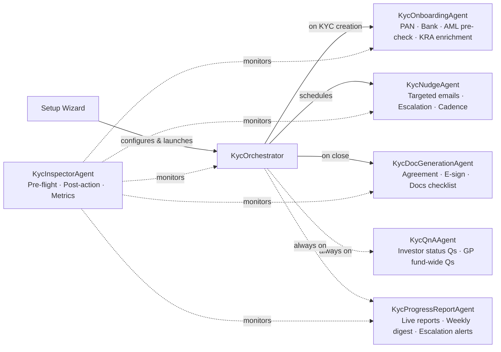
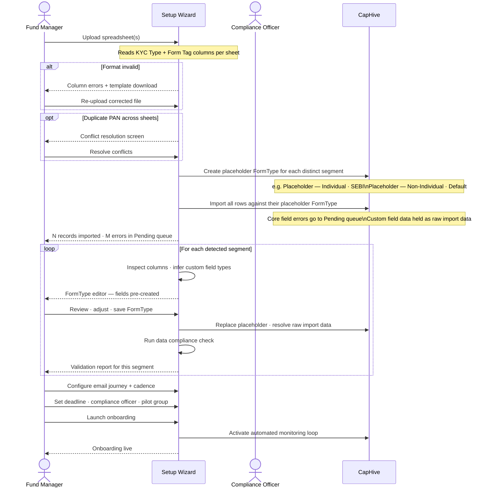
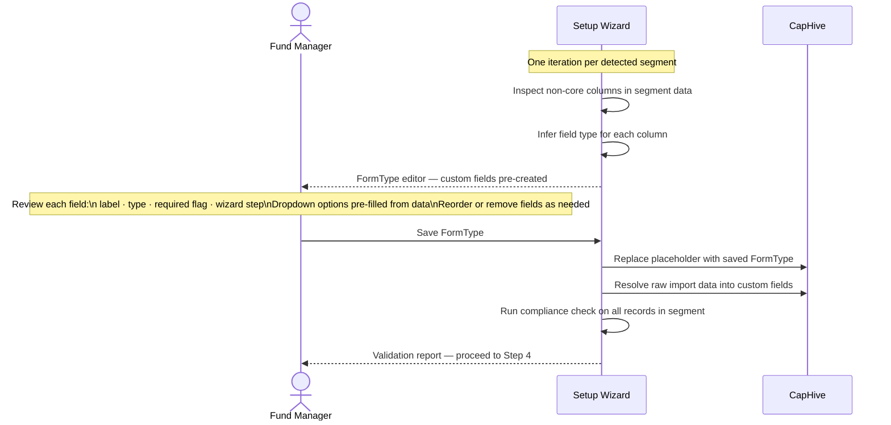
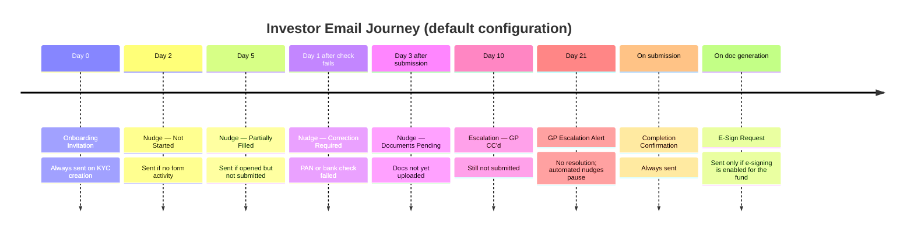
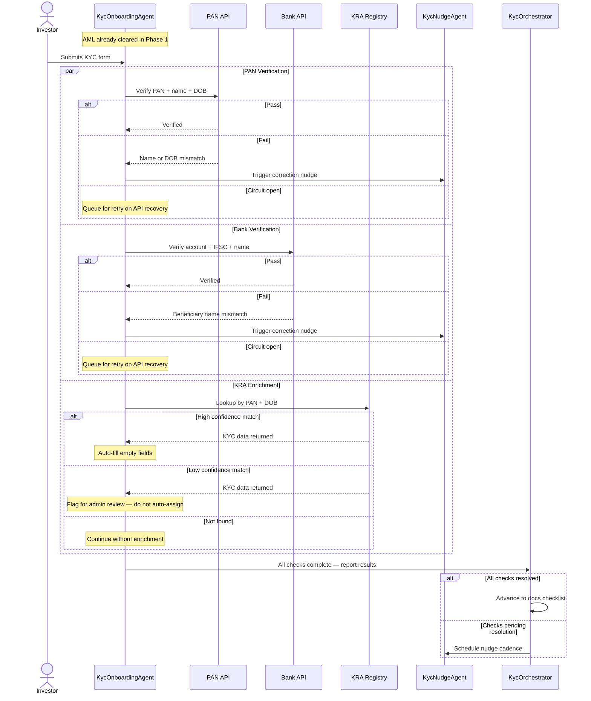
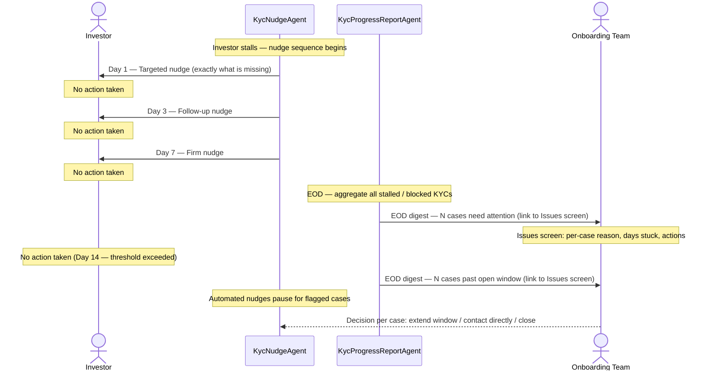
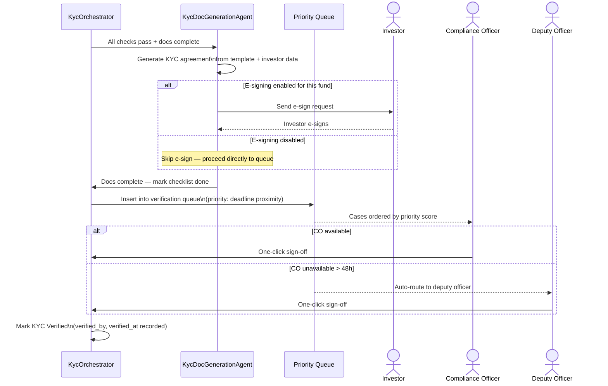
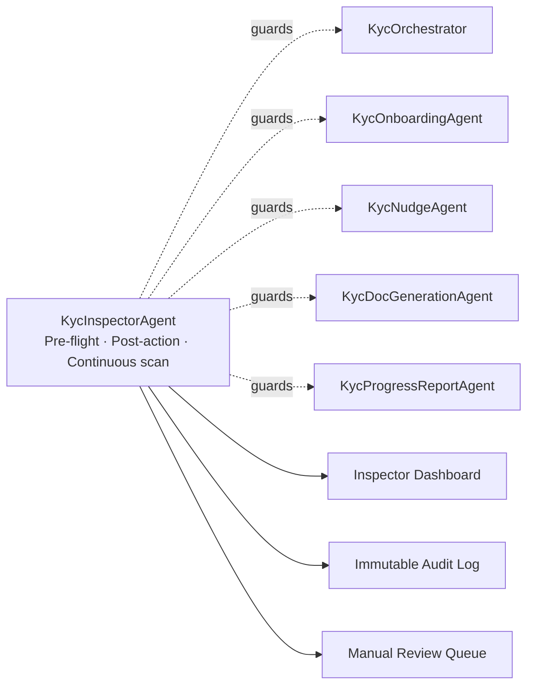

# PRD: Autonomous KYC Onboarding

## 1. Problem Statement

- KYC onboarding is the single biggest operational bottleneck between a signed commitment and a fund close.
- Fund managers spend disproportionate time chasing investors for documents, following up on failed checks, and assembling status reports — none of which requires their judgment.
- Investors receive generic reminder emails with no visibility into what is actually missing or why.
- Compliance teams are buried in manual coordination that adds no analytical value.
- The result: prolonged onboarding cycles, delayed closes, and strained GP-LP relationships.

## 2. Vision

- Once a KYC record exists, the system takes over — invitation, monitoring, checks, nudges, escalation, and close.
- GPs and compliance teams review exceptions; they no longer run the process.
- Every nudge tells the investor exactly what is missing and what to do next — not "please complete your KYC."
- Investors can ask plain-language questions about their status at any time and get instant, accurate answers.
- Every automated action is logged with a reason and timestamp — fully auditable, no black boxes.

### System Architecture



---

## 3. Goals

- **Zero manual coordination for standard cases.** A KYC that follows the happy path — investor submits, all checks pass, documents uploaded — closes without a human touching it beyond the final compliance sign-off.
- **Targeted, not generic, investor communication.** Every nudge tells the investor precisely what is missing and what to do, not "please complete your KYC."
- **Visibility without involvement.** The onboarding team can see the status of every investor in real time; escalations arrive as a single EOD digest, not as per-case email noise.
- **Instant answers for LPs and GPs.** Investors and fund managers can ask plain-language questions about onboarding status and process at any time and receive accurate, immediate responses.
- **Auditable.** Every automated decision — a nudge sent, a data field populated from a registry, a doc generated — is recorded with a reason and timestamp.

---

## 4. Non-Goals (v1)

- CKYC integration (removed from scope).
- Automated final compliance verification — a human compliance officer must still provide the final sign-off; the system queues verified-ready cases for one-click approval.
- Multi-fund KYC deduplication (an investor onboarding into two funds simultaneously is treated as two independent onboarding runs).
- Mobile-native investor app.
- Non-Indian regulatory regimes (SEBI, GIFT City, and Default tags are in scope; other jurisdictions are future phases).

---

## 5. Who This Is For

| Persona | Role in onboarding | What they gain |
|---|---|---|
| **Fund Manager / GP** | Oversees the close; wants onboarding done fast with no surprises | Real-time progress reports; escalations only for genuinely blocked cases; no manual chasing |
| **Compliance Officer** | Must verify each KYC before the fund can call capital | A clean, exception-driven queue; all checks pre-run; one-click sign-off for ready cases |
| **Investor (LP)** | Must provide identity, financial, and document information | Guided, personalised experience; instant answers to their questions; no unexplained delays |
| **Fund Operations / Admin** | Historically owns the manual coordination work | Freed from chasing; handles only edge cases surfaced by the system |

---

## 6. Fund Setup Wizard

Before automated onboarding can run, the fund's KYC configuration must be established: what data will be collected, from which investor types, under which regulatory regimes, and how investors will be communicated with throughout the process. This is done once per fund through a guided setup wizard.

The wizard is built around one insight: **get the data in first, configure the forms second.** Rather than blocking import on schema approval, the wizard imports all investor data immediately using placeholder FormTypes, then lets the fund manager and compliance officer configure each FormType at their own pace. Validation happens per FormType as each one is completed — not as a single upfront gate.

This means the fund manager can see all their investors in the system within minutes of uploading their spreadsheets, while the compliance officer reviews FormTypes independently and incrementally.

The wizard autosaves after every step. It can be paused and resumed at any time.

### Step Overview

| Step | Name | Description | Outcome |
|---|---|---|---|
| **1** | Upload Your Investor Spreadsheets | Fund manager uploads one or more Excel files in the standard CapHive KYC import format. Each file or sheet represents one investor segment (e.g. Individual · SEBI, Non-Individual · Default). The system reads the `KYC Type` and `Form Tag` columns to identify distinct segments before any data is written. | Segments identified; files queued for import |
| **2** | Format Validation & Immediate Import | The wizard validates column structure, flags format errors, and resolves duplicate PANs. It then creates a placeholder FormType for each segment and imports all valid rows immediately — no schema approval needed. Invalid rows go to the Pending queue; custom field data is held as raw import data until Step 3. | All valid investor records created in CapHive; errors held in Pending queue |
| **3** | Configure FormType per Segment | For each segment, the system inspects the non-core columns in the imported data, infers a field type for each (checkbox, dropdown, number, date, currency, text), and pre-creates the custom fields. The fund manager reviews the proposals, adjusts labels and types, marks required fields, and saves — no approval loop. The system immediately applies the FormType to all records and resolves the raw import data into structured field values. | Placeholder FormTypes replaced with real definitions; custom fields applied to all records |
| **4** | Data Compliance Check | After each FormType is saved, a rule-based check runs automatically across every record in that segment. It catches type mismatches (e.g. text in a Number field), orphaned columns (data with no matching field — would be silently lost), dropdown values not in the allowed list, and missing required fields. Errors block invitations; warnings are surfaced but not blocking. | All records validated against the FormType; no orphaned data or type mismatches blocking invitations |
| **5** | Design the Investor Email Journey | The fund manager configures the automated communication sequence: what emails go out, when, and with what content. Presented as a visual timeline from invitation to completion. Each email is editable inline with placeholder variables rendered using real sample data. A "Send to myself" test delivers the full journey to the fund manager's inbox before any investor is contacted. | Nudge cadence, email content, and timing confirmed; fund manager has previewed the full investor journey |
| **6** | Final Configuration | Sets the operational parameters for the live system: onboarding deadline, maximum open window before escalation, onboarding team members (who receives EOD escalation digests), escalation CC list, compliance officer and deputy, e-signing on/off, and pilot group if a staged rollout is preferred. | Onboarding team, deadlines, compliance roles, and e-signing configured |
| **7** | Review and Launch | A single summary screen shows every configuration decision — record counts per segment, email journey steps, compliance officer, deadline, and FormTypes — before anything is sent. The fund manager clicks Launch to send the first wave of invitations and activate the automated monitoring loop. | Invitations sent; automated onboarding loop active |

### Wizard Flow



---

### Step 1 — Upload Your Investor Spreadsheets

**Outcome:**
- Each spreadsheet segment (KYC Type + Form Tag combination) is detected and labelled.
- File structure is confirmed before any data is written.
- Fund manager can add more files or proceed to import.

The fund manager uploads one or more Excel files representing the investors they intend to onboard. Each file (or sheet within a file) typically corresponds to a distinct investor segment: Individual SEBI investors, Non-Individual SEBI investors, Individual GIFT City investors, and so on.

Each spreadsheet must use the standard CapHive KYC import format — the same format accepted by the manual KYC import tool. The `KYC Type` column (`individual` / `non_individual`) and the `Form Tag` column (`SEBI`, `GIFT`, `Default`) are required in every file. The fund manager can download the standard import template from within the wizard if needed.

**What the system reads immediately upon upload:**

For each file or sheet, the system reads the `KYC Type` and `Form Tag` columns and counts the data rows:

```
┌─────────────────────────────────────────────────────────────────┐
│  Sheet: "Individual Investors"                                  │
│  Type: Individual · SEBI  (from KYC Type + Form Tag columns)   │
│  Investors: 47 rows                                             │
│  Form: Individual KYC — SEBI                                    │
└─────────────────────────────────────────────────────────────────┘

┌─────────────────────────────────────────────────────────────────┐
│  Sheet: "Trusts and Companies"                                  │
│  Type: Non-Individual · Default                                 │
│  Investors: 12 rows                                             │
│  Form: Non-Individual KYC — Default                             │
└─────────────────────────────────────────────────────────────────┘
```

Additional files can be added at any point in the wizard. The fund manager proceeds to format validation once all files are uploaded.

---

### Step 2 — Format Validation & Immediate Import

**Outcome:**
- Placeholder FormTypes created for each detected segment (e.g. `Placeholder — Individual · SEBI`).
- All valid rows imported as KYC records in CapHive — data is live immediately.
- Invalid rows (bad PAN format, duplicate PAN) held in the Pending queue; they do not block the rest of the import.
- Custom field columns stored as raw import data per record, ready to be resolved in Step 3.

The wizard validates the format of each file and then imports immediately — no dry-run, no waiting for schema approval.


Before importing, the wizard reads the distinct `KYC Type + Form Tag` combinations present across all uploaded sheets and creates a **placeholder FormType** for each one (e.g. `Placeholder — Individual · SEBI`, `Placeholder — Non-Individual · Default`). Each imported record is then assigned to its corresponding placeholder. This allows the data to be committed immediately without any custom field configuration in place.

Core field errors (invalid PAN format, duplicate PAN within the fund) skip the affected row to the Pending queue — they do not block the rest of the import.

Custom field columns from the spreadsheet are stored as raw import data attached to each KYC record, ready to be applied once the real FormType is configured.

---

### Step 3 — Configure FormType per Segment

**Outcome:**
- Placeholder FormType replaced with a real, fund-specific FormType for the segment.
- Custom fields created with system-inferred types; fund manager reviews, adjusts, and saves — no approval loop.
- Raw import data resolved into structured custom field values on all records in the segment.
- Repeated once per segment until all placeholders are replaced.

When the fund manager opens the FormType editor for a segment, the system has already inspected the non-core columns in that segment's spreadsheet data and **pre-created the custom fields** — one per unrecognised column — with types inferred from the column values. The fund manager reviews and adjusts the proposals rather than building from scratch.

**Type inference rules:**

| Column data pattern | Inferred field type |
|---|---|
| Only `Y` / `N`, `Yes` / `No`, `True` / `False` | Checkbox |
| Small set of distinct text values (≤ 10 unique) | Dropdown — options pre-populated from the data |
| Numeric values only | Number |
| Values matching a date pattern | Date |
| Numeric values with currency symbols or comma-formatting | Currency |
| Free text, short (median length < 50 chars) | Text |
| Free text, long (median length ≥ 50 chars) | Text area |



The fund manager saves directly in the wizard — no approval workflow, no back and forth. Once saved, the system immediately applies the FormType to all records in the segment and runs an automated data compliance check.

---

### Step 4 — Data Compliance Check

**Outcome:**
- Every record in the segment checked against the FormType definition just saved.
- Errors (type mismatch, orphaned column, invalid dropdown value) surfaced inline — block invitations until resolved.
- Warnings (missing required field) noted but not blocking — investor fills these on their form.
- Segment marked clean once zero errors remain; fund manager can re-run at any time after corrections.

After the FormType is saved, a rule-based check runs automatically across every record in the segment. No AI required — these are deterministic rules against the FormType definition just saved.


**Error types and actions:**

| Issue | Severity | Action |
|---|---|---|
| Value does not match field type (e.g. text in a Number field) | Error — blocks invitation | Fix the field type definition or correct the data inline |
| Spreadsheet column has no matching custom field (orphaned) | Error — data would be lost | Map the column to an existing field or add a new custom field |
| Dropdown value not in the field's option list | Error — blocks invitation | Add the value to the dropdown options or correct the data |
| Required custom field has no value for a record | Warning — investor fills themselves | No action needed; investor prompted on their form |
| Optional custom field has no value | Informational | No action needed |

The fund manager can re-run the check at any time after making corrections. Once there are no errors (warnings are allowed), the segment is ready and the wizard advances.

---

### Step 5 — Design the Investor Email Journey

**Outcome:**
- Full nudge cadence configured: triggers, delays, and recipients for each email in the investor journey.
- Email subjects and body copy reviewed and edited inline using real sample data.
- Sender name set per email (personal from fund manager, or generic fund address).
- Fund manager has sent the complete journey to themselves and confirmed every email reads correctly before any investor receives one.

This step is where the automated onboarding communication is configured. It is presented as a visual journey — a sequence of events the investor experiences from first invitation through to completion. Each node is clickable: the fund manager sees the email content, edits it, and adjusts timing, all in one place.



All placeholder variables (`{Fund Name}`, `{First Name}`, `{Missing Fields}`, etc.) are rendered with real sample data in the preview. The fund manager edits prose directly — no template syntax required.

The fund manager can:
- Adjust the delay on any email.
- Edit the subject and body inline.
- Add a new email at any point in the journey.
- Remove emails they do not want.
- Assign a different sender name per email (nudges from the fund manager personally, not from a generic address).

**"Send to myself" test:**
At any point, the fund manager clicks **Send me the full journey** and receives every email in the sequence to their own inbox, rendered with a sample investor's data. This makes the experience tangible before a single investor is contacted.

---

### Step 6 — Final Configuration

**Outcome:**
- Onboarding deadline and maximum open window set.
- Onboarding team members selected (≥1 required); escalation CC list added.
- Compliance officer and deputy compliance officer assigned.
- E-signing toggled on or off for this fund.
- Pilot group and launch mode decided (all at once, or pilot-first).

A short set of operational parameters that govern how the automated system behaves once live:

| Setting | Description | Default |
|---|---|---|
| **Onboarding deadline** | Date by which all KYCs must be verified; nudges intensify as this approaches | Fund close date |
| **Maximum open window** | After this many days with no progress, escalate regardless of cadence | 30 days |
| **Pilot group** | A subset of investors who receive the invitation first, before full rollout | None |
| **Launch mode** | Send to all at once, or hold until manually triggered per investor | All at once |
| **E-signing** | Whether the generated KYC agreement must be e-signed by the investor before the record enters the verification queue | Off |
| **Compliance officer** | Who receives the verification queue and AML alerts | Required |
| **Deputy compliance officer** | Auto-receives the queue if primary is inactive for > 48h | Recommended |
| **Onboarding team** | Selected employees of the entity responsible for onboarding; all escalation digests are sent to this group | Required (≥1) |
| **Escalation CC** | Additional email addresses (outside the platform) copied on all escalation digests | Optional |
| **Weekly digest recipients** | Who receives the automated progress report | Onboarding team |

---

### Step 7 — Review and Launch

**Outcome:**
- All configuration displayed on one summary screen — segment counts, email steps, compliance officer, deadline, and FormTypes.
- Fund manager confirms and clicks Launch.
- First wave of invitations sent immediately (or pilot group first if configured).
- Automated monitoring loop activated; the system takes over from this point.

```
┌─────────────────────────────────────────────────────────────┐
│  Ready to launch onboarding for Fund III                    │
│                                                             │
│  KYC records to be created:     263                         │
│    Individual · SEBI:           189                         │
│    Individual · Default:         34                         │
│    Non-Individual · SEBI:        40                         │
│                                                             │
│  Invitations to be sent:        263  (immediately)          │
│  OR  Pilot group first:          10  (then 253 on approval) │
│                                                             │
│  Email journey:                 9 steps configured          │
│  Compliance officer:            Priya Sharma                │
│  Onboarding deadline:           15 Sept 2026                │
│  FormTypes approved:            3  (Individual SEBI, Ind. Default, NI SEBI) │
│                                                             │
│         [← Back and edit]          [Launch onboarding →]   │
└─────────────────────────────────────────────────────────────┘
```

Clicking **Launch onboarding** sends the first wave of invitations and activates the automated monitoring loop.

---

### What Happens to Errors and Pending Rows

Rows that could not be imported are held in a **Pending Imports** queue accessible from the fund's KYC admin panel. As errors are resolved, rows are committed individually or in bulk. They automatically receive the onboarding invitation the moment they are successfully imported.

---

## 7. The Onboarding Journey

Once the setup wizard is complete, the system manages each investor's KYC through three phases automatically.

### KYC State Machine

```mermaid
stateDiagram-v2
    direction LR

    [*] --> Created

    Created --> AMLFlagged : AML flagged (PAN+name+DOB present)
    Created --> InvitationSent : AML clear or data not yet available

    InvitationSent --> Submitted : Investor fills & submits

    Submitted --> ChecksRunning
    ChecksRunning --> AMLFlagged : AML flagged (deferred check)
    ChecksRunning --> ChecksFailed : PAN or bank fail
    ChecksRunning --> DocsRequired : Checks pass · docs missing
    ChecksRunning --> ReadyToClose : Checks pass · docs complete

    ChecksFailed --> ChecksRunning : Investor resolves
    ChecksFailed --> Escalated : Nudges exhausted

    DocsRequired --> ReadyToClose : Docs uploaded
    DocsRequired --> Escalated : Nudges exhausted

    ReadyToClose --> DocGenerated : Agreement generated
    DocGenerated --> AwaitingESig : E-sign enabled
    DocGenerated --> VerificationQueue : E-sign disabled
    AwaitingESig --> VerificationQueue : Investor e-signs

    VerificationQueue --> Verified : Compliance sign-off

    AMLFlagged --> InvitationSent : Compliance clears (pre-submission)
    AMLFlagged --> ChecksRunning : Compliance clears (post-submission)
    AMLFlagged --> Stale : Compliance confirms — do not proceed

    Escalated --> Stale : Max window exceeded
    Stale --> [*] : Archived
    Verified --> [*]
```



---

### Phase 1 — Per-Investor Setup

Triggered whenever a KYC record is created — via the setup wizard import, manually by a fund admin, or automatically when a new commitment is recorded (where commitments exist).

1. The system determines the correct KYC form type based on the fund's configured regulatory regime.
2. **AML pre-check runs silently** — but only when PAN + name + date of birth are already present on the record at creation time. If any of these three are missing, the check is deferred; the investor still receives their invitation immediately.
   - If AML flags the investor → the case is held for compliance review. No invitation is sent. The investor is never contacted until the flag is resolved.
   - If AML is clear, or data is not yet available → the investor receives their onboarding invitation.
3. The case enters Phase 2.

> **Deferred AML**: When PAN or DOB are not available at creation (common in bulk imports), the AML check runs automatically during Phase 2 as soon as the investor submits their form and the required fields are populated. This ensures AML always runs before the case can proceed to `ReadyToClose`.

> **AML flag review timeout**: If an AML-flagged case has not been reviewed by the compliance officer within 48 hours, it surfaces in the next EOD digest with an explicit "AML flag unreviewed" label. If still unreviewed after 7 days it is escalated directly to the onboarding team lead as a separate alert, not just the digest.

---

### Phase 2 — Nudges and Monitoring

The system monitors every open KYC and acts continuously until the case is ready to close.

#### Automated Checks Flow



#### Nudge Escalation Sequence

Escalations are never sent per individual KYC event. Instead, the system accumulates all blocked cases throughout the day and sends a single EOD digest to the configured onboarding team (and CC list). The digest links to an Issues screen showing every blocked case with its reason, days stuck, and available actions.



#### Investor Opt-Out

All investor emails include an unsubscribe link. If an investor opts out:
- All automated nudges are suppressed immediately and permanently for that KYC.
- The case surfaces in the next EOD digest as "investor opted out — manual contact required."
- The onboarding team must contact the investor directly and, if successful, re-enable nudges explicitly. Nudges never auto-resume after an opt-out.

This is a legal requirement (TRAI DLT regulations) and a practical safeguard — suppressing silently and continuing would risk the case stalling indefinitely without anyone noticing.

#### Progress Reporting

The system produces a live progress report for each fund, updated continuously:

- Total investors: complete, in progress, or blocked.
- Stage breakdown across the state machine.
- Blocked list: investor name, days stuck, and specific reason.
- Weekly email digest to configured recipients.

The GP can ask a plain-language question ("How many KYCs are verified for Fund III?") at any time and receive an immediate answer.

---

### Phase 3 — Close

Once all checks have passed and all required documents are uploaded:



The verification queue is **priority-ordered**, not FIFO. During onboarding there are no capital commitments yet, so priority is based on days until the fund's onboarding deadline and time in queue. Once the fund moves to a capital call stage and commitments are recorded, committed amount can be incorporated as a secondary priority signal.

A **deputy compliance officer** is configurable in the setup wizard. If the primary officer has not actioned any queue items for more than 48 hours, the queue automatically routes to the deputy. If both are inactive for more than 48 hours simultaneously, the onboarding team lead is alerted via the EOD digest with a "verification queue stalled" flag. This prevents the entire close pipeline from stalling on one person's availability.

**Sign-off confirmation**: The compliance officer sees a brief confirmation modal before sign-off is recorded ("Confirm verified: [Investor Name], [Fund]"), reducing the risk of one-click misfire on a large queue. A sign-off can be reversed within 1 hour by the same officer — after that it is locked for audit integrity.

**Post-document data change**: If a core KYC field is updated after the agreement has been generated but before compliance sign-off, the system voids the existing document, regenerates it with the updated data, and re-sends the e-sign request if e-signing is enabled. The compliance officer is notified of the regeneration. Fields locked post-sign-off cannot be edited without explicit admin override.

**Outcome:** A fully verified KYC record with complete audit trail, ready for capital calls. Where e-signing is enabled, the record includes the signed agreement document.

---

## 8. Investor Q&A

Throughout all three phases, investors and GPs can ask plain-language questions and receive immediate, accurate answers.

**Investors can ask:**
- "What documents do I still need to upload?"
- "Why did my bank verification fail?"
- "What happens after I submit my form?"
- "When will my KYC be complete?"

**GPs and fund operations can ask:**
- "Which investors are blocked and why?"
- "How many KYCs have been verified for Fund III?"
- "Why is Investor A still pending?"
- "What is the typical time to complete onboarding?"

Answers draw on the investor's live KYC record for status questions and on the fund's onboarding rules and regulatory documentation for process questions. The system is explicit about the boundary between what it can answer confidently and what requires a human.

---

## 9. Escalation Principles

The system is designed to escalate late rather than early. A human is only pulled in when:

- A check has failed and the investor has not resolved it after repeated nudges.
- An AML flag has been raised.
- Registry data conflicts materially with what the investor submitted.
- A case has been open beyond the fund's maximum onboarding window.

Escalations are batched, not per-KYC. The onboarding team (configured during setup) receives a single EOD digest listing every case that needs attention, with a direct link to the Issues screen. No individual case fires its own alert email — this prevents inbox noise and keeps escalation actionable. The CC list (also set during setup) receives the same digest.

The Issues screen shows each blocked case with its reason, time stuck, and available actions — the team resolves from one place, not from their inbox.

---

## 10. KYC Internal Notes

Each KYC record has an internal notes thread visible only to the onboarding team — investors never see it. Notes are the team's shared scratchpad for anything that matters to a specific case but doesn't fit into a structured field: a call the investor had with the GP, a document that's in transit, a compliance concern that needs watching, a manual exception being tracked.

### What Notes Are For

- Recording context from out-of-band conversations (phone calls, WhatsApp, email threads with the investor).
- Flagging edge cases being handled manually before they are resolved in the system.
- Leaving a handoff note when a case transfers between team members.
- Annotating an AML flag or a failed check with what was found during manual investigation.

### Behaviour

- Any member of the onboarding team can add a note to any KYC at any time.
- Notes are timestamped and attributed to the team member who wrote them.
- Notes appear in the KYC detail view and in the Issues screen alongside the case status.
- Notes are included in the audit trail — they are never deleted, only superseded by newer notes.
- The system does not act on notes; they are purely informational for humans.

### Access Control

| Role | Can read notes | Can write notes |
|---|---|---|
| Onboarding team member | Yes | Yes |
| Compliance officer | Yes | Yes |
| Investor | No | No |
| KycQnAAgent | No | No |

> Notes are internal. No automated agent reads or surfaces note content to investors or in outbound communications.

---

## 11. Inspector Agent, Resilience & Metrics

> Full detail is in the companion document: **[KYC Inspector Agent & System Resilience](autonomous_kyc_inspector_agent.md)**

### What's covered there

- **KycInspectorAgent** — architecture, action flow, per-agent checklists (Orchestrator, NudgeAgent, OnboardingAgent, QnAAgent, ProgressReportAgent, DocGenerationAgent), Inspector Dashboard, and continuous metrics.
- **Resilience patterns** — idempotency keys on all agent actions, circuit breakers for external APIs (PAN, Bank, KRA, AML), orchestrator heartbeat and re-hydration, and stale KYC archival.
- **Failure Mode Reference** — consolidated table of what can go wrong across every phase, how it is detected, and whether it resolves autonomously or requires a human in the loop.
- **Success metrics** — v1 targets for wizard completion time, import error rate, time-to-verified, hands-off close rate, nudge conversion, escalation share, and compliance sign-off time.
- **Out of scope / future phases** — what is explicitly excluded from v1.

### Inspector role in brief

The KycInspectorAgent runs continuously alongside all other agents. It guards every action with a pre-flight check, verifies every outcome post-action, and scans for drift on a periodic schedule. It does not fix errors — it detects, explains, and routes them to an automated retry, the manual review queue, or a developer alert depending on severity.


