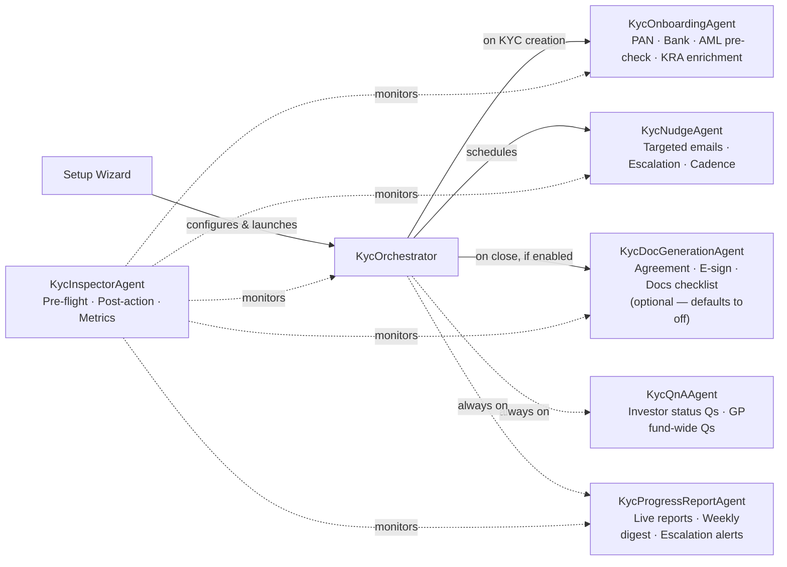
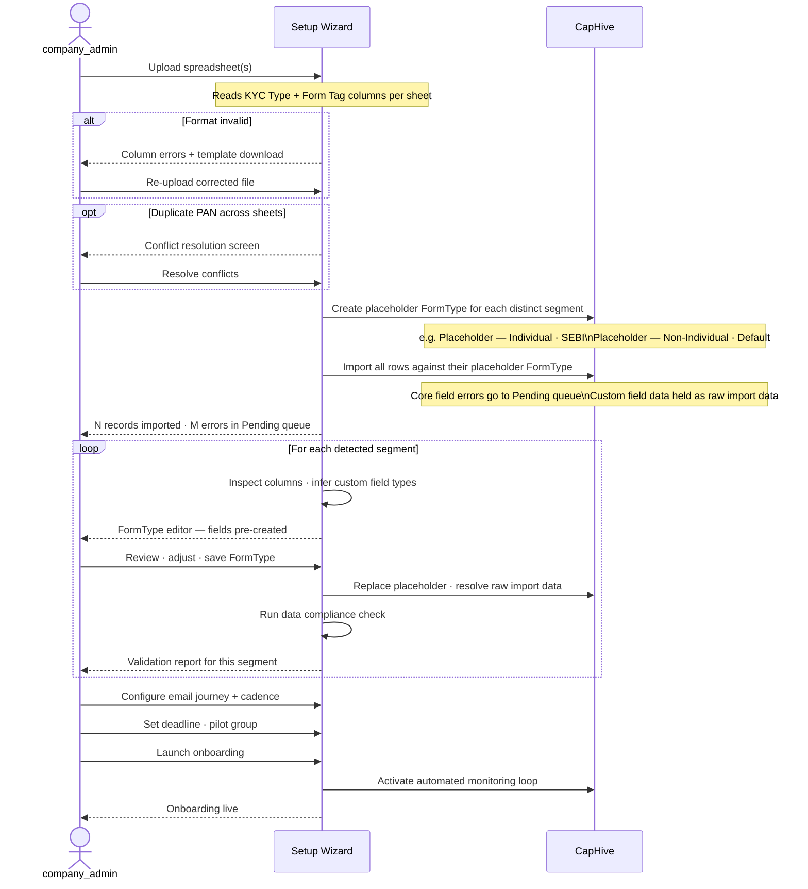
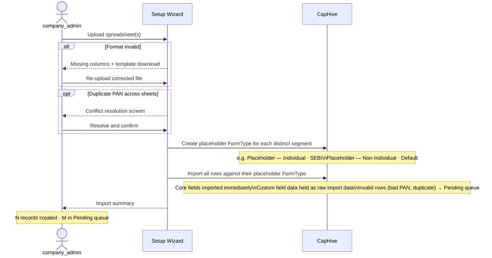
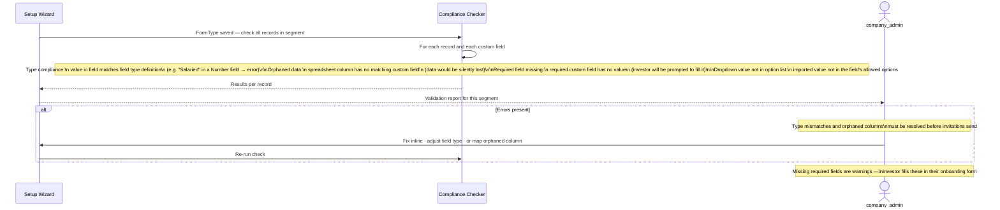
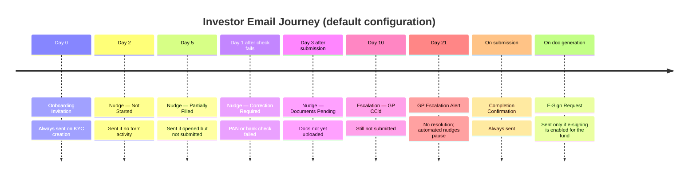
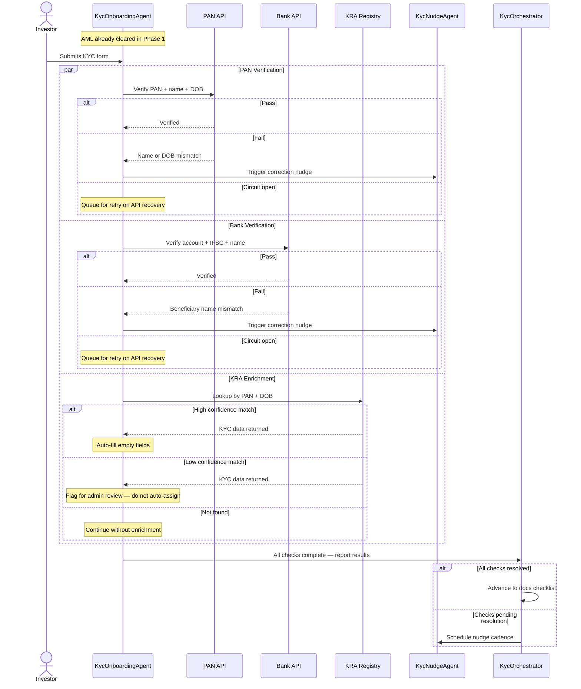
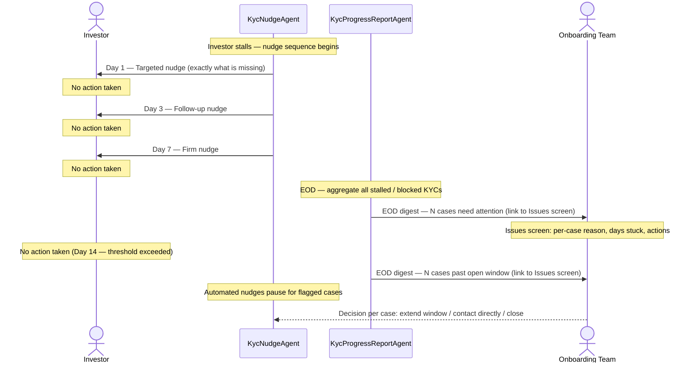
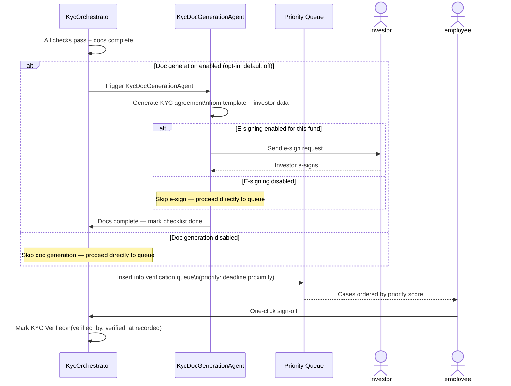
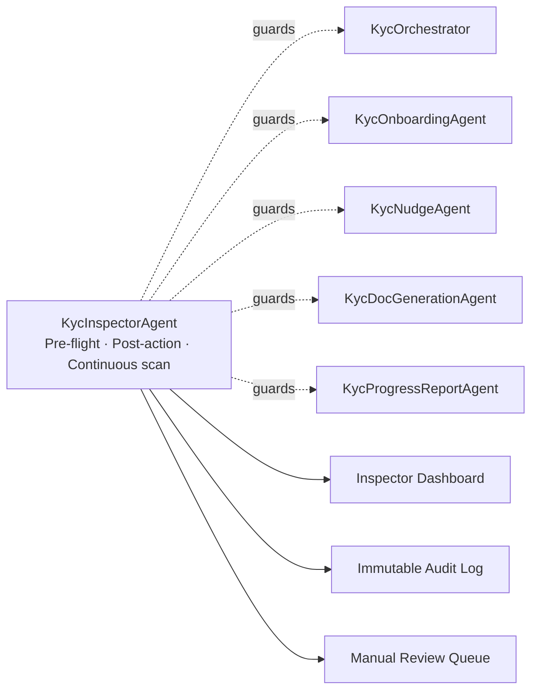

# PRD: Autonomous KYC Onboarding

> **See also:** [High Level Design](autonomous_kyc_onboarding_hld.md) · [Inspector Agent & Resilience](autonomous_kyc_inspector_agent.md)

> **Roles used in this document**
> | Role | App role | Who |
> |---|---|---|
> | `company_admin` | `:company_admin` | Full system access; can perform all KYC onboarding functions |
> | `employee` | `:employee` + `investor_kyc_onboarding` flag | Can perform all KYC onboarding functions — equivalent to `company_admin` within this feature |
> | `investor` | `:investor` | Submits KYC; receives nudges; uses Q&A agent |
>
> Within this feature, `company_admin` and `employee` (with `investor_kyc_onboarding` flag) have identical access: setup wizard, AML review, Issues screen, verification sign-off, EOD digest, and progress reports. The difference is that `company_admin` has broader system-wide access outside of onboarding.

## 1. Problem Statement

- KYC onboarding is the single biggest operational bottleneck between a signed commitment and a fund close.
- Fund managers spend disproportionate time chasing investors for documents, following up on failed checks, and assembling status reports — none of which requires their judgment.
- Investors receive generic reminder emails with no visibility into what is actually missing or why.
- Compliance teams are buried in manual coordination that adds no analytical value.
- The result: prolonged onboarding cycles, delayed closes, and strained GP-LP relationships.

> **Key Takeaways**
> - The bottleneck is coordination, not analysis — most of what company_admins do to run onboarding requires no judgment from them.
> - Investors have no visibility into what they should do next; generic reminders create friction, not action.
> - The goal is not to speed up the manual process — it is to replace the coordination layer entirely.

## 2. Vision

- Once a KYC record exists, the system takes over — invitation, monitoring, checks, nudges, escalation, and close.
- GPs and compliance teams review exceptions; they no longer run the process.
- Every nudge tells the investor exactly what is missing and what to do next — not "please complete your KYC."
- Investors can ask plain-language questions about their status at any time and get instant, accurate answers.
- Every automated action is logged with a reason and timestamp — fully auditable, no black boxes.

### System Architecture



> **Key Takeaways**
> - One orchestrator drives all agents; no agent communicates with another directly.
> - QnA and ProgressReport are always-on; the rest are triggered by state changes or schedule.
> - KycDocGenerationAgent is **optional** — enabled per fund via configuration; defaults to off. Funds that do not generate KYC agreements skip the DocGeneration step entirely.
> - The Inspector cross-cuts every agent — it is not a phase but a continuous guard.
> - "Fully automated" means humans review exceptions; the final compliance sign-off is still human.

---

## 3. Goals

- **Zero manual coordination for standard cases.** A KYC that follows the happy path — investor submits, all checks pass, documents uploaded — closes without a human touching it beyond the final compliance sign-off.
- **Targeted, not generic, investor communication.** Every nudge tells the investor precisely what is missing and what to do, not "please complete your KYC."
- **Visibility without involvement.** Any onboarding user (company_admin or employee with the investor_kyc_onboarding flag) can see the status of every investor in real time; escalations arrive as a single EOD digest, not as per-case email noise.
- **Instant answers for LPs and GPs.** Investors and onboarding users can ask plain-language questions about onboarding status at any time and receive accurate, immediate responses.
- **Auditable.** Every automated decision — a nudge sent, a data field populated from a registry, a doc generated — is recorded with a reason and timestamp.

> **Key Takeaways**
> - The north star is zero manual coordination for standard cases — not just "less coordination."
> - Targeted nudges (specific field, specific reason) vs generic reminders is the core product bet.
> - Escalation goes to the team as a digest, not to individuals as per-case alerts.

---

## 4. Non-Goals (v1)

- CKYC integration (removed from scope).
- Automated final compliance verification — a human employee must still provide the final sign-off; the system queues verified-ready cases for one-click approval.
- Multi-fund KYC deduplication (an investor onboarding into two funds simultaneously is treated as two independent onboarding runs).
- Mobile-native investor app.
- Non-Indian regulatory regimes (SEBI, GIFT City, and Default tags are in scope; other jurisdictions are future phases).
- Flexible unique identifier per jurisdiction: the KYC import deduplication is currently hardcoded to the `Pan/Tax Id` column (`import_investor_kyc.rb`). Non-Indian funds (e.g. US) may use a different column (e.g. SSN / Tax Id). In v1 the column is hardcoded; making it configurable at the KYC-configuration level (not on FormType, which is shared across models) is a future-phase item.

> **Key Takeaways**
> - Final compliance sign-off is intentionally not automated in v1 — this is a deliberate trust boundary, not a gap.
> - Each fund's onboarding is an independent run; multi-fund KYC deduplication is a separate problem.
> - India-only scope: SEBI, GIFT City, and Default regulatory tags are the entire surface area for v1.
> - The deduplication unique identifier is hardcoded to `Pan/Tax Id` in v1. Multi-jurisdiction support requires making this configurable at the KYC-configuration level.

---

## 5. Who This Is For

| Role | Responsibilities in onboarding | What they gain |
|---|---|---|
| **`company_admin`** | All KYC onboarding functions: setup wizard, AML review, Issues screen, verification sign-off, progress reports, escalation digest | Real-time progress visibility; no manual coordination for standard cases |
| **`employee`** (investor_kyc_onboarding) | Same as company_admin within this feature: setup wizard, AML review, Issues screen, verification sign-off, progress reports, escalation digest | Same capabilities as company_admin within onboarding; no access to unrelated system modules |
| **`investor`** | Submits identity, financial, and document information | Guided, personalised experience; instant answers via Q&A; no unexplained delays |

> **Key Takeaways**
> - Within KYC onboarding, `company_admin` and `employee` (with `investor_kyc_onboarding` flag) are equivalent — either can run the wizard, review AML flags, work the Issues screen, and sign off on verified KYCs.
> - The only distinction between the two roles is scope outside this feature: `company_admin` has system-wide access; `employee` with the flag is scoped to onboarding.
> - The system is designed so each role only interacts with the decisions that require their judgment — the investor drives their own submission; onboarding operators handle exceptions.

---

## 6. Fund Setup Wizard

Before automated onboarding can run, the fund's KYC configuration must be established: what data will be collected, from which investor types, under which regulatory regimes, and how investors will be communicated with throughout the process. This is done once per fund through a guided setup wizard.

> **Note on role usage in this section:** The wizard can be run by either a `company_admin` or an `employee` with the `investor_kyc_onboarding` flag — they are equivalent within this feature. The term "company_admin" below refers to whoever is operating the wizard, regardless of which role they hold.

The wizard is built around one insight: **get the data in first, configure the forms second.** Rather than blocking import on schema approval, the wizard imports all investor data immediately using placeholder FormTypes, then lets the company_admin configure each FormType at their own pace. Validation happens per FormType as each one is completed — not as a single upfront gate.

This means the company_admin can see all their investors in the system within minutes of uploading their spreadsheets and configure each FormType independently and incrementally.

The wizard autosaves after every step. It can be paused and resumed at any time.

### Step Overview

| Step | Name | Description | Outcome |
|---|---|---|---|
| **1** | Upload Your Investor Spreadsheets | Fund manager uploads one or more Excel files in the standard CapHive KYC import format. Each file or sheet represents one investor segment (e.g. Individual · SEBI, Non-Individual · Default). The system reads the `KYC Type` and `Form Tag` columns to identify distinct segments before any data is written. | Segments identified; files queued for import |
| **2** | Format Validation & Immediate Import | The wizard validates column structure, flags format errors, and resolves duplicate PANs. It then creates a placeholder FormType for each segment and imports all valid rows immediately — no schema approval needed. Invalid rows go to the Pending queue; custom field data is held as raw import data until Step 3. | All valid investor records created in CapHive; errors held in Pending queue |
| **3** | Configure FormType per Segment | For each segment, the system inspects the non-core columns in the imported data, infers a field type for each (checkbox, dropdown, number, date, currency, text), and pre-creates the custom fields. The company_admin reviews the proposals, adjusts labels and types, marks required fields, and saves — no approval loop. The system immediately applies the FormType to all records and resolves the raw import data into structured field values. | Placeholder FormTypes replaced with real definitions; custom fields applied to all records |
| **4** | Data Compliance Check | After each FormType is saved, a rule-based check runs automatically across every record in that segment. It catches type mismatches (e.g. text in a Number field), orphaned columns (data with no matching field — would be silently lost), dropdown values not in the allowed list, and missing required fields. Errors block invitations; warnings are surfaced but not blocking. | All records validated against the FormType; no orphaned data or type mismatches blocking invitations |
| **5** | Design the Investor Email Journey | The company_admin configures the automated communication sequence: what emails go out, when, and with what content. Presented as a visual timeline from invitation to completion. Each email is editable inline with placeholder variables rendered using real sample data. A "Send to myself" test delivers the full journey to the company_admin's inbox before any investor is contacted. | Nudge cadence, email content, and timing confirmed; company_admin has previewed the full investor journey |
| **6** | Final Configuration | Sets the operational parameters for the live system: onboarding deadline, maximum open window before escalation, onboarding team members (who receive the verification queue and EOD escalation digests), escalation CC list, AML alert recipient (company_admin), e-signing on/off, and pilot group if a staged rollout is preferred. | Employee recipients, deadlines, AML alert assignment, and e-signing configured |
| **7** | Review and Launch | A single summary screen shows every configuration decision — record counts per segment, email journey steps, deadline, and FormTypes — before anything is sent. The company_admin clicks Launch to send the first wave of invitations and activate the automated monitoring loop. | Invitations sent; automated onboarding loop active |

> **Key Takeaways**
> - Steps 1–4 are about getting data in and validated. Steps 5–6 are about configuring behaviour. Step 7 is the launch gate.
> - Steps 3 and 4 repeat per segment — each segment is independent and can be completed at different times.
> - No dedicated sign-off step is required within the wizard; setup is entirely a company_admin self-service flow.

### Wizard Flow



> **Key Takeaways**
> - The verification queue is visible to all `company_admin` users and all employees with the `investor_kyc_onboarding` flag — no individual assignee is configured in the wizard.
> - The FormType loop runs once per segment, not once per file. Two files with the same KYC Type + Form Tag are merged into one segment.
> - Everything up to Launch is reversible. The wizard autosaves and can be paused at any step.

---

### Step 1 — Upload Your Investor Spreadsheets

**Outcome:**
- Each spreadsheet segment (KYC Type + Form Tag combination) is detected and labelled.
- File structure is confirmed before any data is written.
- Fund manager can add more files or proceed to import.

The company_admin uploads one or more Excel files representing the investors they intend to onboard. Each file (or sheet within a file) typically corresponds to a distinct investor segment: Individual SEBI investors, Non-Individual SEBI investors, Individual GIFT City investors, and so on.

Each spreadsheet must use the standard CapHive KYC import format — the same format accepted by the manual KYC import tool. The `KYC Type` column (`individual` / `non_individual`) and the `Form Tag` column (`SEBI`, `GIFT`, `Default`) are required in every file. The company_admin can download the standard import template from within the wizard if needed.

**What the system reads immediately upon upload:**

For each file or sheet, the system reads the `KYC Type` and `Form Tag` columns and counts the data rows:

```
┌─────────────────────────────────────────────────────────────────┐
│  Sheet: "Individual Investors"                                  │
│  Type: Individual · SEBI  (from KYC Type + Form Tag columns)   │
│  Investors: 47 rows                                             │
│  Form: Individual KYC — SEBI                                    │
└─────────────────────────────────────────────────────────────────┘

┌─────────────────────────────────────────────────────────────────┐
│  Sheet: "Trusts and Companies"                                  │
│  Type: Non-Individual · Default                                 │
│  Investors: 12 rows                                             │
│  Form: Non-Individual KYC — Default                             │
└─────────────────────────────────────────────────────────────────┘
```

Additional files can be added at any point in the wizard. The company_admin proceeds to format validation once all files are uploaded.

> **Key Takeaways**
> - Segments are identified solely from the `KYC Type` and `Form Tag` columns — these two fields drive the entire FormType structure downstream.
> - No data is written in Step 1; it only reads and detects. All writes happen in Step 2.
> - Additional files can be added at any time before proceeding to Step 2.

---

### Step 2 — Format Validation & Immediate Import

**Outcome:**
- Placeholder FormTypes created for each detected segment (e.g. `Placeholder — Individual · SEBI`).
- All valid rows imported as KYC records in CapHive — data is live immediately.
- Invalid rows (bad PAN format, duplicate PAN) held in the Pending queue; they do not block the rest of the import.
- Custom field columns stored as raw import data per record, ready to be resolved in Step 3.

The wizard validates the format of each file and then imports immediately — no dry-run, no waiting for schema approval.



Before importing, the wizard reads the distinct `KYC Type + Form Tag` combinations present across all uploaded sheets and creates a **placeholder FormType** for each one (e.g. `Placeholder — Individual · SEBI`, `Placeholder — Non-Individual · Default`). Each imported record is then assigned to its corresponding placeholder. This allows the data to be committed immediately without any custom field configuration in place.

Core field errors (invalid PAN format, duplicate PAN within the fund) skip the affected row to the Pending queue — they do not block the rest of the import.

Custom field columns from the spreadsheet are stored as raw import data attached to each KYC record, ready to be applied once the real FormType is configured.

> **Key Takeaways**
> - Data is imported immediately — placeholder FormTypes are what make this possible without a real schema in place yet.
> - Invalid rows (bad PAN, duplicate PAN) go to the Pending queue without blocking the rest of the import.
> - Custom field data is held as raw import data — it is not lost, just waiting for Step 3 to give it a schema to resolve against.

---

### Step 3 — Configure FormType per Segment

**Outcome:**
- Placeholder FormType replaced with a real, fund-specific FormType for the segment.
- Custom fields created with system-inferred types; company_admin reviews, adjusts, and saves — no approval loop.
- Raw import data resolved into structured custom field values on all records in the segment.
- Repeated once per segment until all placeholders are replaced.

When the company_admin opens the FormType editor for a segment, the system has already inspected the non-core columns in that segment's spreadsheet data and **pre-created the custom fields** — one per unrecognised column — with types inferred from the column values. The company_admin reviews and adjusts the proposals rather than building from scratch.

**Type inference rules:**

| Column data pattern | Inferred field type |
|---|---|
| Only `Y` / `N`, `Yes` / `No`, `True` / `False` | Checkbox |
| Small set of distinct text values (≤ 10 unique) | Dropdown — options pre-populated from the data |
| Numeric values only | Number |
| Values matching a date pattern | Date |
| Numeric values with currency symbols or comma-formatting | Currency |
| Free text, short (median length < 50 chars) | Text |
| Free text, long (median length ≥ 50 chars) | Text area |


The company_admin saves directly in the wizard — no approval workflow, no back and forth. Once saved, the system immediately applies the FormType to all records in the segment and runs an automated data compliance check.

> **Key Takeaways**
> - The system infers field types from actual column data — the company_admin reviews proposals, not a blank form.
> - Dropdown options are pre-populated from values already present in the data.
> - Saving the FormType triggers three things atomically: placeholder replaced, raw import data resolved into structured fields, compliance check run.
> - This step repeats independently per segment — each one can be completed at a different time.

---

### Step 4 — Data Compliance Check

**Outcome:**
- Every record in the segment checked against the FormType definition just saved.
- Errors (type mismatch, orphaned column, invalid dropdown value) surfaced inline — block invitations until resolved.
- Warnings (missing required field) noted but not blocking — investor fills these on their form.
- Segment marked clean once zero errors remain; company_admin can re-run at any time after corrections.

After the FormType is saved, a rule-based check runs automatically across every record in the segment. No AI required — these are deterministic rules against the FormType definition just saved.



**Error types and actions:**

| Issue | Severity | Action |
|---|---|---|
| Value does not match field type (e.g. text in a Number field) | Error — blocks invitation | Fix the field type definition or correct the data inline |
| Spreadsheet column has no matching custom field (orphaned) | Error — data would be lost | Map the column to an existing field or add a new custom field |
| Dropdown value not in the field's option list | Error — blocks invitation | Add the value to the dropdown options or correct the data |
| Required custom field has no value for a record | Warning — investor fills themselves | No action needed; investor prompted on their form |
| Optional custom field has no value | Informational | No action needed |

The company_admin can re-run the check at any time after making corrections. Once there are no errors (warnings are allowed), the segment is ready and the wizard advances.

> **Key Takeaways**
> - Errors block invitations; warnings do not. The distinction matters: don't try to fix all warnings before launching.
> - Orphaned columns are errors, not warnings — data with no matching field definition would be silently lost on launch.
> - Missing required fields are warnings because the investor fills them in their onboarding form; they don't need to be pre-populated.
> - The check can be re-run as many times as needed after corrections.

---

### Step 5 — Design the Investor Email Journey

**Outcome:**
- Full nudge cadence configured: triggers, delays, and recipients for each email in the investor journey.
- Email subjects and body copy reviewed and edited inline using real sample data.
- Sender name set per email (personal from company_admin, or generic fund address).
- Fund manager has sent the complete journey to themselves and confirmed every email reads correctly before any investor receives one.

This step is where the automated onboarding communication is configured. It is presented as a visual journey — a sequence of events the investor experiences from first invitation through to completion. Each node is clickable: the company_admin sees the email content, edits it, and adjusts timing, all in one place.



All placeholder variables (`{Fund Name}`, `{First Name}`, `{Missing Fields}`, etc.) are rendered with real sample data in the preview. The company_admin edits prose directly — no template syntax required.

The company_admin can:
- Adjust the delay on any email.
- Edit the subject and body inline.
- Add a new email at any point in the journey.
- Remove emails they do not want.
- Assign a different sender name per email (nudges from the company_admin personally, not from a generic address).

**"Send to myself" test:**
At any point, the company_admin clicks **Send me the full journey** and receives every email in the sequence to their own inbox, rendered with a sample investor's data. This makes the experience tangible before a single investor is contacted.

> **Key Takeaways**
> - The default timeline is a starting point — adjust delays based on your investor base and how responsive they typically are.
> - Each email can have a different sender name. Personal sender (company_admin's name) performs better for high-stakes nudges; a generic fund address is appropriate for confirmations.
> - "Send to myself" is not optional — always test the full journey before launch. It is the only way to experience what your investors will actually receive.

---

### Step 6 — Final Configuration

**Outcome:**
- Onboarding deadline and maximum open window set.
- Onboarding team members selected (≥1 required); escalation CC list added.
- E-signing toggled on or off for this fund.
- Pilot group and launch mode decided (all at once, or pilot-first).

A short set of operational parameters that govern how the automated system behaves once live:

| Setting | Description | Default |
|---|---|---|
| **Onboarding deadline** | Date by which all KYCs must be verified; nudges intensify as this approaches | Fund close date |
| **Maximum open window** | After this many days with no progress, escalate regardless of cadence | 30 days |
| **Pilot group** | A subset of investors who receive the invitation first, before full rollout | None |
| **Launch mode** | Send to all at once, or hold until manually triggered per investor | All at once |
| **E-signing** | Whether the generated KYC agreement must be e-signed by the investor before the record enters the verification queue | Off |
| **Onboarding team** | Employees (investor_kyc_onboarding) responsible for onboarding; all escalation digests and the verification queue are sent to this group | Required (≥1) |
| **AML alert recipient** | company_admin or employee (investor_kyc_onboarding) who receives AML flag notifications | Required |
| **Escalation CC** | Additional email addresses (outside the platform) copied on all escalation digests | Optional |
| **Weekly digest recipients** | Who receives the automated progress report | Onboarding team |

> **Key Takeaways**
> - The maximum open window (default 30 days) is the escalation trigger — after this many days with no progress, the case escalates regardless of the nudge cadence still running.
> - The employee recipients field requires at least one member — escalation digests have no destination without it.
> - The pilot group exists so you can test the full live flow with a small subset before committing to a full rollout.
> - E-signing defaults to off — only enable it if Digio credentials are configured in entity settings.

---

### Step 7 — Review and Launch

**Outcome:**
- All configuration displayed on one summary screen — segment counts, email steps, deadline, and FormTypes.
- Fund manager confirms and clicks Launch.
- First wave of invitations sent immediately (or pilot group first if configured).
- Automated monitoring loop activated; the system takes over from this point.

```
┌─────────────────────────────────────────────────────────────┐
│  Ready to launch onboarding for Fund III                    │
│                                                             │
│  KYC records to be created:     263                         │
│    Individual · SEBI:           189                         │
│    Individual · Default:         34                         │
│    Non-Individual · SEBI:        40                         │
│                                                             │
│  Invitations to be sent:        263  (immediately)          │
│  OR  Pilot group first:          10  (then 253 on approval) │
│                                                             │
│  Email journey:                 9 steps configured          │
│  AML alert recipient:           Priya Sharma (company_admin) │
│  Onboarding deadline:           15 Sept 2026                │
│  FormTypes approved:            3  (Individual SEBI, Ind. Default, NI SEBI) │
│                                                             │
│         [← Back and edit]          [Launch onboarding →]   │
└─────────────────────────────────────────────────────────────┘
```

Clicking **Launch onboarding** sends the first wave of invitations and activates the automated monitoring loop.

> **Key Takeaways**
> - Launch is not easily reversible — once clicked, invitations are sent and the monitoring loop is active. Use the Back button if anything on the summary screen looks wrong.
> - Pilot mode is the safe path: send to 10 investors, confirm everything works, then approve the remaining rollout.
> - The summary screen is the last human gate and the only place all configuration decisions appear together — read it carefully before clicking Launch.

---

### What Happens to Errors and Pending Rows

Rows that could not be imported are held in a **Pending Imports** queue accessible from the fund's KYC admin panel. As errors are resolved, rows are committed individually or in bulk. They automatically receive the onboarding invitation the moment they are successfully imported.

> **Key Takeaways**
> - Pending rows are not abandoned — they live in a queue accessible from the KYC admin panel after launch.
> - Rows commit individually as errors are resolved; you do not need to fix everything at once.
> - A pending row receives its invitation automatically the moment it commits — no manual send required.

> **Key Takeaways**
> - Import first, configure forms second — placeholder FormTypes mean all investor data is live within minutes of upload, before any schema is finalised.
> - The company_admin saves FormTypes directly with no approval loop; no separate review step is required.
> - The data compliance check (Step 4) runs automatically after each FormType save and is the gate that prevents bad data from reaching investors.
> - Step 5's "Send to myself" test is the only way to see the full investor email journey before go-live — always use it.
> - Step 7 (Review and Launch) is the last human gate; everything after is system-driven until the final compliance sign-off.

---

## 7. The Onboarding Journey

Once the setup wizard is complete, the system manages each investor's KYC through three phases automatically.

### KYC State Machine

```mermaid
stateDiagram-v2
    direction LR

    [*] --> Created

    Created --> AMLFlagged : AML flagged (PAN+name+DOB present)
    Created --> InvitationSent : AML clear or data not yet available

    InvitationSent --> Submitted : Investor fills & submits

    Submitted --> ChecksRunning
    ChecksRunning --> AMLFlagged : AML flagged (deferred check)
    ChecksRunning --> ChecksFailed : PAN or bank fail
    ChecksRunning --> DocsRequired : Checks pass · docs missing
    ChecksRunning --> ReadyToClose : Checks pass · docs complete

    ChecksFailed --> ChecksRunning : Investor resolves
    ChecksFailed --> Escalated : Nudges exhausted

    DocsRequired --> ReadyToClose : Docs uploaded
    DocsRequired --> Escalated : Nudges exhausted

    ReadyToClose --> DocGenerated : Doc generation enabled + agreement generated
    ReadyToClose --> VerificationQueue : Doc generation disabled
    DocGenerated --> AwaitingESig : E-sign enabled
    DocGenerated --> VerificationQueue : E-sign disabled
    AwaitingESig --> VerificationQueue : Investor e-signs

    VerificationQueue --> Verified : Compliance sign-off

    AMLFlagged --> InvitationSent : Compliance clears (pre-submission)
    AMLFlagged --> ChecksRunning : Compliance clears (post-submission)
    AMLFlagged --> Stale : Compliance confirms — do not proceed

    Escalated --> Stale : Max window exceeded
    Stale --> [*] : Archived
    Verified --> [*]
```



> **Key Takeaways**
> - `onboarding_state` is nullable — nil means not enrolled in autonomous onboarding. States only exist for KYCs that are actively in the pipeline.
> - AMLFlagged has three exit paths: back to InvitationSent (compliance clears, pre-submission), back to ChecksRunning (compliance clears, post-submission), or to Stale (compliance confirms — do not proceed).
> - Escalated is a waiting state, not a terminal one. It becomes Stale only when the maximum open window is exceeded with no resolution.
> - Verified and Stale are the only true terminal states — all other states are active.

---

### Phase 1 — Per-Investor Setup

Triggered whenever a KYC record is created — via the setup wizard import, manually by a fund admin, or automatically when a new commitment is recorded (where commitments exist).

1. The system determines the correct KYC form type based on the fund's configured regulatory regime.
2. **AML pre-check runs silently** — but only when PAN + name + date of birth are already present on the record at creation time. If any of these three are missing, the check is deferred; the investor still receives their invitation immediately.
   - If AML flags the investor → the case is held for compliance review. No invitation is sent. The investor is never contacted until the flag is resolved.
   - If AML is clear, or data is not yet available → the investor receives their onboarding invitation.
3. The case enters Phase 2.

> **Deferred AML**: When PAN or DOB are not available at creation (common in bulk imports), the AML check runs automatically during Phase 2 as soon as the investor submits their form and the required fields are populated. This ensures AML always runs before the case can proceed to `ReadyToClose`.

> **AML flag review timeout**: If an AML-flagged case has not been reviewed within 48 hours, it surfaces in the next EOD digest with an explicit "AML flag unreviewed" label. If still unreviewed after 7 days it is escalated to all configured recipients as a separate alert, not just the digest.

> **Key Takeaways**
> - Phase 1 has exactly one human-gated decision: reviewing an AML flag (can be performed by any company_admin or employee with the investor_kyc_onboarding flag). Everything else is automatic.
> - An AML flag at creation means the investor receives no invitation and no contact until the flag is resolved — they are never aware the process started.
> - Deferred AML (data not present at creation) always catches up in Phase 2 before the case can close. There is no path to ReadyToClose without AML having run.
> - The 48h / 7d escalation ladder for unreviewed flags ensures AML cases don't silently sit in a queue.

---

### Phase 2 — Nudges and Monitoring

The system monitors every open KYC and acts continuously until the case is ready to close.

#### Automated Checks Flow



> **Key Takeaways**
> - PAN, Bank, and KRA checks run in parallel — a failure in one does not delay the others.
> - KRA enrichment only auto-fills genuinely empty fields. It never overwrites data the investor entered themselves.
> - A low-confidence KRA match is flagged for admin review, not auto-applied. Only high-confidence matches are written automatically.
> - If an API circuit is open when the investor submits, the check queues silently and runs when the API recovers — the investor is not told to wait.

#### Nudge Escalation Sequence

Escalations are never sent per individual KYC event. Instead, the system accumulates all blocked cases throughout the day and sends a single EOD digest to the configured recipients (company_admin and/or employee with the investor_kyc_onboarding flag, plus the CC list). The digest links to an Issues screen showing every blocked case with its reason, days stuck, and available actions.



> **Key Takeaways**
> - Every nudge is targeted — it names the specific field or check that is blocking the investor, not "please complete your KYC."
> - Escalation is never per-KYC. All blocked cases accumulate and go out as one EOD digest.
> - When the open window is exceeded, automated nudges pause for that case. The employee decides the next action per case from the Issues screen — the system does not make that call.

#### Investor Opt-Out

All investor emails include an unsubscribe link. If an investor opts out:
- All automated nudges are suppressed immediately and permanently for that KYC.
- The case surfaces in the next EOD digest as "investor opted out — manual contact required."
- The employee must contact the investor directly and, if successful, re-enable nudges explicitly. Nudges never auto-resume after an opt-out.

This is a legal requirement (TRAI DLT regulations) and a practical safeguard — suppressing silently and continuing would risk the case stalling indefinitely without anyone noticing.

> **Key Takeaways**
> - Opt-out is permanent and immediate — nudges stop the moment the investor clicks unsubscribe and never auto-resume.
> - The case does not close or stall invisibly — it surfaces in the next EOD digest as "manual contact required."
> - Re-enabling nudges after an opt-out requires an explicit action by the employee; the system will not do it automatically even if the investor later engages.

#### Progress Reporting

The system produces a live progress report for each fund, updated continuously:

- Total investors: complete, in progress, or blocked.
- Stage breakdown across the state machine.
- Blocked list: investor name, days stuck, and specific reason.
- Weekly email digest to configured recipients.

The GP can ask a plain-language question ("How many KYCs are verified for Fund III?") at any time and receive an immediate answer.

> **Key Takeaways**
> - Progress reporting is continuous and live — not a daily snapshot. The GP always sees current state.
> - The blocked list names the specific investor, their specific reason, and how many days they have been stuck.
> - The weekly digest is sent to the employee by default; additional recipients are configured in Step 6.

---

### Phase 3 — Close

Once all checks have passed and all required documents are uploaded:



The verification queue is **priority-ordered**, not FIFO. During onboarding there are no capital commitments yet, so priority is based on days until the fund's onboarding deadline and time in queue. Once the fund moves to a capital call stage and commitments are recorded, committed amount can be incorporated as a secondary priority signal.

**Sign-off confirmation**: The onboarding user (company_admin or employee with the investor_kyc_onboarding flag) sees a brief confirmation modal before sign-off is recorded ("Confirm verified: [Investor Name], [Fund]"), reducing the risk of one-click misfire on a large queue. A sign-off can be reversed within 1 hour by the same user — after that it is locked for audit integrity.

**Post-document data change**: If a core KYC field is updated after the agreement has been generated but before sign-off, the system voids the existing document, regenerates it with the updated data, and re-sends the e-sign request if e-signing is enabled. The onboarding team is notified of the regeneration. Fields locked post-sign-off cannot be edited without an explicit override by any company_admin.

**Outcome:** A fully verified KYC record with complete audit trail, ready for capital calls. Where e-signing is enabled, the record includes the signed agreement document.

> **Key Takeaways**
> - KycDocGenerationAgent is optional and defaults to off. Funds that don't generate agreements skip directly from `ReadyToClose` to the verification queue — no doc generation step at all.
> - The verification queue is priority-ordered by deadline proximity, not FIFO — the most time-sensitive cases surface first.
> - A data change after document generation voids the old document and triggers regeneration automatically. The employee is notified but does not need to intervene.
> - Sign-off locks after 1 hour. The confirmation modal and the reversal window together protect against one-click misfires on a large queue.

> **Key Takeaways**
> - AML runs at KYC creation if PAN + name + DOB are available; if not, it defers until the investor submits. It always runs before a case can close.
> - An AML flag blocks the invitation — the investor is never contacted until compliance resolves the flag.
> - PAN, Bank, and KRA checks run in parallel after submission, not sequentially.
> - Escalation is always EOD batched to the employee — never fired per individual KYC event.
> - Investor opt-out permanently suppresses all nudges and never auto-resumes; it surfaces as "manual contact required" in the next digest.
> - The verification queue is priority-ordered by deadline proximity, not FIFO.
> - The 1-hour sign-off reversal window exists to protect against one-click misfires on a large queue; after that, the record locks for audit integrity.

---

## 8. Investor Q&A

Throughout all three phases, investors and GPs can ask plain-language questions and receive immediate, accurate answers.

**Investors can ask:**
- "What documents do I still need to upload?"
- "Why did my bank verification fail?"
- "What happens after I submit my form?"
- "When will my KYC be complete?"

**GPs and fund operations can ask:**
- "Which investors are blocked and why?"
- "How many KYCs have been verified for Fund III?"
- "Why is Investor A still pending?"
- "What is the typical time to complete onboarding?"

Answers draw on the investor's live KYC record for status questions and on the fund's onboarding rules and regulatory documentation for process questions. The system is explicit about the boundary between what it can answer confidently and what requires a human.

> **Key Takeaways**
> - The agent reads the investor's live KYC record at query time — not a cached snapshot.
> - Investor and GP questions have different information scopes: investors see their own record, GPs see fund-wide data.
> - The system is explicit about what it cannot answer and redirects rather than guessing.

---

## 9. Escalation Principles

The system is designed to escalate late rather than early. A human is only pulled in when:

- A check has failed and the investor has not resolved it after repeated nudges.
- An AML flag has been raised.
- Registry data conflicts materially with what the investor submitted.
- A case has been open beyond the fund's maximum onboarding window.

Escalations are batched, not per-KYC. All configured onboarding users (company_admin or employee with the investor_kyc_onboarding flag) receive a single EOD digest listing every case that needs attention, with a direct link to the Issues screen. No individual case fires its own alert email — this prevents inbox noise and keeps escalation actionable. The CC list (also set during setup) receives the same digest.

The Issues screen shows each blocked case with its reason, time stuck, and available actions — the team resolves from one place, not from their inbox.

> **Key Takeaways**
> - The system escalates late and selectively — only genuinely blocked cases reach the team.
> - One EOD digest covers all escalations; no individual case fires its own alert.
> - The Issues screen is where the team works; the digest is just the notification that links to it.
> - The CC list handles external stakeholders who need visibility without a CapHive account.

---

## 10. KYC Internal Notes

Each KYC record has a rich-text internal notes field, editable in place on the KYC detail view. It is visible only to employees and company_admins — investors never see it, and no automated agent reads it.

Notes are the team's shared scratchpad for anything that matters to a specific case but doesn't fit into a structured field: a call the investor had with the GP, a document that's in transit, a compliance concern that needs watching, a manual exception being tracked.

### What Notes Are For

- Recording context from out-of-band conversations (phone calls, WhatsApp, email threads with the investor).
- Flagging edge cases being handled manually before they are resolved in the system.
- Leaving a handoff note when a case transfers between team members.
- Annotating an AML flag or a failed check with what was found during manual investigation.

> **Key Takeaways**
> - Notes capture what the system cannot: the phone call the investor had, the document couriered but not yet scanned, the exception being tracked manually.
> - Notes are not a substitute for resolving the underlying issue in the system — they are context for the humans handling it.

### Behaviour

- Any employee or company_admin can edit the notes field on any KYC at any time.
- Notes appear on the KYC detail view and in the Issues screen alongside the case status.
- The full edit history is retained via ActionText's built-in versioning.
- The system does not act on notes; they are purely informational for humans.

> **Key Takeaways**
> - Notes are collaborative — any employee or company_admin can read and edit the notes for any KYC.
> - Notes appear alongside the case in the Issues screen, so the team always has context when working a blocked case.
> - Edit history is automatic via ActionText — no extra setup needed.

### Access Control

| Role | Can read | Can write |
|---|---|---|
| `employee` (investor_kyc_onboarding) | Yes | Yes |
| `company_admin` | Yes | Yes |
| `investor` | No | No |
| KycQnAAgent | No | No |

> Notes are internal. No automated agent reads or surfaces note content to investors or in outbound communications.

> **Key Takeaways**
> - KycQnAAgent has no read access to notes — it cannot leak internal context to investors even if asked directly.

> **Key Takeaways**
> - Notes are a human scratchpad only — no automated agent reads or acts on note content.
> - Use notes for out-of-band context: phone calls, manual exceptions, handoff notes between team members.
> - Investors never see the notes field; it is not part of their onboarding experience.
> - Full edit history is preserved automatically via ActionText versioning.

---

## 11. Inspector Agent, Resilience & Metrics

> Full detail is in the companion document: **[KYC Inspector Agent & System Resilience](autonomous_kyc_inspector_agent.md)**

### What's covered there

- **KycInspectorAgent** — architecture, action flow, per-agent checklists (Orchestrator, NudgeAgent, OnboardingAgent, QnAAgent, ProgressReportAgent, DocGenerationAgent), Inspector Dashboard, and continuous metrics.
- **Agent Evaluation (Evals) Framework** — the Husain-Shankar eval flywheel applied to KYC agents: trace logging, random sampling, Benevolent Dictator review per agent, KYC-specific product failure examples, trace schemas, and the path from human critique to automated assertions.
- **Resilience patterns** — idempotency keys on all agent actions, circuit breakers for external APIs (PAN, Bank, KRA, AML), orchestrator heartbeat and re-hydration, and stale KYC archival.
- **Failure Mode Reference** — consolidated table of what can go wrong across every phase, how it is detected, and whether it resolves autonomously or requires a human in the loop.
- **Success metrics** and **out of scope / future phases**.

> **Key Takeaways**
> - The companion doc is not optional reading — it covers how the system fails, how failures are detected, and what the success criteria are.
> - The Evals section explains the difference between runtime error detection (Inspector) and product quality review (thumbs up/down + assertion table).

### Inspector role in brief

The KycInspectorAgent runs continuously alongside all other agents. It guards every action with a pre-flight check, verifies every outcome post-action, and scans for drift on a periodic schedule. It does not fix errors — it detects, explains, and routes them to an automated retry, the manual review queue, or a developer alert depending on severity.



> **Key Takeaways**
> - The Inspector does not fix errors — it detects, explains, and routes them to retry, manual review, or a developer alert.
> - Pre-flight blocks an action before it runs; post-action verifies the outcome after.
> - The Inspector is a continuous cross-cutting module, not a phase — it runs alongside all other agents at all times.
> - Full checklists, failure modes, eval framework, and resilience patterns are in the companion doc.
