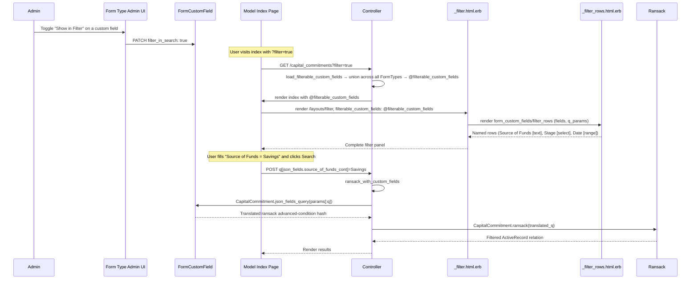

# Custom Field Filter Search — PRD

## Overview

Entity admins can mark any `FormCustomField` as **"Show in Filter"**. Those fields then appear as dedicated filter rows in the Ransack filter panel for that model's index page, allowing users to search and narrow records by custom field values without needing to know the internal JSON key names.

---

## Problem Statement

Every model with `include WithCustomField` stores user-defined data in a JSON column (`json_fields`). The existing Ransack filter (`/layouts/_filter.html.erb`) exposes only the whitelisted `ransackable_attributes` for each model — standard columns like `created_at`, `fund_id`, `investor_name`. Custom field values stored in `json_fields` are invisible to the filter.

The only workaround today is `InvestorKycList`, which manually calls `InvestorKyc.json_fields_query(@params[:q])` to translate params — but this is one model, hand-wired, and not available to any of the other 33 models that include `WithCustomField`.

---

## Goals

1. Let admins flag specific custom fields as filterable — no blanket "expose all" that leaks internal or regulatory fields.
2. Render those fields as named, typed filter rows in the existing filter panel — no second filter UI to learn.
3. Support field-type-appropriate input widgets and predicates (text search, numeric range, date range, dropdown match).
4. Pluggable into any model that includes `WithCustomField` with minimal per-model work.
5. Saved Reports continue to work — the filter state is still encoded in `params[:q]` and the URL.

---

## Non-Goals

- Full-text search across all custom fields at once.
- Exposing `Calculation` or `GridColumns` fields in the filter (these are computed/layout types).
- Changing how ransack `attribute_select` works for the generic condition builder rows.

---

## User Stories

### Admin (Company Admin role)

> As an admin, when I configure a Form Type, I can toggle "Show in Filter" on any custom field. That field then appears as a search row in the filter panel on that model's index page.

### Fund Manager / Employee

> As an employee viewing the Capital Commitments list, I can open the Filter panel and see rows for any custom fields the admin has enabled — e.g., "Source of Funds" (text), "Investment Stage" (dropdown), "KYC Completion Date" (date range). I can fill them in and click Search without knowing anything about JSON keys.

---

## Current System — Key Facts

| Piece | File | Role |
|---|---|---|
| `WithCustomField` concern | `app/packs/misc/form_custom_fields/models/concerns/with_custom_field.rb` | Adds `json_fields`, `ransacker :json_fields`, `ransacker :json_field_value`, `json_fields_query` class method |
| `_filter.html.erb` | `app/packs/core/base/views/layouts/_filter.html.erb` | Generic filter shell; accepts `include_template:` to inject extra rows |
| `_condition_fields.html.erb` | `app/packs/core/base/views/layouts/_condition_fields.html.erb` | Renders the Ransack attribute-select + predicate-select + text value rows |
| `_filter_ext.html.erb` | `app/packs/core/base/views/layouts/_filter_ext.html.erb` | Hardcoded extras (fund dropdown, sale dropdown) |
| `WithFilterParams` | `app/packs/core/base/controllers/concerns/with_filter_params.rb` | `ransack_with_snapshot`, `filter_params`, `get_q_param` |
| `json_fields_query` | Inside `WithCustomField` | Translates `"json_fields.name_cont" => "India"` into Ransack advanced condition hash (`c/a/p/v` format) |
| `InvestorKycList` | `app/packs/core/investor_kycs/services/investor_kyc_list.rb` | Only model today that calls `json_fields_query` |

### How `json_fields_query` works

Input: `{ "json_fields.nationality_cont" => "India", "investor_name_cont" => "Ravi" }`

For any key starting with `"json_fields."`, it strips the prefix, extracts the Ransack predicate, and builds an advanced condition entry:

```ruby
{
  c: [{
    a: { "0" => { name: "json_fields", ransacker_args: "nationality" } },
    p: "cont",
    v: ["India"]
  }]
}
```

Non-`json_fields.*` keys pass through unchanged. The result is merged back into `params[:q]`.

---

## Proposed Design

### 1. Database Migration — Add `filter_in_search` to `form_custom_fields`

```ruby
# db/migrate/YYYYMMDDHHMMSS_add_filter_in_search_to_form_custom_fields.rb
add_column :form_custom_fields, :filter_in_search, :boolean, default: false, null: false
```

No index needed (queried only via `form_type.form_custom_fields.filterable`, never ad-hoc).

Add to `FormCustomField`:

```ruby
scope :filterable, -> { where(filter_in_search: true).where.not(field_type: %w[File Header GridColumns Calculation]) }
```

---

### 2. Admin UI — Toggle on FormCustomField

In the Form Type admin edit form (wherever the field row is rendered), add a **"Show in Filter"** checkbox alongside the existing `required` / `read_only` checkboxes.

- Only visible to `company_admin` (same authorization as the rest of that form).
- Not available for field types: `File`, `Header`, `GridColumns`, `Calculation` (disabled + tooltip: "This field type cannot be used as a filter").
- Permit `filter_in_search` in the strong params for the FormCustomField nested attributes.

---

### 3. New Partial — `_custom_fields_filter.html.erb`

Location: `app/packs/misc/form_custom_fields/views/form_custom_fields/_filter_rows.html.erb`

This partial receives `@form_type` (set by each controller's `before_action`) and renders one filter row per filterable custom field.

Each row matches the visual layout of `_condition_fields.html.erb`:

```
[Field Label — disabled text]  [Predicate label — static]  [Value input]  [Trash icon]
```

The trash icon uses the existing `remove_fields` CSS class to hide the row (it does not submit blank params).

#### Row rendering per field type

| Field Type | Predicate(s) | Input Widget | Param key(s) |
|---|---|---|---|
| `TextField`, `TextArea` | `cont` (contains) | `text_field` | `json_fields.{name}_cont` |
| `NumberField`, `Money` | `gteq` / `lteq` | Two `number_field` inputs ("From" / "To") | `json_fields.{name}_gteq`, `json_fields.{name}_lteq` |
| `DateField` | `gteq` / `lteq` | Two `date_field` inputs ("From" / "To") | `json_fields.{name}_gteq`, `json_fields.{name}_lteq` |
| `Select`, `Radio`, `DataList` | `eq` | `select_tag` built from `fcf.meta_data` options | `json_fields.{name}_eq` |
| `MultiSelect`, `CheckBox` | `cont` | `select_tag multiple: true` | `json_fields.{name}_cont` |

Param names follow the `json_fields.{name}_{predicate}` convention already understood by `json_fields_query`.

**Partial signature:**

```erb
<%# locals: (form_type:, q_params: {}) %>
<% form_type.form_custom_fields.filterable.each do |fcf| %>
  <%# render the appropriate row based on fcf.field_type %>
<% end %>
```

`q_params` is `params[:q]` passed in so the filter can show the current values (sticky filter state on page reload).

---

### 4. Controller Concern — `WithCustomFieldFilter`

Location: `app/packs/misc/form_custom_fields/controllers/concerns/with_custom_field_filter.rb`

The concern loads the **union** of filterable fields across all FormTypes for the entity + model. This handles models in `MULTIPLE_FORM_TYPES_ALLOWED` (e.g. `CapitalCommitment`, `InvestorKyc`) where more than one FormType can exist per entity, each with its own set of custom fields. Fields with the same name that appear in multiple FormTypes are deduplicated by name — the first occurrence (lowest `form_type_id`) wins for display purposes; all share the same `json_fields` key so the query is unambiguous.

```ruby
module WithCustomFieldFilter
  extend ActiveSupport::Concern

  included do
    before_action :load_filterable_custom_fields, if: :filter_active?
  end

  private

  def load_filterable_custom_fields
    model_class = controller_name.classify.constantize
    return unless model_class.include?(WithCustomField)

    # Collect filterable fields from ALL form types for this entity + model class,
    # deduplicated by name so the same json_fields key doesn't render twice.
    form_types = FormType.where(entity_id: current_user.entity_id, name: model_class.name)
    all_filterable = FormCustomField
      .where(form_type: form_types)
      .filterable
      .order(:form_type_id, :position)

    @filterable_custom_fields = all_filterable.index_by(&:name).values
  end

  def filter_active?
    params[:filter].present? || params[:q].present?
  end

  # Call this in the controller action instead of bare Model.ransack(params[:q]).
  # Translates json_fields.* keys before handing off to Ransack.
  def ransack_with_custom_fields(model_class = nil)
    model_class ||= controller_name.classify.constantize
    q_params = model_class.include?(WithCustomField) ?
                 model_class.json_fields_query(params[:q]) :
                 params[:q]
    @q = model_class.ransack(q_params)
    policy_scope(@q.result)
  end
end
```

Controllers that support custom field filtering include this concern and call `ransack_with_custom_fields` in their `index` action instead of bare `Model.ransack(params[:q])` / `ransack_with_snapshot`.

**Models to update in phase 1** (highest-value / most custom-field usage):
- `CapitalCommitmentsController`
- `InvestorKycsController` (replace the current manual `json_fields_query` call in `InvestorKycList`)
- `AccountEntriesController`
- `PortfolioInvestmentsController`
- `ValuationsController`

---

### 5. Index View Integration

Each model's index view already passes `include_template:` to `_filter.html.erb`. Change to also pass `@filterable_custom_fields`:

```erb
<%# Before %>
<%= render "/layouts/filter", associations:, include_template: "/capital_commitments/group_filter" %>

<%# After %>
<%= render "/layouts/filter",
      associations:,
      include_template: "/capital_commitments/group_filter",
      filterable_custom_fields: @filterable_custom_fields %>
```

In `_filter.html.erb`, after the `include_template` render, add:

```erb
<% if local_assigns[:filterable_custom_fields].present? %>
  <%= render "form_custom_fields/filter_rows",
        fields: filterable_custom_fields,
        q_params: params[:q] %>
<% end %>
```

The partial receives a plain array of `FormCustomField` records (already deduplicated by the concern) — it has no dependency on `FormType` itself. This keeps `_filter.html.erb` clean — rows only appear if the entity has configured any filterable fields.

---

### 6. Sticky Filter State

The filter rows use `name="q[json_fields.{name}_{predicate}]"` input names — the same format `json_fields_query` expects. On page reload (after filter submit redirects back), `q_params` is passed into the partial so each input can pre-fill from `params[:q]["json_fields.{name}_{predicate}"]`.

---

### 7. Saved Reports Compatibility

Reports save the full `params[:q]` hash (including `json_fields.*` keys) in the `url` column. The `WithCustomFieldFilter` concern calls `json_fields_query` on every request before ransack, so saved report URLs that contain `json_fields.*` keys continue to work without any report migration.

---

## Sequence Diagram



---

## Data Model Changes

```
form_custom_fields
  + filter_in_search  boolean  default: false  (new column)
```

No join tables, no new models. All filter configuration lives on `FormCustomField`.

---

## Authorization / Pundit

- `filter_in_search` is an admin-only attribute: add to `FormCustomFieldPolicy` — only `company_admin` may set it.
- `load_filterable_custom_fields` queries `FormType.where(entity_id: current_user.entity_id, ...)` — scoped to the current entity, no cross-entity leakage possible even with multiple FormTypes.
- `filterable` scope excludes `File`, `Header`, `GridColumns`, `Calculation` — no internal computed fields are exposed.

---

## Implementation Phases

### Phase 1 — Core (required for anything to work)
1. Migration: add `filter_in_search` to `form_custom_fields`
2. `FormCustomField`: add `filterable` scope, permit `filter_in_search` in strong params
3. Admin UI: checkbox on form type edit page
4. `_filter_rows.html.erb` partial (all field types)
5. `WithCustomFieldFilter` concern (union load across all entity FormTypes)
6. Wire up `CapitalCommitmentsController` + `InvestorKycsController` (replace manual `json_fields_query` in `InvestorKycList`)
7. Update `_filter.html.erb` to accept `filterable_custom_fields:` and render the partial

### Phase 2 — Broader model rollout
8. `AccountEntriesController`, `PortfolioInvestmentsController`, `ValuationsController`, `FundUnitsController`
9. Remaining models as needed

### Phase 3 — UX polish
10. Display current active custom field filter values in the filter toggle card header (e.g. "Filter (3 active)")
11. "Clear custom field filters" link

---

## Cucumber Feature Tests

### Scenario: Admin enables a custom field for filtering
```gherkin
Given a company admin on the CapitalCommitment form type
When the admin toggles "Show in Filter" on the "Source of Funds" field
Then the field's filter_in_search flag is true

When a company employee visits the capital commitments index with the filter open
Then they see a "Source of Funds" text filter row
```

### Scenario: Filtering by a text custom field
```gherkin
Given two capital commitments with json_fields source_of_funds: "Savings" and "Inheritance"
And "Source of Funds" is marked filter_in_search on the CapitalCommitment form type
When the employee filters by Source of Funds contains "Savings"
Then only the "Savings" commitment is shown
```

### Scenario: Filtering by a dropdown custom field
```gherkin
Given "Investment Stage" is a Select field with options ["Seed","Series A","Series B"]
And it is marked filter_in_search
When the employee selects "Series A" in the Investment Stage filter row
Then only records with json_fields investment_stage: "Series A" are shown
```

### Scenario: Filtering by a date range custom field
```gherkin
Given "KYC Completion Date" is a DateField marked filter_in_search
When the employee sets the From date to 2025-01-01 and To date to 2025-06-30
Then only records whose kyc_completion_date falls in that range are shown
```

### Scenario: Saved report with custom field filter
```gherkin
Given a saved report URL that includes q[json_fields.source_of_funds_cont]=Savings
When the report is visited
Then the results are filtered by Source of Funds = "Savings" without error
```

### Scenario: Non-admin cannot set filter_in_search
```gherkin
Given an employee (non-admin) attempts to PATCH filter_in_search: true
Then the request is rejected with 403
```

### Scenario: File and Calculation fields not available
```gherkin
Given the form type has a File field and a Calculation field
Even if filter_in_search is true on those fields
They do not appear in the filter panel
```

### Scenario: Multiple FormTypes — union of filterable fields
```gherkin
Given an entity has two CapitalCommitment FormTypes:
  FormType A with filterable field "Source of Funds"
  FormType B with filterable field "Investment Stage"
When an employee opens the capital commitments filter
Then they see both "Source of Funds" and "Investment Stage" filter rows

Given FormType A and FormType B both have a filterable field named "region"
Then only one "Region" filter row appears
```

### Scenario: Partial fill on a date range filter
```gherkin
Given "KYC Completion Date" is a DateField marked filter_in_search
When the employee sets only the From date to 2025-01-01 and leaves To blank
Then only records whose kyc_completion_date is on or after 2025-01-01 are shown
And no error is raised for the missing To value
```

---

## Design Decisions (Resolved)

1. **Multiple FormTypes per model** — Show the **union** of filterable fields across all FormTypes for the entity + model class. Fields with the same name across multiple FormTypes are deduplicated by name (lowest `form_type_id` wins for display; all map to the same `json_fields` key so the query is unambiguous).

2. **`json_fields_query` merge strategy** — The method appends to `c:` via `(obj[:c] ||= []) <<`. If `params[:q]` already carries an advanced-condition `c:` array from the generic Ransack builder, the `||=` will append to the existing array correctly. Covered by a test that submits both a generic condition and a `json_fields.*` condition in the same request.

3. **SQL dialect** — MySQL only. The `json_fields_query` ransacker and all new filter SQL use `JSON_UNQUOTE` / `->`. No SQLite fallback is needed or maintained.

4. **Numeric/date range partial fill** — Ransack silently ignores predicates whose value is blank, so submitting `gteq=2025-01-01` with `lteq=` applies only the lower bound. No special handling required in the partial or controller; covered by Cucumber scenario.
