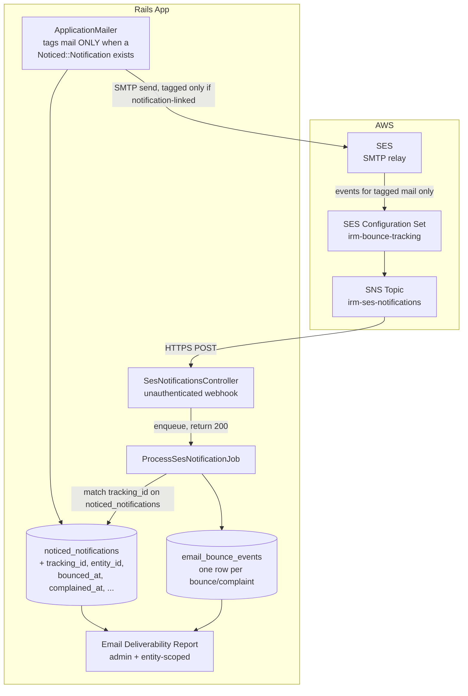
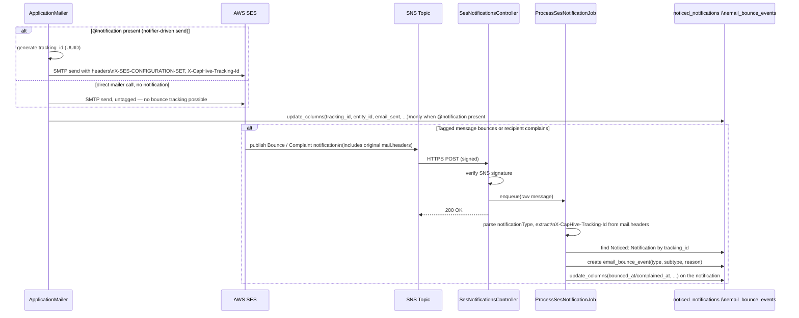

# PRD: Email Bounce & Complaint Detection and Reporting

## 1. Problem Statement

The app sends a large volume of email through AWS SES — capital call notices, KYC requests, document shares, KPI report reminders, AI-generated digests, and more — all routed through a single SMTP relay (`config/application.rb:97-105`). Today there is no visibility into which of these emails actually reached a recipient. If an investor's address is stale, their mailbox is full, or a spam filter rejects the message, the send silently "succeeds" from the app's point of view (`ApplicationMailer#mark_delivered` marks `email_sent: true` the moment SMTP accepts the message — it has no knowledge of what SES does with it afterward).

This has two consequences: fund teams have no way to know a capital call notice never reached an LP, and the app has no defense against sustained bounce/complaint rates, which AWS treats as a sender-reputation signal and can act on (up to throttling or suspending the sending identity) — invisible to us until it happens.

## 2. Goals

- Capture SES bounce and complaint events for every outbound email sent through the `Noticed` notifier pattern, in near real time (see Non-Goals for the accepted coverage gap on direct-call mailers).
- Persist enough detail to identify what bounced/complained, why, and which fund/entity it belongs to.
- Provide an in-app report of bounce/complaint events, viewable by internal admins (all entities) and fund managers (scoped to their own entity's recipients).
- Distinguish bounce subtypes (Permanent/hard vs Transient/soft vs Undetermined) so admins can judge which need manual follow-up.
- Let an admin manually disable further email to a bounced/complained address, in one action, across every `InvestorAccess` record that shares that address — without the app doing this automatically.

## 3. Non-Goals (v1)

- No *automatic* action on bounce or complaint (no auto-disabling `InvestorAccess.email_enabled`, no suppression list). Detection remains report-only — but see §8.6 for a manual, admin-triggered action on the report itself.
- No CSV export or scheduled digest email — in-app dashboard only.
- No bounce-rate/complaint-rate threshold alerting. A future iteration can add this once baseline data exists.
- No polling-based fallback — detection is SNS-driven only.
- **Bounce tracking is scoped to notifier-driven sends only** — a mailer action is only tagged (and therefore only trackable) when it's invoked with a `Noticed::Notification` (i.e. `params[:notification_id]` set, the pattern used by `*_notifier.rb` classes). Of the ~39 mailer files in the app, roughly half are invoked directly (`SomeMailer.with(...).action.deliver_now/later`) without ever going through a notifier, and get **no bounce/complaint tracking at all** in v1: `UserMailer#magic_link` (login links), `DocShareMailer`, `NudgeMailer`, `EntityMailer`, `KycExpiryMailer`, `WorkflowMailer`, `ReportInsightMailer`, `CustomerSupportEscalationMailer`, `DataQualityMailer`, `FundStatsMailer`, `DealMailer`, `KpiReportsMailer`, `DeviseMailer`, and all of the AI support-agent digest/reminder mailers (`CashFlowReportMailer`, `CashFlowReminderMailer`, `DealsReportMailer`, `DealManagementDigestMailer`, `DealManagementReminderMailer`, `RtaReconciliationMailer`, `EsignMonitorMailer`). This is a deliberate scope decision (accepted tradeoff, not an oversight) — see Resolved Design Decisions.

## 4. Who This Is For

**Primary user:** Internal ops/admin staff monitoring overall email deliverability across all funds.
**Secondary user:** Fund managers checking whether their own investor notices (capital calls, distributions, KYC requests) reached recipients.
**Cadence:** Ad hoc — checked when an investor reports "I never got the notice," or periodically as a deliverability health check.

## 5. User Stories

**As an internal admin**, I want to see every bounced or complained email across all entities, with the reason and affected recipient, so I can spot systemic deliverability problems.

**As a fund manager**, I want to see bounces for my own fund's investor notices, so I can follow up with an LP whose email address is stale.

**As an engineer investigating a "did the investor get this?" support ticket**, I want to look up a specific recipient/notice and see whether SES reported a bounce, without digging through SMTP logs.

**As an admin reviewing a hard bounce**, I want a single button that disables further email to that address across every `InvestorAccess` record it appears on (the same person may be a contact on several investors/entities), so I don't have to hunt down and edit each record individually.

## 6. High-Level Architecture



## 7. Sequence Diagram



## 8. Technical Design

### 8.1 AWS Infrastructure Setup (in scope)

Provisioned via new Pulumi resources in the `IRM-Infra` repo, kept as a standalone entrypoint separate from the main `__main__.py` stack (same pattern as the existing `update_security_groups.py`) so it can be deployed/destroyed independently of the VPC/compute/ALB resources:

- `IRM-Infra/ses_bounce.py` — `create_ses_bounce_tracking_resources(region, stack, provider, webhook_url)`: creates the SES `ConfigurationSet`, the SNS `Topic` + `TopicPolicy` (scoped to `ses.amazonaws.com` publishing from this account only) + `TopicSubscription`, and the `EventDestination` wiring `Bounce`/`Complaint` events (not `Delivery` — out of scope, high volume with no reporting value here) from the configuration set to the topic.
- `IRM-Infra/ses_bounce_tracking.py` — standalone `main()`, mirrors `update_security_groups.py`'s use of `pulumi.Config()`/`Provider`/stack-splitting. Derives the webhook host per stack from the existing `domain_name` config value (`app.<domain>` for production stacks, `dev.<domain>` for staging), confirmed against `HOST` in `.env.production.us`/`.env.production.in`/`.env.staging.us`/`.env.staging.in`.
- Run in **all 6 existing stacks** (`production-us-east-1`, `production-in-ap-south-1`, `production-in-ap-south-2`, `staging-us-east-1`, `staging-ap-south-1`, `staging-ap-south-2`) — both `production-in` regions and both `staging` regions point at the same app host per environment, so their SNS topics both deliver to the same webhook, which is expected.
- Resource names are per region+stack (e.g. `irm-bounce-tracking-ap-south-1-production`), and the configuration set name is a Pulumi export — it must be copied into the matching Rails env file as `SES_CONFIGURATION_SET` so `ApplicationMailer` (§8.2) sends the right `X-SES-CONFIGURATION-SET` header. This copy step is manual in v1, not automated.
- The SNS `TopicSubscription` is HTTPS and requires the Rails webhook (§8.3) to already be deployed and reachable at the target host *before* this Pulumi resource is created, since AWS must receive the subscription confirmation to complete it — sequencing this (infra before or after the Rails deploy) needs to be decided at rollout time.
- **Not run automatically** — the script is written for review; someone runs `pulumi up` manually. See Open Questions for how `IRM-Infra` actually invokes a standalone script like this one (the existing `update_security_groups.py` has no documented invocation instructions in that repo).
- Confirm with infra whether production's SES sending identity/domain setup is otherwise complete — `config/environments/production.rb` currently has **no** `action_mailbox.ingress` setting (only `staging.rb:67` does), so production's SES/SNS wiring may not be provisioned the same way as staging. This needs infra confirmation before the SNS subscription is created.

### 8.2 Tagging Outbound Mail (`ApplicationMailer`)

SES's SMTP interface doesn't return a usable message ID inline the way the API does, so correlation uses a custom header instead: SES echoes the original message's headers back inside the SNS notification payload (`mail.headers`), so any custom header we add survives the round trip.

In `app/packs/core/base/mailers/application_mailer.rb`, alongside the existing `setup_defaults` before_action (line 37-70):

- A new `tag_for_bounce_tracking` before_action runs after `setup_defaults` and **returns immediately if `@notification` is blank** — i.e. only sends triggered with `params[:notification_id]` (the notifier pattern) get tagged. This is the deliberate scope boundary described in Non-Goals: mailers invoked directly (`SomeMailer.with(...).action.deliver_now`) are left completely untouched.
- When `@notification` is present, it generates a `tracking_id` (`SecureRandom.uuid`) and adds two headers to the outgoing message:
  - `X-SES-CONFIGURATION-SET: irm-bounce-tracking-<env>` — tells SES to publish events for this message to the configured destinations.
  - `X-CapHive-Tracking-Id: <tracking_id>` — carried through into the SNS payload for correlation.
- The existing `after_deliver :mark_delivered` hook (line 17-33) is extended to write `tracking_id` and `entity_id` (`@entity&.id`) into the same `@notification&.update_columns(...)` call that already sets `email_sent`/`subject`/`email` — no new table, just two new columns on `noticed_notifications`.

Because untagged mail never carries `X-SES-CONFIGURATION-SET`, SES never publishes bounce/complaint events for it in the first place — so the coverage boundary is enforced at the AWS side too, not just in application code.

### 8.3 SNS Webhook Endpoint

New route (top-level, not nested — mirrors the existing `whatsapp_webhook` pattern at `config/routes.rb:69`):

```ruby
post 'ses_notifications', to: 'ses_notifications#create'
```

New `SesNotificationsController`, following the same conventions as `app/packs/core/users/controllers/users_controller.rb:5-9,21-24` (`whatsapp_webhook`):

- `skip_before_action :verify_authenticity_token, :authenticate_user!, :set_current_entity`
- excluded from `after_action :verify_authorized` (no Pundit check — this is an unauthenticated AWS callback, not a user action)
- Verifies the SNS message signature via `Aws::SNS::MessageVerifier` (new `aws-sdk-sns` gem dependency — see §8.7) before doing anything else. This is the *only* protection on this endpoint since it must be reachable by AWS without app auth, so it is not optional.
- Handles three SNS message types (`params["Type"]`):
  - `SubscriptionConfirmation` — fetch `SubscribeURL` to confirm the subscription (one-time, per environment/topic).
  - `Notification` — parse the JSON `Message` body, enqueue `ProcessSesNotificationJob` with it, return `200` immediately.
  - `UnsubscribeConfirmation` — log only.

### 8.4 Processing Job (`ProcessSesNotificationJob`)

- Parses `notificationType`: `Bounce`, `Complaint`, or `Delivery` (ignored — out of scope).
- **Bounce:** extract `bounceType` (`Permanent`/`Transient`/`Undetermined`), `bounceSubType` (e.g. `General`, `NoEmail`, `Suppressed`, `MailboxFull`), and per-recipient `emailAddress` + `diagnosticCode` from `bouncedRecipients[]`.
- **Complaint:** extract `complaintFeedbackType` (e.g. `abuse`, `not-spam`) and per-recipient `emailAddress` from `complainedRecipients[]`.
- Reads `mail.headers[]` from the payload, finds the `X-CapHive-Tracking-Id` value, and looks up the matching `Noticed::Notification` directly by `tracking_id` (`Noticed::Notification.find_by(tracking_id:)`) — no intermediate table.
- Creates an `EmailBounceEvent` row per affected recipient, linked to that notification (`noticed_notification_id`) when the tracking ID matches, or stored standalone (with the raw payload) when it doesn't — see Edge Cases. Since untagged sends never carry a tracking ID at all, an unmatched event here means either a pre-feature send or a genuine bug, not an expected direct-mailer gap.
- **Updates the notification record directly**: sets `bounced_at`/`bounce_type`/`bounce_subtype` (or `complained_at`/`complaint_feedback_type` for complaints) on the matched `Noticed::Notification` row via `update_columns`, mirroring how `mark_delivered` already sets `email_sent`. This lets any place that already renders notification status show bounce/complaint status inline, with no extra join.
- No automatic account changes (per Resolved Design Decisions) — flags and events are for reporting only; nothing here disables `InvestorAccess.email_enabled` or similar.

### 8.5 Data Model

No separate delivery-log table — tracking is anchored directly on `Noticed::Notification`, since bounce tracking only ever applies to notifier-driven sends (see Non-Goals).

**Schema additions to `noticed_notifications`**

`noticed_notifications` already carries `email`/`email_sent` columns, set by `ApplicationMailer#mark_delivered`. This feature adds sibling columns, set at send time (`tracking_id`/`entity_id`) or by `ProcessSesNotificationJob` when a bounce/complaint resolves to that row. (The legacy `notifications` table, also visible at `db/schema.rb:2874-2890`, has the same `email`/`email_sent` shape but no ActiveRecord model anywhere in the app — confirmed by grep, only `Noticed::Notification` is live — so it does not get these columns; adding them would be dead schema.)

| Field | Type | Purpose |
|---|---|---|
| `tracking_id` | String, unique indexed, nullable | Set at send time only when `@notification` is present. Correlates back to the SNS notification via `X-CapHive-Tracking-Id` |
| `entity_id` | FK, indexed, nullable | Set at send time (`@entity&.id`) alongside `tracking_id`. Lets the report/policy filter by entity without a join |
| `bounced_at` | Datetime, nullable | When SES reported the bounce for this notification's email |
| `bounce_type` | String, nullable | `Permanent` / `Transient` / `Undetermined` |
| `bounce_subtype` | String, nullable | e.g. `General`, `NoEmail`, `Suppressed` |
| `complained_at` | Datetime, nullable | When SES reported a complaint for this notification's email |
| `complaint_feedback_type` | String, nullable | e.g. `abuse`, `not-spam` |

**`email_bounce_events`** (new table — one row per bounce/complaint received, not per send)

| Field | Type | Purpose |
|---|---|---|
| `noticed_notification_id` | FK, nullable | Matched notification, if `tracking_id` was found |
| `entity_id` | FK, nullable, indexed | Denormalized from the matched notification at write time, so the report/policy can filter by entity without a join. `nil` when there's no `tracking_id` match |
| `tracking_id` | String, indexed | Kept even on match failure, for debugging |
| `event_type` | Enum: `bounce` / `complaint` | |
| `bounce_type` | String, nullable | `Permanent` / `Transient` / `Undetermined` |
| `bounce_subtype` | String, nullable | e.g. `General`, `NoEmail`, `Suppressed` |
| `complaint_feedback_type` | String, nullable | e.g. `abuse`, `not-spam` |
| `diagnostic_code` | Text, nullable | Raw SES diagnostic message |
| `recipient_email` | String, indexed | |
| `raw_sns_message` | JSONB | Full payload, retained for audit/debugging |
| `occurred_at` | Datetime | Timestamp from the SES notification itself |

### 8.6 Report UI

Single controller/view, two access levels via Pundit policy scoping (per project convention — every new controller action needs a matching policy method):

- **Internal admin:** `EmailBounceEventsController#index` shows all `email_bounce_events` across entities. Filterable by entity, event type, bounce type/subtype, date range.
- **Everyone else (company_admin, employee, etc.):** same view, scoped to the current user's own `entity_id` — not limited to a "fund manager" role specifically; any non-internal role sees only their own entity's events.

Columns: recipient, entity/fund, mailer class (mapped to a readable label, e.g. "Capital Call Notice"), event type, bounce type/subtype or complaint feedback type, diagnostic code, occurred_at, and a **Disable Email** button per row.

**Disable Email action** (manual, not automatic — per Non-Goals):

- New action, e.g. `POST /email_bounce_events/:id/disable_recipient_email`, guarded by its own Pundit policy method (per project convention).
- Looks up every `InvestorAccess` row where `email` matches the bounce event's `recipient_email` and `email_enabled` is currently `true`, scoped the same way the report itself is scoped (internal admin: all entities; everyone else: only their own entity), and sets `email_enabled: false` on all of them in one transaction.
- Confirmation step required before executing, showing the count of `InvestorAccess` records that will be affected (a bounced address is often shared across multiple investors/entities for the same contact).
- The change is auditable for free: `InvestorAccess` already includes `Trackable.new` (`app/packs/core/investor_accesses/models/investor_access.rb:2`), which wires up the `audited` gem — no model change needed. The disable action must update records individually (`update!`, inside a transaction) rather than `update_all`, since `update_all` skips ActiveRecord callbacks and would silently bypass the audit trail.
- Re-enabling is not part of this action — that remains the existing per-record `InvestorAccess` edit flow, unchanged.

### 8.7 New Dependency

Add `aws-sdk-sns` to the `Gemfile` — used only for `Aws::SNS::MessageVerifier` to validate incoming webhook signatures. No `aws-sdk-ses` needed since sending stays on the existing SMTP relay.

## 9. Edge Cases

| Scenario | Expected Behaviour |
|---|---|
| SNS notification arrives with no matching `tracking_id` (email sent before this feature existed, or the notification record was later deleted) | `EmailBounceEvent` created with `noticed_notification_id: nil`, `raw_sns_message` retained for manual investigation |
| SES publishes a duplicate notification for the same message/recipient | Not deduplicated at write time in v1 (each SNS delivery creates a row) — acceptable since the report is informational, not a count of unique incidents; flagged for a future iteration if it proves noisy |
| SNS `SubscriptionConfirmation` received | Controller fetches `SubscribeURL` to confirm; no job enqueued |
| SNS message signature fails verification | Request rejected (4xx), not processed, logged for investigation — protects against spoofed bounce data |
| Staging traffic redirected via `SanitizeEmail` (`config/initializers/sanitize_email.rb`) to `SANDBOX_EMAILS` | Bounce/complaint data in staging reflects the sandbox addresses, not real investors — expected and not filtered specially, since staging and production data live in separate databases |
| Mailer invoked directly, not through a notifier (e.g. `UserMailer#magic_link`, any AI support-agent digest mailer) | Never tagged — `X-SES-CONFIGURATION-SET` is never set, so SES never emits a bounce/complaint event for it. No row is ever created for these sends; this is the accepted v1 scope boundary, not a matching failure |

## 10. Security Considerations

- `/ses_notifications` is necessarily unauthenticated (AWS cannot authenticate as an app user), so **SNS message signature verification is mandatory, not optional** — every inbound POST must be verified via `Aws::SNS::MessageVerifier` before its contents are trusted or processed. This differs from the existing `whatsapp_webhook` pattern, which has no equivalent cryptographic check; do not copy that endpoint's lack of verification.
- `raw_sns_message` (JSONB) may contain recipient email addresses and diagnostic text from SES — treat with the same data-sensitivity handling as other PII already stored (e.g. `InvestorAccess.email`).

## 11. Resolved Design Decisions

| Question | Decision |
|---|---|
| Detection method: SNS push vs polling? | SNS — SES has no API to retrospectively query bounce status for arbitrary sent mail, so polling isn't viable without SNS in the loop anyway |
| Action on hard bounce? | Report only — no automatic `InvestorAccess.email_enabled` changes in v1 |
| Track complaints too, or bounces only? | Both, via the same SNS pipeline — track complaints report-only, same as bounces (not auto-suppressed, for consistency in v1) |
| Which mailers are in scope? | **Revised from initial "all mailers" decision.** Only mailer actions invoked through the `Noticed` notifier pattern (`params[:notification_id]` present) are tagged and tracked. Roughly half of the app's ~39 mailer files are invoked directly and get no tracking (see Non-Goals for the full list) — accepted after evaluating the alternative: covering all mailers would have required a separate `EmailDelivery` table (one row per send, most of them never bounce) purely to give direct-call mailers somewhere to record a `tracking_id`. Scoping to notifications lets tracking live directly on `noticed_notifications` (two extra columns) with no new high-volume table, at the cost of the coverage gap listed above |
| AWS infra setup in scope? | Yes — SES configuration set, SNS topic, and subscription provisioning are part of this deliverable, not assumed to pre-exist |
| Report format? | In-app dashboard only — no CSV export, no scheduled digest email |
| Show bounce subtypes? | Yes — surface SES's `bounceType`/`bounceSubType` distinction (Permanent/Transient/Undetermined) so admins can judge which bounces warrant manual follow-up |
| Threshold alerting on bounce/complaint rate? | Out of scope for v1 — candidate for a future iteration once baseline data exists |
| Correlating a bounce back to the original send? | Custom `X-CapHive-Tracking-Id` header added at send time, echoed back in the SNS payload's `mail.headers` — not the SES SMTP response, which isn't reliably accessible through the `Mail::SMTP` delivery path |
| Is there enough correlation info to update the specific `Notification` record, not just log an event? | Yes — `mark_delivered` already holds `@notification` (used to set `email_sent`) at the moment `tracking_id` is generated, and `tracking_id` is written directly onto that `Noticed::Notification` row (see §8.5). `ProcessSesNotificationJob` looks the notification up by `tracking_id` directly (`Noticed::Notification.find_by(tracking_id:)`) and updates its `bounced_at`/`bounce_type` (or `complained_at`/`complaint_feedback_type`) columns, in addition to writing the full `EmailBounceEvent` audit row |

## 12. Acceptance Criteria

- [ ] SES configuration set and SNS topic exist in staging and production, with the SNS subscription pointed at `/ses_notifications`.
- [ ] Every mailer action invoked with a `Noticed::Notification` (`params[:notification_id]` set) carries `X-SES-CONFIGURATION-SET` and `X-CapHive-Tracking-Id` headers, and that notification's `tracking_id`/`entity_id` columns are populated after send.
- [ ] A mailer action invoked directly (no notification) never carries these headers and is never tagged.
- [ ] A bounced test send (e.g. to an SES simulator address) results in an `email_bounce_events` row within seconds, correctly linked to its `Noticed::Notification` via `tracking_id`.
- [ ] A complaint test send results in an `email_bounce_events` row with `event_type: complaint` and the correct `complaint_feedback_type`.
- [ ] When the bounced/complained send has an associated `Noticed::Notification` record, that specific row's `bounced_at`/`bounce_type` (or `complained_at`/`complaint_feedback_type`) columns are set directly — verifiable without joining through `email_bounce_events`.
- [ ] Requests to `/ses_notifications` with an invalid or missing SNS signature are rejected and not processed.
- [ ] Internal admins can view bounce/complaint events across all entities in the report UI.
- [ ] Fund managers can view bounce/complaint events scoped only to their own entity's recipients.
- [ ] Bounce type/subtype (Permanent/Transient/Undetermined) is visible in the report for each bounce row.
- [ ] No automatic changes occur to `InvestorAccess.email_enabled` or any other record as a result of a bounce or complaint — only the manual "Disable Email" action changes it.
- [ ] Clicking "Disable Email" on a bounce event, after confirming, sets `email_enabled: false` on every `InvestorAccess` row sharing that recipient's email, scoped to what the acting user can see (all entities for admin, own entities for fund manager).
- [ ] The confirmation step shows the correct count of `InvestorAccess` records that will be affected before the action executes.
- [ ] The disable action is attributed to the acting admin/fund manager with a timestamp (via `audited` on `InvestorAccess`).

## 13. Open Questions

1. Production has no `action_mailbox.ingress` setting (only staging does) — is production's SES sending identity/domain fully provisioned, and who owns creating the SES configuration set and SNS topic (infra/Terraform vs manual console setup)?
2. Should the notification-only coverage gap (see Non-Goals) be revisited in a later phase — e.g. by adding a lightweight tag-and-log path for specific high-value direct-call mailers like `UserMailer#magic_link` or the AI digest mailers, without going back to a full `EmailDelivery` table?
3. Should duplicate SNS notifications for the same message/recipient be deduplicated in v1, or is that only worth doing once real volume is observed?
4. How is a standalone Pulumi script like `ses_bounce_tracking.py` actually meant to be invoked in `IRM-Infra`, given `Pulumi.yaml` has no `main:` override and the CLI always runs `__main__.py`? The precedent (`update_security_groups.py`) has no documented run instructions in that repo — needs confirming before this can be deployed (e.g. temporarily swapping it in as `__main__.py`, or another mechanism).
5. Deploy sequencing: does the Rails webhook (§8.3) need to be live before `pulumi up` creates the HTTPS `TopicSubscription` (AWS requires confirmation from the endpoint), or is there a way to create the subscription unconfirmed and confirm it later?
