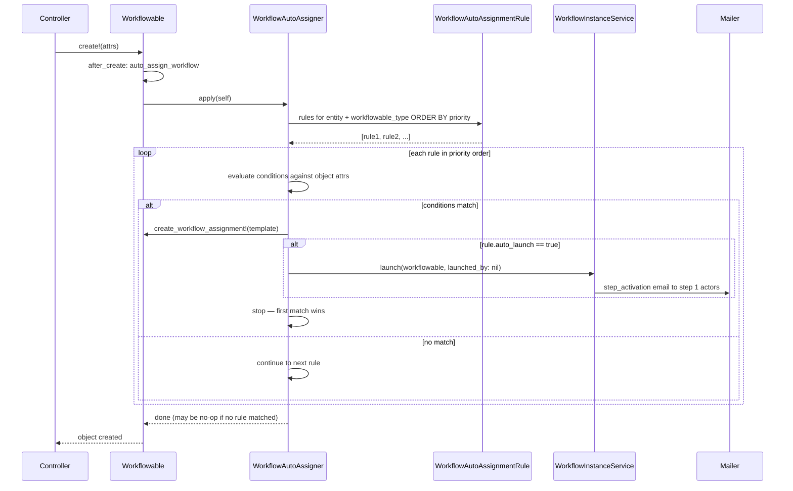

# PRD: Workflows (Polymorphic)

## 1. Overview

This feature lets any object in the system (a folder, a document, a deal, etc.) be associated with a reusable workflow. The associated object — called the **workflowable** — is polymorphic: a single workflow engine handles all types. Once a workflow is launched on a workflowable, it advances through a configurable series of steps. Each step has a set of allowable states (e.g. Approved, Rejected, Tentative) and one or more actors who can change those states. Actors can optionally add a note with each state change. Step transitions trigger email notifications with magic links so actors can respond without logging in. Workflow instances are addressable via standalone URLs independent of the workflowable's own nested routes.

---

## 2. Background & Problem Statement

Objects in the system today (folders, documents, deals) have no formal review or approval lifecycle. Teams rely on out-of-band email threads, Slack messages, or manual status fields to coordinate review. This creates gaps in audit trails, inconsistent outcomes, and no enforcement of who must act before a record is considered final.

A structured workflow engine that can attach to any object gives every reviewable item a defined path from submission to completion, with a clear record of who did what and when. Making the association polymorphic avoids duplicating the workflow engine as new object types are added to the platform.

---

## 3. Goals

- Allow admins to define reusable **workflow templates** with ordered steps.
- Allow **any object** (folder, document, deal, or future type) to be assigned one of those templates via a polymorphic association.
- A workflow instance is launched for the **workflowable object as a whole** — e.g. for a folder it covers all documents in that folder together.
- Each step has: allowable states, actors, quorum rule, on-reject behavior, and optional notes.
- State changes send email notifications to actors; emails contain **magic links** so actors can respond without logging in.
- Emails link actors to the workflowable object so they can review its contents before responding.
- Workflow instances are accessible at **standalone URLs** (`/workflow_instances/:id`) so actors and admins can deep-link without navigating through the workflowable object's own nested routes.
- Provide a full audit trail of every state change (who, when, from→to, via which channel).

---

## 4. Non-Goals

- Parallel/branching workflows (steps are strictly ordered in this version).
- Workflow versioning / migration of in-flight documents when a template changes.
- Mobile push notifications (email only for now).
- Bulk-actioning many documents at once through a workflow step.
- Integration with external e-signature providers.

---

## 5. Key Concepts

| Term | Definition |
|---|---|
| **Workflow template** | A named, reusable ordered list of steps. Scoped to a single workflowable type (e.g. `Folder`, `InvestorKyc`) — a template cannot be assigned to a different type. |
| **Workflowable** | Any object to which a workflow can be attached (e.g. `Folder`, `Document`, `Deal`). The association is polymorphic — `workflowable_type` + `workflowable_id`. |
| **Workflow assignment** | A record linking one workflowable object to one template (`WorkflowAssignment`). One assignment per object at a time. The template's `workflowable_type` must match the object's type — enforced at the model layer. |
| **Auto-assignment rule** | A per-entity, per-type rule that automatically assigns a workflow template when an object is created (and optionally launches it). Rules have optional attribute-based conditions evaluated in priority order. First matching rule wins. |
| **Workflow instance** | A running copy of a template attached to one **workflowable object** via a `WorkflowAssignment`. Represents one full review cycle. Addressable at `/workflow_instances/:id`. |
| **Step** | A single stage in the workflow. Has states, actors, quorum rule, on-reject rule, and optional notes. |
| **State** | A label an actor can assign to a step (e.g. Approved, Rejected, Tentative). States are a configurable comma-separated list per step. |
| **Actor** | An individual employee of the entity who can set the state on a step. |
| **Quorum rule** | How many actor responses are needed to consider a step complete: `any_one`, `all`, or `majority`. Configurable per step; default is `any_one`. |
| **On-reject rule** | What the workflow does when the resolved state for a step is a rejection: `stop`, `previous_step`, `restart`, or `go_to_step_N`. Configurable per step; default is `stop`. |
| **Tiebreaker** | When quorum rule is `all` and actors submit conflicting states, a `company_admin` manually overrides by setting the step to a definitive state. |
| **Auto-reminder** | An email re-sent to pending actors after N days of inactivity. Interval defined at the workflow level; overridable per step. |
| **Magic link** | A multi-use, expiry-free (until step advances) signed URL embedded in the notification email. Allows the actor to set a state without logging in. |

---

## 6. User Stories

**As an admin**, I want to define a workflow template (e.g. "Two-Stage LP Review") with named steps, states, and actors so I can reuse it across multiple objects (folders, documents, deals).

**As an admin**, I want to assign a workflow template to any object and then launch a review cycle for it.

**As a reviewer (actor)**, I want to receive an email when it's my turn to review an object, and I want to click a link in that email to approve, reject, or mark it tentative — without having to log in.

**As a reviewer**, I want to optionally add a note when I change a step's state so my reasoning is captured alongside the decision.

**As an admin or object manager**, I want to see the current step, current state, and history of all state changes for an active workflow so I always know where it stands — either from the object's own panel or by navigating directly to the workflow instance URL.

**As an admin**, I want rejected objects to follow a configurable path (stop, return to prior step, restart) rather than a one-size-fits-all behavior.

**As a `company_admin`**, when actors on an `all`-quorum step submit conflicting states, I want to be able to break the tie by manually setting the resolved state so the workflow can continue.

**As an admin**, I want auto-reminder emails sent to actors who haven't responded after N days, so stalled workflows surface without manual tracking. I want to set the default reminder interval on the template and override it on individual steps where the SLA differs.

---

## 7. Functional Requirements

### 7.1 Workflow Templates

- A workflow template has: `name`, `description`, and an ordered list of steps.
- Templates are created and edited by admins only (not folder managers).
- A template can be assigned to multiple folders simultaneously.
- Editing a template does **not** affect in-flight workflow instances (instances snapshot the template at assignment time).

### 7.2 Steps

Each step contains:

| Field | Type | Default | Notes |
|---|---|---|---|
| `name` | string | — | e.g. "Initial Review" |
| `description` | text | — | Optional context for actors |
| `states` | CSV string | `"Approved,Rejected,Needs Info"` | Fully free-form. First value is the displayed default. |
| `actors` | list of entity employee user IDs | — | At least one required. Individual employees of the owning entity only. |
| `quorum_rule` | enum | `any_one` | `any_one` \| `all` \| `majority` |
| `on_reject_rule` | enum | `stop` | `stop` \| `previous_step` \| `restart` \| `go_to_step_N` |
| `on_reject_target_step` | integer | — | Only used when rule is `go_to_step_N` |
| `reminder_interval_days` | integer | inherits from template | Override the template-level auto-reminder interval for this step. `nil` disables reminders on this step. |

### 7.3 Workflowable–Workflow Association

- Any object can be associated with a template via a `WorkflowAssignment` record (`workflowable_type`, `workflowable_id`, `workflow_template_id`). The object model itself gains no FK column.
- Assigning a template does **not** automatically start a workflow. An admin must explicitly **launch** a workflow instance once the object is ready for review.
- An object can only be associated with one template at a time (one `WorkflowAssignment` per object).
- An object can have multiple workflow instances over time (e.g. annual review cycles), but only one `active` instance at a time.
- Launching a workflow creates a `WorkflowInstance` for the object at step 1 and notifies all step 1 actors.
- Removing the template from an object (deleting its `WorkflowAssignment`) is **blocked** if there is an active workflow instance. The admin must wait for the instance to complete, reject, or manually archive it before the assignment can be removed.
- The engine is workflowable-type-agnostic. Individual workflowable types may expose their own panel UI (e.g. Folder's "Workflow" tab) that calls into the shared `WorkflowInstance` routes.

### 7.4 Workflow Instance Lifecycle

```
Admin creates WorkflowAssignment (workflowable object → template)
        │
Admin clicks "Launch Workflow" (object is ready for review)
        │
        ▼
   Step 1 starts
        │
   Emails sent to step 1 actors (link to workflowable object)
        │
   Actors review object contents and respond via magic link or UI
   (magic link → /workflow_instances/:id/respond or standalone response page)
        │
   Quorum met?  ──No──► wait for more responses
        │Yes
   State = rejection?
        │Yes               │No
   On-reject rule      Advance to next step
        │                   │
   stop/restart/         Repeat until
   prev/go_to_N          final step complete
                              │
                         Workflow complete
```

### 7.5 State Changes

- An actor may change the state of the current step for the active workflow instance (not past steps, not future steps).
- State changes are recorded in `WorkflowStateChange`: actor, timestamp, from_state, to_state, channel (`email_magic_link` or `ui`), optional note.
- A step's **resolved state** is computed from individual actor responses according to the quorum rule:
  - `any_one`: first response wins; step resolves immediately.
  - `all`: step is not resolved until every assigned actor has responded. If all actors agree, that state is the resolved state. If actors submit conflicting states, the step enters **tiebreaker mode** — no automatic resolution. A `company_admin` must visit the step and manually set the final state to unblock the workflow.
  - `majority`: whichever state has more than half the actor responses. If no state achieves majority after all actors respond, the step enters tiebreaker mode (same as `all` conflict above).

### 7.6 Rejection Handling

When a step's resolved state is a rejection state:

| `on_reject_rule` | Behavior |
|---|---|
| `stop` | Workflow is halted; document is marked `rejected`. No further emails. |
| `previous_step` | Workflow reverts to the immediately preceding step. Actors are re-notified. |
| `restart` | Workflow resets to step 1. All prior responses are archived (not deleted). |
| `go_to_step_N` | Workflow jumps to the specified step. |

### 7.7 Email Notifications

Emails are sent to all **pending** actors of a step (those who have not yet responded) when:
- The step becomes active (workflow advances to it).
- An auto-reminder fires (see §7.7b).
- A reminder is manually triggered by an admin.

Email content includes:
- Workflowable object name/title and a link to it (the workflowable provides a `#workflow_display_name` and `#workflow_url` interface).
- Current step name and description.
- Per-actor magic links for each available state (one link per state, e.g. "Click here to **Approve**", "Click here to **Reject**").
- A direct link to the workflow instance: `/workflow_instances/:id`.

### 7.7a Document Attachment in Emails

- The workflow template has an `attach_document_in_email` boolean flag (default: `false`).
- When this flag is enabled and the workflowable object has associated files (e.g. documents in a folder), the notification email additionally attaches those files (subject to the size cap) so actors can review them without logging in.
- If any file exceeds the configured threshold (suggested default: 10 MB per file), the email falls back to a secure object link with a note explaining that attachments were skipped.
- Attachment is at the template level (applies to all steps). Individual steps cannot override this in v1.
- Each workflowable type is responsible for implementing `#workflow_attachable_files` — returning the list of files to attach. Objects with no files simply return `[]`.
- The `WorkflowTemplate` data model gains: `attach_document_in_email` (boolean, default false).

### 7.7b Auto-Reminders

- Each workflow template has a `reminder_interval_days` field (e.g. `3`). A background job checks daily and sends a reminder to all pending actors on any active step whose last notification was ≥ `reminder_interval_days` ago.
- Individual steps can override this interval with their own `reminder_interval_days`. Setting a step's value to `nil` disables auto-reminders for that step.
- Auto-reminder emails are identical in format to the step-activation email (same magic links).
- The `WorkflowStateChange` log records each auto-reminder dispatch with channel = `auto_reminder`.

### 7.8 Magic Links

- A magic link encodes: `workflow_instance_id`, `step_position`, `actor_id`, `target_state`, and an HMAC signature.
- The magic link URL is **standalone** and requires no login: `GET /workflow/respond?token=<signed>`.
- Clicking a link does **not** immediately change state. It opens a confirmation page showing:
  - The workflowable object's name/title and a link to it
  - A list of items associated with the workflowable (e.g. documents in a folder), if applicable
  - The current step name
  - The selected state (pre-filled from the link, but visible to the actor)
  - An optional notes textarea
  - A **Submit** button — state change only occurs on explicit submit
- Links are valid until the step itself advances or the workflow is reset/stopped.
- Clicking a link that is no longer valid shows a friendly "this step has already moved on" message.
- An actor can click a different state link from the same email before submitting to change their mind; last submitted response wins.
- Magic link responses are logged with channel = `email_magic_link`.

### 7.9 Notes

An actor may optionally add a free-text note when submitting a state change, both via the magic-link response page and the in-app UI. Notes are always optional. Each note is stored on the `WorkflowActorResponse` record and displayed in the audit trail.

### 7.10 Audit Trail

- `WorkflowStateChange` records every state change with: actor, timestamp, channel, from_state, to_state, note.
- The workflow instance show page (`/workflow_instances/:id`) displays the full timeline of state changes regardless of workflowable type.
- Individual workflowable object panels (e.g. Folder's "Workflow" tab) embed a summary view that links through to the standalone instance page.
- Export of the full audit trail as CSV from `/workflow_instances/:id/export_audit_trail`.

---

## 8. Permissions & Access Control

| Role | Can do |
|---|---|
| `company_admin` | Create/edit/delete workflow templates; create/delete `WorkflowAssignment`s on any object; view all workflow instances at `/workflow_instances`; manually advance, reset, or break tiebreaker on any step |
| Object manager (e.g. folder manager) | View workflow instances for objects they manage; send manual reminders; cannot edit the template |
| Actor (assigned employee) | Set state on steps they are assigned to; add optional notes; respond via magic link without login; view their assigned instance at `/workflow_instances/:id` |
| Viewer | View current workflow state and history for instances scoped to objects they can access |

---

## 9. Data Model (Conceptual)

```
WorkflowTemplate
  id, name, description, entity_id, reminder_interval_days,
  attach_document_in_email (boolean, default false),
  workflowable_type (string, required)  # e.g. "Folder", "InvestorKyc", "CapitalCommitment", "Approval"
                                         # enforced: a template can only be assigned to objects of this type

WorkflowStep (belongs_to WorkflowTemplate)
  id, position, name, description, states (CSV), quorum_rule,
  on_reject_rule, on_reject_target_step,
  reminder_interval_days (nullable; nil = inherit from template)

WorkflowStepActor (belongs_to WorkflowStep)
  id, user_id  # individual entity employee only

# Polymorphic join — replaces per-model workflow_template_id columns.
# No changes required to Folder, Document, Deal, etc.
WorkflowAssignment
  id, workflowable_type (string), workflowable_id (integer),
  workflow_template_id,
  created_by_id, created_at, updated_at
  # unique index on (workflowable_type, workflowable_id) — one assignment per object

# WorkflowInstance is polymorphic through WorkflowAssignment.
# Addressed directly at /workflow_instances/:id — no nesting required.
WorkflowInstance
  id, workflow_assignment_id,
  workflowable_type (string), workflowable_id (integer),  # denormalised for fast querying
  workflow_template_id, template_snapshot (JSON),
  current_step_position, status, launched_by_id
  (status: active | complete | rejected | archived)
  # template_snapshot preserves the template/steps at launch time

WorkflowActorResponse (belongs_to WorkflowInstance, step_position, actor)
  id, workflow_instance_id, step_position, actor_id, state, note,
  channel (ui | email_magic_link | auto_reminder), responded_at

WorkflowStateChange (event log)
  id, workflow_instance_id, step_position, actor_id, from_state, to_state,
  note, channel, created_at

# Phase 5: Auto-assignment rules — per entity, per workflowable type
WorkflowAutoAssignmentRule
  id, entity_id, workflowable_type (string),  # e.g. "InvestorKyc"
  workflow_template_id,                        # template to assign (must match workflowable_type)
  auto_launch (boolean, default false),        # also launch instance immediately after assignment
  priority (integer),                          # lower number = evaluated first; first match wins
  conditions (jsonb)                           # structured attribute conditions evaluated at runtime
                                               # see §Phase 5 for condition schema
```

### 9.1 Workflowable Interface

The `Workflowable` concern provides sensible defaults for all three interface methods. Models only need to override the ones that differ from convention:

| Method | Default | Override when |
|---|---|---|
| `#workflow_display_name` | `to_s` | The model's `to_s` is not user-friendly |
| `#workflow_url` | `<model_underscore>_path(self)` (derived from class name via Rails route helpers) | Non-standard routes, STI subclasses, or scoped paths |
| `#workflow_attachable_files` | `[]` | The model has associated files to attach to notification emails |

In practice, most models need only `include Workflowable`. Only models with attachable files (e.g. `Folder` — its documents; `InvestorKyc` — polymorphically linked documents) override `#workflow_attachable_files`.

---

## 10. Email & Magic Link Flow

```mermaid
sequenceDiagram
    participant System
    participant Mailer
    participant Actor
    participant MagicLinkController
    participant WorkflowInstanceController

    System->>Mailer: step becomes active (instance, step N, actors A1..An)
    Mailer->>Actor: email with magic links (one per state) + workflowable link + direct instance link + attachments if enabled

    Note over Actor,MagicLinkController: Standalone magic link path (no login required)
    Actor->>MagicLinkController: GET /workflow/respond?token=<signed_token>
    MagicLinkController->>MagicLinkController: verify HMAC signature
    MagicLinkController->>MagicLinkController: check step still active on instance
    alt step still active
        MagicLinkController->>Actor: show confirmation page (workflowable name, item list, step name, selected state, notes textarea)
        Actor->>MagicLinkController: POST /workflow/respond (optional note)
        MagicLinkController->>System: record WorkflowActorResponse (channel: email_magic_link)
        System->>System: evaluate quorum
        alt quorum met
            System->>System: resolve step state
            alt resolved state is rejection
                System->>System: apply on_reject_rule
            else
                System->>System: advance to next step
                System->>Mailer: notify next step actors
            end
        end
        MagicLinkController->>Actor: "Thank you, your response has been recorded."
    else step no longer active
        MagicLinkController->>Actor: "This step has already moved on."
    end

    Note over Actor,WorkflowInstanceController: Authenticated in-app path (standalone route)
    Actor->>WorkflowInstanceController: GET /workflow_instances/:id
    WorkflowInstanceController->>Actor: show instance page (current step, actor responses, timeline, admin controls)
    Actor->>WorkflowInstanceController: POST /workflow_instances/:id/actor_responses (state + optional note)
    WorkflowInstanceController->>System: record WorkflowActorResponse (channel: ui)
    System->>System: evaluate quorum → advance if met
```

---

## 11. UI Touchpoints

1. **Admin: Workflow Templates CRUD** — `/admin/workflow_templates` — list, create, edit, delete templates and their steps.

2. **Object settings panel (e.g. Folder "Workflow" tab)** — assign or remove a template (`WorkflowAssignment`); shows history of workflow instances for this object; "Launch Workflow" button; links through to `/workflow_instances/:id` for each instance. Each workflowable type wires up its own panel; the underlying data calls are the same.

3. **Breadcrumb workflow icon** — the only per-page entry point for actors and viewers. A workflow icon appears in the breadcrumb bar next to the object name, but **only when an active workflow instance exists**. A badge dot overlays the icon when the current user has a pending action on the current step. Clicking the icon navigates to `/workflow_instances/:id`. No icon is shown when there is no active instance.

   ```
   Folders  /  Q3 LP Data Room  ⬡      ← active instance, no action required
   Folders  /  Q3 LP Data Room  ⬡●     ← active instance, current user must respond
   Folders  /  Q3 LP Data Room          ← no active instance, no icon
   ```

   Implemented once in the shared breadcrumb partial — zero changes required when new workflowable types are added:

   ```erb
   <% if defined?(@workflowable) && (instance = @workflowable.workflow_instances.active.first) %>
     <%= link_to workflow_instance_path(instance), title: "Active workflow: #{instance.current_step_name}" do %>
       <%= icon "workflow" %>
       <%= content_tag(:span, "", class: "badge-dot") if instance.pending_for?(current_user) %>
     <% end %>
   <% end %>
   ```

4. **Workflow instance page** — `/workflow_instances/:id` — standalone, no nesting required. Shows workflowable object name (linked), current step, each actor's response status, timeline of all state changes, and admin controls (advance, reset, send reminder, export CSV). Accessible to any authenticated user with permission; also reachable by deep link from notification emails.

5. **Workflow instance list** — `/workflow_instances` — lists all instances the current user can see (admins see all; actors see instances they are assigned to). Filterable by status and workflowable type.

6. **Magic link response page** — `GET /workflow/respond?token=<signed>` — minimal, no-login page. Shows workflowable object name and link, associated item list (if any), step name, pre-selected state, optional notes textarea, and a **Submit** button. State change is recorded only on submit.

7. **Actor dashboard widget** (future) — lists all workflowable objects awaiting the current user's response across all active workflow instances.

---

## 13. Implementation Phases

The feature is split into four phases. Each phase ships independently and adds a layer of capability on top of the previous one. The pack lives at `app/packs/core/workflow_templates/`.

---

### Phase 1 — Data Model & Admin Template CRUD

**Goal:** Admins can create, edit, and delete workflow templates with ordered steps. Nothing fires yet.

**Migrations / Models**
- `WorkflowTemplate` — `name`, `description`, `entity_id`, `reminder_interval_days`, `attach_document_in_email`
- `WorkflowStep` — `workflow_template_id`, `position`, `name`, `description`, `states` (CSV, default `"Approved,Rejected,Needs Info"`), `quorum_rule` (enum, default `any_one`), `on_reject_rule` (enum, default `stop`), `on_reject_target_step`, `reminder_interval_days` (nullable)
- `WorkflowStepActor` — `workflow_step_id`, `user_id`
- `WorkflowAssignment` — `workflowable_type` (string), `workflowable_id` (integer), `workflow_template_id`, `created_by_id`; unique index on `(workflowable_type, workflowable_id)`
- `Workflowable` concern — module included in each participating model (`Folder`, etc.) providing `workflow_display_name`, `workflow_url`, `workflow_attachable_files`, and the `has_one :workflow_assignment, as: :workflowable` association. No FK columns added to model tables.

**Data Migration (existing schema → polymorphic)**

The schema already has `folders.workflow_template_id` and `workflow_instances.folder_id` from the original folder-specific design. Three migrations run in sequence to move to the polymorphic model:

*Migration 1 — create `workflow_assignments`, backfill from `folders.workflow_template_id`:*
```ruby
class CreateWorkflowAssignments < ActiveRecord::Migration[7.1]
  def up
    create_table :workflow_assignments do |t|
      t.string  :workflowable_type,    null: false
      t.bigint  :workflowable_id,      null: false
      t.bigint  :workflow_template_id, null: false
      t.bigint  :created_by_id
      t.timestamps
      t.index [:workflowable_type, :workflowable_id], unique: true,
              name: "index_workflow_assignments_on_workflowable"
      t.index :workflow_template_id
    end

    execute <<~SQL
      INSERT INTO workflow_assignments
        (workflowable_type, workflowable_id, workflow_template_id, created_at, updated_at)
      SELECT 'Folder', id, workflow_template_id, NOW(), NOW()
      FROM folders
      WHERE workflow_template_id IS NOT NULL
    SQL
  end

  def down
    drop_table :workflow_assignments
  end
end
```

*Migration 2 — add polymorphic columns to `workflow_instances`, backfill from `folder_id`, drop `folder_id`:*
```ruby
class MigrateWorkflowInstancesToPolymorphic < ActiveRecord::Migration[7.1]
  def up
    # Add nullable first so the backfill can run before NOT NULL is enforced
    add_column :workflow_instances, :workflowable_type,     :string
    add_column :workflow_instances, :workflowable_id,       :bigint
    add_column :workflow_instances, :workflow_assignment_id, :bigint

    execute <<~SQL
      UPDATE workflow_instances wi
      LEFT JOIN workflow_assignments wa
        ON wa.workflowable_type = 'Folder' AND wa.workflowable_id = wi.folder_id
      SET wi.workflowable_type      = 'Folder',
          wi.workflowable_id        = wi.folder_id,
          wi.workflow_assignment_id = wa.id
    SQL

    change_column_null :workflow_instances, :workflowable_type, false
    change_column_null :workflow_instances, :workflowable_id,   false
    # workflow_assignment_id stays nullable — instances whose assignment was later
    # deleted (template unassigned before instance completed) must remain readable

    add_index :workflow_instances, [:workflowable_type, :workflowable_id, :status],
              name: "index_workflow_instances_on_workflowable_and_status"
    add_index :workflow_instances, :workflow_assignment_id

    remove_index  :workflow_instances, name: "index_workflow_instances_on_folder_and_status"
    remove_index  :workflow_instances, name: "index_workflow_instances_on_folder_id"
    remove_column :workflow_instances, :folder_id
  end

  def down
    add_column :workflow_instances, :folder_id, :bigint
    execute "UPDATE workflow_instances SET folder_id = workflowable_id WHERE workflowable_type = 'Folder'"
    change_column_null :workflow_instances, :folder_id, false
    add_index :workflow_instances, [:folder_id, :status], name: "index_workflow_instances_on_folder_and_status"
    add_index :workflow_instances, :folder_id,            name: "index_workflow_instances_on_folder_id"
    remove_column :workflow_instances, :workflowable_type
    remove_column :workflow_instances, :workflowable_id
    remove_column :workflow_instances, :workflow_assignment_id
  end
end
```

*Migration 3 — remove `workflow_template_id` from `folders`:*
```ruby
class RemoveWorkflowTemplateFkFromFolders < ActiveRecord::Migration[7.1]
  def change
    remove_index  :folders, name: "index_folders_on_workflow_template_id"
    remove_column :folders, :workflow_template_id, :bigint
  end
end
```

> **Note:** `workflow_assignment_id` on `workflow_instances` is left nullable. If a `folder_id` row has no matching `WorkflowAssignment` (template was unassigned before the instance completed), the LEFT JOIN leaves it NULL — the instance record remains readable with only `workflowable_type`/`workflowable_id` to identify its subject.

**Controllers / Policies**
- `WorkflowTemplatesController` (CRUD) under `/admin/workflow_templates`
- `WorkflowStepsController` (nested under template) for step ordering via drag-and-drop position
- `WorkflowAssignmentsController` — `create` / `destroy` (admin only); creates or removes the polymorphic assignment for a workflowable object
- `WorkflowTemplatePolicy` — only `company_admin` can create/edit/delete
- `WorkflowAssignmentPolicy` — only `company_admin` can create/destroy; blocked on destroy if active instance exists

**Views**
- Template list + form (steps nested with Stimulus reorder controller)
- Step form: states CSV field, actor multi-select (entity employees only), quorum/reject enums
- Folder settings panel — "Workflow" tab: dropdown to assign/remove template (calls `WorkflowAssignmentsController`)

**Tests (Cucumber)**
- Admin creates a template with two steps and assigns it to a folder
- Non-admin cannot access `/admin/workflow_templates`
- Folder settings save and display the assigned template name
- Removing an assignment while no active instance exists → succeeds
- Attempting to remove an assignment while active instance exists → blocked with validation error

---

### Phase 2 — Workflow Instance Lifecycle (No Email)

**Goal:** An admin can launch a workflow instance for a folder. The instance advances through steps based on actor responses via the in-app UI. Email comes in Phase 3.

**Migrations / Models**
- `WorkflowInstance` — `workflow_assignment_id`, `workflowable_type` (string, denormalised), `workflowable_id` (integer, denormalised), `workflow_template_id`, `template_snapshot` (JSON), `current_step_position`, `launched_by_id`, `status` (enum: `active | complete | rejected | archived`)
- `WorkflowActorResponse` — `workflow_instance_id`, `step_position`, `actor_id`, `state`, `note`, `channel` (enum: `ui | email_magic_link | auto_reminder`), `responded_at`
- `WorkflowStateChange` (event log) — `workflow_instance_id`, `step_position`, `actor_id`, `from_state`, `to_state`, `note`, `channel`, `created_at`

**Service Objects**
- `WorkflowInstanceService#launch(workflowable, launched_by:)` — called from the "Launch Workflow" action; looks up `WorkflowAssignment` for the workflowable; snapshots the template + steps into `template_snapshot`; creates the instance at step 1; raises if workflowable has no assignment or already has an active instance
- `WorkflowStepResolver#resolve(instance)` — evaluates quorum (`any_one` / `all` / `majority`) against current `WorkflowActorResponse` records; returns resolved state or `:tiebreaker` or `:pending`
- `WorkflowAdvancer#advance(instance)` — called after `resolve` succeeds; applies `on_reject_rule` or advances `current_step_position`; sets `status` to `complete` / `rejected` when done; archives responses on restart/revert
- `WorkflowArchiver#archive(instance)` — called by admin to manually archive a stalled instance (unlocks assignment removal)

**Controllers / Policies**
- `WorkflowInstancesController` — `index` (list all, authenticated), `create` (launch, admin only), `show` (standalone instance page at `/workflow_instances/:id`), `advance` (admin only), `reset` (admin only), `export_audit_trail`
- `WorkflowActorResponsesController` — nested under `WorkflowInstancesController`; `create` (actor sets state + optional note via UI)
- `WorkflowInstancePolicy` — actors can only respond to their assigned step; admin can launch/advance/reset/break tie; viewers can see instances for objects they have access to

**Routes**
```ruby
# Standalone — no nesting under workflowable object
resources :workflow_instances, only: [:index, :show, :create] do
  member do
    post :advance
    post :reset
    get  :export_audit_trail
  end
  resources :actor_responses, only: [:create], controller: 'workflow_actor_responses'
end
```

**Views**
- `/workflow_instances` — list of instances the current user can see; filter by status / workflowable type
- `/workflow_instances/:id` — current step, per-actor response status, full state-change timeline, admin controls; workflowable name/link at the top
- Folder "Workflow" tab: summary widget showing current instance status + "View Workflow" link to `/workflow_instances/:id`; "Launch Workflow" button when no active instance; instance history list with links
- Actor response UI (in-app): dropdown of step states + optional notes textarea + submit button

**Tests (Cucumber)**
- Admin launches workflow for folder → instance created at step 1, visible at `/workflow_instances/:id`
- Launching when active instance exists → blocked with error
- Actor submits `any_one` quorum step → step resolves and advances
- `all` quorum: conflicting responses → tiebreaker mode; admin breaks tie
- `on_reject_rule: stop` → instance becomes `rejected`
- `on_reject_rule: restart` → instance resets to step 1, prior responses archived
- `on_reject_rule: previous_step` → instance reverts one step
- Final step approved → instance becomes `complete`
- `/workflow_instances` returns instances for the current user's workflowable objects
- Navigating to `/workflow_instances/:id` without nesting works correctly

---

### Phase 3 — Email Notifications & Magic Links

**Goal:** Actors receive emails when a step activates; magic links let them respond without logging in.

**Service Objects**
- `WorkflowMagicLinkService#generate(instance, step_position, actor_id, target_state)` — uses `ActiveSupport::MessageVerifier` (same pattern as `DocShareTokenService`) with no expiry; payload: `{ workflow_instance_id:, step_position:, actor_id:, target_state: }`; links expire implicitly when step advances
- `WorkflowMagicLinkService#verify(token)` — verifies signature; returns payload or `nil`; caller checks instance step still matches

**Mailer**
- `WorkflowMailer#step_activation(instance, step_position, actor_id)` — sends per-actor email with one magic link per available state; includes workflowable display name (via `#workflow_display_name`), a link to the workflowable object (via `#workflow_url`), a direct link to `/workflow_instances/:id`, step name/description
- `WorkflowMailer#reminder(instance, step_position, actor_id)` — identical format; triggered by auto-reminder job (Phase 4) or manual admin trigger
- When `attach_document_in_email` is `true`: calls `workflowable.workflow_attachable_files` and attaches each file ≤ configured threshold (default 10 MB); otherwise falls back to the workflowable link with a note

**Controllers**
- `WorkflowMagicLinkController` — `GET /workflow/respond?token=<signed>` → verify token → check step active → render confirmation page (workflowable name, item list from `#workflow_attachable_files` metadata, step name, pre-selected state, notes textarea, Submit button)
- `POST /workflow/respond` → record `WorkflowActorResponse` with `channel: :email_magic_link` → call `WorkflowStepResolver` → call `WorkflowAdvancer` → render "Thank you" or redirect; expired/advanced step → "This step has already moved on"
- Route lives outside Devise auth scope (no login required); workflowable-type-agnostic

**Tests (Cucumber)**
- Step activation email sent to all actors when step becomes active
- Email includes direct link to `/workflow_instances/:id`
- Magic link token verifies correctly and renders confirmation page with workflowable name
- Submitting via magic link records response with `channel: email_magic_link` and advances step
- Clicking a link for an already-advanced step shows the "moved on" message
- Actor changes their mind by using a different state link before submitting — last submit wins
- `attach_document_in_email: true` → attachable files attached (each under 10 MB); falls back to object link when any file exceeds threshold

---

### Phase 4 — Auto-Reminders & Audit Trail Export

**Goal:** Stalled steps surface automatically; full audit trail is exportable.

**Background Job**
- `WorkflowAutoReminderJob` — runs daily (cron); queries `WorkflowInstance` where `status: :active`; for each active step checks the last notification timestamp (`WorkflowStateChange` where `channel: :auto_reminder`) against the effective `reminder_interval_days` (step override → template default → skip if nil); calls `WorkflowMailer#reminder` for each pending actor; logs each dispatch as a `WorkflowStateChange` with `channel: :auto_reminder`

**Controllers / Views**
- `WorkflowInstancesController#export_audit_trail` — `GET /workflow_instances/:id/export_audit_trail` — streams CSV of `WorkflowStateChange` records (actor, timestamp, channel, from_state, to_state, note); accessible from the standalone instance page
- Admin manual reminder button on `/workflow_instances/:id` → calls same `WorkflowMailer#reminder` path

**Tests (Cucumber)**
- Auto-reminder job sends email to pending actors after `reminder_interval_days` of inactivity
- Step with `reminder_interval_days: nil` is skipped by the job
- Step-level override takes precedence over template-level interval
- CSV export at `/workflow_instances/:id/export_audit_trail` contains correct columns and all state change rows
- Manual reminder button on instance page triggers reminder email immediately

---

### Phase 5 — Template Type Scoping & Auto-Assignment Rules

**Goal:** Prevent template mis-assignment by scoping each template to a single workflowable type. Allow entities to configure rules that automatically assign (and optionally launch) a workflow when an object is created, with optional attribute-based conditions.

---

#### 5.1 Template Type Scoping

**Problem:** Currently any template can be assigned to any workflowable type. A "Two-Stage LP KYC Review" template designed for `InvestorKyc` objects could accidentally be assigned to a `Folder` — the steps, actors, and email content may all be wrong for that context.

**Design decision:** Add `workflowable_type` (string, required, immutable after creation) to `WorkflowTemplate`. The `WorkflowAssignment` model validates that `workflow_template.workflowable_type == workflowable.class.name`. Template creation and edit forms add a `workflowable_type` dropdown.

**Constraints:**
- `workflowable_type` is set at creation and cannot be changed (changing it would invalidate all existing assignments).
- The template list and assignment dropdowns are filtered by type — admins only see templates applicable to the object they are assigning to.
- Existing templates (created before this field exists) get a backfill migration that infers `workflowable_type` from the `workflowable_type` column of their existing `WorkflowAssignment` records. Templates with no assignments are left `NULL` and treated as unscoped (can be assigned to any type) until the admin explicitly sets the type. This null-as-unscoped behavior is removed in a future cleanup migration once all templates are typed.

**Migration:**
```ruby
add_column :workflow_templates, :workflowable_type, :string, null: true
# Backfill from existing assignments where unambiguous
execute <<~SQL
  UPDATE workflow_templates wt
  INNER JOIN workflow_assignments wa ON wa.workflow_template_id = wt.id
  SET wt.workflowable_type = wa.workflowable_type
  WHERE wt.workflowable_type IS NULL
SQL
```

**Model validation (`WorkflowAssignment`):**
```ruby
validate :template_type_matches_workflowable

def template_type_matches_workflowable
  return unless workflow_template&.workflowable_type.present?
  unless workflow_template.workflowable_type == workflowable_type
    errors.add(:workflow_template, "is scoped to #{workflow_template.workflowable_type} and cannot be assigned to a #{workflowable_type}")
  end
end
```

---

#### 5.2 Auto-Assignment Rules

**Problem:** When high-volume objects are created (e.g. KYC records, capital commitments), admins must manually assign a template and launch a workflow one by one. For many use cases the right template is deterministic from the object's attributes — it should be automatic.

**Design decision:** Introduce `WorkflowAutoAssignmentRule` — a per-entity, per-type, ordered list of rules evaluated in an `after_create` hook on the workflowable. The first rule whose conditions match assigns the template (and optionally launches the instance).

**Condition schema (JSONB column):**

Conditions are an array of attribute checks evaluated with `AND` logic. Each check is a JSON object:

```json
[
  { "attribute": "form_type_id",   "operator": "eq",  "value": 1 },
  { "attribute": "is_feeder_fund", "operator": "eq",  "value": true }
]
```

Supported operators: `eq`, `not_eq`, `gt`, `lt`, `gte`, `lte`, `in`, `not_in`, `present`, `blank`.

An empty `conditions` array (`[]`) means "always match" — useful for a catch-all default rule at the lowest priority.

**Evaluation at object creation (`after_create`):**

```
For each WorkflowAutoAssignmentRule ordered by priority ASC for this entity + workflowable_type:
  1. Evaluate each condition against the newly created object
  2. If all conditions pass:
     a. Create WorkflowAssignment (workflowable → template)
     b. If rule.auto_launch == true: call WorkflowInstanceService.launch(workflowable, launched_by: nil)
     c. Stop — first match wins; subsequent rules are not evaluated
```

**Open questions (to be resolved before implementation):**
- **`launched_by` for auto-launch:** Who is the "launched_by" user when a workflow auto-launches on object creation? Options: `nil` (system), the creating user (passed from the controller context), or a dedicated system bot user. Each has implications for audit trail display.
- **Rule conflict / no match:** If no rule matches, no assignment is created and no workflow runs. Should this be logged/surfaced to admins, or silently skipped?
- **Method-based conditions:** The examples reference `is_feeder_fund?` (a method call, not a DB column). Evaluating methods dynamically has security implications. Decision needed: restrict to DB-column attributes only (safe, limited), support a curated whitelist of allowed method names per type (safer but rigid), or evaluate via a sandboxed expression language (flexible, complex). **Defer to implementation discussion.**
- **Rule admin UI:** Full CRUD in the admin panel or a simplified "default template" picker per type as a first iteration? Condition editing UI needs careful design — a raw JSON editor is powerful but error-prone.
- **Auto-launch and concurrent creation:** High-throughput bulk imports may create many objects simultaneously. Auto-launch must be wrapped in the same `lock!` + transaction guard already used in `WorkflowInstanceService#launch` to avoid duplicate instances.

**Data model:**
```
WorkflowAutoAssignmentRule
  id, entity_id, workflowable_type, workflow_template_id
  auto_launch      boolean  default false
  priority         integer  not null  (lower = evaluated first)
  conditions       jsonb    not null  default '[]'
  created_by_id, created_at, updated_at

  index: (entity_id, workflowable_type, priority)
```

**Service object (`WorkflowAutoAssigner`):**
```ruby
class WorkflowAutoAssigner
  def self.apply(workflowable)
    rules = WorkflowAutoAssignmentRule
              .where(entity_id: workflowable.entity_id,
                     workflowable_type: workflowable.class.name)
              .order(:priority)
    rule = rules.find { |r| conditions_match?(r, workflowable) }
    return unless rule

    workflowable.create_workflow_assignment!(
      workflow_template: rule.workflow_template,
      created_by: nil  # system-initiated
    )
    if rule.auto_launch
      WorkflowInstanceService.launch(workflowable, launched_by: nil)
    end
  end
end
```

**Workflowable concern hook (`after_create`):**
```ruby
# In Workflowable concern — added in Phase 5
after_create :auto_assign_workflow

def auto_assign_workflow
  WorkflowAutoAssigner.apply(self)
end
```

---

#### 5.3 Sequence Diagram — Auto-Assignment on Object Creation



---

#### 5.4 Tests (Cucumber — Phase 5)

- Template with `workflowable_type: "InvestorKyc"` cannot be assigned to a `Folder` → blocked with validation error
- Template with `workflowable_type: "Folder"` appears in the assignment dropdown for folders but not for KYC objects
- Auto-assignment rule with `conditions: []` assigns template to every new object of the given type
- Auto-assignment rule with `form_type_id eq 1` condition assigns template only to matching objects
- Multiple rules in priority order: first matching rule wins; subsequent rules are not evaluated
- `auto_launch: true` on a matching rule creates both a `WorkflowAssignment` and an active `WorkflowInstance`
- Object created with no matching rule → no assignment created, no error

---

## 12. Decided Design Choices

| # | Question | Decision |
|---|---|---|
| 1 | Conflict resolution for `all`/`majority` quorum | `company_admin` manually breaks the tie via the UI — no automatic resolution |
| 2 | Role-based vs. individual actors | Individual entity employees only; no role references |
| 3 | Template versioning / in-flight warning | Not required; instances snapshot the template silently |
| 4 | Auto-reminders | Yes — interval defined at template level (`reminder_interval_days`); overridable per step; `nil` on a step disables reminders for that step |
| 5 | States taxonomy | Fully free-form CSV; no canonical enum |
| 6 | Step field defaults | `states` defaults to `"Approved,Rejected,Needs Info"`; `quorum_rule` defaults to `any_one`; `on_reject_rule` defaults to `stop` |
| 7 | Document delivery | Workflow template can opt in to attaching the document to notification emails so actors can review without logging in (see §7.7a) |
| 8 | Polymorphic attachment | `WorkflowAssignment` is the polymorphic join — no FK columns added to workflowable model tables. `WorkflowInstance` denormalises `workflowable_type`/`workflowable_id` for fast querying without always joining through assignment. |
| 9 | Workflowable interface | Each participating model includes a `Workflowable` concern and implements `workflow_display_name`, `workflow_url`, `workflow_attachable_files` — the engine calls these, not type-specific conditionals |
| 10 | Standalone instance routes | `WorkflowInstance` is a first-class resource at `/workflow_instances/:id` — no nesting under any workflowable route required. Workflowable panels embed a summary widget and link out to the standalone page. |
| 11 | Per-object workflow entry point | A workflow icon in the breadcrumb bar (shared partial, one implementation) links to the active instance. Badge dot when current user has a pending action. No icon when no active instance. No tab, no panel, no changes to individual show pages. |
| 12 | Template type scoping | Each `WorkflowTemplate` declares a `workflowable_type` (e.g. `"InvestorKyc"`). `WorkflowAssignment` validates the template's type matches the object's class — prevents assigning a KYC template to a folder. Templates with no type set (pre-Phase-5 data) are treated as unscoped until explicitly typed. |
| 13 | Auto-assignment rules | `WorkflowAutoAssignmentRule` — per entity, per type, ordered by priority; first matching rule wins. Conditions are a JSONB array of `{attribute, operator, value}` checks (all must pass). An empty conditions array is a catch-all default. `auto_launch: true` also launches the instance immediately. Method-based conditions (e.g. `is_feeder_fund?`) deferred to implementation discussion — column-only attributes are safe for v1. |
